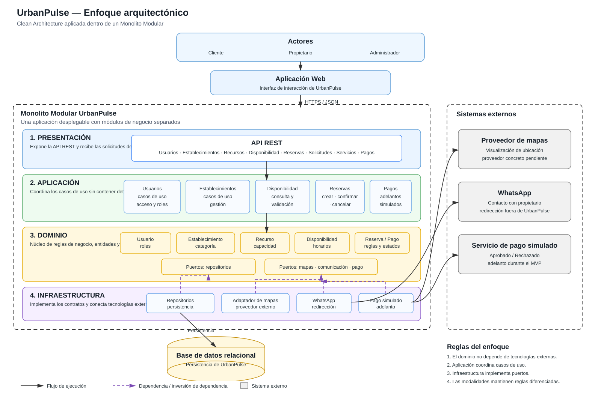

# Enfoque arquitectónico

El enfoque arquitectónico seleccionado para **UrbanPulse** es **Clean Architecture (Arquitectura Limpia)**. Este enfoque se aplicará dentro del estilo de **Monolito Modular** definido para el sistema, permitiendo separar las reglas del negocio de los detalles tecnológicos y de las integraciones externas.

La propuesta se deriva de los drivers arquitectónicos y decisiones previamente establecidos para UrbanPulse, especialmente la necesidad de **extensibilidad**, **consistencia de disponibilidad**, **seguridad**, **mantenibilidad**, **API REST**, **integraciones externas** y **persistencia desacoplada**.

---

## 1. Descripción del enfoque

| Elemento | Descripción aplicada a UrbanPulse |
|---|---|
| **Patrón / enfoque arquitectónico** | **Clean Architecture (Arquitectura Limpia)**. |
| **Estilo de despliegue** | **Monolito Modular**: una única aplicación desplegable, organizada internamente en módulos con responsabilidades separadas. |
| **Objetivo** | Separar las reglas del negocio de los detalles tecnológicos y controlar las dependencias hacia el dominio. |
| **¿Qué problema resuelve?** | Evita el acoplamiento entre la interfaz web, los casos de uso, las reglas de reserva, la persistencia y servicios externos como mapas, WhatsApp y pago simulado. |
| **Capas definidas** | Presentación, Aplicación, Dominio e Infraestructura. |
| **Núcleo de la arquitectura** | El **Dominio** contiene las entidades, reglas de negocio y contratos (puertos) que deben permanecer independientes de tecnologías concretas. |
| **Gestión de dependencias** | Las capas externas pueden depender de las abstracciones definidas por el dominio; las implementaciones concretas se conectan mediante adaptadores. |
| **Beneficios** | Facilita el mantenimiento y las pruebas; permite sustituir tecnologías externas; favorece la incorporación de nuevas modalidades de reserva; y mejora la separación de responsabilidades. |

---

## 2. Capas de Clean Architecture

La arquitectura de UrbanPulse se organiza en cuatro capas principales. La separación permite que cada nivel tenga una responsabilidad específica y evita que las reglas principales del sistema dependan directamente de frameworks o proveedores externos.

| Capa | Responsabilidad | Elementos principales |
|---|---|---|
| **Presentación** | Recibir solicitudes de los usuarios y exponer la interfaz de comunicación del sistema. | Aplicación Web, API REST, controladores, validación de entrada y manejo de respuestas. |
| **Aplicación** | Coordinar los casos de uso y los procesos del sistema. | Usuarios, establecimientos, recursos, disponibilidad, reservas, solicitudes, servicios y pagos. |
| **Dominio** | Mantener las reglas de negocio y los contratos que definen cómo se relaciona el núcleo con otras capas. | Entidades, reglas, estados, puertos de repositorio y contratos para integraciones. |
| **Infraestructura** | Implementar los contratos y conectar UrbanPulse con tecnologías concretas. | Repositorios, persistencia, adaptador de mapas, integración de WhatsApp y pago simulado. |

### Regla principal de dependencia

La regla arquitectónica fundamental es:

> **El dominio no debe depender de tecnologías externas.**

Por ello, la infraestructura implementa los contratos definidos por el dominio, mientras que la capa de aplicación utiliza dichos contratos para ejecutar los casos de uso.

Conceptualmente:

```text
PRESENTACIÓN
     │
     ▼
APLICACIÓN
     │
     ▼
DOMINIO  ←── contratos / puertos
     ▲
     │
INFRAESTRUCTURA ── implementaciones y adaptadores
```

El flujo de ejecución puede avanzar desde la presentación hacia los casos de uso, mientras que las dependencias de código se mantienen orientadas hacia las abstracciones del núcleo.

---

## 3. Aplicación de Clean Architecture en UrbanPulse

### 3.1 Presentación

La capa de presentación constituye el punto de entrada de las solicitudes realizadas por los actores:

- **Cliente**
- **Propietario**
- **Administrador**

La comunicación con el backend se realizará mediante una **API REST**.

Los principales grupos funcionales expuestos son:

- Usuarios.
- Establecimientos.
- Recursos.
- Disponibilidad.
- Reservas.
- Solicitudes y cotizaciones.
- Servicios.
- Pagos.

Esta capa no debe contener las reglas principales de reserva. Su responsabilidad es recibir la solicitud, validar la entrada necesaria, invocar el caso de uso correspondiente y devolver la respuesta.

### 3.2 Aplicación

La capa de aplicación coordina los casos de uso identificados en UrbanPulse.

Entre ellos se encuentran:

- Buscar establecimientos.
- Consultar información.
- Consultar disponibilidad.
- Reservar una cancha.
- Reservar una sala de karaoke.
- Solicitar una reserva de salón o recreo.
- Gestionar establecimientos.
- Gestionar recursos y disponibilidad.
- Gestionar solicitudes.
- Realizar un adelanto mediante pago simulado.
- Consultar reservas.
- Contactar al propietario mediante WhatsApp.
- Visualizar la ubicación de un establecimiento.

Esta capa conoce **qué debe realizarse**, pero evita depender directamente de la implementación concreta de la base de datos o de los proveedores externos.

### 3.3 Dominio

El dominio representa el núcleo de UrbanPulse.

Se consideran principalmente las siguientes entidades y conceptos:

| Elemento de dominio | Responsabilidad |
|---|---|
| **Usuario** | Representar clientes, propietarios y administradores, incluyendo sus roles. |
| **Establecimiento** | Representar canchas, karaokes, salones y recreos. |
| **Recurso** | Representar el elemento específico que puede ser reservado. |
| **Disponibilidad** | Representar fechas, horarios e intervalos disponibles. |
| **Reserva** | Representar la reserva y sus estados y reglas. |
| **Solicitud** | Representar solicitudes que requieren coordinación, especialmente para salones y recreos. |
| **Servicio** | Representar servicios asociados al establecimiento o a una reserva. |
| **Pago** | Representar el estado y resultado del adelanto simulado. |

El dominio también define **puertos** o interfaces para abstraer dependencias externas, por ejemplo:

- Repositorios.
- Proveedor de mapas.
- Comunicación con el propietario.
- Servicio de pago.

De esta manera, una regla de negocio no necesita conocer si la persistencia utiliza una tecnología concreta o si la ubicación se obtiene de un proveedor determinado.

### 3.4 Infraestructura

La infraestructura contiene las implementaciones concretas necesarias para ejecutar el sistema.

Se consideran:

- Implementaciones de repositorios.
- Acceso a la base de datos relacional.
- Adaptador para el proveedor de mapas.
- Adaptador para WhatsApp.
- Adaptador para el servicio de pago simulado.

El proveedor concreto de mapas permanece **pendiente de decisión**, tal como se establece en la documentación del proyecto.

WhatsApp se utilizará inicialmente como mecanismo de **redirección al contacto del propietario**, no como un sistema de mensajería administrado por UrbanPulse.

El pago se mantiene como **simulado durante el MVP**.

---

## 4. Relación con las modalidades de reserva

La Clean Architecture permite mantener separadas las reglas particulares de las diferentes modalidades de UrbanPulse.

| Modalidad | Regla principal |
|---|---|
| **Cancha de gras** | Recurso + bloque horario. |
| **Karaoke** | Sala + intervalo de tiempo. |
| **Salón de eventos** | Fecha + servicios + coordinación + adelanto. |
| **Recreo** | Fecha + servicios + coordinación + adelanto. |

Esta separación es importante porque las modalidades no poseen exactamente el mismo proceso de reserva.

Por ejemplo, una cancha puede utilizar una reserva directa sobre un bloque horario, mientras que un salón puede requerir una solicitud, revisión de disponibilidad, selección de servicios, coordinación, definición de condiciones y posterior adelanto.

---

# 5. Diagrama del enfoque arquitectónico

El siguiente diagrama representa la aplicación de **Clean Architecture + Monolito Modular** en UrbanPulse. Se muestran los actores, la aplicación web, las cuatro capas, los principales módulos de negocio, los contratos del dominio, las implementaciones de infraestructura, la persistencia y los sistemas externos.



### Lectura del diagrama

1. **Los actores** interactúan con la aplicación web.
2. La **aplicación web** se comunica con la API REST mediante HTTPS/JSON.
3. La **capa de presentación** recibe las solicitudes y las dirige hacia los casos de uso.
4. La **capa de aplicación** coordina los procesos funcionales de UrbanPulse.
5. El **dominio** concentra entidades, reglas y contratos.
6. La **infraestructura** implementa los contratos del dominio y conecta las tecnologías concretas.
7. Los **repositorios** permiten acceder a la persistencia sin acoplar el dominio a la base de datos.
8. Los **adaptadores** conectan UrbanPulse con mapas, WhatsApp y el pago simulado.
9. Todo se ejecuta inicialmente dentro de un **único monolito modular**.

---

## 6. Reglas arquitectónicas

La propuesta queda regida por las siguientes reglas:

1. **El dominio no depende de tecnologías externas.**
2. **La capa de aplicación coordina casos de uso y no contiene detalles de infraestructura.**
3. **La presentación se comunica con la aplicación mediante una API REST.**
4. **La infraestructura implementa los contratos definidos por el núcleo.**
5. **La persistencia se accede mediante repositorios.**
6. **Las integraciones externas se realizan mediante interfaces y adaptadores.**
7. **Las modalidades de reserva mantienen reglas diferenciadas según el tipo de establecimiento.**
8. **UrbanPulse se mantiene como un monolito modular durante la etapa inicial del proyecto.**

---

## 7. Relación con las decisiones arquitectónicas

El enfoque se encuentra directamente relacionado con las decisiones arquitectónicas previamente documentadas:

| Decisión | Relación con el enfoque |
|---|---|
| **ADR-001 — Monolito modular** | Define el estilo de despliegue inicial y permite organizar los módulos dentro de una única aplicación. |
| **ADR-002 — Clean Architecture** | Define la separación entre Presentación, Aplicación, Dominio e Infraestructura. |
| **ADR-003 — Separación de modalidades de reserva** | Permite mantener reglas diferentes para canchas, karaokes, salones y recreos. |
| **ADR-004 — Gestión centralizada de disponibilidad y reservas** | Ubica la coordinación de estas reglas dentro de los casos de uso y el dominio. |
| **ADR-005 — API REST** | Establece el mecanismo de comunicación entre la aplicación web y el backend. |
| **ADR-006 — Interfaces y adaptadores** | Permite desacoplar mapas, WhatsApp y pago simulado del núcleo. |
| **ADR-007 — Autenticación y autorización por roles** | Permite controlar las operaciones según Cliente, Propietario y Administrador. |
| **ADR-008 — Persistencia mediante repositorios** | Evita que las reglas de negocio dependan directamente de la implementación de la base de datos. |
| **ADR-009 — Optimización de consultas de disponibilidad** | Orienta el diseño de acceso a los datos necesarios para comprobar disponibilidad de recursos. |

---

## 8. Beneficios esperados

La aplicación de este enfoque aporta los siguientes beneficios para UrbanPulse:

- **Mantenibilidad:** las responsabilidades se encuentran separadas.
- **Testabilidad:** las reglas del dominio pueden probarse sin depender directamente de servicios externos.
- **Extensibilidad:** facilita incorporar nuevas modalidades o tipos de establecimientos.
- **Desacoplamiento:** permite cambiar proveedores externos sin modificar las reglas principales.
- **Consistencia:** favorece una gestión centralizada de disponibilidad y reservas.
- **Evolución tecnológica:** permite sustituir implementaciones de infraestructura manteniendo los contratos del núcleo.
- **Organización:** mantiene una estructura coherente con el estilo de monolito modular definido para el proyecto.

---

## 9. Alcance de la propuesta

Este diagrama representa el **enfoque arquitectónico** y no constituye todavía el diseño detallado de cada componente de implementación.

Por tanto:

- Los nombres de clases concretas pueden cambiar durante el desarrollo.
- El proveedor específico de mapas aún no está definido.
- El pago continúa siendo simulado para el MVP.
- La tecnología concreta de persistencia puede definirse en una etapa posterior.
- La estructura mostrada debe mantenerse consistente con las decisiones arquitectónicas del proyecto.

El objetivo de esta vista es establecer **cómo se organizan las responsabilidades y dependencias** de UrbanPulse antes de profundizar en el diseño de componentes y en la implementación.
