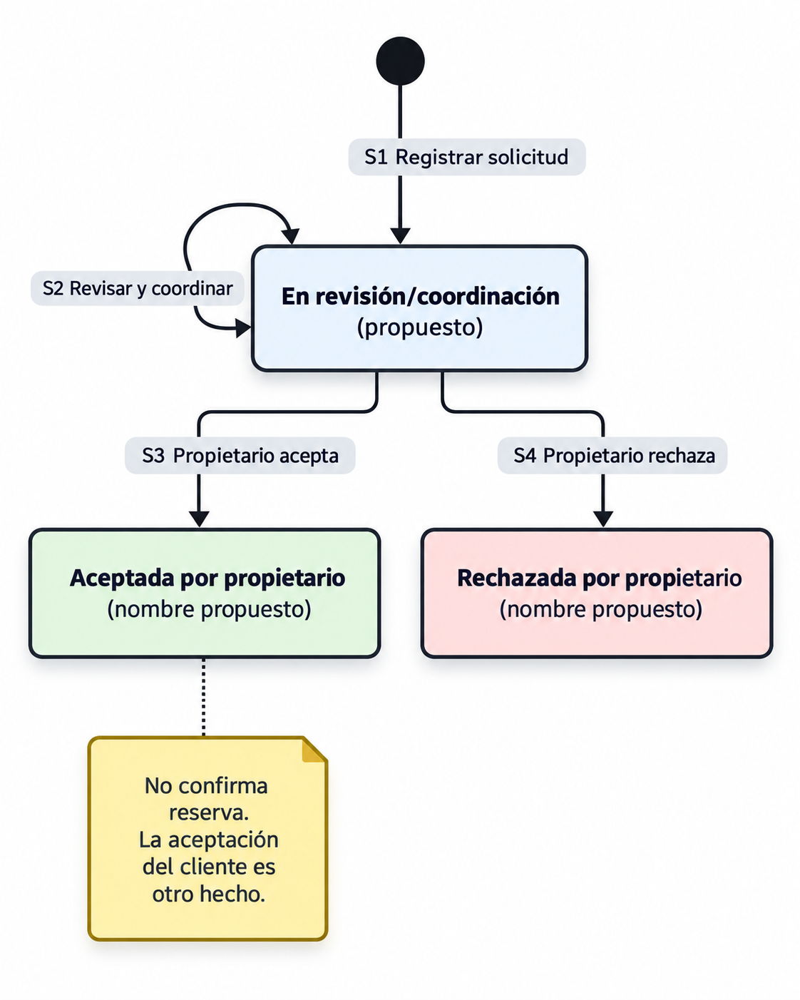
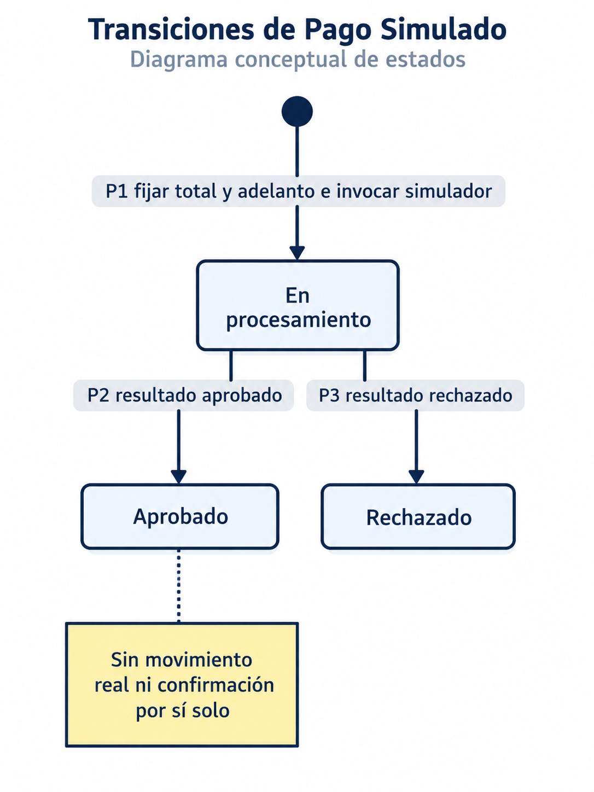
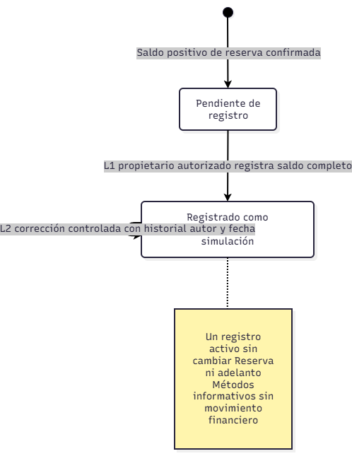

# UrbanPulse — Estados y transiciones

## Propósito y nivel de aprobación

Separar Solicitud de evento, Reserva, Adelanto simulado y Registro de liquidación simulada del saldo conforme a las [reglas RN y fuentes](01-reglas-de-negocio.md). Las acciones funcionales aprobadas no equivalen a una máquina de estados aprobada. Los dos estados informativos del saldo están aprobados por DP-08; los nombres y la organización de los demás estados intermedios son propuestas para auditoría; no fijan tablas, enumeraciones de código, cardinalidades ni el momento de creación de una entidad persistida (PC-02).

Las referencias HU/RF/DF/AC/DA/ADR/EQ remiten a las [fuentes del catálogo](01-reglas-de-negocio.md#fuentes-y-criterio-de-trazabilidad). La lectura arquitectónica conserva Monolito Modular y Clean Architecture. Los diagramas describen comportamiento conceptual, sin elegir mecanismo concurrente, framework, base de datos o despliegue del simulador.

**Diagramas de referencia:** los PNG incorporados representan visualmente las transiciones descritas por las tablas. No aprueban estados propuestos ni acreditan implementación; PC-02 y los demás pendientes descritos arriba siguen vigentes.

Las tablas conservan el detalle textual de las transiciones; los diagramas se mantienen como imágenes PNG.

## Hechos que deben distinguirse

| Hecho | Responsable | Efecto permitido | No acredita |
|---|---|---|---|
| Aceptar solicitud | Propietario | Aceptación de la petición del evento (HU08/RF10; RN-08). | Aceptación del cliente ni reserva confirmada. |
| Registrar cotización y condiciones | Propietario | Poner las condiciones en UrbanPulse (DF-02; RN-09). | Aceptación automática ni disponibilidad retenida. |
| Aceptar cotización y condiciones | Cliente en UrbanPulse | Satisfacer la condición de aceptación (DF-02; RN-09). | Adelanto aprobado ni confirmación. |
| Aprobar adelanto simulado | Simulador, resultado registrado por el sistema | Satisfacer la condición de adelanto correspondiente (RN-14/RN-15). | Movimiento real de dinero ni reserva confirmada por sí solo. |
| Confirmar reserva | Sistema al evaluar el caso de uso; iniciador del evento pendiente PC-03 | Registrar confirmación solo si se cumplen las condiciones de la modalidad (RN-04/RN-11/RN-13). | Una garantía concurrente implementada o un derecho a cancelar. |

La aceptación de cotización se representa como condición del proceso, separada del estado de Solicitud; no se crea otra máquina para la aceptación; la cuarta máquina independiente corresponde al registro del saldo (DP-08). El orden entre aceptación de solicitud y registro de cotización en los flujos es una propuesta de coordinación, no una política contractual aprobada.

## Catálogo de estados

| Entidad | Estado / situación | Significado | Nivel y respaldo |
|---|---|---|---|
| Solicitud | En revisión/coordinación | Petición registrada, sujeta a revisión de fecha, personas, servicios y condiciones. | Nombre propuesto; acciones aprobadas HU05/HU08, RF07/RF10, RN-05/RN-06. |
| Solicitud | Aceptada | El propietario acepta la solicitud, sin confirmar reserva. | Nombre propuesto; aceptación respaldada en HU08/RF10 y RN-08/RN-10. |
| Solicitud | Rechazada | El propietario rechaza la solicitud. | Nombre propuesto; rechazo respaldado en HU08/RF10 y RN-08. No cancela una reserva. |
| Reserva | Pendiente de confirmación | Situación conceptual de una operación que aún no cumple todas las condiciones; no presupone persistencia de un intento directo. | Propuesta; RF12/RF19 y flujo de pagos de arquitectura inicial; RN-11/RN-16. Creación/persistencia pendientes PC-02. |
| Reserva | Confirmada | Se verificó disponibilidad y las condiciones aplicables. | Concepto aprobado RF04/RF06/RF12, DF-03/DF-04; nombre de diseño sujeto a auditoría. |
| Adelanto simulado | En procesamiento | Intento invocado sin resultado de negocio registrado todavía. | Estado técnico propuesto para representar RF11/RF18; no implica espera asíncrona ni protocolo elegido. |
| Adelanto simulado | Aprobado | Resultado positivo del intento asociado al adelanto. | Resultado aprobado HU09/RF18, RC07; RN-14. |
| Adelanto simulado | Rechazado | Resultado negativo del intento, sin adelanto aprobado. | Resultado aprobado HU09/RF18, RC07; RN-14/RN-15. |
| Registro de saldo | Pendiente de registro | Sin recepción simulada activa del saldo completo. | Aprobado DP-08; aplicabilidad a saldo cero pendiente. |
| Registro de saldo | Registrado como recibido en simulación | Existe recepción simulada activa completa y trazable. | Aprobado DP-08; HU14/RF20. |

No tener intento de pago no es un pago rechazado. La ausencia de respuesta no es un resultado aprobado/rechazado ni un nuevo estado de negocio autorizado. “Condiciones aceptadas”, “adelanto requerido” y “disponibilidad consultada” tampoco son estados de Reserva. `Disponible` y `No disponible` son resultados de consulta, sin constituir una reserva o una retención.

## Transiciones de Solicitud

Los ID S, R, P y L son referencias locales de transición. “Inicio” significa ausencia del objeto o situación representada; no es un estado almacenado. Los responsables humanos desencadenan la acción y el sistema verifica autorización y registra el resultado.

| ID | Origen | Evento | Condición | Destino / efecto | Responsable | Respaldo y nivel |
|---|---|---|---|---|---|---|
| S1 | Inicio | Registrar solicitud de salón/recreo | Fecha, cantidad de personas y servicios según RF07; recurso según modalidad | En revisión/coordinación | Cliente / sistema | HU05/RF07; DF-01; RN-05/RN-06. Acción aprobada, nombre propuesto. |
| S2 | En revisión/coordinación | Revisar y coordinar | Propietario autorizado, revisión de disponibilidad y condiciones | En revisión/coordinación | Propietario y cliente / sistema para datos registrados | HU08/RF10; RN-08/RN-09/RN-19. Sin mensajería interna implícita. |
| S3 | En revisión/coordinación | Aceptar solicitud | Decisión del propietario según las condiciones del establecimiento | Aceptada | Propietario / sistema | HU08/RF10; RN-08/RN-10. Acción aprobada. |
| S4 | En revisión/coordinación | Rechazar solicitud | Decisión del propietario según las condiciones del establecimiento | Rechazada | Propietario / sistema | HU08/RF10; RN-08. Acción aprobada. |

Una solicitud aceptada no transita a “reserva confirmada”: son conceptos distintos. Registrar condiciones y su aceptación por el cliente son hechos DF-02, sin transición adicional de Solicitud en esta propuesta. Reapertura, edición tras aceptación y rechazo de cotización por el cliente siguen pendientes PC-01/PC-09.

## Transiciones de Reserva

RF19 se expresa registrando el resultado del adelanto y reflejando su efecto: ante rechazo, sigue sin confirmar; ante aprobación, queda satisfecha únicamente la condición de adelanto y se evalúan las restantes. El modelo conceptual puede conservar “Pendiente de confirmación” y distinguir el motivo; no se adopta una estructura de persistencia ni se elimina la actualización exigida por RF19.

| ID | Origen | Evento | Condición | Destino / efecto | Responsable | Respaldo y nivel |
|---|---|---|---|---|---|---|
| R1 | Inicio / operación directa en curso | Reservar cancha o karaoke | Recurso/fecha/bloque o intervalo definidos; operación autorizada; adelanto simulado aprobado y disponibilidad válida al confirmar | Confirmada | Cliente inicia; sistema confirma | DF-04; DP-02/DP-12; RF04/RF06/RF12; RN-04/RN-13. |
| R2 | Inicio / operación directa en curso | Intentar reserva directa con alguna condición incumplida | Adelanto rechazado o no aprobado, o disponibilidad no válida al confirmar | Sin confirmación; no se crea automáticamente estado Rechazada ni Reserva persistida | Cliente / sistema | DF-04; DP-12; RN-04/RN-15. |
| R3 | Proceso de evento | Representar situación previa a confirmación | Aún faltan condiciones del evento | Pendiente de confirmación, conceptualmente | Sistema; momento de materialización pendiente | RF12/RF19; RN-10/RN-11/RN-16; PC-02. Propuesta de modelo. |
| R4 | Pendiente de confirmación | Evaluar confirmación de evento | Condiciones aceptadas en UrbanPulse + adelanto simulado aprobado + disponibilidad verificada | Confirmada | Sistema; actor iniciador/automatización pendientes | DF-02/DF-03; RF12; RN-09/RN-11/RN-13; AC03/DA02/ADR-004/EQ-03. Guarda aprobada; disparador pendiente PC-03. |
| R5 | Pendiente de confirmación | Registrar resultado de adelanto rechazado | Simulador devuelve rechazo | Permanece pendiente; situación de adelanto rechazado reflejada según RF19 | Simulador devuelve; sistema registra | HU09/RF18/RF19; RN-15/RN-16; EQ-08. No confirmación derivada; representación concreta propuesta. |
| R6 | Pendiente de confirmación | Evaluar con pago aprobado y falta de disponibilidad u otra condición | Incumplimiento de al menos una condición de DF-03 | Permanece pendiente; sin confirmación | Sistema | RN-11/RN-13/RN-15; EQ-03/EQ-08. Resolución posterior pendiente PC-07. |

Cancha y karaoke no pasan por Solicitud de evento, pero sí requieren adelanto simulado obligatorio. R1 exige P2 y disponibilidad válida; R2 cubre también rechazo o ausencia de aprobación. Un intento fallido no presupone una Reserva persistida. R3–R6 conservan el recorrido de eventos y sus tres condiciones.

## Transiciones de Pago simulado

El orden “condiciones aceptadas antes de invocar pago” utilizado en los flujos es una propuesta de recorrido; DF-03 fija la conjunción necesaria para confirmar. DP-03 fija los importes de la operación; DP-04 fija el saldo.

| ID | Origen | Evento | Condición | Destino / efecto | Responsable | Respaldo y nivel |
|---|---|---|---|---|---|---|
| P1 | Inicio | Iniciar adelanto simulado | Recurso/operación y adelanto identificados; total y adelanto mostrados previamente y fijados al iniciar; en eventos según condiciones aceptadas | En procesamiento | Cliente inicia; sistema invoca simulador | HU09/RF11/RF18; DF-04; DP-02/DP-03; RN-14/RN-17. |
| P2 | En procesamiento | Recibir aprobación | Resultado aprobado asociado al intento correspondiente | Aprobado; actualizar situación de reserva y evaluar las otras condiciones | Simulador / sistema | RF18/RF19; DF-03; RN-14–RN-16; DA06/ADR-006/EQ-08. Resultado aprobado. |
| P3 | En procesamiento | Recibir rechazo | Resultado rechazado asociado al intento correspondiente | Rechazado; no satisfacer adelanto, reserva sin confirmar | Simulador / sistema | RF18/RF19; RN-14–RN-16. Resultado aprobado documentalmente. |

Los contratos técnicos de asociación, precisión monetaria, fallos y resultados repetidos siguen pendientes PC-06/PC-08. No se diseña un callback, una política de reintentos ni un mecanismo de idempotencia.

## Estados y transiciones no aprobados

| Elemento | Estado de decisión y efecto sobre este diseño |
|---|---|
| Cancelada / cancelar reserva | RF13 pendiente de validación y sin HU de origen; excluido de las máquinas. |
| Expirada, bloqueo temporal o liberación por vencimiento | Sin política aprobada de retención o plazo; excluidos. |
| Devuelto / reembolsado y transición de devolución | Sin pago real ni condiciones contractuales aprobadas; excluidos. |
| Finalizada, no asistió, borrador o reabierta | Sin ciclo aprobado; no se añaden. |
| Cotización rechazada por cliente, vencida o renegociada | Sin aceptación no se confirma; estados/transiciones y tratamiento pendientes. |
| Rechazado → En procesamiento o Aprobado → Rechazado | No se autoriza reintento ni reversión por este modelo. PC-08 requiere decidir si hay nuevos intentos y cómo se relacionan. |
| Error técnico / tiempo agotado como resultado de pago | Ausencia de respuesta no se transforma en rechazo o aprobación; recuperación pendiente. |
| Confirmada → otro estado | Ciclo posterior sin definir; no se supone inmutabilidad perpetua por omitirlo. |

Los nodos iniciales representados en los diagramas no fijan el momento de persistencia. No se usan nodos finales para afirmar que el ciclo contractual terminó. Los escenarios alternativos y las cuatro modalidades se desarrollan en [flujos de reserva](03-flujos-de-reserva.md); todos los pendientes PC se registran en [reglas](01-reglas-de-negocio.md#restricciones-del-mvp-y-pendientes-contractuales).

## Registro de liquidación simulada del saldo

Máquina independiente de Solicitud, Reserva y Adelanto simulado. L1/L2 son identificadores nuevos necesarios porque P1–P3 describen exclusivamente resultados del simulador y R1–R6 confirmación de Reserva. No se renumeran esas transiciones.

| ID | Origen | Operación y guarda | Destino / efecto | Trazabilidad |
|---|---|---|---|---|
| L1 | Pendiente de registro | Propietario autorizado registra saldo completo positivo de reserva confirmada propia, con método informativo, reserva, importe, autor, fecha y hora; sin otro registro activo | Registrado como recibido en simulación; Reserva y adelanto sin cambios | HU14/RF20; RN-24/RN-25; DF-05; DP-04–DP-08/DP-11. |
| L2 | Registrado como recibido en simulación | Corrección controlada por propietario autorizado con historial anterior preservado, autor y fecha; conservar importe completo y un único registro activo | Mismo estado informativo, con corrección trazable; no segundo pago ni cambio de Reserva | HU14/RF20; RN-25; DP-06/DP-09. |

El intento duplicado se rechaza sin crear otra recepción activa. La consulta autorizada del resumen (RF14/DP-10) no cambia estados. La forma técnica de corregir sigue pendiente; no se agregan estados Anulado, Reembolsado o Cancelado. Si el saldo es cero no se ejecuta L1: representación pendiente sin recepción ficticia.

