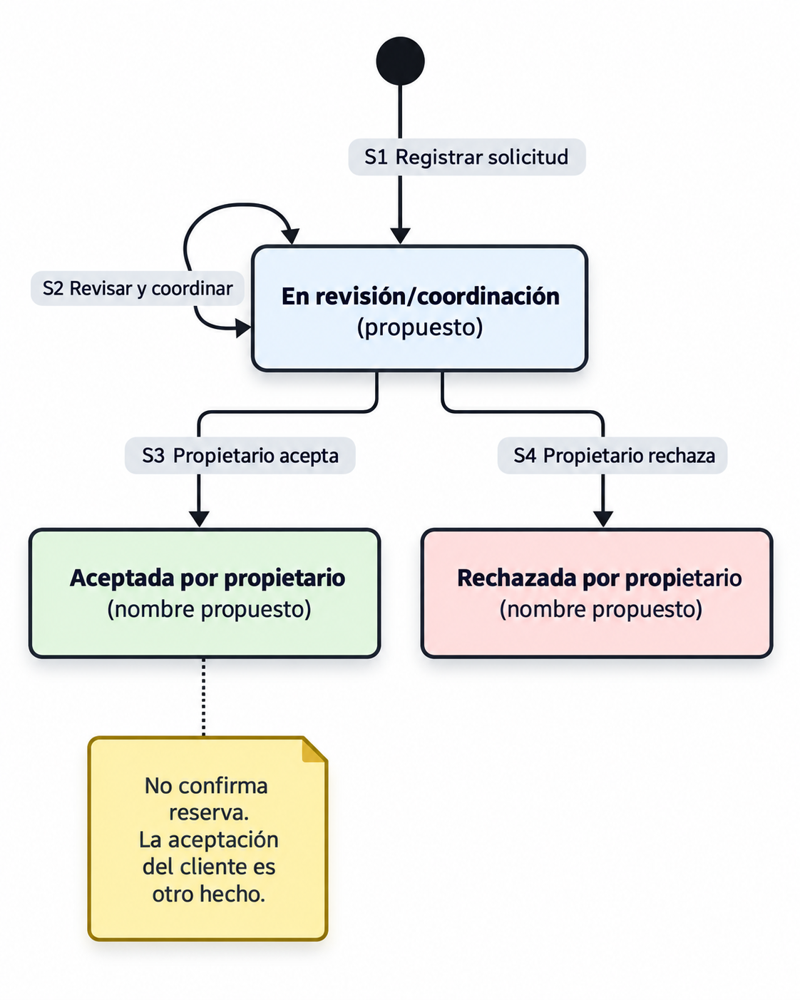
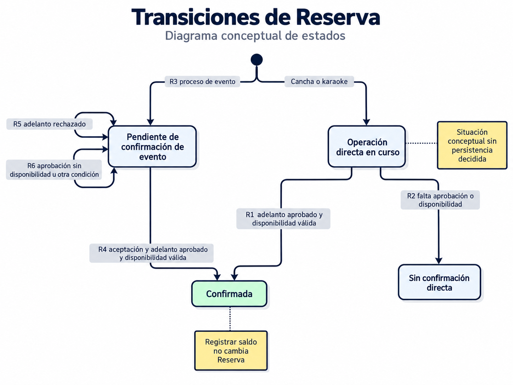
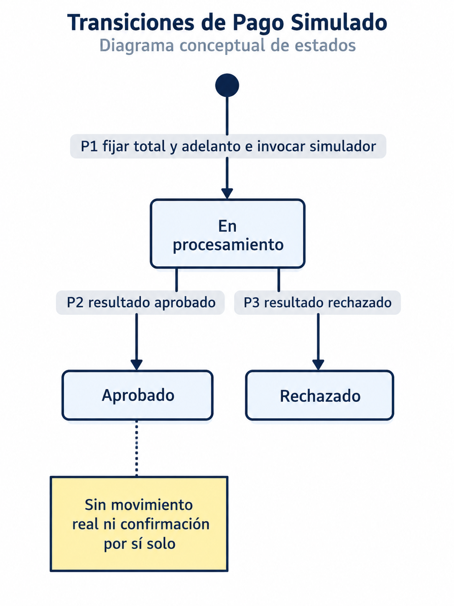
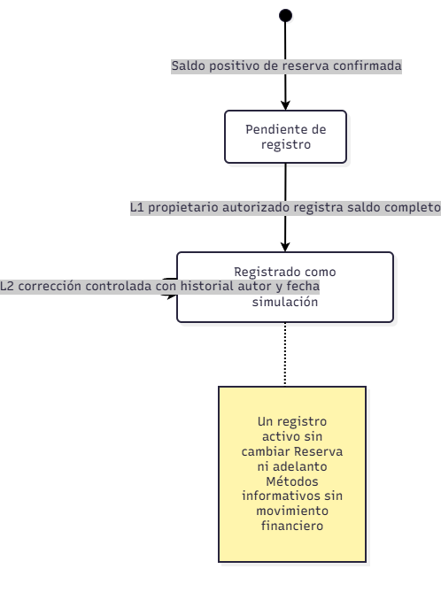

# UrbanPulse — Estados y transiciones

**Reconciliación Tarea 2 — 07/11/2026; pendiente de auditoría.** El alcance funcional de pagos reales sustituye la exclusividad simulada histórica conforme a [RC/DF/DP revisados](../01-analisis-de-sistema/05-restricciones.md) y [ADR-012](../01-analisis-de-sistema/adr/ADR-012-modelo-pagos-mvp.md). Las decisiones arquitectónicas financieras de ADR-012 siguen propuestas; Mercado Pago Marketplace Split 1:1 es candidato, sin capacidades verificadas ni integración de producción aprobada. Esta revisión no acredita implementación o pruebas. AGENTS.md y la arquitectura general se sincronizan en Tarea 4 con el alcance funcional vigente; la arquitectura financiera de ADR-012 sigue propuesta y los cierres históricos no la aprueban.

## Propósito y nivel de aprobación

Separar seis hechos conceptuales sin decidir que sean seis entidades persistidas. Las reglas funcionales proceden de [RN/PC](01-reglas-de-negocio.md), RF11/RF12/RF18–RF20 y DP-01–DP-12. Excepto los dos estados informativos de DP-08, los nombres, estados intermedios y secuencias siguientes son propuestas revisables, sin enumeraciones, cardinalidades ni contratos persistidos aprobados (PC-02/PC-08). Se conservan los identificadores locales S1–S4, R1–R6, P1–P3 y L1/L2.

## Hechos que deben distinguirse

| Ámbito | Situación conceptual | Efecto y límite |
|---|---|---|
| A. Solicitud de evento | En revisión/coordinación; Aceptada; Rechazada | Propietario revisa/acepta/rechaza. Aceptada no equivale a aceptación del cliente ni a Reserva confirmada. |
| B. Reserva | Pendiente de confirmación; Confirmada | Confirmada requiere pago requerido verificado y aplicado, disponibilidad válida y aceptación interna en eventos. Creación previa y persistencia pendientes. |
| C. Operación electrónica | Iniciada/en procesamiento; Pendiente; Aprobada verificada; Rechazada verificada; Resultado incierto | Situaciones conceptuales para interpretar evidencia del proveedor, sin copiar sus enums. Aprobación no es aplicación ni liquidación. Timeout deja incertidumbre. |
| D. Pago verificado y aplicado | Verificado sin aplicación; Aplicado una vez | Verificar aprobación no descuenta importe por sí solo. Aplicación es hecho auditable asociado a la reserva; mecanismo conjunto con confirmación pendiente PC-05/PC-08. |
| E. Registro posterior del saldo positivo | Pendiente de registro; Registrado como recibido | Etiquetas informativas aprobadas DP-08. Declaración del propietario, sin cambiar Reserva o resultado electrónico. Cero: no aplica recepción; etiqueta pendiente. |
| F. Conciliación de incidencias financieras | Incidencia pendiente de análisis; En tratamiento; Resolución documentada | Nombres propuestos. Conserva aprobado sin confirmar, diferencias, duplicados o incertidumbre. No presume devolución ni cierre de Reserva. |

Cotización registrada y aceptación interna son evidencia contractual diferenciada; su organización/versiones siguen en PC-01. Disponibilidad consultada es un resultado sin retención. Un evento duplicado es una condición de procesamiento, no un rechazo financiero ni otro importe aplicado. Dos pagos diferentes potencialmente cobrados requieren conciliación; deduplicar eventos no permite borrar un cobro real adicional.

## Transiciones de Solicitud

| ID | Origen | Acción / guarda | Destino o efecto | Respaldo |
|---|---|---|---|---|
| S1 | Inicio conceptual | Cliente autorizado registra recurso de salón/recreo, fecha, personas y servicios | En revisión/coordinación | HU05/RF07; RN-05/RN-06; DF-01. |
| S2 | En revisión/coordinación | Propietario autorizado revisa y coordina | Misma situación; sin mensajería interna ni retención | HU08/RF10; RN-08/RN-09/RN-19. |
| S3 | En revisión/coordinación | Propietario acepta petición | Aceptada; sin confirmar Reserva | HU08/RF10; RN-08/RN-10. |
| S4 | En revisión/coordinación | Propietario rechaza petición | Rechazada; no cancela una Reserva | HU08/RF10; RN-08. |

Registrar cotización y aceptar condiciones dentro de UrbanPulse son hechos DF-02 separados de S3. Su orden concreto, cambios y reapertura siguen PC-01/PC-09; WhatsApp no sustituye aceptación.

## Transiciones de Reserva

| ID | Origen conceptual | Evaluación / guarda | Destino o efecto | Responsable y respaldo |
|---|---|---|---|---|
| R1 | Inicio / operación directa | Identidad y autorización, recurso/periodo, pago total o adelanto configurado verificado y aplicado, disponibilidad válida; impedir incompatibles concurrentes | Confirmada solo con persistencia consistente | Cliente inicia; sistema evalúa. DF-04; RN-04/RN-13; RF04/RF06/RF12. |
| R2 | Inicio / operación directa | Falta alguna condición de R1 | Sin confirmación; no crea automáticamente Reserva Rechazada ni objeto persistido | Sistema; DP-12; RN-15; PC-02. |
| R3 | Proceso de evento | Aún faltan condiciones | Pendiente de confirmación, conceptualmente | Sistema; PC-02; RF12/RF19. |
| R4 | Pendiente de confirmación | Aceptación de condiciones en UrbanPulse + pago requerido verificado y aplicado + disponibilidad válida sin incompatibles concurrentes | Confirmada | Sistema; iniciador/automatización pendientes PC-03. DF-02/DF-03; RN-11/RN-13. |
| R5 | Pendiente de confirmación | Rechazo verificado | Sigue sin confirmar y refleja rechazo según RF19 | Backend verifica; sistema registra. RF18/RF19; RN-15/RN-16. |
| R6 | Pendiente de confirmación | Pago aprobado pero falta disponibilidad u otra condición | Sin confirmar; aprobación conservada e incidencia trazable | RF19; RN-15; PC-07/PC-08. |

R1/R4 no se alcanzan por P2 aislada: requieren aplicación única y todas las guardas. RN-13 es obligatoria; la tabla no demuestra un mecanismo de concurrencia. El orden lógico de evaluación no aprueba una consulta seguida de escritura ni una transacción distribuida. Reflejar resultados según RF19 no fusiona las máquinas ni obliga a crear Reserva antes de tiempo.

**Desfase gráfico:** el PNG siguiente conserva adelanto simulado obligatorio; es antecedente, no representación financiera vigente.

## Transiciones de operación electrónica y aplicación

| ID | Origen conceptual | Acción / condición | Efecto permitido | Nivel / respaldo |
|---|---|---|---|---|
| P1 | Inicio | Identidad/autorización y receptor vinculado válido; mostrar y fijar total, adelanto, opción, importe y moneda; correlacionar operación | Solicitar pago a proveedor mediante adaptador; iniciada/en procesamiento | RF11; DP-02/DP-03; secuencia propuesta, contratos PC-02/PC-08/PC-11. |
| P2 | En procesamiento / pendiente / incierto | Backend verifica aprobación y contrasta estado, correlación, importe, moneda y receptor | Aprobación verificada; aún no es aplicación ni confirmación | RF18/RF19; RN-14/RN-16. Sustituye aprobación del simulador. |
| P3 | En procesamiento / pendiente / incierto | Backend verifica rechazo correspondiente a operación | Rechazo verificado; no aporta importe ni confirma | RF18/RF19; DP-12. Sustituye rechazo del simulador. |
| P4 | Operación sin resultado definitivo | Proveedor informa pendiente o consulta falla/timeout | Conservar pendiente o incertidumbre con evidencia; reconsulta/recuperación por diseñar | Propuesta de representación; PC-08; nunca aprobar/rechazar por timeout. |
| P5 | Aprobación ya conocida / evento repetido | Mismo pago reaparece por webhook, consulta o reintento | Preservar evidencia y resultado; ninguna aplicación o cobro solicitado duplicados | Obligación RF11/RF18/RF19; mecanismo pendiente. |
| P6 | Resultado contradictorio o fuera de orden | Nueva evidencia requiere contraste autoritativo | No degradar hechos verificados por orden de llegada; preservar incidencia | Propuesta de coordinación; PC-08; contrato del proveedor por verificar. |
| AP1 | Pago verificado sin aplicación | Correlación y condiciones comprobadas; coordinar aplicación única con Reserva y disponibilidad | Registrar aplicación única a reserva; descuento solo del importe efectivamente aplicado | RF12/RF19; DP-04/DP-12; realización PC-02/PC-05/PC-08. |
| AP2 | Aplicación registrada | Repetición del mismo pago, incluso evento distinto | Conservar aplicación existente, sin acumular importe ni generar nueva confirmación | Obligación idempotente; RF18/RF19. |

P4–P6/AP1/AP2 son referencias locales nuevas para separar situaciones antes ausentes; no enumeraciones persistidas. AP1 no ordena aplicar a ciegas antes de validar disponibilidad ni afirma atomicidad: unidad consistente o protocolo recuperable por diseñar. Si hay aprobación y no se consigue confirmar, se conserva tanto resultado como aplicación real existente o ausencia de ella; no se registra aplicación ficticia ni se pierde la incidencia.

El navegador solo informa navegación. Webhook es señal para verificar en backend, con autenticidad y correlación según contrato futuro. Ausencia de intento no es rechazo; una referencia declarada no acredita aprobación. Reintentos de inicio o devolución requieren identidad estable y contratos; resultado incierto no autoriza otro cobro automático.

**Antecedente gráfico sustituido:** el PNG de P1–P3 representa el simulador, no el proveedor ni AP1/AP2.

## Registro posterior del saldo

| ID | Origen | Guarda / operación | Efecto | Respaldo |
|---|---|---|---|---|
| L1 | Pendiente de registro, saldo positivo | Propietario autorizado, reserva confirmada propia, importe completo; reserva, método declarado, fecha de recepción, referencia aplicable, autor/fecha de registro; sin otra recepción activa | Registrado como recibido; no cambia Reserva, pago electrónico ni aplicación | HU14/RF20; RN-24/RN-25; DF-05; DP-04–DP-08/DP-11. |
| L2 | Registrado como recibido | Corrección autorizada con historial anterior preservado, autor/fecha y una recepción activa | Misma situación informativa; corrección trazable, sin segundo pago | DP-06/DP-09; procedimiento pendiente. |

Repetir L1 no crea otra recepción; no se admiten fraccionamientos. La consulta RF14/DP-10 distingue pendiente calculado y recepción declarada para evitar doble descuento o cobro posterior del saldo ya recibido. Con pago total aplicado el pendiente es cero, no se ejecuta L1 ni se inventa recepción. Fecha de recepción no acredita liquidación del proveedor.

**Desfase gráfico:** el PNG conserva la etiqueta anterior «Registrado como recibido en simulación», sustituida por DP-08 revisada.

## Conciliación y devolución diferenciada

| Referencia local nueva | Disparador | Efecto conceptual propuesto y límite |
|---|---|---|
| CF1 | Aprobado sin confirmar; cobro o aplicación inciertos; importe/receptor/correlación divergentes; posibles cobros diferentes duplicados | Registrar incidencia con operación, referencias, receptor, importe, evidencia, motivo, intentos y resolución pendiente. Propiedad y asociación PC-02/PC-07. |
| CF2 | Análisis autorizado y contraste con proveedor | Recuperar evidencia y documentar qué se verificó/aplicó/confirmó; no fabricar rechazo, aprobación o confirmación. Responsables y política pendientes. |
| CF3 | Devolución cuando corresponda según política futura | Operación financiera propia con autorización, correlación, importe, resultado e idempotencia; incertidumbre se conserva. No implica cancelar Reserva ni garantiza devolución completada. |

CF1–CF3 son referencias locales nuevas de conciliación, no nuevos requisitos. Solicitar una devolución y verificar su resultado son hechos separados. RF19 establece trazabilidad; no aprueba aquí estados persistidos de devolución, responsables, automatización o capacidades del candidato.

## Estados y transiciones no aprobados

RF13 mantiene cancelación pendiente. No se añaden Expirada, Reabierta, Finalizada, retenciones ni liberación por vencimiento. El ciclo Confirmada → otro estado, rechazo/reapertura de cotización y reversión de hechos financieros requieren decisión. Una devolución financiera no introduce un estado Reembolsada en Reserva. PC-01–PC-12 siguen abiertos; contratos del proveedor y normalización de estados pendientes.

## Sustituciones y criterio de revisión

S1–S4 conservan su semántica; R1–R6 conservan separación directa/evento con guardas financieras revisadas. P1–P3 dejan de ser resultados del simulador y ya no fusionan aprobación con aplicación; AP1/AP2 explicitan esta última. L1/L2 preservan autorización, unicidad activa e historial, sustituyendo naturaleza simulada y etiqueta de recepción. Todos los PNG son antecedentes preservados sin renderizado ni actualización en esta tarea. Los [flujos](03-flujos-de-reserva.md) y el informe (antecedente auxiliar local, fuera del repositorio) delimitan impacto y pendientes.
