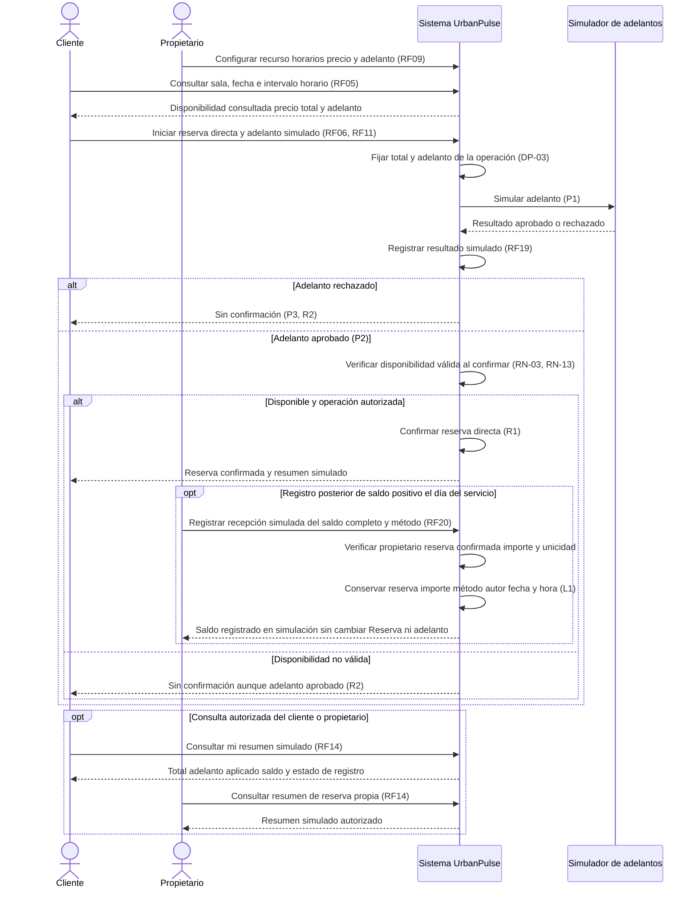
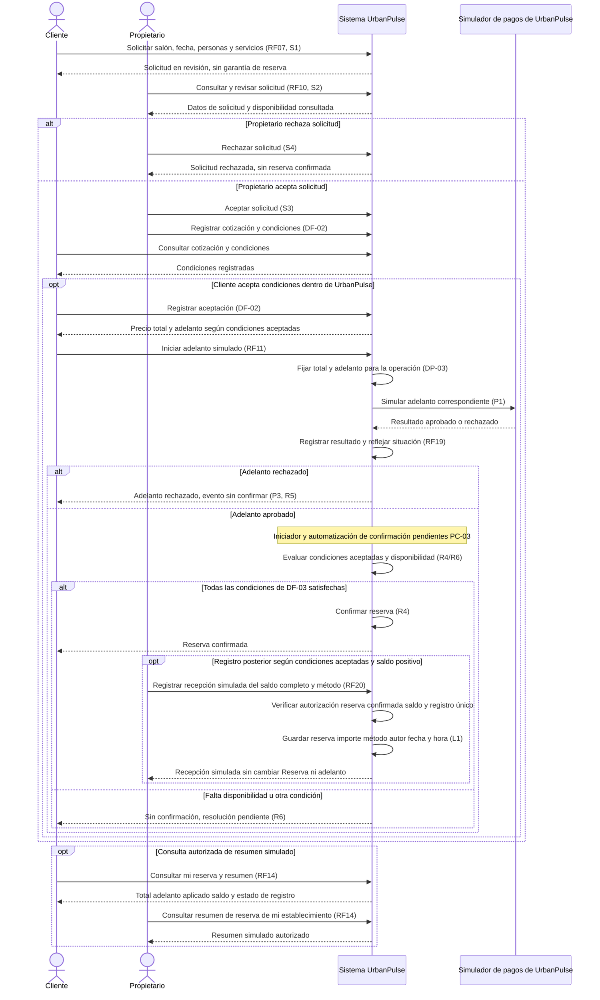
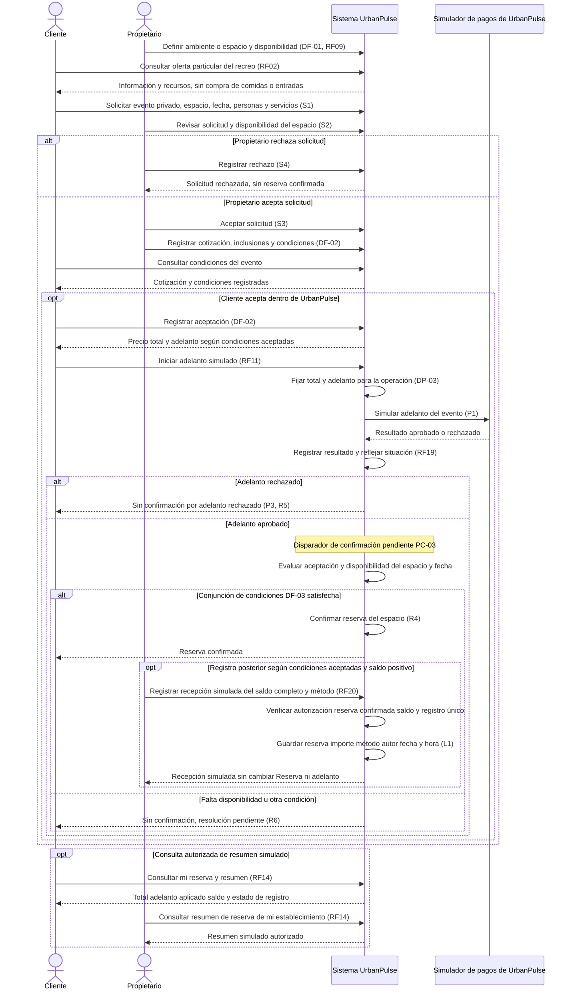

# UrbanPulse — Flujos de reserva

## Propósito y lectura

Describir las cuatro modalidades mediante las [reglas RN](01-reglas-de-negocio.md) y los [estados y transiciones](02-estados-y-transiciones.md). Las referencias HU/RF/DF/AC/DA/ADR/EQ se consultan en las [fuentes](01-reglas-de-negocio.md#fuentes-y-criterio-de-trazabilidad). Las condiciones aprobadas se distinguen de la secuencia propuesta para organizarlas; los diagramas no fijan contratos de API, almacenamiento, temporización ni mecanismos de concurrencia.

Cliente y propietario son actores humanos. “Sistema” representa los casos de uso y reglas de UrbanPulse dentro del Monolito Modular. El simulador de pagos es el componente de UrbanPulse detrás de una abstracción de integración; su línea de vida no representa una pasarela financiera real ni un despliegue externo obligatorio. Presentación recibe las acciones, Aplicación coordina, Dominio decide conforme a las reglas e Infraestructura implementa los adaptadores y repositorios. Las flechas son interacciones, no dependencias de código.

## Coordinación, cotización, adelanto y confirmación

| Paso | Responsable | Alcance |
|---|---|---|
| Coordinar | Cliente y propietario | Aclarar fecha, servicios y condiciones; WhatsApp solo puede complementar mediante redirección. |
| Aceptar solicitud | Propietario | Admitir la petición; no confirma ni representa aceptación del cliente. |
| Registrar cotización y condiciones | Propietario en UrbanPulse | Expresar las condiciones del evento; contenido mínimo, versiones y cambios pendientes PC-01. |
| Aceptar cotización | Cliente en UrbanPulse | Registrar su aceptación de las condiciones; no basta un mensaje en WhatsApp (DF-02). |
| Adelanto simulado | Cliente, sistema y simulador | Invocar y registrar aprobado/rechazado; no mover dinero real ni confirmar por sí solo. |
| Confirmar evento | Sistema, con iniciador pendiente PC-03 | Evaluar conjuntamente aceptación, adelanto aprobado y disponibilidad (DF-03). |
| Confirmar cancha/karaoke | Cliente inicia; sistema verifica y confirma | Adelanto simulado aprobado y disponibilidad válida al confirmar, sin solicitud de evento ni cotización obligatoria (DF-04). |

## F-01 — Reserva directa de cancha

**Base aprobada:** HU03 mantiene consulta de disponibilidad; RF04 permite reserva directa, con asociación contextual de la HU pendiente de precisión. HU07/RF09 configura recurso, horarios, precio y adelanto; HU09/RF11/RF18/RF19 regula simulación; HU14/RF20 registra saldo y HU10/HU14/RF14 consulta el resumen. DF-04–DF-06; DP-01–DP-12; RN-04/RN-13–RN-17/RN-24/RN-25.

**Precondiciones y unidad:** recurso del establecimiento y operación autorizada; recurso, fecha y bloque configurado. El propietario configura el importe del adelanto por recurso. No requiere solicitud de evento ni cotización obligatoria.

1. El cliente consulta disponibilidad (RF03); la consulta no garantiza reserva.
2. Selecciona recurso, fecha y bloque configurado. Conoce el precio total y el adelanto configurado antes de iniciar la operación.
3. Inicia el adelanto simulado; total y adelanto de esa operación quedan fijados (DP-03). Cambios posteriores de configuración no los alteran.
4. El simulador devuelve aprobación o rechazo. Se registra el resultado; rechazo impide confirmar (P3/R2).
5. Con aprobación (P2), el sistema verifica disponibilidad válida al confirmar y prohíbe confirmaciones incompatibles, incluso concurrentes. Solo cumpliendo ambas condiciones confirma (R1). Sin disponibilidad no confirma (R2); la aprobación se mantiene diferenciada y la resolución posterior queda pendiente.
6. Para una reserva confirmada y saldo positivo, el propietario autorizado registra posteriormente el saldo completo simulado, representando la liquidación restante el día del servicio (DP-11). Indica método informativo; el sistema conserva reserva, importe, propietario, fecha y hora (L1). No cambia Reserva ni adelanto.
7. Cliente y propietario autorizados consultan total, adelanto aprobado y aplicado, saldo y estado. Correcciones mediante L2 conservan historial, autor y fecha y un único registro activo. Con saldo cero no se inventa recepción; su representación queda pendiente.

PNG comprobado visualmente contra el Mermaid el 16/10/2026. Cancha: adelanto aprobado, disponibilidad válida y registro posterior del saldo completo positivo.

El propietario configura la oferta y registra posteriormente el saldo; no aprueba cada reserva directa. PC-05 conserva pendiente el mecanismo de concurrencia. Los intentos de recepción no autorizados, duplicados o de importe parcial se rechazan sin crear otro registro activo ni alterar estados.

## F-02 — Reserva directa de karaoke

**Base aprobada:** HU04 mantiene consulta de disponibilidad; RF06 permite reserva directa, con asociación contextual de la HU pendiente de precisión. HU07/RF09 configura recurso, horarios, precio y adelanto; HU09/RF11/RF18/RF19 regula simulación; HU14/RF20 registra saldo y HU10/HU14/RF14 consulta el resumen. DF-04–DF-06; DP-01–DP-12; RN-04/RN-13–RN-17/RN-24/RN-25.

**Precondiciones y unidad:** recurso del establecimiento y operación autorizada; sala, fecha e intervalo horario. El propietario configura el importe del adelanto por recurso. No requiere solicitud de evento ni cotización obligatoria.

1. El cliente consulta disponibilidad (RF05); la consulta no garantiza reserva.
2. Selecciona sala, fecha e intervalo horario. Conoce el precio total y el adelanto configurado antes de iniciar la operación.
3. Inicia el adelanto simulado; total y adelanto de esa operación quedan fijados (DP-03). Cambios posteriores de configuración no los alteran.
4. El simulador devuelve aprobación o rechazo. Se registra el resultado; rechazo impide confirmar (P3/R2).
5. Con aprobación (P2), el sistema verifica disponibilidad válida al confirmar y prohíbe confirmaciones incompatibles, incluso concurrentes. Solo cumpliendo ambas condiciones confirma (R1). Sin disponibilidad no confirma (R2); la aprobación se mantiene diferenciada y la resolución posterior queda pendiente.
6. Para una reserva confirmada y saldo positivo, el propietario autorizado registra posteriormente el saldo completo simulado, representando la liquidación restante el día del servicio (DP-11). Indica método informativo; el sistema conserva reserva, importe, propietario, fecha y hora (L1). No cambia Reserva ni adelanto.
7. Cliente y propietario autorizados consultan total, adelanto aprobado y aplicado, saldo y estado. Correcciones mediante L2 conservan historial, autor y fecha y un único registro activo. Con saldo cero no se inventa recepción; su representación queda pendiente.

PNG comprobado visualmente contra el Mermaid el 16/10/2026. Karaoke: sala e intervalo, adelanto aprobado, disponibilidad válida y registro posterior del saldo completo positivo.

El propietario configura la oferta y registra posteriormente el saldo; no aprueba cada reserva directa. PC-05 conserva pendiente el mecanismo de concurrencia. Los intentos de recepción no autorizados, duplicados o de importe parcial se rechazan sin crear otro registro activo ni alterar estados.

## F-03 — Solicitud y confirmación de salón

**Base aprobada:** HU05/HU08/HU09; RF07/RF10–RF12/RF18/RF19; DF-02/DF-03. La cobertura literal de registrar y aceptar cotización en HU/RF sigue pendiente. **Precondiciones:** salón o ambiente identificado y propietario responsable. **Datos de solicitud:** fecha, cantidad de personas y servicios requeridos. La duración, inclusiones e importes se concretan en condiciones aún sujetas a PC-01/PC-04/PC-06.

1. El cliente consulta información/disponibilidad y registra la solicitud.
2. El propietario revisa fecha, servicios, asistentes y disponibilidad. Puede aceptar o rechazar la solicitud. El rechazo termina este recorrido sin reserva confirmada.
3. Para el recorrido favorable, el propietario registra cotización y condiciones en UrbanPulse y el cliente las acepta allí (DF-02).
4. El cliente conoce total y adelanto según condiciones aceptadas e inicia el adelanto simulado. Ambos importes quedan fijados para la operación (DP-03); el sistema invoca el simulador y registra su resultado.
5. Ante rechazo, refleja el resultado y mantiene el evento sin confirmar. Ante aprobación, refleja el adelanto aprobado y evalúa también aceptación y disponibilidad al confirmar.
6. Solo si se cumplen las tres condiciones confirma. Con conflicto de disponibilidad o condiciones insuficientes sigue sin confirmar; la resolución posterior no está definida.
7. Posteriormente, conforme a las condiciones aceptadas, el propietario autorizado registra la recepción simulada del saldo completo positivo (total acordado menos adelanto aprobado y aplicado), con método informativo y reserva, importe, autor, fecha y hora. Verifica reserva confirmada propia y un solo registro activo (L1). No cambia Reserva ni adelanto. Cliente y propietario consultan RF14; correcciones L2 conservan historial. Saldo cero pendiente de representación sin recepción ficticia.

El orden aceptación de solicitud → cotización → aceptación del cliente → adelanto → evaluación es una **propuesta de recorrido**. DF-03 aprueba las condiciones conjuntas; PC-02/PC-03 conservan abiertos el momento de crear Reserva y el disparador de confirmación. La auto-interacción de evaluación del diagrama no decide que deba ejecutarse automáticamente al recibir el pago.

PNG comprobado visualmente contra el Mermaid el 16/10/2026. Salón: aceptación interna, adelanto aprobado y disponibilidad; recepción posterior del saldo según condiciones aceptadas. PC-03 sigue pendiente.

Sin aceptación del cliente el bloque opcional no se ejecuta en este recorrido; no se crea un estado de rechazo de cotización ni se presume vencimiento. “Pendiente de confirmación” es la situación conceptual del evento, sin decidir que ya exista una Reserva persistida. La forma de poner solicitudes a disposición del propietario no define notificaciones, correo o mensajería nuevos.

## F-04 — Solicitud y confirmación de evento privado en recreo

**Base aprobada:** F-03 más DF-01 y el alcance aprobado recuperado en D2. **Precondiciones:** el propietario ha definido el ambiente o espacio reservable; el cliente solicita un evento privado. No se presume alquiler del recreo completo, exclusividad de todo el día ni compra de actividades o servicios publicados.

1. El propietario define el ambiente/espacio y su disponibilidad. El cliente consulta la oferta particular y solicita evento con recurso, fecha, personas y servicios.
2. El propietario revisa la petición y puede aceptarla o rechazarla.
3. Si continúa, registra cotización y condiciones; el cliente acepta dentro de UrbanPulse. Un servicio publicado solo se incluye en el evento si forma parte de sus condiciones (RN-07).
4. El cliente conoce el total y adelanto de las condiciones aceptadas e inicia el adelanto simulado, fijando ambos importes para la operación (DP-03). El sistema registra aprobado/rechazado y refleja su efecto.
5. El sistema confirma solo con condiciones aceptadas, adelanto aprobado y disponibilidad válida al confirmar del ambiente o espacio y fecha. El conflicto posterior al adelanto impide confirmar y queda pendiente de resolución.
6. Posteriormente, según condiciones aceptadas y solo para reserva confirmada propia con saldo positivo, el propietario registra la recepción simulada del saldo completo, método informativo, reserva, importe, autor, fecha y hora (L1). Un solo registro activo; correcciones con historial (L2). Reserva y adelanto no cambian. Ambos actores autorizados consultan RF14. Saldo cero pendiente de representación sin recepción inventada.

PNG comprobado visualmente contra el Mermaid el 16/10/2026. Recreo: evento privado sobre un espacio concreto, aceptación interna, adelanto y disponibilidad; recepción posterior del saldo según condiciones aceptadas. PC-03 sigue pendiente.

El orden es la misma propuesta de F-03. PC-04 debe precisar incompatibilidades entre espacios y recursos compartidos. DF-01 ya define la unidad como ambiente o espacio del propietario; ese punto no se reabre como si aún fuera desconocido.

## Alternativas, errores y límites de respuesta

Estos escenarios describen efectos mínimos respaldados. No establecen textos definitivos de interfaz, códigos HTTP o contratos técnicos.

| ID | Flujo y situación | Respuesta o límite | Respaldo |
|---|---|---|---|
| A-01 | F-01/F-02: disponibilidad consultada cambia antes de confirmar | Verificar al confirmar; si no está disponible, no confirmar. No crear una Reserva Rechazada por inferencia. | RN-12/RN-13; R2; AC03/DA02/ADR-004/EQ-03. |
| A-02 | F-03/F-04: propietario rechaza solicitud | Solicitud Rechazada (nombre propuesto); no confirma reserva ni cancela una anterior. | HU08/RF10; RN-08; S4. |
| A-03 | F-03/F-04: cliente no acepta cotización | No se satisface DF-03. Rechazo explícito, renegociación y expiración pendientes; no se fuerza un estado nuevo. | RN-09–RN-11; PC-01/PC-09. |
| A-04 | F-01–F-04: simulador rechaza adelanto | Registrar rechazo, actualizar situación de reserva según RF19 y mantener sin confirmar. No contabilizar importe aprobado. | RN-14–RN-17; P3; R2 para F-01/F-02 y R5 para F-03/F-04; RF18/RF19; EQ-08. |
| A-05 | F-01–F-04: adelanto aprobado y disponibilidad perdida | No confirmar; mantener diferenciado el adelanto aprobado de la operación directa sin confirmación o del evento conceptualmente pendiente, sin presumir persistencia (PC-02). Resolución posterior pendiente; sin devolución automática. | RN-04/RN-11/RN-13/RN-15; R2 para F-01/F-02 y R6 para F-03/F-04; PC-07; EQ-03/EQ-08. |
| A-06 | F-01–F-04: sin respuesta o fallo del simulador | No inferir aprobación ni convertir fallo en rechazo de negocio. Contrato y recuperación pendientes. | RN-14/RN-15; PC-08; EQ-08. |
| A-07 | Cualquier flujo: acceso fuera de rol/titularidad | Rechazar operación no autorizada sin exponer datos protegidos ni modificar recursos ajenos; permisos detallados pendientes. | RN-19; AC04/DA05/ADR-007/EQ-04. |
| A-08 | Datos incompletos o intervalos/importes incoherentes | No se puede acreditar la condición de confirmación sin recurso/fecha/periodo y condiciones necesarios. Mensajes, validaciones numéricas y temporales precisas pendientes. | RN-01/RN-11/RN-17; RF07; PC-01/PC-04/PC-06. No constituye un catálogo de errores aprobado. |
| A-09 | Intentos simultáneos incompatibles | Debe impedirse la doble confirmación; el diagrama secuencial no demuestra ni selecciona una garantía concurrente. | RN-13; PC-05; AC03/DA02/ADR-004/EQ-03. |
| A-10 | Pago repetido, respuesta duplicada o reintento | No se define transición ni acumulación de importes; contrato y prevención de inconsistencias pendientes. | RN-17; PC-08; sin reintentos autorizados en P1–P3. |
| A-11 | Coordinación por WhatsApp | Redirección complementaria; volver a UrbanPulse para registrar condiciones y aceptación, sin importar conversaciones. | HU12/RF17; RN-09/RN-20; DF-02; RC08. |
| A-12 | Cliente consulta reservas | Consultar las propias y sus estados según HU10/RF14; no implica consultar solicitudes mediante una función nueva ni cancelar. | RN-19/RN-23; RF13 pendiente. |

## Matriz de trazabilidad de flujos

Las cadenas de calidad se citan como respaldo del diseño. Los RF sin driver de origen explícito se mantienen como contexto funcional; los EQ están pendientes de revisión, sin pruebas o métricas aprobadas.

| Flujo | HU / RF / DF | RN | AC / DA / ADR / EQ |
|---|---|---|---|
| F-01 Cancha | HU03/RF03; RF04 con HU03 contextual; HU07/RF09; HU10/RF14; DF-04. | RN-01/RN-02/RN-04/RN-12/RN-13/RN-19. | AC01/DA04/ADR-009/EQ-01 para consulta; AC03/DA02/ADR-004/EQ-03 para confirmar; AC06/DA03/ADR-003/EQ-06 para separación de modalidad; AC04/DA05/ADR-007/EQ-04 para acceso (RF09 como contexto; RF14 ampliado con origen DA05/DA08). |
| F-02 Karaoke | HU04/RF05; RF06 con HU04 contextual; HU07/RF09; HU10/RF14; DF-04. | RN-01/RN-03/RN-04/RN-12/RN-13/RN-19. | Cadenas de F-01 con RF05/RF06 para esta modalidad; RF09 conserva asociación contextual; RF14/RF20 tienen origen explícito en DA05/DA08. |
| F-03 Salón | HU05/RF07; HU08/RF10/RF12; HU09/RF11/RF18/RF19; HU10/RF14 para consulta posterior; DF-02/DF-03. | RN-01/RN-05/RN-08–RN-20/RN-22/RN-23. | AC05/DA01/ADR-001/EQ-05; AC06/DA03/ADR-003/EQ-06; AC03/DA02/ADR-004/EQ-03; AC08/DA06/ADR-006/EQ-08; AC04/DA05/ADR-007/EQ-04 como control transversal. RF10 sigue sin driver de origen explícito; RF11/RF14/RF19/RF20 se incorporan a DA08 y RF14/RF20 a DA05. |
| F-04 Recreo | HU02/RF02; HU05/RF07; HU07/RF09; HU08/RF10/RF12; HU09/RF11/RF18/RF19; DF-01/DF-02/DF-03; D2. | RN-01/RN-06–RN-23; RN-24/RN-25 aprobadas para cálculo y recepción simulada del saldo. | Cadenas de F-03; EQ-07 como contexto de comprensión de la oferta. RF02/RF09/RF10 mantienen pendiente su origen RF → DA; RF11/RF14/RF19/RF20 cuentan con DA08. |

DF-02 respalda registro y aceptación internos aunque su cobertura literal en HU/RF siga pendiente. Para todos los flujos, AC02/EQ-02 y AC07/EQ-07 son contexto sin driver ni respuesta arquitectónica explícita. AC05 → DA06 → ADR-002/ADR-006 aporta separación de capas e integraciones; no se asigna DA01 → ADR-002. DA07/ADR-005 responde a RC03 y DA08/ADR-008 a RC04/RF04/RF06/RF07/RF12; las relaciones AC05/AC08 de DA07 y AC03/AC05 de DA08 son complementarias.

## Pendientes y criterio de revisión

Los flujos deben revisarse contra [PC-01–PC-12](01-reglas-de-negocio.md#restricciones-del-mvp-y-pendientes-contractuales): contenido/aceptación de condiciones, creación de Reserva, iniciador de confirmación, alcance temporal, concurrencia, importes, pago aprobado sin disponibilidad, fallos/reintentos, cambios y ciclo posterior, permisos y cobertura funcional. No se agrega cancelación, devolución o expiración como alternativa ejecutable.

La revisión conjunta debe comprobar que F-01/F-02 alcanzan R1 solo con P2 y disponibilidad válida, y que F-03/F-04 solo alcanzan R4 con las tres condiciones; S3, aceptación del cliente o P2 aislados no llegan a Confirmada. A-04/A-05 conservan sin confirmar la operación directa o el evento, diferenciados del resultado del adelanto correspondiente. Los Mermaid representan estas condiciones y conservan explícitos los puntos aún no decididos; no son evidencia de una aplicación implementada.

## Trazabilidad adicional de adelanto y saldo en los cuatro flujos

| Flujo | HU → RF | RN → DF/DP | Estados y transiciones |
|---|---|---|---|
| F-01 Cancha | HU07/RF09; HU09/RF11/RF18/RF19; HU10/HU14/RF14; HU14/RF20 | RN-04/RN-13–RN-17/RN-19/RN-24/RN-25; DF-04–DF-06; DP-01–DP-12 | P1–P3; R1/R2; L1/L2. |
| F-02 Karaoke | Mismos vínculos de pagos de F-01; HU04/RF05 y RF06 contextual | Mismas reglas y políticas de pagos de F-01; RN-03 para unidad temporal | P1–P3; R1/R2; L1/L2. |
| F-03 Salón | HU05/HU08/RF07/RF10/RF12; HU09/RF11/RF18/RF19; HU10/HU14/RF14; HU14/RF20 | RN-09/RN-11/RN-13–RN-17/RN-24/RN-25; DF-02/DF-03/DF-05/DF-06; DP-01–DP-12 según modalidad | S1–S4; P1–P3; R3–R6; L1/L2. |
| F-04 Recreo | Vínculos de F-03; HU07/RF09 para espacio específico | Reglas y políticas de F-03 más DF-01/RN-06/RN-21 | S1–S4; P1–P3; R3–R6; L1/L2. |

En L1, efectivo, Yape, Plin y transferencia son categorías simuladas. Se rechazan registros parciales, duplicados y fuera de autorización sin crear recepción activa. L2 conserva historial, autor y fecha y unicidad activa; el procedimiento técnico queda pendiente. Estas operaciones no modifican Reserva ni resultado del adelanto. DP-11 fija el contexto temporal representado, sin inventar vencimientos automáticos.
