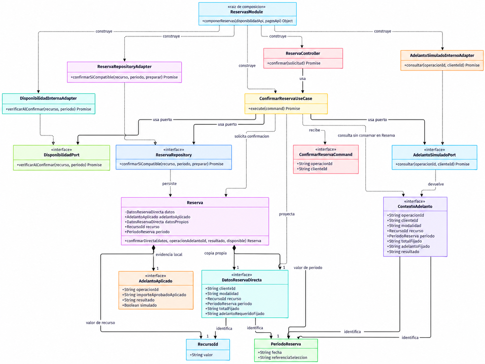
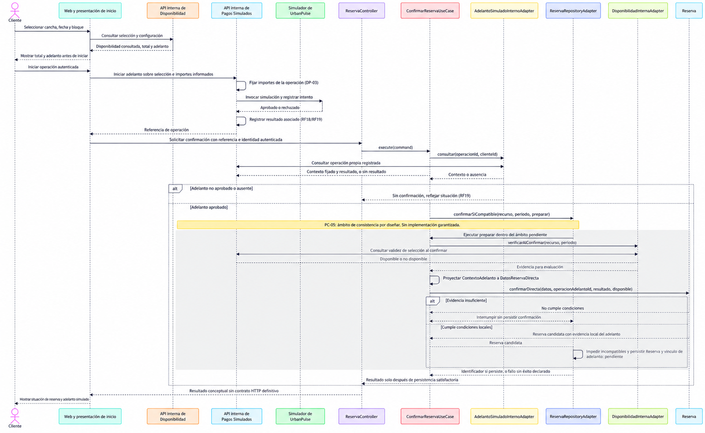

# UrbanPulse — Diseño interno de módulos

**Reconciliación Tarea 2 — 07/11/2026; pendiente de auditoría.** El alcance funcional de pagos reales sustituye la exclusividad simulada histórica conforme a [RC/DF/DP revisados](../../01-analisis-de-sistema/05-restricciones.md) y [ADR-012](../../01-analisis-de-sistema/adr/ADR-012-modelo-pagos-mvp.md). Las decisiones arquitectónicas financieras de ADR-012 siguen propuestas; Mercado Pago Marketplace Split 1:1 es candidato, sin capacidades verificadas ni integración de producción aprobada. Esta revisión no acredita implementación o pruebas. AGENTS.md y la arquitectura general se sincronizan en Tarea 4 con el alcance funcional vigente; la arquitectura financiera de ADR-012 sigue propuesta y los cierres históricos no la aprueban.

**Antecedente:** cierre conceptual del 16/10/2026 para Reservas y reconciliación ADR-010/ADR-011. Se conserva ese alcance histórico; la revisión financiera actual es propuesta de diseño pendiente de auditoría y no hereda aprobación de clases, contratos o mecanismos. Las seis secciones se mantienen; el código ilustrativo del simulador queda sustituido por responsabilidades conceptuales, sin implementar archivos de aplicación.

## 1. Propósito

Reconciliar [RN/PC](../01-reglas-de-negocio.md), [estados](../02-estados-y-transiciones.md) y [F-01–F-04](../03-flujos-de-reserva.md) con HU09/HU14, RF11/RF18/RF19/RF20, DF-03–DF-06, DP-01–DP-12 y ADR-012. Preservar Monolito Modular, cuatro capas oficiales, REST web–backend y persistencia relacional definitiva por repositorios, sin motor seleccionado (ADR-001/ADR-002/ADR-005/ADR-008; RC03/RC04).

| Módulo funcional conservado | Responsabilidad conceptual y colaboración |
|---|---|
| Usuarios | Identidad y roles; cada operación comprueba autorización y titularidad. No amplía administrador a gestión de usuarios. |
| Establecimientos | Oferta y gestión del establecimiento; identificación del propietario y coordinación de ficha pública D1–D6. Colabora para identificar receptor sin custodiar por inferencia todo el modelo financiero. |
| Recursos | Unidades, horarios y configuración de adelanto por recurso; cambios posteriores no alteran operaciones fijadas. |
| Disponibilidad | Consulta y colaboración con confirmación compatible; consultar no retiene. PC-04/PC-05 abiertos. |
| Reservas | Reglas y coordinación de confirmación por modalidad con pago aplicado y disponibilidad, más aceptación interna en eventos. No absorbe proveedor ni conciliación financiera. |
| Solicitudes | Petición, revisión y condiciones de evento; evidencia de cotización y aceptación interna por concretar sin sustituirla por WhatsApp. |
| Servicios | Oferta particular informativa y contribuciones a condiciones del evento cuando se acuerden; no compra independiente ni inclusión automática. |
| Pagos | Evolución del nombre histórico Pagos Simulados: operación electrónica, verificación, aplicación única, recepción posterior y conciliación/devolución cuando corresponda. No es noveno módulo. |

Cancha/karaoke mantienen reserva directa; salón/recreo requieren solicitud, cotización y aceptación del cliente dentro de UrbanPulse. Se reserva el espacio definido del recreo, sin exclusividad de establecimiento o día. Pago total o adelanto configurado verificado y aplicado satisface solo la condición financiera; aprobación no confirma sola (RN-04/RN-11/RN-13/RN-15).

**Niveles:** alcance funcional establecido en Análisis; ADR-001–ADR-009 adoptadas; ADR-010/ADR-011 y D1–D6 conservan cierres conceptuales. Responsabilidades financieras de esta revisión desarrollan propuestas de ADR-012; clases, DTO, ubicación exacta de puertos, cardinalidades, tecnologías y contratos siguen pendientes. El candidato Mercado Pago Marketplace Split 1:1 no acredita elegibilidad en Perú, medios, liquidación, devoluciones o producción.

Se conservan cinco contenedores internos de C2: Aplicación Web, Backend UrbanPulse, Base de datos relacional, Redis y RabbitMQ. El proveedor financiero es sistema externo ya representado en las fuentes C1–C4 revisadas, sin contarlo como sexto contenedor interno. Las seis responsabilidades técnicas de C3 siguen siendo conceptuales; no se amplía su alcance con verificación, webhooks o conciliación.

**Reconciliación Tarea 4:** AGENTS.md, README y los textos de arquitectura general reflejan el objetivo financiero y cuatro capas; catálogo de doce ADR con ADR-012 propuesta. Las seis fuentes C1–C4 fueron revisadas en Tarea 3; sus PNG históricos conservan desfases y no son contratos vigentes. No se selecciona ORM ni se infieren aprobaciones de los cierres anteriores.

## 2. Estructura de carpetas

No se fija un árbol físico nuevo. Cada uno de los ocho módulos conserva separación conceptual de Presentación, Aplicación, Dominio e Infraestructura; composición fuera del núcleo. Las rutas `.ts` anteriores fueron notación ilustrativa, nunca selección de lenguaje o archivos existentes. Su reemplazo conceptual evita presentar el antiguo simulador como contrato del proveedor real. No se crean carpetas, clases, endpoints, tablas o DTO definitivos.

### 2.1 Alcance de la organización propuesta

Cada módulo persiste por repositorios propios y expone una API pública interna acotada. Compartir despliegue/base relacional no autoriza acceder a tablas, entidades o clases privadas ajenas. Las llamadas internas no prescriben HTTP; REST se aplica a la frontera web–backend. La ubicación exacta de contratos y el ensamblado se decidirán con PC-02/PC-05/PC-08/PC-11.

## 3. Capas del módulo y regla de dependencia

| Capa o frontera | Responsabilidad de pagos/reservas | Dependencias |
|---|---|---|
| Presentación | Entrada REST autenticada, recepción técnica de webhook y consulta de estado; traducir formato/identidad, sin decidir aprobación o disponibilidad | API de Aplicación; contrato de webhook pendiente. |
| Aplicación | Coordinar inicio/verificación/aplicación, confirmación, consulta, recepción de saldo y conciliación como casos separados | Dominio y abstracciones internas; no SDK ni adaptadores concretos. |
| Dominio | Condiciones de modalidad, importe aplicable y recepción completa; expresar no duplicidad y compatibilidad global como obligaciones | Núcleo propio; sin Infraestructura, SDK, credenciales, Redis o RabbitMQ. |
| Infraestructura | Adaptador del proveedor, autenticidad y consulta técnica, repositorios relacionales y adaptación de API internas | Contratos hacia el núcleo y fronteras públicas de colaboradores; sin tablas privadas ajenas. |
| Raíz de composición | Suministrar implementaciones a contratos y ensamblar entradas/casos de uso | Puede conocer capas para construir; no contiene reglas ni es quinta capa. |

Dependencias de código: Presentación → Aplicación → Dominio; Infraestructura → contratos del núcleo. El despacho en ejecución por un puerto al adaptador no invierte esta dirección. Ubicación en Dominio o Aplicación de cada abstracción se evalúa según su cliente; no se impone que todo puerto financiero pertenezca a Dominio.

### 3.1 Responsabilidades técnicas de caché e invalidación

La tabla desarrolla las seis responsabilidades identificadas en [C3, componentes técnicos internos](../../04-modelo-c4/03-componentes-c3.md#componentes-técnicos-internos-propuestos). Sus nombres no aprueban clases, interfaces ni una correspondencia de un archivo por caja. Las ubicaciones exactas de las abstracciones y de la coordinación siguen pendientes; no se trasladan automáticamente todos los nuevos puertos al Dominio por seguir el ejemplo de Reservas.

| Responsabilidad conceptual | Capa o frontera | Función y límite |
|---|---|---|
| Puerto de acceso a caché pública | Abstracción interna hacia el núcleo apropiado; consumida por Aplicación, ubicación exacta pendiente. | Solicitar lectura y carga de copias públicas reconstruibles sin conocer el cliente Redis. Contrato y proyección pendientes. |
| Adaptador Redis | Infraestructura; depende de las abstracciones internas pertinentes. | Traducir lectura, carga e invalidación al detalle Redis. No decide condiciones de reserva ni convierte una copia en autoridad de visibilidad. |
| Puerto de publicación de invalidaciones | Abstracción interna consumida por Aplicación; ubicación exacta pendiente. | Comunicar intenciones técnicas de casos de uso existentes que modifiquen campos públicos. No incorpora API del broker al núcleo. |
| Adaptador de publicación RabbitMQ | Infraestructura. | Traducir la publicación al broker. No garantiza atomicidad con el commit relacional; estrategia y recuperación pendientes. |
| Consumidor técnico RabbitMQ | Entrada técnica dentro del Backend UrbanPulse. | Recibir y validar mensajes y solicitar invalidación por la frontera autorizada. La recepción del transporte corresponde a adaptación de Infraestructura y la coordinación debe respetar Aplicación; su reparto concreto sigue pendiente. No es módulo funcional, otra aplicación ni quinta capa. |
| Frontera autorizada de invalidación | Frontera técnica interna mediante abstracción; titular y ubicación pendientes. | Delimitar fichas afectadas y solicitar el efecto al adaptador Redis según la política futura. No concede acceso privado entre módulos ni resuelve por sí sola la retirada segura de publicación. |

Presentación conserva las entradas REST; Aplicación coordina consultas y operaciones; Dominio mantiene reglas independientes; Infraestructura implementa persistencia y adaptación técnica. El núcleo no depende de clientes Redis/RabbitMQ. En **dependencias de código**, los adaptadores conocen los contratos internos; durante la **ejecución**, las llamadas por esos contratos se despachan a los adaptadores. Las comunicaciones del C3 no invierten esa dependencia. Las seis fuentes Mermaid de C1–C4 muestran por separado Reservas, fichas públicas y transporte de invalidaciones; ninguna sustituye los contratos pendientes.

### 3.2 Separación de responsabilidades y dependencia de abstracciones

**SRP:** la coordinación de consulta pública, la política de visibilidad, la traducción del transporte y la ejecución de invalidación tienen razones de cambio distintas y deben mantenerse separadas conceptualmente. La admisibilidad pública no se deduce de que Redis entregue una copia ni de que el broker acepte un mensaje. El consumidor valida y coordina su responsabilidad técnica; no absorbe reglas de Reservas o Pagos.

**DIP:** los casos de uso solicitan caché y publicación mediante abstracciones internas; los detalles técnicos las implementan y se suministran desde el ensamblado externo al núcleo. La política y sus contratos deben poder revisarse sin introducir clientes técnicos en Dominio o Aplicación. Esta orientación no selecciona biblioteca de inyección, mecanismos de visibilidad ni patrones adicionales: Strategy, Factory, State, Observer y Transactional Outbox no se adoptan obligatoriamente.

## 4. Diagrama de clases

El diagrama anterior describe exclusivamente adelanto simulado directo y no representa el nuevo modelo financiero. Se conserva como antecedente sin editar PNG; no se reutilizan sus nombres o multiplicidades como contratos vigentes. La fuente [C4-01 revisada](../../04-modelo-c4/04-codigo-c4.md) ya distingue evidencia de pago real y confirmación; sus participantes siguen candidatos.

### Notación UML y criterios del ejemplo conservados

La auditoría restaura selectivamente contenido técnico del ejemplo anterior; no recupera contratos del simulador ni aprueba clases o firmas nuevas.

| Notación | Significado y límite |
|---|---|
| `-->` | Asociación dirigida: conoce/utiliza una referencia; en las vistas de transporte se identifica expresamente el flujo de ejecución. |
| `..>` | Dependencia de uso o construcción, sin propiedad permanente. |
| `..\|>` | Realización de interfaz; el triángulo apunta al contrato interno. |
| `*--` | Composición de valores; no determina cardinalidades persistidas de pagos o solicitudes. |
| `+` / `-`; `$` | Visibilidad pública/privada y operación estática en notación Mermaid UML. No fijan firmas vigentes. |
| Multiplicidades; `<<interface>>` | Las multiplicidades del ejemplo anterior eran propuestas en memoria; un estereotipo de interfaz no convierte un DTO en puerto obligatorio. PC-02 sigue abierto. |

El ejemplo distinguía identificación del recurso y periodo como valores propios y estables, y validaba referencias no vacías. Se preserva ese criterio conceptual sin adoptar clases, formato de fechas, duración uniforme, representación monetaria o cardinalidades. Reservas conserva su selección y evidencia mínima aplicada; no retiene entidades privadas del módulo Pagos ni recalcula importes con configuración posterior. Ausencia de importe no se convierte en cero (RN-17; PC-06).

Presentación obtiene identidad del contexto autenticado y valida forma/referencia de entrada; no acepta identidad o aprobación financiera del cuerpo como autoridad. El recorrido directo corresponde al cliente; el iniciador de eventos sigue PC-03. Aplicación contrasta operación, cliente, recurso/periodo, receptor e importes por fronteras autorizadas. Solo se comunica confirmación tras efecto definitivo consistente; la candidata en memoria, un callback o una firma de repositorio no prueban persistencia ni PC-05/PC-08. Un fallo conserva la aprobación financiera existente y su incidencia según el protocolo recuperable pendiente.

La raíz de composición suministra implementaciones sin reglas de negocio; la frontera pública no expone automáticamente adaptadores o entidades privadas. Estos criterios del ejemplo siguen siendo ilustrativos, con realización concreta pendiente.

### 4.1 Responsabilidades financieras propuestas

Son responsabilidades, no clases, tablas ni una interfaz obligatoria por fila. Las API públicas internas concretas permanecen pendientes.

| Responsabilidad propuesta | Titular/frontera conceptual | Evidencia y límite |
|---|---|---|
| Operación de pago | Aplicación de Pagos, persistencia mediante repositorio propio | Identidad interna, intención/reintento, cliente, recurso/periodo, reserva/solicitud o intento correlacionado, total/adelanto/opción/importe/moneda/receptor fijados; referencias externas. Creación/cardinalidades PC-02. |
| Propietario receptor | Pagos colabora con Establecimientos y Usuarios mediante API públicas | Contrastar titular del establecimiento y vinculación financiera válida antes de iniciar; renovación/revocación, custodia y onboarding pendientes PC-11/PC-12. Sin recaudación/redistribución manual de UrbanPulse. |
| Integración con proveedor | Puerto hacia núcleo; adaptador en Infraestructura de Pagos | Inicio, consulta y devolución cuando corresponda, sin SDK ni estados específicos del candidato en Dominio. Capacidades y contrato PC-08. |
| Recepción/verificación de webhook | Entrada técnica, adaptación y coordinación de Aplicación de Pagos | Autenticidad/correlación; señal para consulta servidor a servidor y contraste de estado, importe, moneda y receptor. Navegador no es autoridad; HTTP de recepción no acredita aplicación o confirmación. |
| Aplicación única del importe | Pagos coordina con Reservas mediante contratos públicos | Evidencia de pago verificado y aplicación persistida como máximo una vez por pago, aun entre eventos/canales distintos. Distinguir candidato de efecto definitivo; PC-05/PC-08. |
| Confirmación consistente | Reservas con Disponibilidad, evidencia de pago y aceptación en eventos | RN-13 y todas las guardas; persistencia propia y coordinación relacional/protocolo recuperable por diseñar. Aprobación aislada o callback no basta. |
| Correlación y evidencia local | Reservas conserva datos propios y evidencia mínima; Pagos conserva operación y antecedentes | No copiar todo el modelo del proveedor a Reserva ni conservar solo referencia sin importes auditables. Mismo pago no se aplica a dos reservas por reintento; asociaciones concretas PC-02/PC-08. |
| Recepción posterior del saldo | Caso separado de confirmación e integración electrónica; coordinación propuesta en Pagos | Propietario autorizado, confirmada propia, saldo completo positivo, método/importe/fecha/referencia aplicable/autor/registro; una activa e historial. Propiedad persistida concreta PC-02. No es aprobación electrónica. |
| Conciliación | Coordinación propuesta en Pagos, accesos y responsables por definir | Incidencia de aprobado sin confirmar, cobros distintos duplicados, resultado incierto, discrepancias y caída tras cobro. Conservar evidencia y resolución; no borrar aprobación ni confirmar a la fuerza. |
| Devolución cuando corresponda | Operación financiera de Pagos mediante puerto; autorización/política pendientes | Identidad, importe, vínculo con cobro, solicitud y resultado verificado separados; evitar duplicados y mantener incertidumbre. No cancela Reserva, no garantiza fondos/plazos ni soporte del candidato. |

### 4.2 Establecimientos: consulta pública cacheada

Conforme a ADR-010 y C3, Establecimientos coordina conceptualmente la consulta de fichas públicas mediante abstracciones y conserva la gestión autorizada de su información. HU02/RF02 aporta contexto de consulta; HU06/RF08 y HU11/RF15 aportan contexto de modificaciones autorizadas, sin ampliar las funciones del administrador. No se crea un caso de uso con nombre o firma definitivos ni un ejemplo ejecutable.

| Situación | Responsabilidad conceptual | Condición o pendiente |
|---|---|---|
| Cache hit | Solicitar la copia mediante la abstracción de acceso a caché y comprobar su admisibilidad antes de responder, según la política futura. | Existencia de copia no acredita vigencia ni autorización. Mecanismo y tolerancias por campo pendientes; no se admite divulgar contenido retirado. |
| Cache miss | Obtener datos definitivos mediante repositorios y fronteras públicas autorizadas, construir la proyección pública y solicitar su almacenamiento en Redis. | Composición, titular y contratos pendientes; no leer tablas privadas ajenas ni incorporar campos protegidos. |
| Fallo de Redis | Recurrir a persistencia sin interpretar el fallo técnico como inexistencia de datos. Si falla guardar una copia después de obtener un resultado autorizado, ese resultado no se vuelve inexistente. | La base puede fallar o saturarse; no se promete continuidad absoluta. Límites de espera y recuperación pendientes. |
| Cambio confirmado | El caso de uso autorizado produce o conserva intención de invalidación cuando el cambio afecta campos incluidos en la ficha; publicación y consumo se delimitan en la sección 5.2. | No anunciar cambios revertidos como definitivos. La confirmación relacional no acredita publicación ni invalidación completada. |
| Retirada de publicación | Impedir divulgar información que dejó de estar autorizada como pública, incluida una copia anterior. | Obligación del cierre ADR-010. Invalidación asíncrona y TTL genérico no bastan por sí solos; política y mecanismo pendientes de diseño y validación. |

Las fichas contienen exclusivamente información pública autorizada. Se excluyen disponibilidad inicial, reservas, cotizaciones particulares, aceptación contractual, adelantos, saldo e historial, credenciales y otros datos protegidos; los permisos cacheados no constituyen autoridad. Los precios informativos no sustituyen importes autorizados y fijados al iniciar la operación de pago (DP-03), ni condiciones aceptadas. Las búsquedas públicas siguen como ampliación futura condicionada, fuera de esta caché inicial.

La consulta cacheada no necesita pasar por RabbitMQ. Permanecen abiertos obsolescencia, repoblación de una lectura antigua después de invalidar, cambios concurrentes, eventos fuera de orden y reconstrucciones simultáneas. Borrar una copia no demuestra que no vuelva a cargarse información anterior. Versionado o generaciones son alternativas por evaluar, sin algoritmo, claves o TTL adoptados ni consistencia fuerte acreditada.

### 4.3 Recursos y Servicios: productores condicionados

**Recursos** solo es productor candidato cuando una modificación propia afecta información incluida en la ficha pública (contexto HU07/RF09, DF-01/DF-04 y DP-03). **Servicios** solo lo es cuando cambia oferta informativa incluida en esa ficha (contexto HU02/RF02 y HU06/RF08); publicar un servicio no lo incluye automáticamente en una cotización. Ninguno debe emitir eventos por cada operación sin identificar primero el campo público afectado.

La proyección pública, su titular, la cobertura de cambios y los contratos cruzados siguen pendientes. No se deducen llamadas recíprocas ni ciclos Establecimientos–Recursos–Servicios, ni acceso a tablas privadas por compartir persistencia. Los demás módulos no adquieren productores por inferencia. Estas relaciones aportan contexto funcional, sin inventar origen RF02/RF09/RF10 en drivers; ADR-010 es complementaria a DA04 y ADR-011 no constituye una integración de negocio exigida históricamente por DA06.

## 5. Flujo de ejecución: confirmar reserva

Propuesta de coordinación común a F-01–F-04; las guardas funcionales sí están establecidas. No es un algoritmo de transacción implementado:

1. Presentación entrega identidad autenticada; Aplicación autoriza operación y titularidad. Selección y condiciones proceden de fuentes autorizadas; eventos añaden evidencia de aceptación interna, con iniciador PC-03 pendiente.
2. Pagos fija total, adelanto, opción, importe, moneda y receptor, correlaciona intención e inicia por puerto/adaptador. No acepta aprobación del cliente ni valores definitivos de Redis.
3. Consulta o webhook auténtico lleva a verificar el proveedor en backend. Resultado pendiente/incierto conserva evidencia; no confirma ni justifica repetir automáticamente el cobro.
4. Con aprobación verificada se coordina aplicación única y evaluación de confirmación por API públicas de Pagos, Reservas y Disponibilidad. Validar todas las condiciones y preservar asociación del importe aplicado a la misma reserva. No admitir incompatibles concurrentes ni doble aplicación.
5. Registrar confirmación consistente solo con todas las condiciones. Si falla o falta alguna, conservar aprobado sin confirmar y aplicación existente o ausencia; registrar incidencia, sin fabricar rechazo ni devolución. Definir unidad transaccional/protocolo de recuperación entre aplicación y confirmación en PC-05/PC-08, sin asumir transacción distribuida con proveedor.
6. Consulta autorizada distingue operación, aplicación, Reserva, pendiente y recepción posterior. Recepción completa positiva/corrección es otro caso de uso; cero no produce recepción.

La secuencia y el callback del ejemplo histórico no prueban concurrencia. Retención temporal es mecanismo por diseñar y evaluar, sin adopción ni política de expiración. Recuperación tras caída antes/después de persistencia, deduplicación entre consulta/webhook/reintento y tratamiento de eventos fuera de orden siguen pendientes.

### 5.1 Aislamiento de Reservas y Pagos

Pendiente = total acordado − pago verificado y aplicado. Aprobado sin aplicación no se descuenta. Recepción posterior se representa aparte para no descontar dos veces ni volver a cobrar lo ya recibido; no altera Reserva o resultado electrónico. Efectivo/Yape/Plin/transferencia son métodos declarados de esa recepción, sin afirmar soporte integrado.

Redis excluye reservas, disponibilidad, pagos, evidencia contractual/financiera y saldo. RabbitMQ solo invalida fichas públicas: no transporta pagos, webhooks, devoluciones o conciliación. Ampliarlo exige una nueva decisión arquitectónica. RN-13 permanece obligatoria y PC-05 abierto; ACK, TTL o reintentar invalidaciones no resuelven idempotencia financiera.

### 5.2 Invalidación asíncrona de fichas públicas

Este recorrido conceptual es independiente de la confirmación de reservas de la sección 5. No impone nombres de eventos, métodos, contratos REST ni configuraciones:

1. Un caso de uso existente verifica autorización y reglas y confirma en persistencia relacional un cambio que afecta campos públicos. En Establecimientos incluye gestión del propietario o administración dentro de HU11/RF15; Recursos/Servicios conservan la condición de la sección 4.3.
2. La intención técnica correspondiente al cambio confirmado se comunica mediante el puerto de publicación y el adaptador RabbitMQ al broker, según la estrategia pendiente. Confirmar el cambio, conservar la intención y publicar son hechos distintos.
3. El broker entrega el mensaje al consumidor técnico dentro del backend. Este valida forma, versión y alcance y solicita el efecto mediante la frontera autorizada de invalidación, sin acceder a datos privados de otros módulos.
4. La frontera delimita las fichas y solicita al adaptador Redis, mediante abstracción interna, la invalidación requerida. El ACK debe ocurrir después de completar ese efecto. Una consulta posterior podrá reconstruir desde persistencia según la política pública; la invalidación no demuestra por sí sola frescura ni confidencialidad.

**Commit y publicación:** RabbitMQ no garantiza atomicidad con la base relacional. En publicación directa posterior al commit, una caída puede perder la intención antes de conservarla o enviarla; un resultado de red incierto también puede motivar duplicados. **Transactional Outbox permanece como alternativa no adoptada.** Si una decisión futura lo selecciona, cambio e intención deberán conservarse en la misma transacción: no basta crear la intención después del commit, aunque el recorrido anterior la explique tras el cambio confirmado. Propiedad, ámbito transaccional, despacho y recuperación permanecen abiertos, sin añadir tablas ni tareas.

**Entrega y consumo:** pueden existir duplicados y mensajes fuera de orden. La idempotencia es requisito de diseño, con mecanismo pendiente; repetir una eliminación no resuelve carreras de repoblación. Entrega al menos una vez es un objetivo condicionado a conservación, publicación y recuperación concretas, no una garantía acreditada ni entrega exactamente una vez. Los publisher confirms reconocen una etapa distinta del ACK y no prueban consumo o invalidación.

**Fallos y recuperación:** Redis inaccesible requiere fallback para consultas, pero una invalidación fallida no se considera completada ni justifica ACK de éxito. Broker o consumidor caídos pueden prolongar la obsolescencia; no se garantiza recuperar intenciones nunca conservadas. Reconexión, copias reutilizables al volver a servicio, mensajes inválidos, reintentos limitados, agotamiento, eventual DLQ/reproceso y supervisión requieren diseño. TTL no sustituye conservación de intención, entrega fiable, recuperación ni protección de contenido retirado. No se seleccionan colas, exchanges, enrutamiento, durabilidad, tiempos o políticas operativas.

## 6. Código de referencia

Los bloques académicos de confirmación con simulador se sustituyen en esta revisión por la especificación conceptual anterior. No se implementa código funcional ni se aprueban nombres, firmas, DTO, endpoints, esquema relacional, SDK o lenguaje. El antecedente se conserva en Git y en los PNG históricos; C4-01 ya tiene fuente Mermaid revisada para pagos reales. Esta sustitución evita aparentar que basta renombrar un simulador o cambiar `simulado: true` para integrar pagos reales.

### 6.1 Dominio: criterios de diseño pendientes

Expresar condiciones locales y evidencia mínima auditable sin tipos del proveedor. La obligación global RN-13 y aplicación única requieren mecanismo validado fuera de una entidad en memoria. Total/adelanto elegido e importe aplicado no se confunden ni se recalculan con configuración posterior.

### 6.2 Aplicación: criterios de coordinación pendientes

Separar inicio, verificación, aplicación/confirmación, consulta, registro/corrección de saldo y conciliación/devolución. Sincronización y recuperación ante fallos no se resuelven por la lista de casos de uso; coordinar por contratos públicos y permisos. RF19 debe reflejar falta de confirmación aunque el pago esté aprobado.

### 6.3 Infraestructura: criterios de adaptación pendientes

Traducir el contrato del proveedor mediante Adapter y persistir por Repository. Definir autenticidad, consulta autoritativa, identidades de pago/evento/reintento, deduplicación persistente entre canales, incertidumbre y desorden. No convertir timeout en resultado definitivo ni aplicar dos veces eventos diferentes del mismo pago. No atribuir idempotencia, medios o devolución al candidato antes de verificar capacidades.

### 6.4 Presentación: criterios de entrada pendientes

Identidad y rol proceden del mecanismo autenticado, no de un campo confiado al cliente. Recepción de webhook no otorga autorización de negocio ni prueba financiera por sí sola; autenticidad y contraste se coordinan según PC-08/PC-11. REST y formatos/errores pendientes sin rutas nuevas aprobadas.

### 6.5 Raíz de composición y consumidor técnico

Inyectar implementaciones en abstracciones fuera del núcleo, sin biblioteca seleccionada. Consumidor RabbitMQ dentro del backend en el MVP. Worker independiente: **Preparado arquitectónicamente, no obligatorio inicialmente**. Separar recepción del transporte, coordinación y frontera autorizada de invalidación para permitir extracción posterior a otro proceso sin modificar Dominio. Su implementación será posterior; no añade microservicio, noveno módulo ni contenedor obligatorio inicial. No reutilizarlo automáticamente para finanzas.

### 6.6 Reconciliación de esta revisión y pendientes

Los cierres previos se conservan en sus alcances, sin aprobar esta revisión financiera. [Patrones](patrones-de-diseño.md) y [SOLID](principios-de-diseño.md) preservan Repository, Adapter e inyección y principios mediante responsabilidades conceptuales. Los [PC-01–PC-12](../01-reglas-de-negocio.md#restricciones-del-mvp-y-pendientes-contractuales) siguen abiertos: asociaciones relacionales; confirmación concurrente; precisión/moneda; aprobado sin confirmar; proveedor, webhooks, idempotencia y recuperación; permisos, onboarding y cobertura; RF13 y política diferenciada de devolución. No se adoptan retención, Outbox, inbox, scheduler o colas financieras.

D1–D6 conserva sus acuerdos conceptuales: protección de visibilidad y revisiones, impedir seleccionar/emitir como vigente reconstrucción invalidada, sin prohibición absoluta adicional de toda escritura física tardía. Sincronización D3/D4, revisión/repoblación, claves/TTL, seguridad y configuración siguen pendientes. Publicación directa/Outbox, conservación de intención, confirms/ACK, duplicados, reintentos limitados, DLQ y recuperación de invalidaciones tampoco se resuelven aquí.

Trazabilidad: RF04/RF06/RF12 → AC03/DA02/ADR-004; HU09 → RF11/RF18/RF19 con RF18 origen DA06/ADR-006 y RF11/RF19 origen DA08/ADR-008; ADR-012 aporta propuestas, no aprobación. HU10/HU14 → RF14 y HU14 → RF20 tienen DA05/DA08. HU03/RF04 y HU04/RF06 son contextuales; RF02/RF09/RF10 sin origen explícito en drivers; AC02/AC07 sin respuesta/driver explícitos; DF-02 y RF13 pendientes. EQ-03/EQ-04/EQ-08 son evaluación propuesta, sin evidencia ejecutada.
