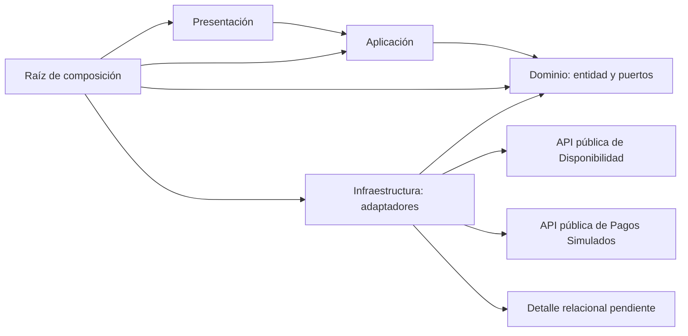
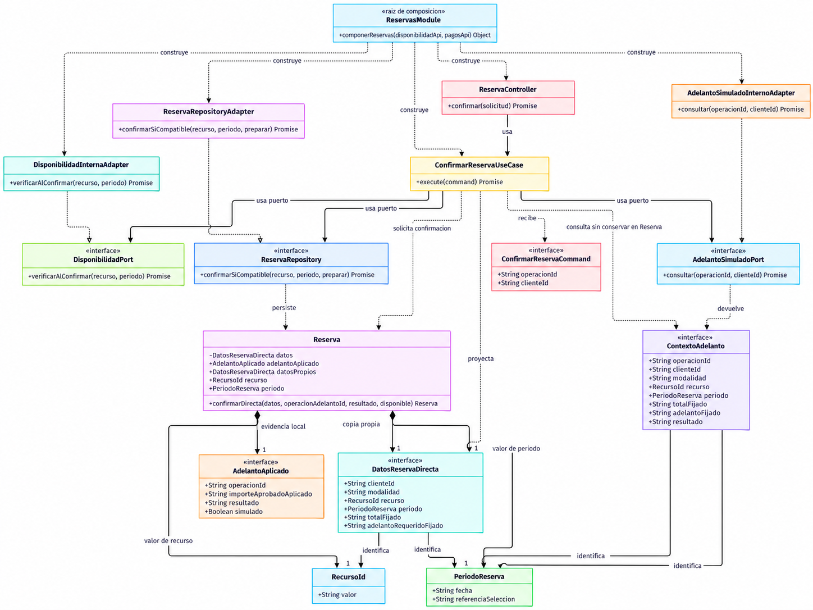
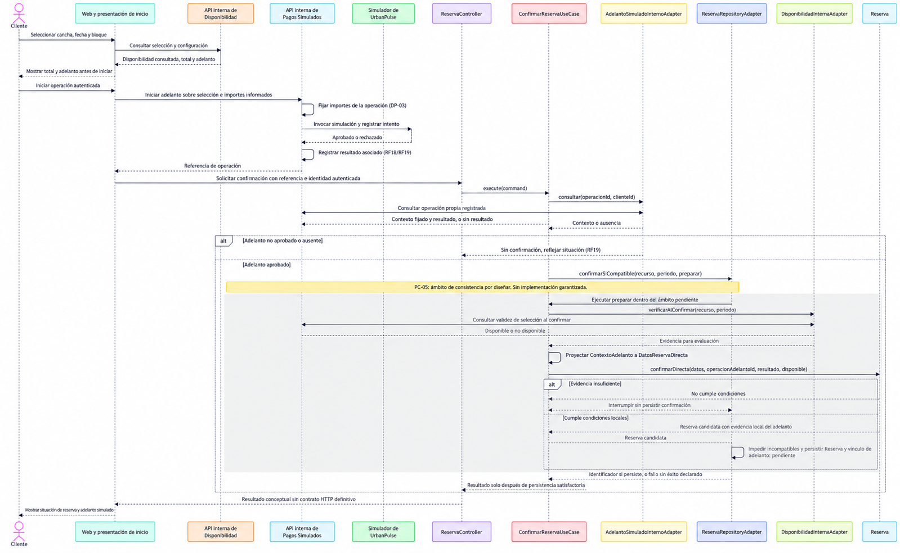

# UrbanPulse — Diseño interno de módulos

**Estado: aprobado conceptualmente y cerrado documentalmente — reconciliado con ADR-010, ADR-011 y C3. Clases, contratos, mecanismos e implementación pendientes.** Fecha: 16/10/2026. No acredita implementación, despliegue ni pruebas; no aprueba clases, firmas, DTO, contratos operativos ni mecanismos pendientes.

## 1. Propósito

Precisar responsabilidades, contratos y dependencias dentro del módulo **Reservas**, manteniendo la trazabilidad del análisis hacia las clases y los casos de uso. Reservas es el módulo de referencia porque coordina la confirmación y necesita colaborar con **Disponibilidad** y **Pagos Simulados**. Este último nombre describe la responsabilidad del módulo Pagos de ADR-001 durante el MVP; no crea un módulo financiero adicional.

UrbanPulse utiliza **Monolito Modular**, con una única aplicación desplegable, y **Clean Architecture** con Presentación, Aplicación, Dominio e Infraestructura (ADR-001/ADR-002). La web se comunica con el backend mediante **API REST** (RC03/ADR-005). La persistencia utiliza una **base de datos relacional**, sin motor concreto aprobado (RC04), y repositorios (ADR-008). El documento de estilo menciona ORM como orientación de infraestructura, sin seleccionar un producto.

Cancha y karaoke utilizan **reserva directa**, con recurso, fecha y bloque o intervalo, adelanto simulado obligatorio y disponibilidad válida al confirmar (DF-04). Salón y recreo utilizan **solicitud de evento**, cotización del propietario y aceptación del cliente dentro de UrbanPulse; la confirmación requiere conjuntamente aceptación, adelanto simulado aprobado y disponibilidad válida (DF-02/DF-03). En recreos se reserva el ambiente o espacio definido por el propietario, sin presumir exclusividad de todo el establecimiento o del día (DF-01). La aprobación del simulador nunca confirma por sí sola.

La revisión anterior consultó los ocho documentos de [análisis](../../01-analisis-de-sistema/01-actores.md), los tres de arquitectura y los documentos previos de [reglas](../01-reglas-de-negocio.md), [estados](../02-estados-y-transiciones.md) y [flujos](../03-flujos-de-reserva.md). Estos últimos conservan el catálogo normativo; aquí se desarrolla su traducción a diseño, sin reproducir sus máquinas o recorridos completos. Esta reconciliación contrasta además las dos ADR independientes, C2/C3, [patrones](patrones-de-diseño.md), [principios](principios-de-diseño.md) y las [restricciones DF/DP](../../01-analisis-de-sistema/05-restricciones.md). Se conservan las seis secciones principales y el diseño ilustrativo de Reservas. El desarrollo y mantenimiento de este documento se rigen por las instrucciones vigentes de [`AGENTS.md`](../../../AGENTS.md), ubicado en la raíz del repositorio UrbanPulse.

| Nivel | Base y aplicación en este documento |
|---|---|
| Aprobado | ADR-001–ADR-009 adoptadas; ADR-010/ADR-011 y representación C2/C3 aprobadas conceptualmente y cerradas documentalmente en sus alcances expresos, sin implementación acreditada; RC01/RC03/RC04/RC06/RC07/RC10; DF-01–DF-06 y DP-01–DP-12; RN según sus niveles individuales. |
| Derivado | Coordinar condiciones mediante contratos internos; no aceptar importes o resultados de pago declarados por el navegador; preservar fronteras modulares al reconstruir fichas y separar datos definitivos de copias técnicas. No constituyen funciones adicionales. |
| Propuesto | Carpetas, archivos, clases, objetos de valor, firmas, DTO, composición y distribución concreta de contratos; realización concreta de las seis responsabilidades técnicas del C3, sin imponer un tipo por responsabilidad. TypeScript es exclusivamente **notación ilustrativa: ejemplo académico no aprobado como lenguaje del proyecto**. |
| Pendiente | PC-01–PC-12, especialmente concurrencia PC-05, modelo persistido PC-02, contratos del simulador PC-08 y precisión monetaria PC-06; proyección pública, titular, puertos, visibilidad, caché, publicación y recuperación concretas de ADR-010/011. RF13 continúa pendiente de validación. |

**Discrepancias conservadas:** [arquitectura inicial](../../02-arquitectura-software/01-arquitectura-inicial.md) describe tres capas generales, mientras [estilo](../../02-arquitectura-software/02-estilo-arquitectonico.md), [enfoque](../../02-arquitectura-software/03-enfoque-arquitectonico.md) y [ADR-002](../../01-analisis-de-sistema/07-decisiones-arquitectonicas.md) establecen cuatro capas oficiales. Además, la sección 3 de ADR afirma que los textos de arquitectura ya explicitan cuatro, lo que no coincide con el texto inicial actual. Se aplica ADR-002 sin corregir silenciosamente las fuentes. Las observaciones históricas sobre tecnologías y cancelación en imágenes no son decisiones aprobadas ni una nueva inspección visual. La referencia Marketplace/Guía 004 no fue aportada ni localizada en el proyecto; la organización sigue las seis secciones solicitadas, sin afirmar una comparación directa con aquel archivo.

Esta revisión amplía la cobertura conceptual a la consulta pública de **Establecimientos** y a las responsabilidades técnicas de caché e invalidación, conservando íntegros los ejemplos y el recorrido de Reservas. Se apoya también en la auditoría de impacto entregada en esta conversación, sin atribuirle un informe guardado en el repositorio. La ampliación documenta responsabilidades, colaboraciones y límites; no diseña contratos ejecutables nuevos.

El [catálogo vigente ADR-001–ADR-011](../../01-analisis-de-sistema/07-decisiones-arquitectonicas.md) conserva las nueve decisiones adoptadas y agrega [ADR-010 — Redis](../../01-analisis-de-sistema/adr/ADR-010-cache-redis.md#registro-de-cierre-conceptual) y [ADR-011 — RabbitMQ](../../01-analisis-de-sistema/adr/ADR-011-mensajeria-rabbitmq.md#registro-de-cierre-conceptual), aprobadas conceptualmente y cerradas documentalmente con mecanismos operativos pendientes. Redis/cache-aside se limita a fichas públicas reconstruibles; RabbitMQ transporta invalidaciones técnicas asíncronas y su consumidor permanece dentro del backend. La persistencia relacional es la fuente definitiva. ADR-010 complementa ADR-009 sin cachear inicialmente disponibilidad ni extender la caché a búsquedas públicas.

El [C2 revisado](../../04-modelo-c4/02-contenedores-c2.md) está cerrado documentalmente con **cinco contenedores**: Aplicación Web UrbanPulse, Backend UrbanPulse, Base de datos relacional, Redis y RabbitMQ. El [C3 revisado](../../04-modelo-c4/03-componentes-c3.md) también está cerrado conceptualmente y conserva **ocho módulos funcionales**: Usuarios, Establecimientos, Recursos, Disponibilidad, Reservas, Solicitudes, Servicios y Pagos Simulados. Sus **seis responsabilidades técnicas propuestas**, descritas en la sección 3.1, no son módulos funcionales adicionales. Estos cierres no acreditan implementación ni aprueban la composición concreta de esta revisión del Diseño Interno.

**Reconciliación y alcance histórico:** AGENTS.md, restricciones y los otros documentos de Diseño Interno conservan referencias a la base de nueve ADR; el catálogo vigente incorpora once. El catálogo y las ADR independientes aún describen C2 con tres contenedores y C3 anterior; C2 también presenta la actualización de C3 como futura. Se aplican los registros explícitos de cierre de ADR-010/011 y las revisiones cerradas de C2/C3, sin corregir esas fuentes ni deducir aprobación por fecha o estado de Git. La aprobación conceptual declarada en Patrones mantiene su alcance histórico: no aprueba clases o firmas de Reservas ni se extiende automáticamente a los componentes técnicos nuevos. Tras la auditoría favorable sin hallazgos arquitectónicos bloqueantes comunicada en la solicitud de cierre, esta revisión queda aprobada conceptualmente y cerrada documentalmente en el alcance delimitado en la sección 6.6; las clases, los contratos y los mecanismos continúan pendientes.

## 2. Estructura de carpetas

Árbol **propuesto**, expresado con extensión `.ts` solo para relacionar la notación académica de la sección 6. No se crean estos archivos en `src/`. Los nombres de tablas, rutas HTTP, frameworks, ORM y motor permanecen sin definir.

```text
src/
└── modules/
    └── reservas/
        ├── dominio/
        │   ├── reserva.ts
        │   ├── recurso-id.ts
        │   ├── periodo-reserva.ts
        │   ├── datos-reserva-directa.ts
        │   ├── adelanto-aplicado.ts
        │   ├── contexto-adelanto.ts
        │   └── puertos/
        │       ├── reserva.repository.ts
        │       ├── disponibilidad.port.ts
        │       └── adelanto-simulado.port.ts
        ├── aplicacion/
        │   ├── confirmar-reserva.command.ts
        │   └── confirmar-reserva.use-case.ts
        ├── infraestructura/
        │   ├── reserva-repository.adapter.ts
        │   ├── disponibilidad-interna.adapter.ts
        │   └── adelanto-simulado-interno.adapter.ts
        ├── presentacion/
        │   └── reserva.controller.ts
        ├── reservas.module.ts
        └── index.ts
```

| Archivo | Capa | Responsabilidad | Depende de |
|---|---|---|---|
| `recurso-id.ts` | Dominio | Identificación inmutable de cancha o sala; no carga datos de Recursos. | Tipos básicos. |
| `periodo-reserva.ts` | Dominio | Fecha y referencia del bloque/intervalo configurado; sin imponer duración uniforme. | Tipos básicos. |
| `contexto-adelanto.ts` | Dominio | Contrato conceptual de operación: titular, modalidad, selección e importes fijados y resultado registrado. | `RecursoId`, `PeriodoReserva`. |
| `datos-reserva-directa.ts` | Dominio | Datos propios de confirmación: titular, modalidad, recurso, periodo, total y adelanto requerido fijados. | `RecursoId`, `PeriodoReserva`. |
| `adelanto-aplicado.ts` | Dominio | Evidencia mínima local: referencia de operación, importe aprobado y aplicado, aprobación y carácter simulado. | Tipos básicos; no depende del contexto de Pagos. |
| `reserva.ts` | Dominio | Expresar condiciones locales y conservar datos propios y evidencia del adelanto aplicado. | `DatosReservaDirecta`, `AdelantoAplicado`, objetos de valor; no depende de `ContextoAdelanto`. |
| `reserva.repository.ts` | Dominio | Puerto de persistencia de confirmación con obligación de no admitir incompatibles. | `Reserva`, `RecursoId`, `PeriodoReserva`. |
| `disponibilidad.port.ts` | Dominio | Consultar validez de selección al confirmar, sin retener recursos. | `RecursoId`, `PeriodoReserva`. |
| `adelanto-simulado.port.ts` | Dominio | Consultar contexto y resultado registrado de la operación simulada propia. | `ContextoAdelanto`. |
| `confirmar-reserva.command.ts` | Aplicación | Transportar referencia de operación y cliente autenticado. | Tipos básicos. |
| `confirmar-reserva.use-case.ts` | Aplicación | Coordinar consulta de adelanto, disponibilidad, dominio y persistencia. | Comando, entidad y tres puertos. |
| `reserva-repository.adapter.ts` | Infraestructura | Punto de implementación de persistencia y garantía PC-05; ejemplo deliberadamente incompleto. | Puerto, entidad y futuros detalles relacionales. |
| `disponibilidad-interna.adapter.ts` | Infraestructura | Traducir el puerto a la API pública interna de Disponibilidad. | Puerto y contrato público de Disponibilidad. |
| `adelanto-simulado-interno.adapter.ts` | Infraestructura | Traducir consulta al módulo Pagos Simulados. | Puerto y contrato público de Pagos. |
| `reserva.controller.ts` | Presentación | Validar forma de entrada, traducir identidad y llamar al caso de uso. | Comando y caso de uso. |
| `reservas.module.ts` | Raíz de composición | Construir adaptadores e inyectarlos en caso de uso y controlador. | Capas y contratos públicos de módulos colaboradores. |
| `index.ts` | Frontera pública | Exponer únicamente la fachada necesaria del módulo. | Tipos públicos de Presentación/Aplicación. |

Las API públicas de Disponibilidad y Pagos pertenecen a sus respectivos módulos; sus firmas locales de ejemplo aparecen en los adaptadores, sin diseñar aquí su estructura de carpetas. El precio y adelanto configurados proceden de Recursos/Disponibilidad según la responsabilidad por concretar; Pagos conserva los importes fijados para la operación. Reservas no recalcula importes desde la configuración actual ni convierte ausencia de importe en cero (DP-03/RN-17).

### 2.1 Alcance de la organización propuesta

El árbol anterior sigue limitado a Reservas. La incorporación conceptual de Establecimientos, Redis y RabbitMQ no genera carpetas, paquetes, archivos, DTO ni nombres físicos adicionales. Los ocho módulos del C3 conservan sus responsabilidades; los puertos, adaptadores y el consumidor se organizan dentro de las cuatro capas y del ensamblado del backend, con propiedad y ubicación exactas pendientes. No se añade un módulo de Caché, Mensajería o Invalidación, ni un worker independiente. Cada módulo accede a sus datos por repositorios y colabora por fronteras públicas internas, sin acceso a tablas o clases privadas ajenas.

## 3. Capas del módulo y regla de dependencia

Dominio define reglas, objetos de valor y puertos, conforme al enfoque arquitectónico vigente. Aplicación coordina los casos de uso. Presentación recibe solicitudes autenticadas y no accede directamente a persistencia. Infraestructura implementa los puertos definidos hacia el interior. La raíz de composición conecta interfaces e implementaciones; puede conocer todas las capas para construirlas, sin trasladar reglas de negocio a ese ensamblado.

| Capa | Contiene | Responsabilidad | Puede depender de | No puede depender de |
|---|---|---|---|---|
| Dominio | `Reserva`, objetos de valor, contexto y puertos. | Condiciones de confirmación y contratos necesarios para preservarlas. | Elementos del propio dominio. | Infraestructura, Presentación, Aplicación, frameworks o tablas. |
| Aplicación | Comando y `ConfirmarReservaUseCase`. | Coordinar reglas, identidad y acceso mediante puertos. | Dominio y sus contratos. | Adaptadores concretos, controladores, tablas de módulos. |
| Presentación | `ReservaController`. | Traducir entrada/salida REST y validar estructura. | API de Aplicación. | Repositorios concretos, base de datos o reglas duplicadas. |
| Infraestructura | Tres adaptadores. | Persistir y traducir integraciones internas. | Puertos del Dominio y API públicas de colaboradores; detalles tecnológicos futuros. | Tablas o clases privadas de otros módulos. |
| Raíz de composición | `reservas.module.ts`. | Ensamblar dependencias. | Las cuatro capas y API públicas necesarias. | No debe ser utilizada por Dominio o Aplicación para localizar servicios. |

Los módulos se comunican mediante **contratos internos definidos**, sin acceso directo a tablas ajenas. Compartir despliegue y base de datos relacional no autoriza compartir internamente todos los modelos. Las llamadas entre módulos del ejemplo son internas al monolito; no implican HTTP interno, microservicios ni un protocolo adicional aprobado.

El siguiente Mermaid representa **dependencias del código**: la flecha apunta al elemento conocido. La ejecución puede pasar desde un puerto a su adaptador, aunque el adaptador sea quien depende de la interfaz. No hay flecha de Dominio hacia Infraestructura.



La obligación global RN-13 no puede garantizarse solo dentro de una entidad en memoria. Dominio la expresa en el contrato del repositorio; Aplicación integra la consulta y la construcción de la confirmación en ese límite; la implementación debe demostrar la garantía concurrente. **PC-05 permanece abierto** y ningún adaptador ilustrativo lo resuelve. El callback `preparar` expresa dónde se solicita la evaluación, pero no proporciona atomicidad, exclusividad ni protección frente a cambios concurrentes de disponibilidad. También debe contrastarse que la Reserva candidata identifica el mismo recurso y periodo recibidos por el repositorio. El reparto técnico de esa responsabilidad entre persistencia y Disponibilidad sigue pendiente; no se aprueban bloqueos, transacciones distribuidas ni reservas temporales.

### 3.1 Responsabilidades técnicas de caché e invalidación

La tabla desarrolla las seis responsabilidades identificadas en [C3, componentes técnicos internos](../../04-modelo-c4/03-componentes-c3.md#componentes-técnicos-internos-propuestos). Sus nombres no aprueban clases, interfaces ni una correspondencia de un archivo por caja. Las ubicaciones exactas de las abstracciones y de la coordinación siguen pendientes; no se trasladan automáticamente todos los nuevos puertos al Dominio por seguir el ejemplo de Reservas.

| Responsabilidad conceptual | Capa o frontera | Función y límite |
|---|---|---|
| Puerto de acceso a caché pública | Abstracción interna hacia el núcleo apropiado; consumida por Aplicación, ubicación exacta pendiente. | Solicitar lectura y carga de copias públicas reconstruibles sin conocer el cliente Redis. Contrato y proyección pendientes. |
| Adaptador Redis | Infraestructura; depende de las abstracciones internas pertinentes. | Traducir lectura, carga e invalidación al detalle Redis. No decide condiciones de reserva ni convierte una copia en autoridad de visibilidad. |
| Puerto de publicación de invalidaciones | Abstracción interna consumida por Aplicación; ubicación exacta pendiente. | Comunicar intenciones técnicas de casos de uso existentes que modifiquen campos públicos. No incorpora API del broker al núcleo. |
| Adaptador de publicación RabbitMQ | Infraestructura. | Traducir la publicación al broker. No garantiza atomicidad con el commit relacional; estrategia y recuperación pendientes. |
| Consumidor técnico RabbitMQ | Entrada técnica dentro del Backend UrbanPulse. | Recibir y validar mensajes y solicitar invalidación por la frontera autorizada. La recepción del transporte corresponde a adaptación de Infraestructura y la coordinación debe respetar Aplicación; su reparto concreto sigue pendiente. No es módulo funcional, otra aplicación ni quinta capa. |
| Frontera autorizada de invalidación | Frontera técnica interna mediante abstracción; titular y ubicación pendientes. | Delimitar fichas afectadas y solicitar el efecto al adaptador Redis según la política futura. No concede acceso privado entre módulos ni resuelve por sí sola la retirada segura de publicación. |

Presentación conserva las entradas REST; Aplicación coordina consultas y operaciones; Dominio mantiene reglas independientes; Infraestructura implementa persistencia y adaptación técnica. El núcleo no depende de clientes Redis/RabbitMQ. En **dependencias de código**, los adaptadores conocen los contratos internos; durante la **ejecución**, las llamadas por esos contratos se despachan a los adaptadores. Las comunicaciones del C3 no invierten esa dependencia. El Mermaid existente sigue mostrando exclusivamente el ejemplo de Reservas; no representa todavía estas responsabilidades ni se amplía en esta revisión.

### 3.2 Separación de responsabilidades y dependencia de abstracciones

**SRP:** la coordinación de consulta pública, la política de visibilidad, la traducción del transporte y la ejecución de invalidación tienen razones de cambio distintas y deben mantenerse separadas conceptualmente. La admisibilidad pública no se deduce de que Redis entregue una copia ni de que el broker acepte un mensaje. El consumidor valida y coordina su responsabilidad técnica; no absorbe reglas de Reservas o Pagos Simulados.

**DIP:** los casos de uso solicitan caché y publicación mediante abstracciones internas; los detalles técnicos las implementan y se suministran desde el ensamblado externo al núcleo. La política y sus contratos deben poder revisarse sin introducir clientes técnicos en Dominio o Aplicación. Esta orientación no selecciona biblioteca de inyección, mecanismos de visibilidad ni patrones adicionales: Strategy, Factory, State, Observer y Transactional Outbox no se adoptan obligatoriamente.

## 4. Diagrama de clases

Las clases e interfaces siguientes constituyen una **propuesta de diseño interno, no código implementado**. El detalle modela la confirmación directa de cancha/karaoke. No sirve para confirmar eventos sin ampliar el contrato con evidencia de cotización y aceptación interna; esa extensión depende de PC-01/PC-02/PC-03. Se propone representar una confirmación candidata mediante `Reserva`, sin enumeración persistida de estados.

`RecursoId` y `PeriodoReserva` son valores inmutables. La composición expresa que cada Reserva contiene su propia representación de esos valores; no significa que sea propietaria del recurso del establecimiento ni que borrarlo elimine Recursos. Las multiplicidades son propuestas del objeto en memoria, no cardinalidades entre tablas de Reserva, Solicitud y Pago, todavía pendientes PC-02.

**Corrección OBS-01:** se descarta conservar todo `ContextoAdelanto` en la entidad. Es un contrato de consulta del puerto, no el modelo persistente de Reserva ni una entidad del módulo Pagos. Aplicación proyecta sus datos a `DatosReservaDirecta`; Reserva conserva una copia inmutable y una evidencia local `AdelantoAplicado`. Esta mantiene referencia de operación, importe aprobado y aplicado y naturaleza simulada, junto con titular, selección e importes fijados de Reserva. La asociación Reserva–operación se registra solo al persistir satisfactoriamente la confirmación. El detalle del intento, su resultado registrado y los antecedentes permanecen en Pagos y deben ser auditables por la referencia; no se eliminan por reducir el objeto de Reserva. Un candidato descartado no constituye un adelanto aplicado persistido. Correlación inequívoca, duplicados y conservación del vínculo siguen pendientes PC-02/PC-08; no se afirma que una referencia aislada los resuelva.



`confirmarSiCompatible` expresa una obligación de persistencia consistente; la función `preparar` debe ejecutarse dentro del ámbito de consistencia que se decida. Su firma no demuestra que exista dicho ámbito ni prescribe cómo coordinarlo. Una evidencia de disponibilidad aislada puede quedar obsoleta; el contrato exige impedir la doble confirmación y conservar la asociación de adelanto aplicado, pero falta diseñar cómo satisfacerlo. El adaptador de la sección 6.3 falla expresamente antes de ejecutar el callback: no ofrece una alternativa secuencial que aparente cumplir PC-05.

### 4.1 Notación UML utilizada

| Símbolo | Significado | Ejemplo en UrbanPulse |
|---|---|---|
| `-->` | Asociación dirigida: un objeto conoce o utiliza otro mediante una referencia. | Caso de uso → `DisponibilidadPort`; controlador → caso de uso. |
| `..>` | Dependencia: uso de un tipo o construcción, sin expresar propiedad permanente. | Caso de uso recibe `ConfirmarReservaCommand`; raíz construye adaptadores. |
| `..\|>` | Realización de interfaz; triángulo hacia el contrato. | `ReservaRepositoryAdapter` realiza `ReservaRepository`. |
| `*--` | Composición de valores integrantes del objeto, sin identidad de entidad independiente. | Reserva contiene representación de `RecursoId` y `PeriodoReserva`. |
| `+` / `-` | Visibilidad pública / privada, respectivamente. | `+execute`; `-datos` en Reserva. |
| `"1"` en ambos extremos | Cada instancia representada participa con exactamente un valor; multiplicidad propuesta en memoria. | Una Reserva tiene un valor de recurso y uno de periodo. |
| `<<interface>>` | Contrato implementable. | Los tres puertos y los DTO conceptuales. |
| `$` al final de operación | Operación estática en Mermaid UML. | `Reserva.confirmarDirecta`. |

No se representa herencia entre modalidades, agregación compartida ni multiplicidades de pagos/solicitudes: no hacen falta para el ejemplo y no están resueltas como modelo persistido.

### 4.2 Establecimientos: consulta pública cacheada

Conforme a ADR-010 y C3, Establecimientos coordina conceptualmente la consulta de fichas públicas mediante abstracciones y conserva la gestión autorizada de su información. HU02/RF02 aporta contexto de consulta; HU06/RF08 y HU11/RF15 aportan contexto de modificaciones autorizadas, sin ampliar las funciones del administrador. No se crea un caso de uso con nombre o firma definitivos ni un ejemplo ejecutable.

| Situación | Responsabilidad conceptual | Condición o pendiente |
|---|---|---|
| Cache hit | Solicitar la copia mediante la abstracción de acceso a caché y comprobar su admisibilidad antes de responder, según la política futura. | Existencia de copia no acredita vigencia ni autorización. Mecanismo y tolerancias por campo pendientes; no se admite divulgar contenido retirado. |
| Cache miss | Obtener datos definitivos mediante repositorios y fronteras públicas autorizadas, construir la proyección pública y solicitar su almacenamiento en Redis. | Composición, titular y contratos pendientes; no leer tablas privadas ajenas ni incorporar campos protegidos. |
| Fallo de Redis | Recurrir a persistencia sin interpretar el fallo técnico como inexistencia de datos. Si falla guardar una copia después de obtener un resultado autorizado, ese resultado no se vuelve inexistente. | La base puede fallar o saturarse; no se promete continuidad absoluta. Límites de espera y recuperación pendientes. |
| Cambio confirmado | El caso de uso autorizado produce o conserva intención de invalidación cuando el cambio afecta campos incluidos en la ficha; publicación y consumo se delimitan en la sección 5.2. | No anunciar cambios revertidos como definitivos. La confirmación relacional no acredita publicación ni invalidación completada. |
| Retirada de publicación | Impedir divulgar información que dejó de estar autorizada como pública, incluida una copia anterior. | Obligación del cierre ADR-010. Invalidación asíncrona y TTL genérico no bastan por sí solos; política y mecanismo pendientes de diseño y validación. |

Las fichas contienen exclusivamente información pública autorizada. Se excluyen disponibilidad inicial, reservas, cotizaciones particulares, aceptación contractual, adelantos, saldo e historial, credenciales y otros datos protegidos; los permisos cacheados no constituyen autoridad. Los precios informativos no sustituyen importes autorizados y fijados al iniciar el adelanto (DP-03), ni condiciones aceptadas. Las búsquedas públicas siguen como ampliación futura condicionada, fuera de esta caché inicial.

La consulta cacheada no necesita pasar por RabbitMQ. Permanecen abiertos obsolescencia, repoblación de una lectura antigua después de invalidar, cambios concurrentes, eventos fuera de orden y reconstrucciones simultáneas. Borrar una copia no demuestra que no vuelva a cargarse información anterior. Versionado o generaciones son alternativas por evaluar, sin algoritmo, claves o TTL adoptados ni consistencia fuerte acreditada.

### 4.3 Recursos y Servicios: productores condicionados

**Recursos** solo es productor candidato cuando una modificación propia afecta información incluida en la ficha pública (contexto HU07/RF09, DF-01/DF-04 y DP-03). **Servicios** solo lo es cuando cambia oferta informativa incluida en esa ficha (contexto HU02/RF02 y HU06/RF08); publicar un servicio no lo incluye automáticamente en una cotización. Ninguno debe emitir eventos por cada operación sin identificar primero el campo público afectado.

La proyección pública, su titular, la cobertura de cambios y los contratos cruzados siguen pendientes. No se deducen llamadas recíprocas ni ciclos Establecimientos–Recursos–Servicios, ni acceso a tablas privadas por compartir persistencia. Los demás módulos no adquieren productores por inferencia. Estas relaciones aportan contexto funcional, sin inventar origen RF02/RF09/RF10 en drivers; ADR-010 es complementaria a DA04 y ADR-011 no constituye una integración de negocio exigida históricamente por DA06.

## 5. Flujo de ejecución: confirmar reserva

Recorrido principal: **reserva directa de cancha con adelanto simulado obligatorio**. Los pasos 1–5 incluyen la preparación en Disponibilidad/Recursos y Pagos Simulados; el caso de uso de Reservas se invoca con una referencia de operación ya iniciada. Separar inicio del adelanto y confirmación es una propuesta de coordinación, sin fijar endpoints, asincronía o disparadores adicionales. La selección se recupera del contexto interno de esa operación, no se acepta un resultado aprobado enviado por el navegador.

1. El cliente selecciona cancha, fecha y bloque configurado después de consultar disponibilidad; esa consulta no retiene el recurso.
2. La aplicación recibe la operación mediante la presentación autenticada y coordina el inicio del adelanto en Pagos Simulados.
3. Identifica precio total y adelanto configurado por el propietario para ese recurso, y los muestra antes de iniciar. El diseño de cómo reconocer la información mostrada sigue pendiente en los contratos de entrada; no se asume aceptación de una configuración diferente.
4. Pagos fija los importes al iniciar (DP-03), registra/invoca la simulación y conserva su correlación con cliente, recurso y selección temporal. Las firmas y asociación exacta son propuestas sujetas a PC-08.
5. El simulador devuelve aprobación o rechazo; Pagos registra el resultado. Reservas lo consulta mediante `AdelantoSimuladoPort` y refleja la situación para RF19.
6. Si el resultado no está aprobado, la reserva no se confirma. Ausencia de respuesta no se transforma en rechazo de negocio ni en aprobación.
7. Con adelanto aprobado, el caso de uso solicita al repositorio el límite `confirmarSiCompatible`; dentro de ese límite consulta `DisponibilidadPort.verificarAlConfirmar`.
8. Aplicación proyecta el contexto a datos propios de Reserva. `Reserva.confirmarDirecta` exige aprobación y disponibilidad y construye la evidencia mínima del adelanto aplicado candidato; RN-13 exige además impedir confirmaciones incompatibles globalmente. La entidad expresa condiciones locales y el repositorio asume la obligación global pendiente de implementación PC-05.
9. Solo si se cumplen las condiciones y puede satisfacerse esa obligación se persiste la confirmación y se obtiene su identificador. No se afirma que una consulta seguida de escritura proporcione la garantía.
10. Presentación devuelve el resultado: confirmación registrada o explicación de la falta de confirmación. Son resultados del caso de uso, no nuevos estados persistidos.

La secuencia siguiente muestra **ejecución entre componentes internos**, no dependencias del código. El bloque delimitado es una obligación de diseño por satisfacer, no una garantía técnica ya implementada.



| Paso | Origen → destino | Acción | Capa | Trazabilidad |
|---|---|---|---|---|
| 1 | Cliente → Web → Disponibilidad | Seleccionar recurso, fecha, bloque y consultar; sin exclusividad. | Presentación / Aplicación colaboradora. | HU03/RF03; RF04 contextual con HU03; RN-01/RN-02/RN-12. |
| 2 | Web → operación de inicio en Pagos | Recibir intención del cliente autenticado. | Presentación / Aplicación. | RF04/RF11; HU09; ADR-005/ADR-007. |
| 3 | Configuración del recurso → Web | Mostrar total y adelanto configurado. | Aplicación colaboradora / Presentación. | HU07/RF09; RF11; RN-04/RN-17; DF-04/DP-02. |
| 4 | Pagos → Simulador | Fijar importes, registrar e invocar simulación. | Aplicación / Infraestructura de Pagos. | HU09/RF11/RF18; DP-01/DP-03; RN-14/RN-17. |
| 5 | Simulador → Pagos → puerto de Reservas | Registrar y consultar resultado asociado a la operación propia. | Infraestructura / Aplicación. | RF18/RF19; HU09; DP-01; PC-08 para correlación técnica. |
| 6 | Caso de uso → Presentación | Reflejar adelanto no aprobado sin confirmar. | Aplicación / Presentación. | RF12/RF19; RN-04/RN-15/RN-16; DF-04/DP-12. |
| 7 | Caso de uso → repositorio → Disponibilidad | Verificar al confirmar dentro del ámbito pendiente. | Aplicación / puertos de Dominio / Infraestructura. | RF04/RF12; RN-13; DP-12; ADR-004; PC-05. |
| 8 | Caso de uso → Reserva | Aplicar guardas de dominio y obligación global del contrato. | Dominio. | RF12; RN-04/RN-13; DF-04; DP-02/DP-12. |
| 9 | Repositorio → persistencia de Reservas | Registrar solo confirmación compatible; sin mecanismo elegido. | Infraestructura. | RF04/RF12; RN-13; ADR-008; PC-02/PC-05. |
| 10 | Caso de uso → controlador → cliente | Comunicar confirmación o falta de ella y resultado simulado. | Aplicación / Presentación. | RF19; HU10/RF14 como consulta posterior; DP-10 como contexto. |

Para **salón y recreo**, la solicitud, cotización y aceptación interna preceden la evaluación según el recorrido propuesto en F-03/F-04. Se necesitan condiciones aceptadas, adelanto aprobado y disponibilidad válida conjuntamente (RN-09/RN-11; DF-02/DF-03; RF07/RF10/RF12). La aceptación del propietario no sustituye la del cliente. El iniciador de confirmación de eventos sigue pendiente PC-03; el controlador ilustrado no otorga ese permiso. DF-01 delimita el recurso del recreo, sin resolver todos los solapamientos PC-04.

El **registro posterior del saldo completo** pertenece a HU14/RF20, no a `ConfirmarReservaUseCase`. Saldo = total acordado − adelanto simulado aprobado y aplicado (DP-04); no se admiten parciales (DP-05). Propietario autorizado, reserva confirmada propia, un registro activo, método informativo e historial con autor/fecha según DP-06–DP-09. RF14/DP-10 permite consulta autorizada. DP-11 sitúa la liquidación representada el día del servicio en cancha/karaoke y según condiciones en eventos. Registrar el saldo **no cambia Reserva ni el adelanto** (DF-05/RN-16); saldo cero sigue pendiente sin recepción ficticia. Estos contratos no se implementan en los ejemplos de confirmación.

### 5.1 Aislamiento de Reservas y Pagos Simulados

Redis no es autoridad de disponibilidad ni confirmación y no retiene recursos. RabbitMQ transporta únicamente invalidaciones técnicas, no confirmaciones, pagos, resultados del adelanto ni evidencia contractual obligatoria. **RN-13 permanece obligatoria y PC-05 conserva pendiente su mecanismo concurrente**: ni una consulta seguida de escritura, ni el callback, ni la caché o el broker satisfacen esa garantía por sí solos. El adaptador ilustrativo de la sección 6.3 no demuestra persistencia transaccional operativa. Se conservan sin cambios la entidad, los puertos, el caso de uso, las consultas a Disponibilidad/Pagos y los adaptadores de referencia. El saldo completo exclusivamente simulado y su historial permanecen separados de la confirmación; registrar o corregir saldo no cambia Reserva ni adelanto.

### 5.2 Invalidación asíncrona de fichas públicas

Este recorrido conceptual es independiente de la confirmación de reservas de la sección 5. No impone nombres de eventos, métodos, contratos REST ni configuraciones:

1. Un caso de uso existente verifica autorización y reglas y confirma en persistencia relacional un cambio que afecta campos públicos. En Establecimientos incluye gestión del propietario o administración dentro de HU11/RF15; Recursos/Servicios conservan la condición de la sección 4.3.
2. La intención técnica correspondiente al cambio confirmado se comunica mediante el puerto de publicación y el adaptador RabbitMQ al broker, según la estrategia pendiente. Confirmar el cambio, conservar la intención y publicar son hechos distintos.
3. El broker entrega el mensaje al consumidor técnico dentro del backend. Este valida forma, versión y alcance y solicita el efecto mediante la frontera autorizada de invalidación, sin acceder a datos privados de otros módulos.
4. La frontera delimita las fichas y solicita al adaptador Redis, mediante abstracción interna, la invalidación requerida. El ACK debe ocurrir después de completar ese efecto. Una consulta posterior podrá reconstruir desde persistencia según la política pública; la invalidación no demuestra por sí sola frescura ni confidencialidad.

**Commit y publicación:** RabbitMQ no garantiza atomicidad con la base relacional. En publicación directa posterior al commit, una caída puede perder la intención antes de conservarla o enviarla; un resultado de red incierto también puede motivar duplicados. **Transactional Outbox permanece como alternativa no adoptada.** Si una decisión futura lo selecciona, cambio e intención deberán conservarse en la misma transacción: no basta crear la intención después del commit, aunque el recorrido anterior la explique tras el cambio confirmado. Propiedad, ámbito transaccional, despacho y recuperación permanecen abiertos, sin añadir tablas ni tareas.

**Entrega y consumo:** pueden existir duplicados y mensajes fuera de orden. La idempotencia es requisito de diseño, con mecanismo pendiente; repetir una eliminación no resuelve carreras de repoblación. Entrega al menos una vez es un objetivo condicionado a conservación, publicación y recuperación concretas, no una garantía acreditada ni entrega exactamente una vez. Los publisher confirms reconocen una etapa distinta del ACK y no prueban consumo o invalidación.

**Fallos y recuperación:** Redis inaccesible requiere fallback para consultas, pero una invalidación fallida no se considera completada ni justifica ACK de éxito. Broker o consumidor caídos pueden prolongar la obsolescencia; no se garantiza recuperar intenciones nunca conservadas. Reconexión, copias reutilizables al volver a servicio, mensajes inválidos, reintentos limitados, agotamiento, eventual DLQ/reproceso y supervisión requieren diseño. TTL no sustituye conservación de intención, entrega fiable, recuperación ni protección de contenido retirado. No se seleccionan colas, exchanges, enrutamiento, durabilidad, tiempos o políticas operativas.

## 6. Código de referencia

Todos los bloques TypeScript son **ejemplos académicos y notación ilustrativa no aprobada**; permanecen en este Markdown. Se omiten importaciones entre archivos para leer los fragmentos como un único ámbito conceptual; las dependencias corresponden a la tabla de la sección 2. No se selecciona framework, motor, proveedor financiero ni contrato HTTP. Los contratos propuestos no son una implementación lista para producción.

**Advertencia OBS-03:** los ejemplos **no constituyen una implementación ejecutable completa**. Faltan autenticación real, traducción de DTO de frontera, persistencia, tratamiento uniforme de errores y la garantía PC-05. Una eventual comprobación de tipos de los fragmentos concatenados solo acredita coherencia estática; no valida esas piezas ausentes ni aprueba TypeScript para UrbanPulse.

### 6.1 Dominio · entidad e interfaces

En `recurso-id.ts` y `periodo-reserva.ts` se propone conservar identidades y selección temporal inmutables. La referencia identifica un bloque de cancha o intervalo de karaoke configurado, no prescribe su duración. El contrato colaborador debe validar existencia y correspondencia de recurso, fecha y selección. Formatos temporales, extremos e incompatibilidades siguen pendientes PC-04; el ejemplo no calcula solapamientos.

```typescript
class RecursoId {
  constructor(public readonly valor: string) {
    if (!valor.trim()) throw new Error("Recurso requerido");
  }
}

class PeriodoReserva {
  constructor(
    public readonly fecha: string,
    public readonly referenciaSeleccion: string
  ) {
    if (!fecha.trim() || !referenciaSeleccion.trim()) {
      throw new Error("Fecha y selección temporal requeridas");
    }
  }
}
```

`contexto-adelanto.ts` representa la información devuelta por Pagos mediante un contrato interno, nunca un DTO confiado al cliente. Los importes se mantienen como cadenas opacas: no se hace aritmética ni se aprueba moneda, escala o límites PC-06. La ausencia de contexto representa falta de resultado consultable, no un estado nuevo. El tipo limita el ejemplo a cancha/karaoke y no admite eventos.

```typescript
interface ContextoAdelanto {
  readonly operacionId: string;
  readonly clienteId: string;
  readonly modalidad: "cancha" | "karaoke";
  readonly recurso: RecursoId;
  readonly periodo: PeriodoReserva;
  readonly totalFijado: string;
  readonly adelantoFijado: string;
  readonly resultado: "aprobado" | "rechazado";
}
```

`datos-reserva-directa.ts` y `adelanto-aplicado.ts` definen contratos **locales de Reservas**, independientes de `ContextoAdelanto`. Se conservan por separado adelanto requerido fijado e importe aprobado y aplicado: en este recorrido se aplica el importe fijado de la operación aprobada, nunca una tarifa actualizada ni un rechazo. Las cadenas no resuelven validación monetaria PC-06. El resultado literal `aprobado` y la marca `simulado` describen la evidencia del adelanto; no agregan estados de Reserva.

```typescript
interface DatosReservaDirecta {
  readonly clienteId: string;
  readonly modalidad: "cancha" | "karaoke";
  readonly recurso: RecursoId;
  readonly periodo: PeriodoReserva;
  readonly totalFijado: string;
  readonly adelantoRequeridoFijado: string;
}

interface AdelantoAplicado {
  readonly operacionId: string;
  readonly importeAprobadoAplicado: string;
  readonly resultado: "aprobado";
  readonly simulado: true;
}
```

En `reserva.ts`, la fábrica expresa condiciones locales RN-04/RN-15. El resultado es candidato a persistencia; **crearlo en memoria no acredita una reserva confirmada ni un adelanto aplicado almacenados**. Se copia la selección y se congela la representación local para no conservar el objeto de consulta de Pagos ni referencias mutables a su respuesta. No se define una máquina persistida ni la creación de Reserva antes del adelanto PC-02. La entidad expone una instantánea de sus datos propios para el futuro mapeo; no contiene operaciones de recepción o corrección del saldo (DF-05).

```typescript
class Reserva {
  private constructor(
    private readonly datos: DatosReservaDirecta,
    public readonly adelantoAplicado: AdelantoAplicado
  ) {}

  get recurso(): RecursoId { return this.datos.recurso; }
  get periodo(): PeriodoReserva { return this.datos.periodo; }
  get datosPropios(): DatosReservaDirecta { return this.datos; }

  static confirmarDirecta(
    datos: DatosReservaDirecta,
    operacionAdelantoId: string,
    resultado: "aprobado" | "rechazado",
    disponible: boolean
  ): Reserva {
    if (datos.modalidad !== "cancha" && datos.modalidad !== "karaoke") {
      throw new Error("El ejemplo solo admite reserva directa");
    }
    if (resultado !== "aprobado" || !disponible) {
      throw new Error("No se cumplen las condiciones de confirmación directa");
    }
    if (!operacionAdelantoId.trim()) {
      throw new Error("Referencia del adelanto requerida para trazabilidad");
    }
    const propios: DatosReservaDirecta = Object.freeze({
      clienteId: datos.clienteId,
      modalidad: datos.modalidad,
      recurso: Object.freeze(new RecursoId(datos.recurso.valor)),
      periodo: Object.freeze(new PeriodoReserva(
        datos.periodo.fecha, datos.periodo.referenciaSeleccion
      )),
      totalFijado: datos.totalFijado,
      adelantoRequeridoFijado: datos.adelantoRequeridoFijado
    });
    const aplicado: AdelantoAplicado = Object.freeze({
      operacionId: operacionAdelantoId,
      importeAprobadoAplicado: datos.adelantoRequeridoFijado,
      resultado: "aprobado",
      simulado: true
    });
    const reserva = new Reserva(propios, aplicado);
    Object.freeze(reserva);
    return reserva;
  }
}
```

En `dominio/puertos/` se definen las tres interfaces. El contrato del repositorio incluye la obligación global RN-13, que una entidad aislada no puede comprobar. `preparar` permite ubicar la consulta de disponibilidad y construcción dentro del ámbito de consistencia por diseñar, sin elegir su técnica. PC-05 debe precisar cómo coordinar Disponibilidad y persistencia de Reservas para impedir también carreras con cambios de disponibilidad.

```typescript
interface ReservaRepository {
  // Obligación propuesta, SIN implementación de garantía concurrente:
  // ejecutar preparar y persistir sin admitir confirmaciones incompatibles.
  // Resolver ámbito, conflictos y coordinación con Disponibilidad: PC-05.
  // La candidata debe corresponder al recurso y periodo de estos argumentos.
  // Conservar datos propios y vínculo de adelanto aprobado y aplicado.
  // Un fallo no registra confirmación; no modifica el resultado en Pagos.
  // Retornar identificador únicamente tras persistencia satisfactoria.
  confirmarSiCompatible(
    recurso: RecursoId,
    periodo: PeriodoReserva,
    preparar: () => Promise<Reserva>
  ): Promise<string>;
}

interface DisponibilidadPort {
  // Consulta de validez actual; por sí sola NO retiene ni garantiza exclusividad.
  verificarAlConfirmar(
    recurso: RecursoId,
    periodo: PeriodoReserva
  ): Promise<boolean>;
}

interface AdelantoSimuladoPort {
  // Consulta autorizada de operación propia y resultado ya registrado.
  // La asociación exacta y los resultados repetidos siguen pendientes PC-08.
  consultar(
    operacionId: string,
    clienteId: string
  ): Promise<ContextoAdelanto | undefined>;
}
```

Las condiciones de eventos no están representadas por un booleano inventado en el comando. Antes de reutilizar la entidad para esa modalidad deberá proponerse un contrato confiable de cotización y aceptación interna, conservando la conjunción de DF-03 y sus pendientes. No se incorpora operación de cancelación ni reembolso.

### 6.2 Aplicación · caso de uso

`confirmar-reserva.command.ts` solo transporta referencia de operación e identidad obtenida del contexto autenticado. La selección, importes y resultado se recuperan por el puerto; el usuario no puede declarar la aprobación. El comando no define la solicitud de inicio del adelanto, que corresponde a Pagos.

```typescript
interface ConfirmarReservaCommand {
  readonly operacionId: string;
  readonly clienteId: string;
}
```

`confirmar-reserva.use-case.ts` coordina puertos, comprueba correspondencia de operación propia y aplica las condiciones locales mediante la entidad. La consulta de disponibilidad se realiza dentro de `preparar`; eso expresa el punto de integración requerido, **no implementa ni prueba PC-05**. Los resultados de salida son DTO ilustrativos, no estados persistidos ni códigos HTTP aprobados.

```typescript
class ConfirmarReservaUseCase {
  constructor(
    private readonly reservas: ReservaRepository,
    private readonly disponibilidad: DisponibilidadPort,
    private readonly adelantos: AdelantoSimuladoPort
  ) {}

  async execute(command: ConfirmarReservaCommand) {
    const contexto = await this.adelantos.consultar(
      command.operacionId, command.clienteId
    );
    if (!contexto) {
      return { confirmada: false as const, motivo: "Sin resultado consultable" };
    }
    if (contexto.operacionId !== command.operacionId ||
        contexto.clienteId !== command.clienteId) {
      throw new Error("Operación no autorizada o contexto inconsistente");
    }
    if (contexto.resultado !== "aprobado") {
      return {
        confirmada: false as const,
        motivo: "Adelanto simulado rechazado",
        resultadoAdelanto: contexto.resultado
      };
    }

    const reservaId = await this.reservas.confirmarSiCompatible(
      contexto.recurso, contexto.periodo,
      async () => {
        const disponible = await this.disponibilidad.verificarAlConfirmar(
          contexto.recurso, contexto.periodo
        );
        const datos: DatosReservaDirecta = {
          clienteId: contexto.clienteId,
          modalidad: contexto.modalidad,
          recurso: contexto.recurso,
          periodo: contexto.periodo,
          totalFijado: contexto.totalFijado,
          adelantoRequeridoFijado: contexto.adelantoFijado
        };
        return Reserva.confirmarDirecta(
          datos, contexto.operacionId, contexto.resultado, disponible
        );
      }
    );
    return {
      confirmada: true as const,
      reservaId,
      resultadoAdelanto: contexto.resultado
    };
  }
}
```

Validar reglas y coordinar infraestructura son responsabilidades distintas: la entidad exige aprobación y disponibilidad; el caso de uso solicita la evidencia mediante contratos y proyecta el contexto a datos locales; el adaptador debe preservar la consistencia global al persistir. La proyección usa una misma operación propia para selección, total, adelanto y referencia: no permite mezclar un resultado aprobado con importes de otra operación. No acredita por sí sola autenticidad del resultado, aplicación única ni atomicidad; esas obligaciones dependen de PC-05/PC-08 y del contrato colaborador. Un conflicto, evidencia insuficiente o fallo de persistencia no retorna éxito. El resultado del adelanto ya registrado sigue siendo independiente de la falta de confirmación (RF19/PC-07). La conversión de excepciones a respuestas y motivos uniformes queda pendiente; no se convierte una excepción técnica en pago rechazado. Reintentos, duplicados y aplicación única de un adelanto requieren PC-08, sin inventar idempotencia.

### 6.3 Infraestructura · adaptador

`reserva-repository.adapter.ts` es un **esqueleto intencionalmente no operativo**. No ejecuta una comprobación seguida de una escritura que aparente resolver carreras. Falta definir mapeo relacional, identificadores, persistencia de datos propios y evidencia mínima y garantía concurrente. El mapeo tendrá que conservar titular, modalidad, recurso/periodo, importes fijados y asociación del adelanto aprobado y aplicado, accesibles mediante `datosPropios` y `adelantoAplicado`; no persistirá por conveniencia todo `ContextoAdelanto`. La ubicación exacta de esos datos, el acceso auditable a los antecedentes de Pagos y la coordinación entre módulos no están decididos (PC-02/PC-08).

```typescript
class ReservaRepositoryAdapter implements ReservaRepository {
  async confirmarSiCompatible(
    _recurso: RecursoId,
    _periodo: PeriodoReserva,
    _preparar: () => Promise<Reserva>
  ): Promise<string> {
    throw new Error(
      "Pendiente PC-02/PC-05: persistencia y garantía de incompatibilidad"
    );
  }
}
```

Los adaptadores `disponibilidad-interna.adapter.ts` y `adelanto-simulado-interno.adapter.ts` muestran delegación a **API públicas internas propuestas**. Los nombres de estas API se usan solo como contratos de ejemplo; no existen implementaciones acreditadas. Reciben y devuelven un vocabulario de frontera acordable, sin acceder a tablas ajenas. En una implementación deberán validar y traducir sus DTO hacia los valores locales, según PC-04/PC-06/PC-08.

```typescript
// Formas locales de los contratos públicos de los módulos colaboradores.
// El ejemplo comparte valores de frontera por brevedad; no comparte entidades.
interface DisponibilidadApi {
  verificarSeleccion(
    recurso: RecursoId, periodo: PeriodoReserva
  ): Promise<boolean>;
}

interface PagosSimuladosApi {
  consultarOperacionPropia(
    operacionId: string, clienteId: string
  ): Promise<ContextoAdelanto | undefined>;
}

class DisponibilidadInternaAdapter implements DisponibilidadPort {
  constructor(private readonly api: DisponibilidadApi) {}

  verificarAlConfirmar(recurso: RecursoId, periodo: PeriodoReserva) {
    return this.api.verificarSeleccion(recurso, periodo);
  }
}

class AdelantoSimuladoInternoAdapter implements AdelantoSimuladoPort {
  constructor(private readonly api: PagosSimuladosApi) {}

  consultar(operacionId: string, clienteId: string) {
    return this.api.consultarOperacionPropia(operacionId, clienteId);
  }
}
```

El adaptador de Pagos **consulta**, no simula nuevamente ni cobra. Inicio, fijación de importes, invocación y registro del resultado de RF11/RF18 pertenecen al módulo Pagos, como muestra la sección 5. No hay pasarela financiera ni movimiento de fondos. PC-08 debe concretar fallos, correlación, duplicados y recuperación; estos fragmentos no los resuelven.

### 6.4 Presentación · controlador

`reserva.controller.ts` recibe una solicitud cuyo contexto de identidad fue autenticado por el mecanismo aún pendiente PC-11. Comprueba el rol Cliente para este recorrido directo y valida la forma del cuerpo. La titularidad se contrasta en Aplicación y en la consulta autorizada de Pagos. No obtiene identidad de un campo del cuerpo, no accede a persistencia ni decide disponibilidad o aprobación.

```typescript
interface SolicitudAutenticada {
  readonly identidad: { readonly id: string; readonly rol: string };
  readonly cuerpo: unknown;
}

class ReservaController {
  constructor(private readonly confirmarReserva: ConfirmarReservaUseCase) {}

  async confirmar(solicitud: SolicitudAutenticada) {
    if (solicitud.identidad.rol !== "Cliente") {
      throw new Error("Acceso no autorizado para este recorrido directo");
    }
    const cuerpo = solicitud.cuerpo;
    if (typeof cuerpo !== "object" || cuerpo === null ||
        !("operacionId" in cuerpo) ||
        typeof cuerpo.operacionId !== "string" ||
        !cuerpo.operacionId.trim()) {
      throw new Error("Referencia de operación requerida");
    }
    const command: ConfirmarReservaCommand = {
      operacionId: cuerpo.operacionId,
      clienteId: solicitud.identidad.id
    };
    return this.confirmarReserva.execute(command);
  }
}
```

Las etiquetas de rol son ilustrativas y no fijan una enumeración del sistema. La autenticación real, la matriz detallada de permisos y la traducción de errores a REST siguen pendientes. No se asignan rutas, verbos o códigos de respuesta como contratos aprobados. El controlador devuelve un resultado conceptual que el adaptador HTTP futuro serializará. Si el repositorio de ejemplo falla por PC-05, debe comunicarse falta de confirmación; nunca una respuesta de éxito.

### 6.5 Raíz de composición

`reservas.module.ts` propone la función de ensamblado, representada en UML como `ReservasModule` para identificar su responsabilidad, sin exigir una clase ni un contenedor de inyección. La aplicación principal del monolito entrega las API públicas de Disponibilidad y Pagos; el módulo construye sus adaptadores e inyecta los tres puertos en el caso de uso y este en el controlador.

```typescript
function componerReservas(
  disponibilidadApi: DisponibilidadApi,
  pagosApi: PagosSimuladosApi
) {
  const reservas: ReservaRepository = new ReservaRepositoryAdapter();
  const disponibilidad: DisponibilidadPort =
    new DisponibilidadInternaAdapter(disponibilidadApi);
  const adelantos: AdelantoSimuladoPort =
    new AdelantoSimuladoInternoAdapter(pagosApi);
  const confirmarReserva = new ConfirmarReservaUseCase(
    reservas, disponibilidad, adelantos
  );
  const controller = new ReservaController(confirmarReserva);
  return { controller };
}

// index.ts: frontera propuesta, sin exportar adaptadores ni entidad interna.
export { componerReservas };
export type { SolicitudAutenticada };
```

Sustituir el adaptador de persistencia por una implementación que satisfaga el mismo contrato solo cambia la composición; no modifica la entidad ni el caso de uso. Lo mismo aplica a la integración con Disponibilidad o Pagos. Esa sustitución no puede debilitar RN-13, reinterpretar importes fijados ni transformar pagos simulados en pagos reales. La composición actual devuelve un controlador cuyo repositorio falla expresamente hasta resolver PC-05; no constituye un módulo ejecutable terminado.

La siguiente matriz permite auditar el enlace entre necesidades y diseño sin crear relaciones de origen inexistentes.

| HU / RF y decisiones | Clases y contratos propuestos | Responsabilidad y límite |
|---|---|---|
| HU03/RF03; RF04 contextual con HU03; HU04/RF05; RF06 contextual con HU04 | `RecursoId`, `PeriodoReserva`, `DisponibilidadPort`, `Reserva`. | Unidad de selección y confirmación directa; falta precisar cobertura de reservar en HU03/HU04. |
| HU07/RF09; HU09/RF11; DF-04/DP-02/DP-03 | `ContextoAdelanto`, `AdelantoSimuladoPort`, `DatosReservaDirecta`, `AdelantoAplicado` y adaptador. | Consultar contexto y proyectar solo datos necesarios; conservar importes fijados y evidencia aprobada/aplicada. Configuración e inicio pertenecen a colaboradores. |
| HU09/RF18/RF19; RF12; RN-04/RN-13/RN-15 | `ConfirmarReservaUseCase`, `Reserva`, `ReservaRepository`, `DisponibilidadPort`. | Aprobación más disponibilidad y ausencia de incompatibles; PC-05 sin implementación. |
| HU05/HU08/RF07/RF10/RF12; DF-01–DF-03 | Futura extensión del caso de uso y contrato de aceptación de eventos. | Diferencia documentada, sin reutilizar el recorrido directo ni decidir iniciador PC-03. DF-02 pendiente de formalización en HU/RF. |
| HU10/HU14/RF14; HU14/RF20; DF-05/DP-04–DP-11 | Datos propios de Reserva, `AdelantoAplicado` y referencia de operación para futuros casos de consulta/registro de saldo. | Conservan total y adelanto aplicado auditables; recepción/corrección fuera de confirmación, sin cambiar Reserva ni adelanto. |
| ADR-002/ADR-005/ADR-006/ADR-007/ADR-008 | Controlador, puertos, adaptadores y composición. | Separación, API REST, integración interna y acceso propio; contratos técnicos pendientes. |

**Pendientes de auditoría:** aprobar o ajustar clases, firmas y frontera pública; resolver PC-01–PC-04 para eventos y modelo temporal/persistido; diseñar y verificar PC-05 antes de implementar confirmación; concretar PC-06/PC-08 para importes y resultados; conservar PC-07 para aprobación sin disponibilidad; mantener PC-09/PC-10 sin nuevos estados u operaciones; completar PC-11/PC-12 para permisos y trazabilidad. No se decide framework, motor, ORM concreto, mecanismo de bloqueo, endpoint ni estado persistido adicional.

**Auditoría correctiva OBS-01–OBS-04:** se conservan las seis secciones y sus subsecciones. Se sustituye la retención de todo el contexto por datos propios y evidencia mínima local; se descartan conservar solo una referencia sin importes auditables, copiar el modelo completo de Pagos y considerar un candidato como aplicación persistida. Se precisa la obligación de `confirmarSiCompatible` sin aprobar un mecanismo concurrente. Se refuerza la advertencia académica y se sincronizan árbol, responsabilidades, UML, secuencia, firmas y ejemplos. No se incorporan funcionalidades ni tecnologías aprobadas; RF13 y DF/DP/RN permanecen sin cambios.

**Antecedente de verificación documental de la edición anterior:** en aquella edición se comprobó que las secciones 4 y 5 usan las imágenes PNG previstas, que el Mermaid conservado corresponde a la sección 3 y que los enlaces de imagen de los tres documentos modificados resuelven. `git diff --check` no reporta errores. No se encontraron `mmdc`, `mermaid` ni `@mermaid-js/mermaid-cli` en PATH o las dependencias locales examinadas; no se declara validación mediante parser ni renderizado. Estas verificaciones no prueban comportamiento ejecutable ni concurrencia. La referencia Marketplace sigue sin estar disponible para cotejo directo.

### 6.6 Reconciliación de esta revisión y pendientes

Esta revisión modifica exclusivamente este documento y conserva sus seis secciones principales, árbol ilustrativo, código de Reservas, Mermaid y enlaces PNG existentes. La ampliación de las secciones 1–5 documenta responsabilidades de ADR-010/011 y C3, sin representar aún clases ni mecanismos operativos nuevos y sin alterar las condiciones funcionales de confirmación, adelanto o saldo.

**Alcance del cierre conceptual:** la auditoría favorable respalda las responsabilidades, colaboraciones y límites modulares reconciliados con ADR-010/ADR-011 y C3: Redis como caché de fichas públicas mediante cache-aside, base relacional definitiva y fallback; RabbitMQ como transporte asíncrono de invalidaciones con consumidor técnico dentro del backend; seis responsabilidades conceptuales sin equivalencia obligatoria con seis clases; ocho módulos funcionales y aplicación conceptual de SRP y DIP dentro de las cuatro capas. Se conserva el alcance histórico de las aprobaciones anteriores. Este cierre no aprueba clases, firmas, DTO, contratos operativos, mecanismos de recuperación ni implementación, y no acredita funcionamiento, despliegue o pruebas.

Siguen pendientes proyección pública y titular, contratos y ubicación de puertos/fronteras, política segura de retirada, tolerancias de obsolescencia, claves/TTL/evicción, repoblación concurrente, versiones/generaciones, clientes y bibliotecas, seguridad y capacidad; publicación directa frente a Transactional Outbox, esquemas, enrutamiento, durabilidad, publisher confirms y ACK, idempotencia concreta, reintentos, eventual DLQ, recuperación y supervisión. Son decisiones por diseñar y aprobar, no garantías implementadas. Procedimientos y métricas EQ continúan pendientes de evaluación.

PC-01–PC-12 conservan íntegramente su alcance en el [catálogo RN/PC](../01-reglas-de-negocio.md#restricciones-del-mvp-y-pendientes-contractuales); RN-13 sigue aprobada, RN-12 derivada y RF13 pendiente. No se reabren DF-01–DF-06, DP-01–DP-12, la fórmula del saldo ni su registro manual completo. No se añaden estados de Reserva, pagos reales, cancelaciones, reembolsos, retenciones ni expiraciones. El diseño de la representación del saldo cero y los demás contratos abiertos conservan su estado pendiente, sin recepción ficticia. Este cierre documental no resuelve esos pendientes ni reconcilia automáticamente Patrones, Principios u otras fuentes.

**URBANPULSE — DISEÑO INTERNO DE MÓDULOS APROBADO CONCEPTUALMENTE — RECONCILIACIÓN ADR-010/ADR-011 CERRADA DOCUMENTALMENTE — SIN COMMIT NI PUSH.**
