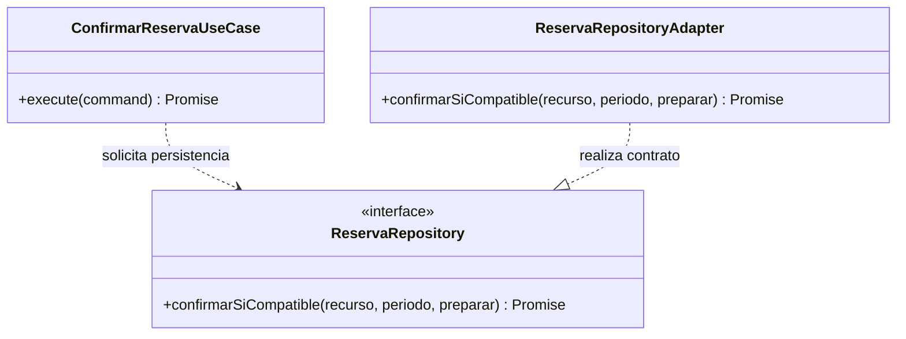
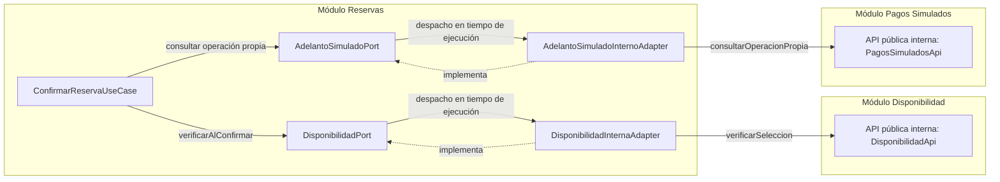
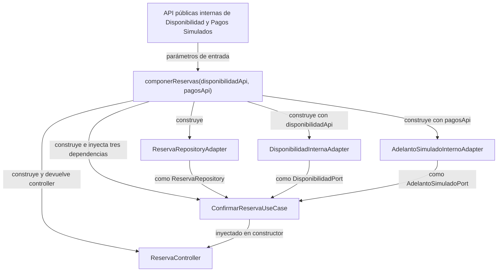

# UrbanPulse — Patrones de diseño

## Objetivo

Identificar, explicar y justificar las soluciones de diseño que organizan las responsabilidades y dependencias de UrbanPulse, tomando el módulo Reservas como referencia. Los patrones de diseño describen colaboraciones reutilizables para resolver problemas recurrentes; aquí permiten separar la coordinación de la confirmación, las reglas del dominio, la persistencia y la comunicación con otros módulos, sin incorporar funcionalidades.

Su finalidad es favorecer la **mantenibilidad**, la **separación de responsabilidades**, el **bajo acoplamiento**, la **facilidad de pruebas**, la **extensibilidad** y la **independencia de tecnologías concretas**. Son beneficios esperados del diseño, no resultados medidos o pruebas ejecutadas.

**Monolito Modular (ADR-001) y Clean Architecture (ADR-002) son decisiones arquitectónicas adoptadas.** Los patrones tratados organizan aspectos específicos dentro de esa arquitectura. Clean Architecture no es un patrón GoF; Repository es un patrón de persistencia, Adapter es un patrón estructural GoF y la inyección de dependencias es una técnica de ensamblado de colaboraciones.

## Contexto

UrbanPulse es una plataforma web para consultar disponibilidad y reservar canchas de gras, salas de karaoke, salones de eventos y ambientes de recreos destinados a eventos privados. En recreos se reserva el ambiente o espacio definido por el propietario, sin presumir exclusividad del establecimiento completo ni de todo el día (DF-01).

| Modalidad | Condiciones para confirmar | Referencias |
|---|---|---|
| Directa: cancha y karaoke | Adelanto simulado aprobado y disponibilidad válida al confirmar para el recurso y bloque o intervalo. Sin solicitud de evento ni cotización obligatoria. | DF-04; RN-01–RN-04/RN-13/RN-15; RF04/RF06/RF12. |
| Eventos: salón y recreo | Cotización y condiciones registradas por el propietario y aceptadas por el cliente dentro de UrbanPulse, adelanto simulado aprobado y disponibilidad válida al confirmar. | DF-01–DF-03; RN-05/RN-06/RN-09–RN-11/RN-13/RN-15; RF07/RF10/RF12. |

Todos los pagos son **exclusivamente simulados** (DF-06/DP-01/RN-14). La aprobación del adelanto no confirma por sí sola. Los importes total y adelanto quedan fijados al iniciar la operación (DP-03/RN-17). La recepción simulada posterior del saldo completo corresponde al propietario autorizado de una reserva confirmada propia (HU14/RF20); no cambia Reserva ni el resultado del adelanto (DF-05/RN-16/RN-24/RN-25). No se agregan operaciones de saldo al caso de uso de confirmación.

### Fuentes y niveles de evidencia

Se revisaron el [diseño interno de módulos](diseño-interno-de-modulos.md), las [reglas de negocio](../01-reglas-de-negocio.md), los [estados y transiciones](../02-estados-y-transiciones.md), los [flujos de reserva](../03-flujos-de-reserva.md), la [arquitectura inicial](../../02-arquitectura-software/01-arquitectura-inicial.md), el [estilo](../../02-arquitectura-software/02-estilo-arquitectonico.md) y el [enfoque arquitectónico](../../02-arquitectura-software/03-enfoque-arquitectonico.md). La trazabilidad se contrasta con los [RF](../../01-analisis-de-sistema/03-requisitos-funcionales.md), [AC](../../01-analisis-de-sistema/04-atributos-de-calidad.md), [restricciones y DF/DP](../../01-analisis-de-sistema/05-restricciones.md), [DA](../../01-analisis-de-sistema/06-driver-arquitectonicos.md), [ADR](../../01-analisis-de-sistema/07-decisiones-arquitectonicas.md) y [escenarios de calidad](../../01-analisis-de-sistema/08-escenarios-atributos-calidad.md).

El documento sigue el enfoque académico solicitado para la Guía 004 de Arquitectura de Software (IS-488), sin afirmar cotejo directo con esa guía.

| Nivel | Evidencia y alcance |
|---|---|
| Decisiones arquitectónicas aprobadas | ADR-001–ADR-009, API REST entre web y backend (ADR-005/RC03) y base de datos relacional sin motor definido (RC04). Se respetan DF-01–DF-06, DP-01–DP-12 y los niveles originales de RN-01–RN-25. |
| Patrones evidenciados en el diseño interno propuesto | Repository, Adapter e inyección por constructor aparecen en sus contratos, adaptadores y composición. Están alineados con decisiones adoptadas, sin acreditar implementación ni pruebas. |
| Recomendaciones todavía no aprobadas | Conservar la inyección manual y las fronteras propuestas al desarrollar el módulo; someter clases, firmas, DTO y composición a auditoría. Son recomendaciones de continuidad del diseño, sin aprobar un contenedor o un patrón adicional. |
| Candidatos para iteraciones posteriores | Strategy, Factory, State y Specification requieren evaluar una necesidad concreta y resolver sus dependencias; no se incorporan automáticamente. |

**Precisión de aprobación:** el contenido técnico está aprobado conceptualmente; la cabecera del diseño interno conserva el estado «pendiente de aprobación» para las clases y firmas concretas. Las ADR mantienen su carácter de decisiones adoptadas. La expresión «patrones aplicados» en este documento significa identificados en esa propuesta documental, sin acreditar implementación ni pruebas.

La arquitectura inicial describe tres capas generales; ADR-002, estilo y enfoque establecen las cuatro capas oficiales: Presentación, Aplicación, Dominio e Infraestructura. Se aplica ADR-002 y se conserva esa discrepancia documental sin modificar las fuentes. Las tecnologías que aparezcan en representaciones históricas no se convierten en decisiones vigentes.

### Módulo de referencia y responsabilidades

Reservas coordina la confirmación mediante contratos. Disponibilidad informa la validez de la selección al confirmar; Pagos Simulados proporciona el contexto y resultado ya registrado de la operación propia. Sus adaptadores llaman a las API públicas internas de los módulos colaboradores, dentro del mismo monolito, sin acceder a tablas o clases privadas ajenas.

| Componente propuesto | Responsabilidad documentada |
|---|---|
| `Reserva` | Expresar condiciones locales de confirmación directa y conservar datos propios y evidencia mínima del adelanto aplicado; no retiene todo `ContextoAdelanto`. |
| `ConfirmarReservaUseCase` | Consultar la operación propia, verificar correspondencia, coordinar disponibilidad, proyectar datos locales y solicitar persistencia de la confirmación. |
| `ReservaRepository` | Abstracción de persistencia que declara la obligación de impedir confirmaciones incompatibles y conservar datos propios y vínculo del adelanto aplicado. |
| `ReservaRepositoryAdapter` | Punto de implementación de persistencia relacional; el esqueleto ilustrativo lanza un error por PC-02/PC-05 y no es operativo. |
| `DisponibilidadPort` | Contrato local para verificar disponibilidad al confirmar, sin retener recursos ni garantizar exclusividad por sí mismo. |
| `DisponibilidadInternaAdapter` | Delegar y adaptar la consulta a la API pública interna de Disponibilidad. |
| `AdelantoSimuladoPort` | Consultar contexto y resultado registrado de una operación propia, sin iniciar un pago. |
| `AdelantoSimuladoInternoAdapter` | Delegar y adaptar esa consulta a la API pública interna de Pagos Simulados. |
| `ReservaController` | Validar forma de entrada y rol del recorrido directo, tomar identidad del contexto autenticado y llamar al caso de uso. |
| `componerReservas()` | Construir adaptadores y suministrarlos al caso de uso; entregar este al controlador y devolver la frontera propuesta. |

Los ejemplos de la fuente cubren **cancha y karaoke**. No existe en esas firmas un contrato suficiente para confirmar eventos: falta concretar evidencia confiable de cotización y aceptación (PC-01–PC-03). TypeScript se utiliza exclusivamente como notación académica, sin aprobar lenguaje, framework, ORM, motor, endpoints ni tecnologías adicionales.

## Patrones aplicados

### Repository

`ReservaRepository` permite que `ConfirmarReservaUseCase` solicite persistencia mediante una abstracción del dominio, sin conocer el motor relacional, tablas ni detalles de acceso. `ReservaRepositoryAdapter` realiza ese contrato desde Infraestructura. Es la concreción propuesta de **ADR-008**, cuyo driver es DA08.

La operación `confirmarSiCompatible()` hace explícita la obligación RN-13 de impedir confirmaciones incompatibles, conservar los datos propios de Reserva y asociar el adelanto aprobado y aplicado. Declarar esa obligación no implementa la solución concurrente **PC-05**. El callback `preparar` identifica el punto de evaluación requerido; no crea por sí mismo atomicidad ni exclusividad.

### Adapter

`DisponibilidadInternaAdapter` implementa `DisponibilidadPort` y delega en `DisponibilidadApi.verificarSeleccion()`. `AdelantoSimuladoInternoAdapter` implementa `AdelantoSimuladoPort` y delega en `PagosSimuladosApi.consultarOperacionPropia()`. Ambos traducen el vocabulario local de Reservas hacia las **API públicas internas** de sus respectivos módulos.

El ejemplo fuente muestra delegación con valores de frontera compartidos por brevedad; no demuestra una traducción completa de DTO. Su validación y traducción concreta quedan pendientes. Ninguno presupone HTTP interno, microservicios, SDK o proveedores externos. El adaptador de Pagos consulta un resultado registrado: no vuelve a simular ni cobra.

ADR-002 respalda la dirección de las dependencias. ADR-006 adopta interfaces y adaptadores para integraciones externas; su principio de desacoplamiento orienta esta colaboración interna, sin convertirla en una integración externa aprobada adicional. `ReservaRepositoryAdapter` también realiza una adaptación de infraestructura, aunque se analiza principalmente por su responsabilidad Repository.

### Inyección de Dependencias

El constructor de `ConfirmarReservaUseCase` recibe `ReservaRepository`, `DisponibilidadPort` y `AdelantoSimuladoPort`. La función `componerReservas()` actúa como **raíz de composición**: conoce las implementaciones, las construye y las suministra al caso de uso, que luego entrega a `ReservaController`.

La **inversión de dependencias** es el principio que orienta el código hacia abstracciones del núcleo; la **inyección de dependencias** es la técnica que suministra esas colaboraciones. Repository organiza el acceso a persistencia y Adapter la traducción de contratos. Son responsabilidades distintas y complementarias. La propuesta usa composición manual y no acredita un contenedor ni una biblioteca de inyección.

### Tabla comparativa

| Patrón | Problema que resuelve | Aplicación en UrbanPulse | Componentes involucrados | Estado del diseño |
|---|---|---|---|---|
| Repository | Acoplamiento del caso de uso a persistencia concreta. | Solicitar confirmación compatible mediante un contrato de dominio. | `ConfirmarReservaUseCase`, `ReservaRepository`, `ReservaRepositoryAdapter`, `Reserva`. | ADR-008 adoptada; contratos y adaptador propuestos, pendientes de aprobación e implementación. PC-05 abierto. |
| Adapter | Diferencias entre contratos locales y API de colaboradores. | Consultar disponibilidad y adelanto por fronteras públicas internas. | `DisponibilidadPort`, `DisponibilidadInternaAdapter`, `DisponibilidadApi`; `AdelantoSimuladoPort`, `AdelantoSimuladoInternoAdapter`, `PagosSimuladosApi`. | Evidenciado en la propuesta; contratos técnicos y traducciones pendientes. Sin pruebas acreditadas. |
| Inyección de Dependencias | Construcción de implementaciones concretas dentro del caso de uso. | Recibir tres contratos por constructor y ensamblar en la raíz. | `componerReservas()`, tres adaptadores, `ConfirmarReservaUseCase`, `ReservaController`. | Técnica propuesta coherente con ADR-002; composición manual pendiente de aprobación. |

## Cómo funciona cada patrón

### Repository: persistir sin acoplar la confirmación al almacenamiento

1. **Situación o problema.** Confirmar una cancha o sala requiere almacenar la reserva sin permitir incompatibles. Si el caso de uso conociera tablas o un motor, mezclaría coordinación del negocio con persistencia y dificultaría cambios y pruebas.
2. **Participantes.** `ConfirmarReservaUseCase` consume `ReservaRepository`; `ReservaRepositoryAdapter` lo realiza y deberá persistir la `Reserva` candidata con sus datos propios y evidencia local del adelanto.
3. **Secuencia de colaboración.** El caso de uso consulta por `AdelantoSimuladoPort` el resultado de la operación propia y verifica referencia y titular. Sin resultado aprobado no solicita confirmación. Con aprobación invoca `confirmarSiCompatible(recurso, periodo, preparar)`. El callback consulta disponibilidad mediante `DisponibilidadPort`, proyecta el contexto a `DatosReservaDirecta` y llama a `Reserva.confirmarDirecta()`. El repositorio deberá impedir incompatibles y devolver identificador únicamente tras persistencia satisfactoria. Esta es la colaboración requerida; el esqueleto actual falla antes de ejecutar el callback.
4. **Ejemplo UrbanPulse.** Un cliente intenta confirmar una cancha en un bloque configurado con adelanto aprobado. Si el bloque deja de estar disponible no se confirma, aunque Pagos conserve su aprobación. La duración del bloque procede de la configuración y no se impone una duración uniforme (RN-02/PC-04).
5. **Restricciones y pendientes.** PC-02 debe precisar el modelo persistido; PC-05, el ámbito de consistencia y su coordinación con Disponibilidad. Debe contrastarse que la candidata corresponde al mismo recurso y periodo del contrato. Una consulta aislada puede quedar obsoleta: ni el callback ni el patrón garantizan atomicidad. PC-08 conserva pendientes correlación inequívoca, duplicados y aplicación única del adelanto. No se seleccionan bloqueos, retenciones, transacciones ni otro mecanismo concurrente. PC-07 mantiene pendiente la resolución de adelanto aprobado sin disponibilidad.
6. **Justificación técnica.** La abstracción sitúa la obligación de persistencia en una frontera identificable y mantiene Aplicación independiente del almacenamiento (ADR-008). Facilita evaluar RN-13 mediante implementaciones del mismo contrato, pero su cumplimiento concurrente deberá diseñarse y verificarse por separado (AC03/DA02/ADR-004).

**Diagrama 1 — Repository.** `..>` indica dependencia hacia la interfaz; `..|>` indica realización por el adaptador. Las flechas representan dependencias de código, no una garantía de ejecución o concurrencia.



**Fragmento académico de TypeScript**, fiel al contrato de la sección 6.1 del diseño interno; los tipos referenciados ya están definidos allí. No se agrega un contrato CRUD ni una implementación de concurrencia.

```typescript
interface ReservaRepository {
  // Obligación RN-13; garantía concurrente pendiente PC-05.
  confirmarSiCompatible(
    recurso: RecursoId,
    periodo: PeriodoReserva,
    preparar: () => Promise<Reserva>
  ): Promise<string>;
}
```

El adaptador ilustrativo de la fuente lanza expresamente un error por PC-02/PC-05. Construir una candidata en memoria no acredita una confirmación almacenada ni un adelanto aplicado persistido.

### Adapter: colaborar mediante las fronteras públicas de los módulos

1. **Situación o problema.** Reservas necesita evidencia de disponibilidad y del adelanto, pero conocer modelos privados o tablas de los colaboradores acoplaría sus cambios. Los puertos expresan lo que necesita Reservas y los adaptadores conectan ese vocabulario con los contratos públicos de los otros módulos.
2. **Participantes.** `ConfirmarReservaUseCase`, `DisponibilidadPort`, `DisponibilidadInternaAdapter`, `DisponibilidadApi`, `AdelantoSimuladoPort`, `AdelantoSimuladoInternoAdapter` y `PagosSimuladosApi`. Estas API son nombres de contratos propuestos ya presentes en la fuente.
3. **Secuencia de colaboración.** El caso de uso invoca `consultar(operacionId, clienteId)` por el puerto del adelanto; su adaptador delega en `consultarOperacionPropia()`. El caso de uso contrasta referencia y titular y solo continúa con aprobación. Dentro de `preparar`, llama a `verificarAlConfirmar(recurso, periodo)`; el adaptador de Disponibilidad delega en `verificarSeleccion()`. Las respuestas vuelven por los mismos contratos sin exponer implementaciones privadas.
4. **Ejemplo UrbanPulse.** Para una sala de karaoke, Reservas recupera el contexto de la operación propia y consulta la validez de esa sala e intervalo al confirmar. Un adelanto rechazado impide continuar. Una respuesta ausente no se convierte en aprobación ni en rechazo de negocio (RN-14/RN-15/PC-08).
5. **Restricciones y pendientes.** Las llamadas son internas al monolito; la API REST aprobada es la frontera web–backend. El ejemplo no define transporte interno ni acceso directo a tablas. PC-04/PC-06/PC-08 deben precisar DTO, validaciones temporales y monetarias, fallos y correlación. Compartir tipos en la ilustración no autoriza compartir entidades privadas. El adaptador de Pagos no inicia RF11/RF18 ni implementa RF20.
6. **Justificación técnica.** Una variación de la API colaboradora puede concentrarse en el adaptador mientras se preserve el contrato local. Esa frontera reduce el impacto sobre reglas y coordinación (AC05), favorece pruebas con sustitutos y mantiene el desacoplamiento planteado en ADR-002 y ADR-006, sin afirmar que el patrón garantice autenticación o consistencia concurrente.

**Diagrama 2 — Adapter.** Las flechas continuas indican llamadas a través de contratos; en particular, las flechas `Port → Adapter` representan despacho en tiempo de ejecución y no dependencias de código. Las discontinuas indican qué puerto implementa cada adaptador: la implementación concreta continúa dependiendo del puerto, respetando Clean Architecture (ADR-002). Es una vista de colaboración dentro del monolito, no un despliegue distribuido ni un diagrama UML de dependencias.



**Fragmentos académicos de TypeScript**, tomados de las colaboraciones de la sección 6.3 de la fuente. Muestran delegación; la traducción detallada de DTO sigue por concretar.

```typescript
class DisponibilidadInternaAdapter implements DisponibilidadPort {
  constructor(private readonly api: DisponibilidadApi) {}

  verificarAlConfirmar(recurso: RecursoId, periodo: PeriodoReserva) {
    return this.api.verificarSeleccion(recurso, periodo);
  }
}

class AdelantoSimuladoInternoAdapter implements AdelantoSimuladoPort {
  constructor(private readonly api: PagosSimuladosApi) {}

  consultar(operacionId: string, clienteId: string) {
    return this.api.consultarOperacionPropia(operacionId, clienteId);
  }
}
```

### Inyección de Dependencias: ensamblar el módulo desde su raíz

1. **Situación o problema.** Si `ConfirmarReservaUseCase` construyera adaptadores concretos, conocería detalles de Infraestructura y dificultaría sustituir colaboraciones. La raíz de composición concentra esa elección fuera del caso de uso.
2. **Participantes.** `componerReservas()`, las API públicas de Disponibilidad y Pagos recibidas del monolito, los tres adaptadores, los tres contratos del constructor, `ConfirmarReservaUseCase` y `ReservaController`.
3. **Secuencia de colaboración.** La aplicación principal entrega las API a `componerReservas()`. La función construye `ReservaRepositoryAdapter`, `DisponibilidadInternaAdapter` y `AdelantoSimuladoInternoAdapter`, los asigna a los contratos locales y los pasa al constructor del caso de uso. Luego construye `ReservaController(confirmarReserva)` y devuelve `{ controller }`. El núcleo no consulta la raíz para localizar dependencias.
4. **Ejemplo UrbanPulse.** Para evaluar el comportamiento ante un adelanto rechazado puede suministrarse al caso de uso un sustituto del puerto que devuelva ese resultado y observar que no solicita persistencia. Es una posibilidad de prueba futura; no se añade una clase concreta ni se afirma haber ejecutado ese ensayo.
5. **Restricciones y pendientes.** La composición manual es propuesta, sin contenedor o biblioteca seleccionados. Sustituir implementaciones exige respetar las obligaciones de los contratos. Un sustituto en memoria no prueba RN-13 bajo concurrencia. La composición de la fuente utiliza un repositorio que falla hasta resolver PC-02/PC-05; ensamblarlo no convierte el módulo en una implementación terminada. PC-11 mantiene pendientes los mecanismos reales de autenticación y autorización.
6. **Justificación técnica.** Suministrar colaboraciones por constructor hace explícitas las dependencias y facilita cambios localizados y pruebas aisladas. La inversión hacia los contratos es coherente con ADR-002; la raíz puede conocer todas las capas para construirlas, sin trasladar allí reglas de confirmación ni permitir que Dominio dependa de Infraestructura.

**Diagrama 3 — Inyección de Dependencias.** Las flechas desde la raíz representan construcción; las restantes, suministro de instancias mediante los contratos indicados en sus etiquetas. Las interfaces describen el tipo de las referencias suministradas; no se construyen objetos de interfaz en ejecución.



**Fragmentos académicos de TypeScript.** El primer bloque muestra solo el constructor de la sección 6.2; se omite `execute()` deliberadamente. El segundo conserva la función de composición de la sección 6.5. Son extractos explicativos del mismo diseño, no archivos de aplicación ni un módulo autónomo.

```typescript
class ConfirmarReservaUseCase {
  constructor(
    private readonly reservas: ReservaRepository,
    private readonly disponibilidad: DisponibilidadPort,
    private readonly adelantos: AdelantoSimuladoPort
  ) {}
  // execute(command) se documenta en la fuente; se omite en este extracto.
}
```

```typescript
function componerReservas(
  disponibilidadApi: DisponibilidadApi,
  pagosApi: PagosSimuladosApi
) {
  const reservas: ReservaRepository = new ReservaRepositoryAdapter();
  const disponibilidad: DisponibilidadPort =
    new DisponibilidadInternaAdapter(disponibilidadApi);
  const adelantos: AdelantoSimuladoPort =
    new AdelantoSimuladoInternoAdapter(pagosApi);
  const confirmarReserva = new ConfirmarReservaUseCase(
    reservas, disponibilidad, adelantos
  );
  const controller = new ReservaController(confirmarReserva);
  return { controller };
}
```

## Beneficio

Los beneficios siguientes son expectativas justificadas por las responsabilidades y fronteras propuestas. Los identificadores remiten a los catálogos enlazados en Contexto; no expresan resultados de evaluación.

| Beneficio | Cómo se consigue | Ejemplo en UrbanPulse | Atributo de calidad relacionado |
|---|---|---|---|
| Mantenibilidad | Separar contratos del núcleo, adaptación y construcción de dependencias. | Cambiar el mapeo relacional en `ReservaRepositoryAdapter` preservando el contrato usado por el caso de uso. | AC05; relación complementaria DA08 → ADR-008; AC05 → DA06 → ADR-002/ADR-006 para separación de integraciones. |
| Testabilidad | Inyectar colaboraciones reemplazables y observar las solicitudes a sus puertos. | Evaluar falta de contexto o adelanto rechazado sin un almacenamiento concreto. | Apoyo a AC05, sin crear un AC de testabilidad; DA06/ADR-002 y DA08/ADR-008 respaldan las fronteras. |
| Extensibilidad | Conservar fronteras y reglas diferenciadas por modalidad. | Poder proponer posteriormente contratos para eventos sin forzarlos en `confirmarDirecta()`. | AC06 → DA03 → ADR-001/ADR-003; ADR-002 también responde a DA03. |
| Separación de responsabilidades y bajo acoplamiento | Controlador traduce entrada, caso de uso coordina, entidad expresa condiciones y adaptadores conectan infraestructura. | `AdelantoSimuladoInternoAdapter` consulta Pagos sin trasladar el contexto completo a `Reserva`. | AC05 → DA06 → ADR-002/ADR-006; AC08 → DA06 → ADR-006 como respaldo del desacoplamiento de integraciones. |
| Seguridad en operaciones autorizadas | Ubicar comprobación de rol e identidad en las fronteras correspondientes y contrastar titularidad de la operación. | `ReservaController` toma identidad autenticada; caso de uso y consulta de Pagos verifican operación propia. HU14/RF20 exige propietario autorizado en el registro posterior de saldo. | AC04 → DA05 → ADR-007; RN-19/RN-25; PC-11 abierto. Los patrones no autentican por sí solos. |
| Consistencia de confirmación | Expresar la obligación RN-13 en el repositorio y coordinar aprobación y disponibilidad al confirmar. | No devolver confirmación con rechazo o selección no disponible; falta demostrar la prevención de confirmaciones concurrentes incompatibles. | AC03 → DA02 → ADR-004; DA08 → ADR-008 para persistencia, con AC03 como relación complementaria. PC-05 abierto. |

La trazabilidad funcional principal enlaza **HU09/RF11/RF18/RF19 → consulta del adelanto y coordinación de confirmación**, **RF04/RF06/RF12 → `Reserva`, disponibilidad y repositorio**, y **HU14/RF20/RF14 → conservación auditable de datos propios y adelanto aplicado para operaciones posteriores**, sin implementar aquí recepción, consulta o corrección de saldo. RF11/RF14/RF19/RF20 tienen origen explícito en DA08; RF14/RF20 también en DA05. HU03 → RF04 y HU04 → RF06 conservan su asociación contextual pendiente de precisión. RF02/RF09/RF10 siguen sin driver de origen explícito: no se completa esa cobertura por analogía.

DA07 → ADR-005 procede de RC03; sus vínculos con AC05/AC08 son complementarios. DA08 → ADR-008 procede de RC04 y los RF enumerados en su catálogo; AC03/AC05 son relaciones complementarias, sin inventar una cadena de origen. AC02 y AC07 no tienen driver explícito. No se atribuye DA01 → ADR-002.

EQ-03, EQ-04, EQ-05, EQ-06 y EQ-08 aportan contexto para evaluar consistencia, seguridad, mantenibilidad, extensibilidad e interoperabilidad. Sus procedimientos siguen pendientes de revisión; no se agregan métricas ni se afirman ensayos realizados. Repository y Adapter no garantizan por sí solos consistencia concurrente o seguridad.

**Costos y compromisos.** El diseño requiere más interfaces, adaptadores y código de composición, además de mantener coherentes los contratos locales y públicos. Una modificación de DTO puede exigir ajustar y revisar ambas fronteras. Estas abstracciones se justifican por las dependencias reales de Reservas; multiplicarlas sin una necesidad demostrable aumentaría el mantenimiento. La persistencia deberá satisfacer el contrato y demostrar PC-05 antes de considerar operativo el recorrido.

## Patrones previstos para siguientes iteraciones

Los siguientes patrones son **candidatos a evaluación**, no decisiones adoptadas ni tareas de implementación autorizadas por esta documentación. Cada uno requiere una necesidad concreta que justifique su costo.

### Strategy

Podría encapsular reglas de confirmación distintas entre reservas directas y eventos, en apoyo de AC06/DA03/ADR-003. La fuente solo desarrolla el recorrido directo; no se debe implantar una jerarquía de estrategias antes de definir los contratos de cotización y aceptación y resolver PC-01–PC-03. Strategy no decidiría quién inicia la confirmación ni reduciría las tres condiciones obligatorias de DF-03.

### Factory

Podría resultar útil si construir objetos de dominio complejos exige variantes y validaciones que las fábricas existentes no expresen con claridad. Antes debe evaluarse si `Reserva.confirmarDirecta(datos, operacionAdelantoId, resultado, disponible)` ya cubre la necesidad local: la fuente la utiliza para validar condiciones y construir la candidata con copia de datos propios y evidencia mínima.

Esta operación estática **no implica que Factory Method GoF esté aprobado**: no se documenta una jerarquía de creadores ni una decisión de delegar la creación a subclases. Una fábrica adicional solo se recomendaría ante complejidad demostrada, después de precisar PC-01/PC-02/PC-06/PC-08, sin crear clases nuevas en esta entrega.

### State

Podría aplicarse si las máquinas conceptuales requieren posteriormente comportamiento polimórfico por estado. Las tablas y diagramas actuales no obligan a crear clases de estado ni una enumeración persistida; PC-02 sigue abierto. Solicitud, Reserva, adelanto y registro de saldo mantienen significados separados. Los dos estados informativos del saldo aprobados por DP-08 no constituyen una aplicación del patrón State.

No se crean estados **Cancelada, Expirada, Reembolsada ni Finalizada**. RF13 continúa pendiente y PC-09/PC-10 no habilitan nuevas transiciones u operaciones.

### Specification

Podría encapsular y combinar condiciones de disponibilidad, compatibilidad temporal y confirmación si su reutilización y complejidad lo justifican (RN-11/RN-13/RN-15). Antes deben precisarse los límites temporales PC-04 y, para eventos, la evidencia contractual PC-01. No se proponen clases ni firmas adicionales.

Una especificación evaluada sobre datos en memoria puede quedar obsoleta antes de persistir. El patrón **no resuelve por sí solo la atomicidad ni la concurrencia PC-05**, ni reemplaza la obligación de `confirmarSiCompatible()` o la coordinación con Disponibilidad.

### Tabla de evaluación futura

| Patrón candidato | Posible aplicación | Problema que resolvería | Dependencias o decisiones pendientes | Estado |
|---|---|---|---|---|
| Strategy | Reglas distintas de confirmación directa y de eventos. | Evitar condicionales crecientes al variar reglas por modalidad. | PC-01–PC-03; contratos de aceptación; DF-03/DF-04 y ADR-003. | Candidato; sin jerarquía aprobada. |
| Factory | Construcción de objetos de dominio complejos. | Centralizar creación cuando las fábricas existentes dejen de ser suficientes. | Evaluar primero `Reserva.confirmarDirecta()`; PC-01/PC-02/PC-06/PC-08. | Candidato condicionado; sin Factory Method GoF aprobado. |
| State | Comportamientos variables según estados futuros formalizados. | Evitar dispersión de comportamiento cuando exista polimorfismo justificado. | PC-02/PC-09/PC-10; RF13 pendiente; separación de máquinas conceptuales. | Candidato; sin estados o transiciones adicionales. |
| Specification | Condiciones reutilizables de disponibilidad y confirmación. | Componer predicados de negocio sin duplicar su expresión. | PC-01/PC-04; coordinación de persistencia PC-05 sigue siendo independiente. | Candidato; sin solución concurrente aprobada. |

No se concluye que todos deban implementarse. Una solución existente suficiente o una complejidad baja puede justificar descartar cualquiera de ellos.

### Decisiones y pendientes conservados

Se mantienen DF-01–DF-06 y DP-01–DP-12 completos: unidad reservable, aceptación interna y condiciones conjuntas; adelanto obligatorio según modalidad; importes fijados; saldo igual a total menos adelanto aprobado y aplicado; sin pagos parciales; un registro activo con correcciones históricas; métodos informativos; estados mínimos de registro; consulta autorizada; momento de liquidación según modalidad y prohibición de confirmar ante rechazo o indisponibilidad. Se respetan RN-01–RN-25 según sus niveles: RN-10/RN-12 son derivadas, RN-07/RN-17/RN-20 combinan aprobación y derivación, y RN-23 conserva RF13 pendiente. Las demás mantienen el estado declarado en el catálogo.

| Pendientes vigentes | Qué queda sin resolver en esta documentación |
|---|---|
| PC-01 / PC-02 / PC-03 | Contenido y evidencia de aceptación, modelo y momento de creación de Reserva, relaciones persistidas e iniciador o automatización de confirmación del evento. |
| PC-04 / PC-05 | Límites temporales, solapamientos y espacios compartidos; garantía concurrente y coordinación con Disponibilidad, sin mecanismo seleccionado. |
| PC-06 / PC-07 / PC-08 | Precisión monetaria y saldo cero; resolución de adelanto aprobado sin disponibilidad; fallos, reintentos, duplicados y correlación del simulador. La fórmula DP-04 ya está aprobada. |
| PC-09 / PC-10 | No aceptación, cambios, reapertura y ciclo posterior. No se habilitan cancelación, devolución, expiración o cierre por incorporar un patrón. |
| PC-11 / PC-12 | Permisos y mecanismos concretos, cobertura HU/RF/DA y evaluación de escenarios. No se inventan relaciones para cerrar vacíos. |

Se conservan Monolito Modular, Clean Architecture, API REST y persistencia relacional sin motor definido. No se seleccionan tecnologías ni endpoints; no se incorporan funcionalidades, contratos de persistencia adicionales o clases concretas nuevas. Ningún patrón autoriza pagos reales, cancelación, reembolso o fraccionamiento del saldo. La aprobación del adelanto sigue siendo independiente de la confirmación y la recepción posterior del saldo no modifica Reserva.
