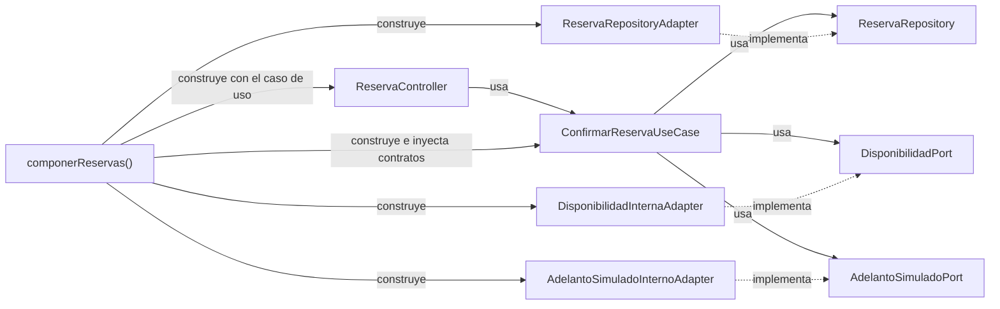
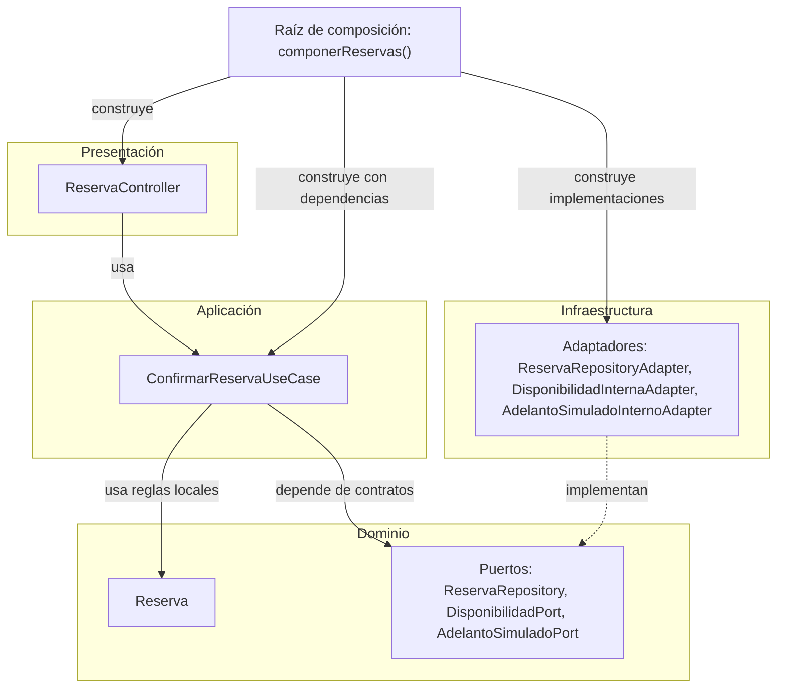

# UrbanPulse — Principios de diseño SOLID

**Estado: aprobado conceptualmente y cerrado documentalmente — reconciliado con ADR-010, ADR-011 y C3. Contratos, mecanismos e implementación pendientes.**

**Antecedente:** tercer entregable de Diseño Interno, pendiente de auditoría antes de esta revisión. Fecha de revisión: 16/10/2026. Tras la auditoría conceptual favorable, sin hallazgos arquitectónicos bloqueantes, esta revisión queda aprobada conceptualmente y cerrada documentalmente. El cierre aprueba únicamente el análisis conceptual de SRP, OCP, LSP, ISP y DIP aplicado a Reservas y extendido a las responsabilidades técnicas de Redis y RabbitMQ: separación de consulta, visibilidad, reconstrucción y acceso a caché; publicación, recepción e invalidación técnica; obligaciones semánticas de los contratos futuros y dependencias hacia abstracciones. Conserva el consumidor interno dentro del backend y los ocho módulos funcionales, sin imponer una clase o interfaz por responsabilidad. No acredita implementación, pruebas ni aprobación de clases, contratos o mecanismos concretos.

## Objetivo

Explicar cómo los principios SOLID orientan las responsabilidades y contratos internos de UrbanPulse. Son cinco criterios de diseño orientado a objetos que ayudan a revisar qué debe conocer cada componente, por qué cambia y qué obligaciones mantiene al colaborar con otros.

La revisión mantiene Reservas como ejemplo y extiende los criterios a las responsabilidades técnicas de ADR-010/ADR-011, C2/C3 y los dos documentos de Diseño Interno cerrados conceptualmente. Se conservan la estructura principal, los ejemplos, las tablas técnicas de Reservas y los dos Mermaid; estos diagramas continúan limitados al ejemplo original y no representan el recorrido técnico de invalidación.

| Sigla | Principio | Criterio de diseño |
|---|---|---|
| S | Single Responsibility Principle — Responsabilidad Única | Reunir una responsabilidad coherente y una razón principal de cambio por componente. |
| O | Open/Closed Principle — Abierto/Cerrado | Permitir extensiones justificadas sin modificar innecesariamente el núcleo estable. |
| L | Liskov Substitution Principle — Sustitución de Liskov | Sustituir implementaciones preservando las obligaciones observables del contrato. |
| I | Interface Segregation Principle — Segregación de Interfaces | Exponer a cada cliente las operaciones que necesita, sin dependencias ajenas a su función. |
| D | Dependency Inversion Principle — Inversión de Dependencias | Orientar las dependencias hacia abstracciones del núcleo, separadas de los detalles concretos. |

En Reservas, estos criterios permiten razonar sobre **cohesión** de responsabilidades, **desacoplamiento** entre coordinación e infraestructura, **mantenibilidad** ante cambios localizados, **testabilidad** mediante colaboradores sustituibles y **extensibilidad** por modalidad. Se trata de beneficios esperados que pueden revisarse conceptualmente en las dependencias propuestas; no son resultados medidos.

SOLID no garantiza por sí solo seguridad, consistencia transaccional ni ausencia de reservas incompatibles. Esas propiedades requieren contratos completos, mecanismos adecuados y verificaciones específicas. Separar interfaces o inyectar un repositorio no resuelve la concurrencia PC-05.

## Contexto

UrbanPulse es una plataforma web de descubrimiento, consulta de disponibilidad y reserva de establecimientos de entretenimiento y recreación en Huamanga. El **módulo Reservas** es el ejemplo de referencia porque coordina condiciones de confirmación y colabora con Disponibilidad y Pagos Simulados.

| Modalidad | Recorrido y condiciones aprobadas |
|---|---|
| Cancha y karaoke | Reserva directa de recurso, fecha y bloque configurado o sala e intervalo. Requiere adelanto simulado obligatorio configurado por recurso y disponibilidad válida al confirmar; no exige solicitud de evento ni cotización. Los bloques de cancha no tienen duración uniforme obligatoria (DF-04; RN-01–RN-04). |
| Salón y recreo | Solicitud, revisión y cotización y condiciones registradas por el propietario y aceptadas por el cliente dentro de UrbanPulse. Confirmar exige conjuntamente aceptación interna, adelanto simulado aprobado y disponibilidad verificada (DF-02/DF-03). En recreo se reserva el ambiente o espacio definido por el propietario, sin presumir exclusividad de todo el establecimiento o del día (DF-01). |

Aceptar una solicitud, aceptar condiciones y confirmar son hechos distintos (RN-10, derivada). WhatsApp solo redirecciona al contacto y no sustituye la aceptación interna. Consultar disponibilidad o coordinar no retiene recursos (RN-12, derivada). Deben impedirse confirmaciones incompatibles incluso concurrentes (RN-13, aprobada); el mecanismo sigue pendiente.

**Todos los pagos son exclusivamente simulados** (DF-06/DP-01). El cliente conoce total y adelanto antes de iniciar la simulación y ambos se fijan al iniciarla (DP-03). Un rechazo, ausencia de aprobación o disponibilidad inválida impiden confirmar; una aprobación aislada no confirma. RF19 exige reflejar el resultado del adelanto en la situación de la reserva sin confundir ambos conceptos.

El registro posterior del **saldo completo simulado** corresponde al propietario autorizado de una reserva confirmada propia (HU14/RF20). Saldo = total acordado menos adelanto aprobado y aplicado (DP-04). Conserva reserva, importe, método informativo, autor, fecha/hora, una sola recepción activa e historial de correcciones. No admite parciales ni cambia Reserva o el resultado del adelanto. Efectivo, Yape, Plin y transferencia son categorías informativas; saldo cero mantiene su representación pendiente, sin recepción ficticia. DP-11 sitúa la liquidación representada el día del servicio en cancha/karaoke y según condiciones aceptadas en eventos. Este registro no se incorpora al caso de uso de confirmación.

### Base documental y niveles de aprobación

La lectura parte de [actores](../../01-analisis-de-sistema/01-actores.md), [HU](../../01-analisis-de-sistema/02-historias-del-usuarios.md), [RF](../../01-analisis-de-sistema/03-requisitos-funcionales.md), [AC](../../01-analisis-de-sistema/04-atributos-de-calidad.md) y [restricciones, DF y DP](../../01-analisis-de-sistema/05-restricciones.md). Se contrasta con [drivers DA](../../01-analisis-de-sistema/06-driver-arquitectonicos.md), [ADR](../../01-analisis-de-sistema/07-decisiones-arquitectonicas.md), [reglas RN y pendientes PC](../01-reglas-de-negocio.md), [estados](../02-estados-y-transiciones.md) y [flujos](../03-flujos-de-reserva.md). Los componentes de Reservas proceden del [diseño interno de módulos](diseño-interno-de-modulos.md) y se interpretan junto con [patrones de diseño](patrones-de-diseño.md); las responsabilidades técnicas se contrastan además con las ADR y C2/C3 enlazados a continuación.

| Nivel | Alcance en este documento |
|---|---|
| Aprobado conceptualmente | ADR-001–ADR-011 vigentes: las nueve primeras adoptadas y ADR-010/ADR-011 cerradas conceptualmente en sus alcances acotados; C2, C3, Diseño Interno de Módulos y Patrones cerrados conceptualmente. Análisis conceptual de los cinco principios SOLID aplicado a Reservas y a las responsabilidades técnicas de Redis/RabbitMQ, en el alcance de este cierre. DF-01–DF-06 y DP-01–DP-12 aprobadas; RN-01–RN-25 conserva sus niveles individuales y RF13 sigue pendiente. Los cierres no acreditan implementación ni aprueban mecanismos operativos. |
| Derivado | Separar coordinación, reglas locales, adaptación y composición permite revisar razones de cambio y dependencias; no crea funcionalidades. |
| Propuesto | Clases, firmas, DTO, puertos, ubicación y composición concretas del diseño interno. La aplicación explicativa de SOLID queda aprobada conceptualmente en esta revisión, sin constituir código implementado ni aprobación de esos detalles. |
| Decisión pendiente | PC-01–PC-12 y mecanismos de caché, visibilidad, publicación, consumo y recuperación. Redis/RabbitMQ están adoptados conceptualmente; sus contratos y configuración siguen pendientes. Strategy, Factory, State y Specification conservan su carácter candidato; Outbox continúa evaluado, no adoptado. |

RN-10/RN-12 conservan su nivel derivado; RN-07/RN-17/RN-20 combinan aprobación y derivación; RN-23 conserva RF13 pendiente. Las restantes mantienen el nivel declarado en el catálogo. Los dos estados informativos del saldo aprobados por DP-08 no aprueban las demás máquinas propuestas.

**Discrepancias y criterio aplicado.** El [README](../../../README.md) y la [arquitectura inicial](../../02-arquitectura-software/01-arquitectura-inicial.md) presentan la separación general de tres capas, frente a las cuatro oficiales de ADR-002, también presentes en [estilo](../../02-arquitectura-software/02-estilo-arquitectonico.md) y [enfoque](../../02-arquitectura-software/03-enfoque-arquitectonico.md). Se aplica ADR-002; no se reproduce la dependencia de Dominio hacia Infraestructura. La afirmación de armonización del catálogo ADR no coincide con el texto inicial actual, y sus referencias gráficas conservan desfases documentados. La mención de ORM en estilo no aprueba su selección. Patrones declara aprobación conceptual, mientras el diseño interno mantiene pendiente la aprobación concreta: aquí no se extiende aquella declaración a clases o firmas. Estas diferencias se informan sin modificar las fuentes ni impedir este análisis conceptual.

La estructura sigue la solicitud para la Guía 004 del curso Arquitectura de Software (IS-488). No se aportó el contenido del ejemplo Marketplace ni de la guía para cotejo directo; no se afirma haberlos contrastado ni se trasladan clases o reglas de Pedidos.

### Arquitectura vigente y estados contrastados

Los registros de cierre de [ADR-010 — Redis](../../01-analisis-de-sistema/adr/ADR-010-cache-redis.md#registro-de-cierre-conceptual) y [ADR-011 — RabbitMQ](../../01-analisis-de-sistema/adr/ADR-011-mensajeria-rabbitmq.md#registro-de-cierre-conceptual) respaldan Redis/cache-aside exclusivamente para fichas públicas reconstruibles y RabbitMQ para invalidación técnica asíncrona. La base relacional mantiene los datos definitivos y el fallback ante fallos de Redis, sujeto a la disponibilidad de la propia base. No se cachean inicialmente disponibilidad, reservas, aceptación contractual, adelantos, saldos ni permisos como autoridad; las búsquedas públicas siguen como ampliación futura condicionada. Consultar una ficha no requiere pasar por el broker.

El [C2 cerrado](../../04-modelo-c4/02-contenedores-c2.md) representa cinco contenedores: Aplicación Web, Backend UrbanPulse, Base de datos relacional, Redis y RabbitMQ. El [C3 cerrado](../../04-modelo-c4/03-componentes-c3.md) mantiene ocho módulos funcionales: Usuarios, Establecimientos, Recursos, Disponibilidad, Reservas, Solicitudes, Servicios y Pagos Simulados. Sus seis responsabilidades técnicas son puerto de acceso a caché pública, adaptador Redis, puerto de publicación de invalidaciones, adaptador de publicación RabbitMQ, consumidor técnico RabbitMQ y frontera autorizada de invalidación. Son responsabilidades conceptuales, sin correspondencia obligatoria con seis interfaces, clases o archivos. El consumidor permanece dentro del backend, sin otro despliegue, noveno módulo ni quinta capa.

El [Diseño Interno, sección 6.6](diseño-interno-de-modulos.md#66-reconciliación-de-esta-revisión-y-pendientes) y Patrones están aprobados conceptualmente y cerrados documentalmente para responsabilidades y límites reconciliados, con sus antecedentes preservados. Clases, firmas, DTO, composición, contratos operativos y mecanismos siguen pendientes; su cierre no aprueba automáticamente esta revisión de Principios.

**Desfases y efecto sobre esta revisión:** AGENTS.md y restricciones conservan referencias a nueve ADR y al marco previo sin caché aprobada, mientras el catálogo vigente reconoce once. El catálogo y las ADR aún describen C2 con tres contenedores y C3 anterior; C2 presenta la actualización de C3 como futura. Frente a ello, los registros explícitos de cierre de C2/C3, Diseño Interno y Patrones acreditan sus estados conceptuales actuales. Se aplican sus alcances expresos, sin inferir aprobación por fecha o Git ni corregir las fuentes. La discrepancia previa de tres frente a cuatro capas sigue regida por ADR-002. La aprobación histórica de Patrones para Reservas y su ampliación conceptual a Redis/RabbitMQ no aprueban contratos concretos ni mecanismos de esta revisión.

### Componentes del ejemplo propuesto

Los puertos están ubicados en Dominio en la propuesta fuente. Su distribución es diseño concreto pendiente, coherente con dependencias hacia el núcleo.

| Componente | Responsabilidad | Capa | Relación con SOLID |
|---|---|---|---|
| `Reserva` | Condiciones locales de confirmación directa, datos propios y evidencia mínima del adelanto aplicado; no conserva todo el contexto de Pagos. | Dominio | SRP: reglas locales separadas de integración y almacenamiento. |
| `ConfirmarReservaUseCase` | Consultar operación propia, contrastar referencia y titular, coordinar disponibilidad, proyectar datos y solicitar confirmación compatible. | Aplicación | SRP, ISP y DIP: coordinación mediante contratos acotados. |
| `ReservaRepository` | Expresar la obligación de persistir confirmación compatible y conservar datos propios y vínculo del adelanto aplicado. | Dominio, puerto | ISP, DIP y LSP: obligación observable independiente del almacenamiento. |
| `DisponibilidadPort` | Consultar validez de la selección al confirmar, sin retener recursos. | Dominio, puerto | ISP y DIP: consulta específica; LSP exige conservar su significado. |
| `AdelantoSimuladoPort` | Consultar contexto y resultado ya registrado de una operación propia. | Dominio, puerto | ISP, DIP y LSP: no inicia simulación ni registra saldo. |
| `ReservaRepositoryAdapter` | Punto de implementación de persistencia relacional; esqueleto no operativo por PC-02/PC-05. | Infraestructura | SRP y DIP; cumplimiento de LSP todavía por demostrar. |
| `DisponibilidadInternaAdapter` | Delegar y adaptar consulta a la frontera pública interna de Disponibilidad. | Infraestructura | SRP, DIP y LSP: aislar adaptación y preservar semántica. |
| `AdelantoSimuladoInternoAdapter` | Delegar y adaptar consulta a la frontera pública interna de Pagos Simulados. | Infraestructura | SRP, DIP y LSP: mantener resultado, titularidad y contexto. |
| `ReservaController` | Traducir solicitud, validar forma y rol del recorrido directo, usar identidad autenticada y llamar al caso de uso. | Presentación | SRP: frontera de entrada separada de reglas y persistencia. |
| `componerReservas()` | Construir adaptadores y suministrarlos al caso de uso; entregar este al controlador. | Raíz de composición, fuera del núcleo | Habilita DIP mediante inyección; concentra la elección de detalles. |

## SOLID en el módulo Reservas

### S — Principio de Responsabilidad Única (SRP)

Una clase o componente debe concentrar una responsabilidad coherente y una razón principal de cambio. Esto no significa tener un solo método: significa evitar que decisiones independientes obliguen a modificar el mismo componente.

`Reserva` expresa condiciones locales y conserva datos propios y evidencia mínima del adelanto aplicado. No administra el intento completo de pago. `ConfirmarReservaUseCase` coordina la consulta autorizada, la disponibilidad y la solicitud de persistencia; delega las condiciones locales en la entidad. `ReservaController` traduce entradas y resultados; los adaptadores atienden cambios en contratos colaboradores y detalles tecnológicos. Pagos Simulados administra el resultado del adelanto y sus antecedentes, sin trasladar todo ese contexto a Reserva.

| Responsabilidad | Lugar propuesto | Razón principal de cambio |
|---|---|---|
| Condiciones locales de confirmación directa | `Reserva` | Una regla local de negocio aprobada cambia. |
| Coordinación de la confirmación | `ConfirmarReservaUseCase` | Cambia la colaboración necesaria para el caso de uso. |
| Traducción de la solicitud | `ReservaController` | Cambia el contrato de entrada o su representación. |
| Consulta y adaptación de adelanto | `AdelantoSimuladoInternoAdapter` | Cambia el contrato público colaborador, preservando el puerto local. |
| Persistencia y garantía de compatibilidad | `ReservaRepositoryAdapter` | Se concreta o cambia el detalle de almacenamiento que satisface el contrato. |

**Ejemplo concreto.** Si cambia la representación de la respuesta pública de Pagos Simulados, la adaptación debería concentrarse en `AdelantoSimuladoInternoAdapter`, manteniendo el significado de la operación propia y su resultado. `Reserva` debe seguir recibiendo los datos locales que necesita, sin aprender la estructura completa del intento. En cambio, cambiar una condición local aprobada de confirmación exige revisar el dominio y sus dependencias pertinentes. SRP permite distinguir ambas razones; no garantiza que cualquier cambio sea de un solo archivo.

Construir una candidata con evidencia mínima en memoria no acredita adelanto aplicado persistido. La asociación se conserva al persistir satisfactoriamente la confirmación; PC-02/PC-08 deben concretar su trazabilidad. La responsabilidad global RN-13 requiere colaboración con persistencia y Disponibilidad, y no puede quedar garantizada solo por `Reserva`.

**Extensión a fichas públicas e invalidación (ADR-002/ADR-008/ADR-010/ADR-011).** Las siguientes responsabilidades tienen razones de cambio distintas. Su separación conceptual no impone una clase por fila ni fija su ubicación exacta:

| Responsabilidad | Razón de cambio y límite |
|---|---|
| Consulta pública de Establecimientos | Coordinar la obtención de una ficha; no absorber transporte, persistencia concreta o todas las reglas de seguridad. |
| Política de admisibilidad y visibilidad | Determinar qué contenido puede publicarse; un hit no concede autorización. Titular, política y mecanismo de retirada segura pendientes. |
| Reconstrucción desde datos definitivos | Componer la proyección mediante repositorios y fronteras públicas autorizadas; sin acceder a tablas privadas ajenas. Composición y contratos pendientes. |
| Acceso técnico Redis | Traducir lectura, carga e invalidación mediante abstracciones internas; no decidir reglas de negocio ni visibilidad por sí solo. |
| Publicación de invalidaciones | Comunicar intenciones técnicas de cambios públicos confirmados desde casos de uso existentes y adaptarlas al broker; fiabilidad por diseñar. |
| Recepción y validación RabbitMQ | Adaptar entrada técnica, validar forma, versión y alcance; recibir no equivale a completar el efecto. |
| Coordinación de invalidación | Solicitar por la frontera autorizada el efecto sobre las fichas afectadas, separada de la recepción del transporte y respetando Aplicación. |

Estas siete razones de cambio no redefinen las seis responsabilidades técnicas de C3. El consumidor no absorbe Reservas o Pagos Simulados ni crea un módulo funcional. Retirar visibilidad exige impedir divulgación de contenido ya no autorizado; TTL e invalidación asíncrona no bastan por sí solos, y su mecanismo sigue pendiente.

### O — Principio Abierto/Cerrado (OCP)

Un componente debe admitir extensiones justificadas sin modificaciones innecesarias de su núcleo estable. La estabilidad se define respecto de variaciones conocidas; OCP no exige congelar contratos incompletos ni construir jerarquías por anticipado.

ADR-003 diferencia modalidades. El diseño interno desarrolla el recorrido directo de cancha y karaoke con `Reserva.confirmarDirecta()` y los tres puertos. La confirmación de salón y recreo necesita contratos adicionales de cotización y aceptación todavía pendientes (PC-01–PC-03); esas condiciones no están representadas en las firmas actuales. No basta enviar otro valor de modalidad ni introducir un booleano de aceptación declarado por el navegador.

**Escenario ilustrativo de extensión.** Al diseñar la confirmación de un evento en un ambiente de recreo, se evaluaría cómo obtener evidencia confiable de condiciones aceptadas, además del adelanto aprobado y la disponibilidad válida. El trabajo debería conservar el recorrido directo y revisar las fronteras realmente afectadas, sin imponer cotización a una cancha. El contrato del evento y su iniciador deben definirse antes de decidir su composición. No se presentan clases nuevas, firmas definitivas ni una reutilización directa de `confirmarDirecta()` para eventos.

**Strategy es un candidato futuro**, ya identificado en patrones, para encapsular variaciones si su complejidad lo justifica. No está implementado ni aprobado como jerarquía concreta. OCP favorece una extensión controlada después de resolver contratos; no evita toda modificación ni autoriza nuevas reglas comerciales.

**Extensión técnica por contratos (ADR-002/ADR-006/ADR-010/ADR-011).** Redis implementa conceptualmente una abstracción de caché; el adaptador RabbitMQ traduce publicación técnica mediante su puerto. Los casos de uso pueden conservar su coordinación al sustituir un detalle que respete el comportamiento del contrato, mientras la raíz de composición externa al núcleo suministra las implementaciones. No se exige Strategy, Factory ni otro patrón nuevo para esa sustitución.

OCP no hace intercambiables todas las tecnologías ni deja sin efecto su adopción conceptual. Un cambio de implementación debe revisar semántica de ausencia y error, admisibilidad, efecto requerido y garantías de publicación/recuperación; si exige un contrato distinto, habrá que revisar el diseño y obtener la decisión correspondiente. Los contratos actuales de caché y mensajería siguen por definir, por lo que no se acredita sustituibilidad operativa.

### L — Principio de Sustitución de Liskov (LSP)

Una implementación debe poder reemplazar a otra sin romper las obligaciones que sus clientes esperan del contrato. Tener el mismo nombre de método y tipo de retorno es insuficiente: también deben conservarse precondiciones, postcondiciones y efectos observables. Una sustitución no debe exigir condiciones más fuertes al cliente ni debilitar los resultados prometidos.

`ReservaRepositoryAdapter` debe respetar `ReservaRepository.confirmarSiCompatible(recurso, periodo, preparar)`: la candidata corresponde a ese recurso y periodo; se conservan datos y vínculo del adelanto aplicado; el identificador se devuelve únicamente tras persistencia satisfactoria y se impiden confirmaciones incompatibles. Un adaptador alternativo no puede exigir que el llamador haya eliminado previamente toda concurrencia ni admitir duplicidad incompatible. El mecanismo para cumplir esa obligación sigue abierto en PC-05.

`DisponibilidadInternaAdapter` debe conservar el significado de disponibilidad para la selección solicitada. `AdelantoSimuladoInternoAdapter` debe conservar referencia, titularidad, importes fijados y significado del resultado registrado. Un rechazo no puede convertirse en aprobación; ausencia de resultado tampoco es aprobación ni rechazo de negocio. Estos criterios no completan el tratamiento técnico de fallos pendiente en PC-08.

| Ejemplo | Evaluación del contrato |
|---|---|
| Correcto, como criterio para una sustitución futura | Un adaptador alternativo del adelanto consulta la misma operación propia y devuelve su contexto sin alterar importes ni resultado; si no hay resultado consultable, conserva la ausencia. El caso de uso mantiene la operación sin confirmar. No se afirma que exista tal implementación. |
| Incorrecto, antipatrón ilustrativo | Un adaptador devuelve aprobación por defecto cuando falta respuesta, para permitir continuar. Mantiene una firma compatible, pero cambia la semántica y permite satisfacer artificialmente la condición de adelanto. |
| Incorrecto, antipatrón ilustrativo de persistencia | Un repositorio comprueba disponibilidad y luego escribe sin garantía concurrente, pero devuelve éxito como si cumpliera RN-13. El orden secuencial no preserva la obligación contractual ante carreras. |

El adaptador actual de persistencia de la fuente es un **esqueleto no operativo**: lanza un error por PC-02/PC-05 antes de ejecutar `preparar`. No acredita cumplimiento de LSP en ejecución ni una persistencia funcional. Tampoco un sustituto en memoria demuestra la garantía concurrente. LSP sirve aquí para formular criterios de evaluación futura; declarar la interfaz no demuestra su cumplimiento.

**Equivalencia semántica de caché y mensajería.** Son criterios de evaluación de futuras implementaciones, no interfaces nuevas ni garantías ya demostradas:

| Distinción | Obligación semántica y límite |
|---|---|
| Cache miss / fallo técnico | Falta de copia no prueba ausencia definitiva del establecimiento. Un fallo de Redis no se convierte en dato inexistente: se recurre a persistencia por fronteras autorizadas; si la base falla tampoco se inventa ausencia (ADR-008/ADR-010). |
| Copia existente / copia actualmente publicable | La presencia en Redis no acredita vigencia o visibilidad autorizada. Un sustituto debe respetar la política pública que se defina; TTL no prueba confidencialidad (ADR-007/ADR-010). |
| Publicación solicitada / publicación confirmada | Pedir publicar expresa una intención, sin acreditar aceptación del broker ni atomicidad con el commit. Error o resultado incierto deben conservar su significado según el contrato futuro (ADR-011). |
| Publisher confirm / mensaje procesado | La confirmación del broker reconoce otra etapa; no demuestra consumo ni invalidación de Redis (ADR-011). |
| Mensaje entregado / invalidación completada | Recibir o validar no completa el efecto. Si falla Redis, la invalidación requerida no se considera completada (ADR-010/ADR-011). |
| ACK / efecto requerido | El ACK debe ocurrir después de completar la invalidación requerida. Un sustituto no puede anticiparlo como éxito; un fallo tras el efecto y antes del ACK puede producir duplicados según las garantías concretas de entrega (ADR-011). |

Idempotencia es requisito conceptual con mecanismo pendiente; repetir una eliminación no resuelve por sí solo repoblaciones concurrentes. Entrega al menos una vez es objetivo condicionado a conservación, publicación y recuperación, sin garantía acreditada de exactamente una vez. LSP exige no debilitar las obligaciones acordadas, pero no proporciona por sí mismo fiabilidad ni recuperación de intenciones nunca conservadas.

### I — Principio de Segregación de Interfaces (ISP)

Los clientes no deben depender de métodos innecesarios. Una interfaz se justifica por la colaboración que requiere su cliente, no por reunir todas las operaciones disponibles del sistema.

| Puerto existente | Operación documentada | Necesidad de Reservas |
|---|---|---|
| `DisponibilidadPort` | `verificarAlConfirmar(recurso, periodo)` | Obtener validez actual de la selección; no configurar recursos ni retenerlos. |
| `AdelantoSimuladoPort` | `consultar(operacionId, clienteId)` | Recuperar resultado y contexto registrados de operación propia; no iniciar simulación ni recibir saldo. |
| `ReservaRepository` | `confirmarSiCompatible(recurso, periodo, preparar)` | Solicitar persistencia compatible con la obligación RN-13 y el vínculo del adelanto aplicado. |

Una interfaz gigante que incluya búsqueda de establecimientos, inicio de pagos, recepción/corrección de saldos y administración haría que confirmar una cancha dependiera de operaciones ajenas. Sus cambios afectarían implementaciones y sustitutos utilizados por Reservas sin necesidad funcional. Los tres puertos acotan esas dependencias y permiten revisar cada colaboración por separado.

ISP no exige una interfaz por cada método del sistema ni suprime los controles de autorización. Se conservan exactamente las operaciones propuestas, sin agregar métodos a los puertos ni trasladar HU14/RF20 a la confirmación. Su suficiencia para eventos todavía debe evaluarse cuando se definan los contratos correspondientes.

**Segregación de responsabilidades técnicas.** El cliente de una colaboración debe conocer únicamente lo necesario para ella, preservando las fronteras de ADR-001/ADR-002/ADR-008/ADR-010/ADR-011:

| Colaboración | Separación requerida, con contratos pendientes |
|---|---|
| Acceso a caché pública | Lectura/carga de copias sin exigir al caso de uso administrar el broker o conocer pagos. |
| Publicación | Comunicar intenciones técnicas sin incorporar operaciones de consumo, persistencia relacional o administración general. |
| Consumo técnico | Recibir y validar mensajes sin exponer al productor los detalles del receptor ni conceder permisos de negocio por el mensaje. |
| Invalidación autorizada | Delimitar fichas afectadas y solicitar su invalidación sin abrir tablas privadas o toda la gestión de establecimientos al consumidor. |
| Persistencia relacional | Conservar datos propios definitivos por repositorios; una caché no reemplaza automáticamente el contrato Repository de negocio. |
| Reservas y Pagos Simulados | Conservar operaciones de confirmación, consulta del adelanto y registro posterior de saldo separadas de caché y mensajería técnica. |

Una interfaz general que mezcle caché, publicación, consumo, pagos y administración impondría dependencias innecesarias. Las seis responsabilidades de C3 no equivalen obligatoriamente a seis interfaces: número, propiedad, ubicación y contratos requieren diseño. No se fijan firmas, DTO o nombres físicos nuevos.

### D — Principio de Inversión de Dependencias (DIP)

Los componentes de alto nivel deben depender de abstracciones y no de implementaciones concretas; los detalles también dependen de esas abstracciones. En la propuesta, la coordinación de Aplicación utiliza contratos definidos hacia el núcleo:

```text
ConfirmarReservaUseCase → ReservaRepository / DisponibilidadPort / AdelantoSimuladoPort
```

`ReservaRepositoryAdapter`, `DisponibilidadInternaAdapter` y `AdelantoSimuladoInternoAdapter` implementan los respectivos contratos desde Infraestructura. El caso de uso no construye esos adaptadores ni conoce el almacenamiento o los modelos privados de otros módulos. La adaptación a Disponibilidad y Pagos usa fronteras públicas internas del monolito; no implica HTTP interno ni servicios desplegados por separado.

**Diagrama 1 — DIP en el diseño propuesto.** Las flechas continuas representan uso o construcción de código, según etiqueta. Las discontinuas apuntan desde cada implementación al contrato que realiza. Se omiten DTO y métodos para mantener el foco en las dependencias; no se añaden componentes concretos.



`componerReservas()` recibe las fronteras públicas colaboradoras, construye los adaptadores y suministra las tres dependencias al constructor del caso de uso. Luego entrega ese caso de uso al controlador. Concentrar allí la elección de implementaciones permite que el núcleo ignore sus detalles.

**DIP e inyección son distintos.** DIP es el principio que determina hacia dónde apuntan las dependencias del código. La inyección es la técnica de proporcionar colaboradores, aquí por constructor y mediante composición manual propuesta. Inyectar una implementación concreta cuyo tipo conoce el caso de uso no demostraría inversión hacia abstracciones. No se selecciona contenedor, biblioteca o framework. Componer el esqueleto actual tampoco vuelve operativa la persistencia.

**Extensión a Redis/RabbitMQ.** Aplicación consume abstracciones internas de caché, publicación e invalidación; Infraestructura implementa los contratos definidos hacia el núcleo. Dominio no conoce clientes Redis/RabbitMQ ni importa Infraestructura. La raíz de composición conecta implementaciones y abstracciones fuera del núcleo, sin biblioteca DI obligatoria. La propiedad y ubicación exactas de puertos y componentes siguen pendientes; no se trasladan automáticamente al Dominio todos los nuevos puertos por seguir el ejemplo de Reservas.

La recepción técnica RabbitMQ pertenece a adaptación de Infraestructura y la coordinación permanece separada, respetando Aplicación y la frontera autorizada de invalidación. El consumidor se ensambla dentro del backend; no constituye quinta capa ni worker independiente. Las flechas de C3 representan comunicación en ejecución: el despacho puerto → adaptador no significa dependencia de código del núcleo hacia el adaptador. Los Mermaid existentes conservan correctamente esta orientación para Reservas, sin representar ni aprobar el ensamblado técnico nuevo (ADR-002/ADR-010/ADR-011).

### Tabla resumen SOLID

Cada beneficio es una expectativa con un criterio de revisión conceptual, sin mediciones ni pruebas ejecutadas.

| Principio | Aplicación en UrbanPulse | Componentes involucrados | Beneficio esperado | Limitaciones o pendientes |
|---|---|---|---|---|
| SRP | Distinguir regla local, coordinación, entrada y adaptación. | `Reserva`, `ConfirmarReservaUseCase`, `ReservaController`, adaptadores. | Localizar un cambio de representación de Pagos en la adaptación, preservando responsabilidades del dominio. | Contratos y DTO por concretar; una responsabilidad no equivale a un método. |
| OCP | Extender modalidades sin imponer el proceso de eventos al recorrido directo. | `Reserva`, `ConfirmarReservaUseCase` y sus contratos actuales como referencia. | Revisar que la extensión conserve las condiciones de cancha/karaoke. | PC-01–PC-03; Strategy candidato, sin clases definitivas. |
| LSP | Preservar significado y efectos al sustituir implementaciones. | Los tres puertos y sus adaptadores. | Comparar resultados y obligaciones del sustituto con el contrato, sin aprobación artificial ni éxito prematuro. | Esqueleto no operativo; PC-05/PC-08 y comprobación de comportamiento pendientes. |
| ISP | Limitar contratos a disponibilidad, consulta de adelanto y confirmación compatible. | `DisponibilidadPort`, `AdelantoSimuladoPort`, `ReservaRepository`. | Verificar que confirmar no requiere métodos de administración o saldo. | No se amplían puertos; eventos requieren diseño adicional. |
| DIP | Coordinar a través de abstracciones y elegir detalles en la raíz. | `ConfirmarReservaUseCase`, puertos, adaptadores, `componerReservas()`. | Revisar que Aplicación no construya ni importe adaptadores concretos; facilitar sustitutos para pruebas futuras. | Composición propuesta; no prueba seguridad, persistencia o concurrencia. |

## Qué pasaría sin SOLID en UrbanPulse

Los siguientes casos son **antipatrones ilustrativos**, no hallazgos de código existente. Muestran cómo responsabilidades y contratos mal distribuidos afectarían las funciones ya documentadas.

| Principio vulnerado | Diseño problemático | Consecuencia en UrbanPulse | Alternativa propuesta |
|---|---|---|---|
| SRP | Un controlador consulta disponibilidad, decide reglas, simula adelantos y escribe reservas directamente. | Cambios de entrada, reglas, simulación y persistencia se mezclan; es más difícil comprobar que adelanto aprobado y disponibilidad concurren al confirmar. | Controlador traduce; caso de uso coordina; entidad valida condiciones locales; adaptadores conectan fronteras. El inicio del adelanto permanece en Pagos Simulados. |
| DIP | Caso de uso conoce una tecnología concreta de persistencia y la construye. | Cambiar el almacenamiento obliga a cambiar la coordinación; probar rechazo de adelanto exige preparar detalles ajenos al escenario. | Depender de `ReservaRepository` y recibir su implementación desde `componerReservas()`. |
| LSP | Adaptador interpreta rechazo o respuesta ausente como aprobación. | Se falsea el resultado del adelanto y puede confirmarse sin una condición obligatoria. | Preservar resultado y ausencia; sin aprobación no confirmar; errores y recuperación siguen en PC-08. |
| ISP | Una interfaz única mezcla consulta de establecimientos, pagos, saldo y administración. | Reservas y sus sustitutos dependen de operaciones innecesarias y reciben impacto de cambios ajenos. | Conservar puertos específicos de las colaboraciones actuales. |
| OCP | Incorporar eventos modifica indiscriminadamente la lógica directa. | Se puede exigir cotización a una cancha o confirmar un salón sin aceptación interna al mezclar recorridos. | Diseñar la extensión tras resolver los contratos del evento, conservando DF-03/DF-04 y evaluando Strategy solo si se justifica. |

### Riesgos técnicos como antipatrones ilustrativos

Estos escenarios amplían el análisis conceptual; no se afirma que existan en código ejecutado. Cada alternativa expresa un criterio de diseño, sin aprobar su mecanismo:

| Riesgo o antipatrón | Principios y decisiones | Consecuencia y criterio de revisión |
|---|---|---|
| Caché como fuente definitiva | SRP, LSP; ADR-008/ADR-010. | La pérdida de una copia aparentaría pérdida de negocio. Mantener base relacional definitiva y copias reconstruibles por fronteras autorizadas. |
| Dominio accede directamente a clientes Redis/RabbitMQ | DIP, OCP; ADR-002/ADR-006/ADR-010/ADR-011. | Reglas dependen de detalles técnicos. Consumir abstracciones internas e inyectar implementaciones desde la composición. |
| Redis decide por sí solo visibilidad pública | SRP, LSP; ADR-007/ADR-010. | Una copia antigua podría divulgar contenido retirado. Separar admisibilidad y acceso técnico; protección concreta pendiente, sin atribuir garantía a TTL. |
| Invalidaciones ejecutan operaciones críticas de negocio | SRP, ISP, LSP; ADR-003/ADR-004/ADR-010/ADR-011. | Un reenvío técnico podría alterar aceptación, adelanto o saldo. Mantenerlos fuera de los mensajes de caché y preservar evidencia definitiva. |
| Consumidor convertido en módulo funcional | SRP, ISP; ADR-001/ADR-011. | La adaptación técnica absorbería responsabilidades de negocio. Conservar ocho módulos y consumidor dentro del backend, sin módulo ni despliegue adicional. |
| RabbitMQ confirma reservas | SRP, LSP; ADR-004/ADR-011. | Entrega o consumo se confundirían con condiciones de confirmación. Reservas coordina sus condiciones independientemente del broker; RN-13 obligatoria y PC-05 abierto. |
| Acceso a tablas privadas de otros módulos | SRP, DIP; ADR-001/ADR-002/ADR-008. | Se eluden contratos y responsabilidades ajenas. Reconstruir fichas por repositorios propios y fronteras públicas internas. |
| Error técnico interpretado como ausencia | LSP; ADR-008/ADR-010/ADR-011. | Redis caído aparentaría establecimiento inexistente o un envío incierto aparentaría resultado definitivo. Preservar las distinciones semánticas y diseñar errores/recuperación. |
| Publicación considerada atómica con el commit | LSP, SRP; ADR-008/ADR-011. | Tras el commit puede perderse la intención antes de publicar. Publicación directa u Outbox siguen por decidir; RabbitMQ no aporta atomicidad relacional. |
| ACK anticipado | LSP, SRP; ADR-011. | Se reconoce trabajo antes de completar el efecto y podría perderse la invalidación. Exigir ACK posterior al efecto; tratamiento de fallos y duplicados pendiente. |
| Dependencias circulares Establecimientos–Recursos–Servicios | SRP, ISP, DIP; ADR-001/ADR-002/ADR-010/ADR-011. | Componer una ficha podría inducir llamadas recíprocas o acceso privado. Propiedad de proyección y contratos pendientes; Recursos/Servicios solo son productores candidatos si cambian campos incluidos, sin deducir ciclos. |

**Pseudocódigo académico — comparación parcial.** El primer bloque concentra responsabilidades y elude la obligación global de compatibilidad. Las descripciones de operaciones no son nombres de métodos propuestos ni contratos nuevos.

```text
ANTIPATRÓN ILUSTRATIVO: todo dentro del controlador
  recibir selección e identidad autenticada
  consultar disponibilidad directamente
  iniciar y resolver la simulación del adelanto desde el controlador
  decidir allí si el resultado permite confirmar
  si aprobado y la consulta indicó disponible:
      escribir directamente una confirmación en almacenamiento concreto
      devolver éxito
  // Mezcla responsabilidades y no demuestra RN-13 bajo concurrencia.
```

La comparación usa las operaciones existentes del recorrido directo. Empieza con una referencia de adelanto ya iniciado, como el caso de uso fuente; no reproduce el inicio de RF11/RF18. Se omiten tipos, DTO, respuestas y tratamiento de errores para explicar la coordinación, sin presentar un programa compilable.

```text
COORDINACIÓN PROPUESTA MEDIANTE PUERTOS
  ReservaController llama a ConfirmarReservaUseCase.execute(command)
  contexto ← adelantos.consultar(command.operacionId, command.clienteId)
  si no hay contexto: terminar sin confirmación; no inferir resultado
  contrastar referencia y titular con command; si no corresponden, interrumpir
  si contexto.resultado no es aprobado: terminar sin confirmación
  reservas.confirmarSiCompatible(contexto.recurso, contexto.periodo, preparar):
      preparar:
          disponible ← disponibilidad.verificarAlConfirmar(recurso, periodo)
          datos ← proyección local del contexto con selección e importes fijados
          devolver Reserva.confirmarDirecta(
              datos, contexto.operacionId, contexto.resultado, disponible)
  devolver éxito únicamente tras persistencia satisfactoria
  // El contrato exige RN-13; su ámbito de consistencia sigue pendiente PC-05.
```

`recurso` y `periodo` dentro de `preparar` corresponden a la misma selección del contexto. La candidata y el vínculo del adelanto deben corresponder a la operación consultada. El callback ubica la evaluación requerida, pero no garantiza atomicidad, exclusividad ni coordinación concurrente con cambios de Disponibilidad. El adaptador fuente falla expresamente hasta resolver persistencia y PC-05; esta comparación no afirma ejecución satisfactoria. Tampoco resuelve correlación, duplicados o aplicación única del adelanto (PC-08).

## Relación con Clean Architecture y los patrones

Monolito Modular organiza el sistema como una aplicación desplegable con módulos; Clean Architecture separa capas y orienta las dependencias; SOLID ayuda a revisar responsabilidades y contratos dentro de esa organización. Repository, Adapter e inyección de dependencias concretan colaboraciones de la propuesta. Actúan en niveles diferentes y se complementan.

| Concepto | Nivel de aplicación | Ejemplo UrbanPulse | Principios SOLID relacionados |
|---|---|---|---|
| Monolito Modular | Organización global y fronteras entre módulos, ADR-001. | Reservas colabora con Disponibilidad y Pagos Simulados mediante fronteras públicas internas. | SRP y OCP orientan responsabilidades y evolución; un módulo no es una clase. |
| Clean Architecture | Capas y dirección de dependencias, ADR-002. | Presentación → Aplicación → Dominio; Infraestructura implementa contratos del núcleo. | DIP como dirección; SRP e ISP ayudan a revisar separación y contratos. |
| SOLID | Responsabilidades de componentes y obligaciones de contratos. | Distinguir coordinación del caso de uso, reglas de Reserva y detalles de adaptadores. | Los cinco principios, aplicados conceptualmente. |
| Repository | Abstracción de persistencia, ADR-008. | `ReservaRepository` y `ReservaRepositoryAdapter`; confirmación compatible requerida. | DIP e ISP para la frontera; LSP para sus implementaciones. |
| Adapter | Traducción entre contratos y módulos. | `DisponibilidadInternaAdapter` y `AdelantoSimuladoInternoAdapter`. | SRP, DIP y LSP; conservar significado al traducir. |
| Inyección de dependencias | Técnica de composición de colaboradores. | `componerReservas()` suministra tres contratos al constructor del caso de uso. | Facilita DIP y sustitución evaluable con LSP; no equivale a ninguno de ellos. |

ADR-006 adopta interfaces/adaptadores para integraciones externas. La propuesta interna sigue ese criterio de desacoplamiento con apoyo de ADR-002, sin declarar una integración externa adicional. Adapter es un patrón estructural GoF; Repository es de persistencia; la inyección es una técnica y Clean Architecture es arquitectura, sin tratar todos como patrones GoF.

**Diagrama 2 — Integración conceptual.** Todas las flechas representan dependencias de código o de construcción hacia el elemento conocido. Los puertos aparecen dentro de Dominio conforme a la fuente; la raíz de composición puede conocer las capas para ensamblarlas y no contiene reglas de confirmación.



**Código y ejecución.** Aplicación conoce puertos; los adaptadores dependen de esos puertos. Durante la ejecución, una llamada del caso de uso por una referencia de puerto se despacha al adaptador suministrado. Ese flujo de control hacia Infraestructura no invierte la dependencia del código ni hace que Dominio importe Infraestructura. La raíz pertenece al ensamblado externo al núcleo. Las llamadas internas permanecen en el monolito; la API REST aprobada por ADR-005/RC03 corresponde a la frontera web–backend, cuyos endpoints detallados siguen pendientes.

### Relación documentada con calidad y decisiones

La tabla conserva las cadenas respaldadas por los catálogos. La relación con componentes describe apoyo del diseño propuesto; no demuestra cumplimiento ni crea un nuevo origen funcional.

| Atributo o restricción | Driver y decisiones documentados | Contribución conceptual y límite |
|---|---|---|
| AC05 — Mantenibilidad | AC05 → DA06 → ADR-002/ADR-006; AC05 → DA01 → ADR-001. | SRP, ISP y DIP permiten revisar cambios localizados en controlador, coordinación y adaptación. La colaboración interna es propuesta; no se atribuye DA01 → ADR-002. |
| AC06 — Extensibilidad | AC06 → DA03 → ADR-001/ADR-002/ADR-003. | OCP orienta extensión por modalidad sin alterar condiciones directas; contratos de eventos y Strategy siguen pendientes. |
| AC08 — Interoperabilidad | AC08 → DA06 → ADR-006. | DIP y LSP exigen separar adaptación y preservar semántica de resultados. SOLID no implementa servicios ni garantiza disponibilidad de colaboradores. |
| AC03 — Consistencia | AC03 → DA02 → ADR-004. | LSP explicita que todo repositorio sustituto debe impedir incompatibles; SOLID no resuelve PC-05. |
| AC04 — Seguridad | AC04 → DA05 → ADR-007. | Separar entrada, identidad y consulta propia ayuda a ubicar controles, pero no autentica ni autoriza por sí solo; PC-11 abierto. |
| RC04 — Persistencia relacional | RC04 y RF de origen catalogados en DA08 → ADR-008; AC03/AC05 son relaciones complementarias de DA08. | Repository y DIP separan persistencia del caso de uso. No hay motor, ORM concreto ni implementación aprobados. |
| RC03 — API REST | RC03 → DA07 → ADR-005; AC05/AC08 son relaciones complementarias de DA07. | SRP permite acotar traducción en Presentación sin mezclar reglas ni definir endpoints aquí. |
| AC01 — Rendimiento | AC01 → DA04 → ADR-009. | Se preserva optimización de consultas como decisión; las abstracciones SOLID no demuestran rendimiento ni aprueban caché o métricas. |

La tabla conserva las cadenas de origen anteriores: la adopción posterior de Redis corresponde a ADR-010 y apoya complementariamente AC01/DA04 para fichas públicas, sin convertir RF02 en origen de DA04 ni cachear disponibilidad. ADR-011 se apoya en el desacoplamiento de ADR-002/ADR-006 sin atribuir a DA06 una exigencia histórica de RabbitMQ. SOLID no es la fuente de aprobación de ambas tecnologías ni acredita rendimiento. Sus relaciones y límites se consultan en los cierres enlazados y en el catálogo vigente, sin inventar nuevas cadenas HU/RF/DA.

La testabilidad se presenta como apoyo a AC05, sin inventar un AC o DA específico: recibir colaboradores permite plantear pruebas de ausencia o rechazo del adelanto y observar que no se solicita confirmación. Son posibilidades futuras, sin ensayos ejecutados. AC02 y AC07 no tienen driver ni respuesta arquitectónica explícita; no se completa esa cobertura por analogía.

En trazabilidad funcional, HU09 → RF11/RF18/RF19 aporta adelanto simulado y efecto sobre confirmación; RF04/RF06/RF12 respaldan las condiciones del recorrido y figuran como origen de DA02 y DA08. HU03/RF04 y HU04/RF06 conservan asociaciones contextuales. HU14 → RF20 y HU10/HU14 → RF14 respaldan registro y consulta posteriores; RF14/RF20 figuran en DA05/DA08, sin convertirlos en métodos del caso de uso de confirmación. RF11/RF19 figuran como origen explícito de DA08; RF18, de DA06. RF02/RF09/RF10 siguen sin driver de origen explícito. DF-02 conserva pendiente su formalización detallada en HU/RF. Los escenarios EQ mantienen procedimientos y métricas pendientes de revisión y no acreditan pruebas realizadas.

### Pendientes conservados y alcance de las propuestas

Se respetan ADR-001–ADR-011, las seis DF y las doce DP, sin alterar reglas ni seleccionar lenguaje, framework, ORM, motor, proveedor o infraestructura adicional. Redis y RabbitMQ conservan exclusivamente el alcance conceptual adoptado por ADR-010/ADR-011; la persistencia definitiva sigue siendo relacional. Los fragmentos son pseudocódigo académico; no se crea código en `src/`, clases definitivas de patrones futuros, nuevos métodos de puertos ni estados.

| Pendientes abiertos | Límite conservado |
|---|---|
| PC-01 / PC-02 / PC-03 | Evidencia, versiones y aceptación de cotización; creación y relaciones de Reserva/Solicitud/Pago; iniciador o automatización de confirmación de eventos. |
| PC-04 / PC-05 | Límites temporales, solapamientos y recursos compartidos; garantía concurrente y coordinación con Disponibilidad sin mecanismo seleccionado. No se aprueban bloqueos, retenciones o expiraciones. |
| PC-06 / PC-07 / PC-08 | Precisión monetaria, límites y representación del saldo cero; resolución del adelanto aprobado sin disponibilidad u otras condiciones; fallos, reintentos, duplicados y asociación de resultados. La fórmula y el registro manual completo del saldo ya están aprobados. |
| PC-09 / PC-10 | No aceptación, cambios, reapertura y ciclo posterior. RF13 sigue pendiente; no se habilitan cancelación, devolución, reembolso, expiración o cierre por inferencia. |
| PC-11 / PC-12 | Permisos y mecanismos concretos de autenticación/autorización; cobertura HU/RF/DA y evaluación EQ. No se amplía al administrador a gestión de usuarios. |

El procedimiento técnico de corrección del saldo con historial y unicidad activa, los contratos REST, la persistencia y el simulador siguen pendientes de diseño. Las recomendaciones de esta revisión son evaluar responsabilidades, sustituciones y fronteras con SOLID sobre el ejemplo de Reservas y las responsabilidades técnicas conceptuales existentes, y estudiar extensiones después de precisar sus contratos. No se incorporan pagos reales, integraciones financieras, comprobantes bancarios, fraccionamiento del saldo ni funcionalidades adicionales.

Permanecen pendientes proyección pública y titular, política y mecanismo seguro de retirada de publicación, ubicación de puertos/componentes, claves, TTL, evicción, versiones/generaciones, invalidación y repoblación concurrente; publicación fiable, esquemas, enrutamiento, durabilidad, publisher confirms, ACK, idempotencia concreta, reintentos limitados, eventual DLQ, recuperación y seguridad operativa. **Transactional Outbox es alternativa evaluada, no adoptada:** si se eligiera, cambio e intención deberían conservarse en la misma transacción relacional; despacho y recuperación seguirían por diseñar y los duplicados continuarían siendo posibles. TTL no sustituye conservación de intención, entrega fiable o confidencialidad. No se selecciona publicación directa ni Outbox en esta revisión.

Strategy, Factory, State y Specification conservan su condición de candidatos en Patrones; no se incorporan por esta ampliación de SOLID. Observer y una topología publish-subscribe no quedan adoptados por usar RabbitMQ. La confirmación continúa independiente de Redis/RabbitMQ, con **RN-13 aprobada y obligatoria, PC-05 sin mecanismo concurrente aprobado, PC-01–PC-12 abiertos y RF13 pendiente**. Se preservan importes fijados al iniciar, saldo posterior completo con historial y sin parciales, y separación de Reserva, adelanto y registro del saldo. No se añaden cancelaciones, reembolsos, expiraciones ni retenciones.

Los cierres conceptuales de ADR, C2/C3, Diseño Interno y Patrones conservan sus alcances y no prueban seguridad, consistencia, rendimiento o recuperación. Esta revisión de Principios queda aprobada conceptualmente y cerrada documentalmente tras la auditoría favorable comunicada en la solicitud de cierre, sin mecanismos operativos adoptados por el análisis SOLID ni pruebas ejecutadas. La aprobación comprende únicamente el análisis conceptual delimitado en la cabecera; contratos, clases, mecanismos e implementación siguen pendientes.

SOLID aporta criterios concretos para mantener responsabilidades cohesionadas, dependencias explícitas y contratos sustituibles en UrbanPulse. Su utilidad para la mantenibilidad y evolución depende de conservar las reglas aprobadas y verificar posteriormente las implementaciones; la claridad del diseño no sustituye la garantía de consistencia ni su evaluación.

**URBANPULSE — PRINCIPIOS DE DISEÑO SOLID APROBADOS CONCEPTUALMENTE — RECONCILIACIÓN ADR-010/ADR-011 CERRADA DOCUMENTALMENTE — SIN COMMIT NI PUSH.**
