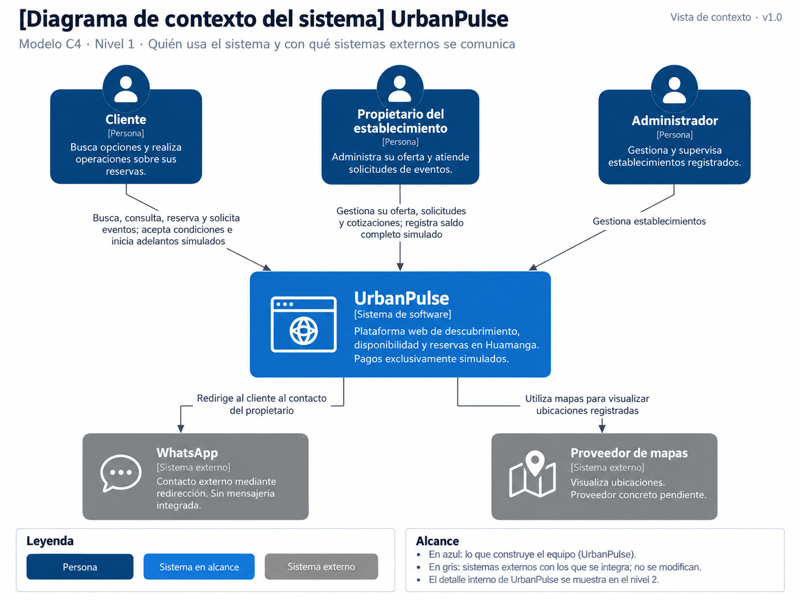

# UrbanPulse — Modelo C4, nivel 1: contexto del sistema

**Estado:** aprobado conceptualmente y cerrado documentalmente. No acredita implementación, despliegue ni pruebas ejecutadas.

## 1. Objetivo

Representar a UrbanPulse como un único sistema y mostrar las personas que interactúan directamente con él, los sistemas externos respaldados por los requisitos y las responsabilidades visibles desde el exterior. El límite funcional comprende el descubrimiento de establecimientos, la consulta de información y disponibilidad, las modalidades de reserva y la administración autorizada, incluidos los adelantos y registros de saldo exclusivamente simulados.

El C1 es una vista de alto nivel dirigida a participantes técnicos y del negocio. No muestra capas, módulos, componentes, controladores, puertos, adaptadores, tablas, bases de datos ni casos de uso técnicos. La aplicación web y su backend pertenecen al mismo sistema representado; la API REST no es un sistema externo.

El alcance se contrasta con el [catálogo de actores](../01-analisis-de-sistema/01-actores.md), las [historias de usuario](../01-analisis-de-sistema/02-historias-del-usuarios.md), los [requisitos funcionales](../01-analisis-de-sistema/03-requisitos-funcionales.md) y las [restricciones y decisiones DF/DP](../01-analisis-de-sistema/05-restricciones.md). Se preservan los estados de aprobación de esas fuentes.

La ubicación sigue la organización C4 de la Guía 004 de Arquitectura de Software, páginas 8 y 12, adaptando `docs/04-modelo-c4` a la carpeta existente `Doc`. Se conserva el nombre solicitado `01-contexto-c1.md`. La guía fue consultada como referencia académica local; sus ejemplos de Marketplace no constituyen requisitos de UrbanPulse y no se adopta su instrucción de realizar un commit.

## 2. Diagrama

**Leyenda:** `Person` representa un rol humano; `System`, el único sistema UrbanPulse y su límite funcional; `System_Ext`, un sistema ajeno a ese límite. Las flechas `Rel` expresan interacciones funcionales dirigidas, sin definir protocolos, orden temporal ni contratos técnicos. Las consultas incluyen las respuestas mostradas al usuario y no requieren flechas de retorno separadas.

Los sistemas externos están confirmados en el alcance documental, sin que ello acredite una integración implementada. La interacción con WhatsApp consiste en una redirección o apertura del servicio externo desde el navegador o dispositivo del cliente, sin comunicación servidor a servidor ni mensajería integrada en UrbanPulse (HU12/RF17/RC08). La conversación posterior entre cliente y propietario ocurre fuera de UrbanPulse y no se detalla en esta vista. La relación con mapas no decide si se utilizará navegación, incrustación u otro mecanismo.

El diagrama se presenta como imagen PNG. Esta vista no conserva el código Mermaid fuente ni afirma que la imagen se haya generado desde él.

## 3. Personas (usuarios)

Los nombres se toman del catálogo oficial. «Propietario» es la forma abreviada de «Propietario del establecimiento» en HU/RF.

| Actor | Descripción | Responsabilidades en UrbanPulse | HU/RF relacionados |
|---|---|---|---|
| Cliente | Persona que busca entretenimiento y recreación y realiza operaciones propias. | Buscar establecimientos; consultar información, disponibilidad y ubicación; reservar directamente canchas o karaoke; presentar solicitudes de salón/recreo y aceptar sus condiciones dentro de UrbanPulse; iniciar adelantos simulados; consultar sus reservas, estados y resumen autorizado; acceder al contacto por WhatsApp. No registra la recepción posterior del saldo. | HU01 → RF01; HU02 → RF02; HU03 → RF03; HU04 → RF05; RF04 y RF06 con HU03/HU04 **contextuales**; HU05 → RF07; HU09 → RF11/RF18/RF19; HU10 → RF14; HU12 → RF17; HU13 → RF16. DF-02 respalda la aceptación interna, con formalización detallada pendiente en HU05/HU08 y RF07/RF10/RF12. |
| Propietario del establecimiento | Responsable de la oferta y las operaciones autorizadas de su establecimiento. | Registrar y administrar información, servicios y condiciones; gestionar recursos, horarios y disponibilidad; configurar el adelanto por recurso de cancha/karaoke; revisar y aceptar o rechazar solicitudes de eventos; registrar cotizaciones y condiciones; consultar el resumen autorizado y registrar posteriormente el saldo completo simulado de reservas confirmadas propias, con correcciones trazables. | HU06 → RF08; HU07 → RF09; HU08 → RF10/RF12; HU14 → RF20 y RF14. Cotización y condiciones: DF-02, con HU05/HU08 y RF07/RF10/RF12 como contexto pendiente de formalización detallada. |
| Administrador | Responsable de gestionar y supervisar establecimientos registrados. | Consultar y revisar información, gestionar el estado del establecimiento y supervisar lo registrado según el alcance de HU11. No se le atribuye gestión de usuarios ni confirmación de eventos. | HU11 → RF15; AC04 y ADR-007 limitan el acceso por rol, sin ampliar competencias. |

Las asociaciones anteriores se verifican en las tablas de [HU](../01-analisis-de-sistema/02-historias-del-usuarios.md) y [RF](../01-analisis-de-sistema/03-requisitos-funcionales.md). Gestionar una solicitud por el cliente se limita a las acciones respaldadas de presentación y aceptación de condiciones; no presupone edición, reapertura, cancelación o una nueva función de consulta de solicitudes. RF12 expresa condiciones de confirmación, sin asignar al propietario el disparador de confirmación del evento (PC-03).

## 4. Sistemas

| Sistema | Tipo | Responsabilidad | Estado de integración | Evidencia |
|---|---|---|---|---|
| UrbanPulse | Sistema principal | Plataforma web para descubrir establecimientos, consultar información y disponibilidad, reservar según modalidad y administrar las operaciones previstas para cada actor, incluidos adelantos y saldo simulados. En C1 aparece como una unidad. | Alcance documentado; esta vista no acredita implementación. | RC01/RC05/RC06; RF01–RF12/RF14–RF20; DF-01–DF-06; ADR-001. |
| WhatsApp | Sistema externo confirmado en el alcance | Permitir el contacto externo entre cliente y propietario después de la redirección. UrbanPulse no administra conversaciones ni su historial. | Redirección aprobada; mecanismo técnico pendiente, sin evidencia de implementación en esta vista. | HU12 → RF17; RC08; catálogo de actores; DA06/ADR-006. |
| Proveedor de mapas | Sistema externo confirmado en el alcance, identificado por su función | Permitir visualizar la ubicación registrada de los establecimientos. | Uso de un servicio externo aprobado; proveedor y mecanismo concretos pendientes. | HU13 → RF16; RC09/RC10; catálogo de actores; DA06/ADR-006. |

La evidencia se encuentra en [actores](../01-analisis-de-sistema/01-actores.md), [HU/RF](../01-analisis-de-sistema/03-requisitos-funcionales.md), [restricciones](../01-analisis-de-sistema/05-restricciones.md), [drivers](../01-analisis-de-sistema/06-driver-arquitectonicos.md) y [ADR](../01-analisis-de-sistema/07-decisiones-arquitectonicas.md).

**Servicios mencionados y medios que no constituyen integraciones adicionales:**

- Google Maps figura como ejemplo previo, sin selección aprobada (RC09). Se representa la función genérica «Proveedor de mapas»; no se añade otro sistema por cada proveedor posible. No hay un proveedor GPS aprobado.
- «Servicio de pago simulado» se denomina sistema externo conceptual en parte del análisis. Las aclaraciones de RC07, DA06 y ADR-006 sitúan el componente de simulación dentro de UrbanPulse durante el MVP; por ello no se dibuja como sistema externo ni como integración financiera. No se afirma que esté implementado.
- Efectivo, Yape, Plin y transferencia son categorías informativas del registro simulado (DP-07). No representan bancos, billeteras o pasarelas conectadas.
- No hay un servicio externo de autenticación confirmado. ADR-007 exige autenticación y autorización por roles, pero deja pendiente el mecanismo; no justifica añadir un proveedor al C1.

Reservas, disponibilidad, establecimientos, pagos simulados y demás responsabilidades internas quedan comprendidas en UrbanPulse. La persistencia relacional y la API REST también son internas al límite de esta vista.

## 5. Relaciones

Las filas desglosan las cinco flechas del diagrama para mantener sus etiquetas legibles; no representan pasos secuenciales ni nuevas relaciones internas.

| Origen | Destino | Interacción | Finalidad | Referencia HU/RF | Estado |
|---|---|---|---|---|---|
| Cliente | UrbanPulse | Buscar y consultar información, disponibilidad y ubicación. | Elegir establecimiento y recurso con información disponible. | HU01/RF01; HU02/RF02; HU03/RF03; HU04/RF05; HU13/RF16. | Aprobada; consultar no retiene el recurso (consecuencia derivada RN-12). |
| Cliente | UrbanPulse | Reservar directamente cancha o karaoke por recurso, fecha y bloque/intervalo. | Obtener confirmación solo con adelanto simulado aprobado y disponibilidad válida. | RF04/RF06/RF12; HU03/RF04 y HU04/RF06 contextuales; HU09/RF11; DF-04. | Modalidad aprobada; precisión de cobertura HU pendiente. |
| Cliente | UrbanPulse | Presentar solicitud de salón/recreo y aceptar cotización y condiciones dentro de la plataforma. | Solicitar el evento y registrar la aceptación necesaria para evaluar su confirmación. | HU05/RF07; HU05/HU08 y RF07/RF10/RF12 como contexto de DF-02; RF12 explicita la aceptación como condición. | DF-02/DF-03 aprobadas; formalización detallada HU/RF pendiente. No asigna iniciador de confirmación. |
| Cliente | UrbanPulse | Iniciar adelanto simulado y consultar sus reservas, estados y resumen autorizado. | Conocer el resultado del adelanto y la situación de la reserva, distinguiendo total, adelanto aplicado, saldo y estado de registro. | HU09/RF11/RF18/RF19; HU10/RF14; DP-03/DP-10. | Aprobada; aprobación aislada no confirma. |
| Cliente | UrbanPulse | Solicitar contacto con el propietario mediante WhatsApp. | Acceder a la redirección de contacto complementaria. | HU12/RF17. | Aprobada; sin mensajería propia. |
| Propietario del establecimiento | UrbanPulse | Gestionar información, servicios, condiciones, recursos, horarios, disponibilidad y adelanto configurado. | Mantener la oferta propia y sus condiciones de reserva. | HU06/RF08; HU07/RF09. | Aprobada; no altera importes fijados de operaciones iniciadas. |
| Propietario del establecimiento | UrbanPulse | Revisar solicitudes de eventos, aceptarlas o rechazarlas y registrar cotizaciones y condiciones. | Atender las solicitudes y poner las condiciones a disposición de la aceptación del cliente. | HU08/RF10/RF12; DF-02 con cobertura contextual HU05/HU08 y RF07/RF10/RF12. | Acciones aprobadas; aceptar solicitud no confirma; detalle de cotización y aceptación pendiente. |
| Propietario del establecimiento | UrbanPulse | Registrar el saldo completo simulado de reserva confirmada propia, conservar correcciones y consultar el resumen autorizado. | Mantener un registro académico trazable con una recepción activa y su historial. | HU14/RF20/RF14; DF-05/DF-06; DP-04–DP-11. | Aprobada; procedimiento técnico de corrección y representación de saldo cero pendientes. |
| Administrador | UrbanPulse | Gestionar y supervisar establecimientos. | Mantener información válida de los establecimientos registrados. | HU11/RF15. | Aprobada; no incluye gestión de usuarios. |
| UrbanPulse | WhatsApp | Redirigir al cliente al contacto registrado del propietario. | Facilitar contacto fuera de UrbanPulse sin administrar mensajes. | HU12/RF17; RC08. | Alcance aprobado; integración no acreditada como implementada. No sustituye aceptación interna. |
| UrbanPulse | Proveedor de mapas | Utilizar un servicio externo para visualizar ubicaciones registradas. | Presentar la ubicación del establecimiento al cliente. | HU13/RF16; RC09. | Alcance aprobado; proveedor y mecanismo pendientes. |

## 6. Decisiones y supuestos

### Decisiones respaldadas

- **Ámbito web y local:** RC01/RC05 orientan UrbanPulse a una plataforma web para entretenimiento y recreación en Huamanga.
- **Modalidades diferenciadas:** RC06, DF-01–DF-04 y ADR-003 mantienen reserva directa de cancha/karaoke y solicitud de evento para salón/recreo. En recreos se reserva el ambiente o espacio definido por el propietario; no se presume exclusividad del establecimiento ni de todo el día. Los bloques de cancha no requieren duración uniforme.
- **Condiciones de confirmación:** RF04/RF06/RF12, DF-02–DF-04 y DP-12 exigen adelanto simulado aprobado y disponibilidad válida al confirmar; los eventos exigen además aceptación del cliente dentro de UrbanPulse. Aceptar la solicitud, aceptar condiciones y confirmar son hechos distintos. Una aprobación aislada del adelanto no confirma (RF19). Consultar o coordinar no retiene el recurso (RN-12, derivada); impedir confirmaciones incompatibles incluso concurrentes es una obligación aprobada (RN-13/AC03/DA02/ADR-004), con mecanismo pendiente PC-05.
- **Simulación académica:** RC07, DF-04–DF-06 y DP-01–DP-12 preservan adelantos y saldo simulados. Total y adelanto se muestran antes y quedan fijados al iniciar (DP-03). Saldo = total acordado menos adelanto aprobado y aplicado (DP-04). Solo el propietario autorizado registra posteriormente el saldo completo de una reserva confirmada propia, sin parciales, con reserva, importe, método informativo, autor, fecha/hora, una recepción activa e historial de correcciones. Cliente y propietario autorizados consultan el resumen. Registrar o corregir saldo no cambia Reserva ni resultado del adelanto. DP-08 aprueba sus dos estados informativos, sin aprobar otras máquinas de estados. No se fijan importes, porcentajes o plazos universales; saldo cero sigue pendiente, sin recepción ficticia.
- **Responsabilidades por rol:** HU11/RF15 y AC04/DA05/ADR-007 limitan al administrador a establecimientos. HU14/RF20 respalda el registro del saldo por el propietario autorizado, sin concederlo al cliente ni al administrador.
- **Límite externo:** HU12/RF17/RC08 respaldan WhatsApp como redirección; HU13/RF16/RC09 respaldan mapas externos sin elegir proveedor. AC08/DA06/ADR-006 respalda su desacoplamiento y la abstracción del simulador interno del MVP, sin añadir integraciones financieras.
- **Arquitectura vigente:** ADR-001 adopta Monolito Modular; ADR-002 establece Presentación, Aplicación, Dominio e Infraestructura. El C1 conserva UrbanPulse como una unidad y no muestra esa estructura. RC03/ADR-005, RC04/ADR-008 y ADR-009 siguen vigentes para comunicación interna, persistencia y consultas, sin seleccionar tecnologías, caché o métricas.
- **Exclusiones:** RF13 sigue pendiente; no se habilitan cancelación, devolución, expiración, reapertura ni cierre del ciclo. DF-01/DF-06 y RN-21 excluyen compra de comidas, entradas o actividades y reserva de habitaciones, pagos reales y comprobantes bancarios. No se introduce mensajería propia.

Estas decisiones se consultan en [restricciones y DF/DP](../01-analisis-de-sistema/05-restricciones.md), [calidad](../01-analisis-de-sistema/04-atributos-de-calidad.md), [drivers](../01-analisis-de-sistema/06-driver-arquitectonicos.md), [ADR](../01-analisis-de-sistema/07-decisiones-arquitectonicas.md), [RN y pendientes PC](../03-diseño-software/01-reglas-de-negocio.md), [estados](../03-diseño-software/02-estados-y-transiciones.md) y [flujos](../03-diseño-software/03-flujos-de-reserva.md).

### Supuestos de representación

- Agrupar las interacciones de cada persona en una flecha hacia UrbanPulse para mantener legibilidad; la tabla de relaciones conserva su detalle y trazabilidad.
- Mostrar un único nodo UrbanPulse, conforme al [nivel de contexto del modelo C4](https://c4model.com/diagrams/system-context). Su caja expresa el límite del sistema, sin requerir un contorno adicional ni descomponerlo.
- Representar mapas por la función aprobada del servicio, aunque el proveedor permanezca pendiente. WhatsApp se identifica por su nombre porque las fuentes lo especifican. No se añaden proveedores hipotéticos ni protocolos.
- Representar la redirección con una flecha UrbanPulse → WhatsApp como responsabilidad de navegación visible al usuario. No implica comunicación servidor a servidor ni gestión de la conversación posterior.
- Mantener leyenda textual junto al diagrama. La agrupación y las flechas son decisiones gráficas propuestas para auditoría; no aprueban tecnologías, permisos ni secuencias operativas nuevas.

### Pendientes por definir

| Aspecto | Evidencia y estado | Efecto sobre futuras versiones del C1 |
|---|---|---|
| Mapas | RC09/HU13/RF16 confirman el servicio externo; proveedor y mecanismo siguen pendientes. Google Maps es solo ejemplo previo. | Sustituir el nombre genérico únicamente cuando exista una selección aprobada; no añadir GPS ni otras capacidades por inferencia. |
| Contacto por WhatsApp | HU12/RF17/RC08 ya resuelven el alcance como redirección. Falta su mecanismo concreto; no hay mensajería integrada pendiente de aprobación en esta vista. | Precisar representación si cambia el alcance mediante aprobación; la aceptación de eventos sigue siendo interna. |
| Autenticación e integraciones adicionales | ADR-007/PC-11 dejan pendientes mecanismos concretos. No hay proveedor externo de identidad ni otras integraciones adicionales confirmadas. | Añadir un sistema externo solo ante evidencia de alcance aprobado. No se infiere de la existencia de roles. |
| Cobertura funcional | HU03/RF04 y HU04/RF06 son contextuales; DF-02 tiene formalización detallada pendiente. RF13 no está aprobado. | Revisar trazabilidad sin inventar HU/RF ni ampliar acciones del diagrama. |
| Cobertura de calidad | RF02/RF09/RF10 carecen de origen explícito en drivers; AC02/AC07 no tienen driver ni respuesta arquitectónica explícita. EQ conserva medidas y procedimientos pendientes de revisión. | No completar cadenas por analogía ni afirmar cumplimiento de atributos por este C1. |
| Imagen del diagrama | La vista se incluye como PNG; su visualización depende del visor utilizado. | Verificar la legibilidad en el entorno de entrega. |

**Discrepancias conservadas y criterio aplicado:**

- [README](../../README.md) y [arquitectura inicial](../02-arquitectura-software/01-arquitectura-inicial.md) describen una separación de tres capas; ADR-002 establece cuatro y tiene prioridad. La afirmación de armonización de la sección 3 de ADR no coincide con el texto inicial actual. El C1 no reproduce capas y deja constancia del desfase sin modificar las fuentes.
- README y arquitectura inicial enumeran pago simulado entre sistemas externos. Las precisiones de RC07, DA06 y ADR-006 lo sitúan como componente de UrbanPulse durante el MVP. Se aplica esa delimitación y se excluye un nodo financiero externo; la abstracción conceptual no demuestra despliegue externo.
- [Estilo arquitectónico](../02-arquitectura-software/02-estilo-arquitectonico.md) menciona ORM, pero no hay selección técnica aprobada. [Enfoque arquitectónico](../02-arquitectura-software/03-enfoque-arquitectonico.md) conserva el desacoplamiento. Ninguna mención habilita tecnologías o proveedores en el C1. La aprobación conceptual de patrones tampoco aprueba clases o firmas concretas del diseño interno.
- ADR conserva referencias gráficas desactualizadas, entre ellas nombres de arquitectura inicial y matriz HU/RF que no coinciden con los archivos versionados. No se utilizan esos destinos como evidencia del C1, no se corrigen otras etapas y no se afirma una nueva auditoría visual de sus imágenes.
- La guía utiliza `docs`, mientras UrbanPulse mantiene `Doc` y nombres propios por etapa. Se adapta únicamente la nueva carpeta C4; no se reorganiza el repositorio ni se copian tecnologías, actores o integraciones del Marketplace. Su mención de commit no prevalece sobre la prohibición expresa de esta tarea.

Los [PC-01–PC-12](../03-diseño-software/01-reglas-de-negocio.md#restricciones-del-mvp-y-pendientes-contractuales) continúan abiertos. Se distinguen de la identificación externa propia del C1: tratan principalmente contenido/versionado de cotización y aceptación (PC-01), creación y relaciones persistentes (PC-02), iniciador de confirmación (PC-03), alcance temporal y espacios compartidos (PC-04), concurrencia (PC-05), precisión y saldo cero (PC-06), aprobación sin demás condiciones (PC-07), fallos y duplicados (PC-08), cambios/no aceptación (PC-09), ciclo posterior (PC-10), permisos y autenticación (PC-11) y trazabilidad/evaluación (PC-12). PC-03 y PC-11 podrían precisar responsabilidades visibles futuras; este C1 no los resuelve. No se reabren la fórmula del saldo ni su registro manual completo, ya aprobados.

