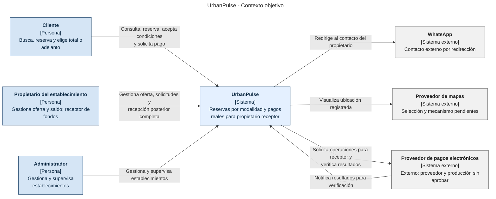
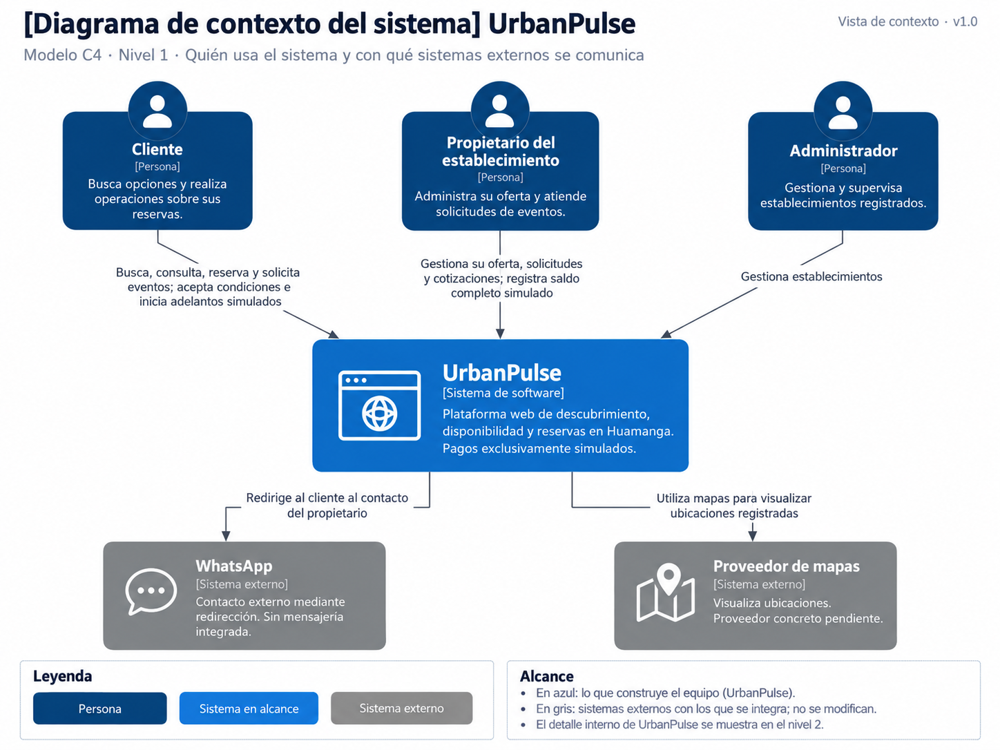

# UrbanPulse — Modelo C4, nivel 1: contexto del sistema

**Revisión Tarea 3 — 07/11/2026; pendiente de auditoría.** Se conserva el antecedente de aprobación conceptual y cierre documental de la estructura anterior. La revisión financiera no hereda ese cierre: el alcance funcional está establecido por [RC/DF/DP vigentes](../01-analisis-de-sistema/05-restricciones.md), mientras la respuesta arquitectónica de [ADR-012](../01-analisis-de-sistema/adr/ADR-012-modelo-pagos-mvp.md) sigue propuesta. Mercado Pago Marketplace Split 1:1 es solamente candidato, sin capacidades verificadas ni aprobación de producción. No se acredita implementación, despliegue o pruebas.

## 1. Objetivo

Representar UrbanPulse como un único sistema para descubrir entretenimiento y recreación en Huamanga, consultar información/disponibilidad y reservar según modalidad. Incluye pagos electrónicos reales completos o adelantos configurados, para el propietario receptor, y registro posterior separado del saldo. C1 no muestra capas, módulos, almacenes, REST o componentes técnicos.

Se contrasta con [actores](../01-analisis-de-sistema/01-actores.md), [HU](../01-analisis-de-sistema/02-historias-del-usuarios.md), [RF](../01-analisis-de-sistema/03-requisitos-funcionales.md) y [restricciones](../01-analisis-de-sistema/05-restricciones.md).

## 2. Diagrama

Fuente Mermaid editable; interacciones funcionales, sin contratos ni secuencia temporal. El rectángulo único UrbanPulse es el límite del sistema. La notación `flowchart` permite distribuir las relaciones sin superponer etiquetas. WhatsApp, mapas y pagos están fuera; Redis y RabbitMQ no son actores externos del contexto.

**Leyenda:** las cajas rotuladas Persona representan roles humanos; Sistema identifica el único UrbanPulse; Sistema externo identifica cada sistema fuera de su límite. Las flechas expresan interacción funcional dirigida, sin protocolo u orden temporal; incluyen respuesta sin exigir flecha inversa. Web/backend y REST quedan internos al sistema de C1.

**Pendiente visible:** proveedor sin selección definitiva; Mercado Pago Marketplace Split 1:1 solo candidato. Producción, vinculación del receptor y contratos por validar. La flecha al proveedor no acredita integración ni recaudación propia de UrbanPulse.

**PNG histórico desactualizado respecto del modelo financiero vigente:** omite la integración externa y conserva el alcance anterior. Se conserva sin reemplazar; no es la vista vigente ni se acredita revisión visual en esta tarea.

## 3. Personas (usuarios)

| Actor | Responsabilidad | Evidencia y límite |
|---|---|---|
| Cliente | Buscar, consultar disponibilidad/ubicación, reservar cancha/karaoke, solicitar salón/recreo, aceptar condiciones dentro de UrbanPulse, elegir total/adelanto y consultar resumen propio. | HU01–HU05/HU09/HU10/HU12/HU13; RF01–RF07/RF11/RF14/RF16–RF19. RF04/RF06 contextuales con HU03/HU04. No registra recepción del saldo. |
| Propietario del establecimiento | Gestionar oferta propia, recursos, horarios, disponibilidad y adelanto; revisar solicitudes y registrar cotización/condiciones; receptor de fondos y registro posterior de saldo completo positivo. | HU06–HU08/HU14; RF08–RF10/RF12/RF14/RF20; DF-02/DF-05. Iniciador de confirmación de eventos PC-03 pendiente. |
| Administrador | Gestionar y supervisar establecimientos. | HU11 → RF15; ADR-007. Sin gestión administrativa de usuarios o autoridad financiera añadida. |

La vinculación del propietario como receptor exige diseño y cobertura documental pendiente; esta vista no inventa un nuevo actor ni un flujo de alta aprobado.

## 4. Sistemas

| Sistema | Posición y responsabilidad | Estado |
|---|---|---|
| UrbanPulse | Único sistema principal: descubrimiento, disponibilidad, reservas diferenciadas y coordinación de pagos para propietario receptor. | RC01/RC05/RC06/RC07; alcance objetivo, sin implementación acreditada. |
| WhatsApp | Externo, contacto cliente–propietario por redirección. | HU12/RF17/RC08; sin mensajería propia ni almacenamiento de conversaciones. |
| Proveedor de mapas | Externo, visualización de ubicación registrada. | HU13/RF16/RC09/RC10; proveedor/frontera/mecanismo pendientes. Google Maps solo ejemplo histórico. |
| Proveedor de pagos electrónicos | Externo, operación real de total o adelanto con propietario receptor; resultados verificados por backend. | HU09/RF11/RF18/RF19/RC07; ADR-012 propuesta. Candidato sin aprobación de producción. |

Efectivo, Yape, Plin y transferencia declarados para el saldo no agregan sistemas bancarios ni conexiones financieras. No hay proveedor externo de autenticación seleccionado. Redis, RabbitMQ, web, backend y persistencia son detalles internos visibles en C2, no externos C1.

## 5. Relaciones

| Origen → destino | Interacción y límite | Respaldo |
|---|---|---|
| Cliente → UrbanPulse | Consulta, reserva directa o solicitud/aceptación interna de evento y elección de pago; consulta de situación autorizada. Consultar no retiene. | HU01–HU05/HU09/HU10; DF-01–DF-04; RN-12/RN-13. |
| Propietario → UrbanPulse | Oferta y solicitudes propias; cotización/condiciones; registro/corrección de recepción completa. Aceptar solicitud no confirma. | HU06–HU08/HU14; DF-02/DF-05; DP-05–DP-11. |
| Administrador → UrbanPulse | Gestión y supervisión de establecimientos dentro de HU11/RF15. | ADR-007; PC-11. |
| UrbanPulse → WhatsApp | Abrir contacto externo a petición del cliente; no sustituye aceptación interna. | HU12/RF17/RC08. |
| UrbanPulse → mapas | Visualizar ubicación; asignación técnica pendiente en C2. | HU13/RF16/RC09/RC10. |
| UrbanPulse → proveedor de pagos | Inicio, consulta/verificación y devolución cuando corresponda, con receptor identificado. Sin redistribución manual de fondos. | RC07; DF-06; ADR-006/ADR-012. Contratos propuestos. |
| Proveedor de pagos → UrbanPulse | Notificaciones de pago como señal para verificar. No confirman por sí solas. | ADR-012; PC-07/PC-08. |

No se dibuja un enlace financiero adicional entre propietario y proveedor que presuponga contratos/onboarding definidos. Los fondos corresponden al propietario; aprobación no acredita liquidación ni retiro inmediato.

## 6. Decisiones y supuestos

### Decisiones respaldadas

Cancha mantiene recurso, fecha y bloque configurado sin duración uniforme obligatoria; karaoke, sala, fecha e intervalo. Son reservas directas, sin solicitud de evento ni cotización obligatoria. Salón/recreo mantienen solicitud, revisión, cotización y condiciones aceptadas por el cliente dentro de UrbanPulse. Recreo reserva un ambiente/espacio definido, sin exclusividad presunta del establecimiento o del día (DF-01–DF-04).

El cliente elige total o adelanto configurado. Antes de iniciar se muestran y fijan total, adelanto, opción, importe, moneda y propietario receptor (DP-02/DP-03). Confirmar exige pago requerido verificado por backend y aplicado una sola vez, disponibilidad válida y ausencia de confirmaciones incompatibles concurrentes; eventos requieren además aceptación interna. Aprobación aislada, navegador o notificación sin verificar no confirman. Consultar/coordinar no retiene recursos (RN-12/RN-13; DP-12; PC-05).

Importe pendiente = total acordado − pago verificado y aplicado. Pago total aplicado implica cero; aprobado sin aplicar no se descuenta. La recepción posterior del saldo completo positivo se registra separadamente, sin doble descuento ni nuevo cobro de lo ya recibido. Solo propietario autorizado de reserva confirmada propia registra método declarado, importe, fecha de recepción, referencia cuando corresponda, autor y fecha/hora de registro; una recepción activa e historial de correcciones. Registrar/corregir no cambia Reserva ni resultado electrónico. Sin fraccionamientos posteriores ni recepción ficticia para cero, cuya etiqueta sigue pendiente (HU14/RF20; DF-05; DP-04–DP-11).

Operación electrónica, resultado verificado, aplicación, confirmación, recepción declarada y liquidación del proveedor son hechos distintos. Aprobados sin confirmación conservan evidencia para conciliación y devolución cuando corresponda; políticas, permisos y ejecución pendientes. Esto no habilita RF13, cancelación, expiración o reapertura. Efectivo, Yape, Plin y transferencia son métodos declarados del saldo, sin acreditar soporte electrónico del candidato. UrbanPulse no recauda para redistribuir manualmente fondos ni adopta comisión propia (RC07/DF-06; ADR-012).

### Supuestos de representación

La jerarquía aplicada es: solicitud explícita actual y Análisis vigente (actores, HU/RF, RC/DF/DP); decisiones estructurales ADR-001–ADR-011 y estado individual de ADR-012; RN/PC, estados y flujos; Diseño Interno; representación C4. Los informes son antecedentes auxiliares, no aprobaciones. Tarea 4 sincroniza AGENTS.md, README y los textos de arquitectura con pagos reales como objetivo y las cuatro capas de ADR-002. Las seis fuentes C1–C4 ya existen para revisión; sus PNG históricos siguen pendientes de actualización. Los ejemplos no seleccionan tecnología ni aprueban ADR-012.

El cierre histórico del C1 se conserva como antecedente; esta revisión queda revisable. Los informes y PNG no aprueban el proveedor o mecanismos. ADR-001 mantiene el Monolito Modular; ADR-002 las cuatro capas, sin dibujarlas en C1.

| Respaldo | Aplicación y límite |
|---|---|
| HU09 → RF11/RF18/RF19; RC07/RC10 y AC08 → DA06 → ADR-006/ADR-012 | Pagos reales con integración desacoplada; RF18 es origen explícito de DA06; RF11/RF19 son contexto allí y origen en DA08. Arquitectura financiera propuesta. |
| RF04/RF06/RF12 y AC03 → DA02 → ADR-004/ADR-012; RN-13, DP-12 | Confirmación compatible, disponibilidad válida y aplicación única; PC-05 pendiente. HU03/RF04 y HU04/RF06 son contextuales. |
| RC04 y RF11/RF19 → DA08 → ADR-008/ADR-012 | Evidencia definitiva por repositorios; AC03/AC05 son complementarios en DA08, sin garantía operativa inferida. |
| HU10/HU14 → RF14; HU14 → RF20; AC04 → DA05 → ADR-007; RF14/RF20 → DA08 → ADR-008/ADR-012 | Resumen autorizado y recepción posterior completa; autorización apoya ADR-012, sin nuevo origen RF18 → DA05. |
| RC03 → DA07 → ADR-005 | REST web–backend; AC05/AC08 complementarios en DA07. No impone REST entre módulos. |
| AC01 y RF01/RF03/RF05 → DA04 → ADR-009; ADR-010 complementaria | Consultas y fichas públicas; no cachear disponibilidad. ADR-011 procede de su cierre propio, sin nuevo driver de origen. |

La evidencia detallada reside en [HU](../01-analisis-de-sistema/02-historias-del-usuarios.md), [RF](../01-analisis-de-sistema/03-requisitos-funcionales.md), [AC](../01-analisis-de-sistema/04-atributos-de-calidad.md), [drivers](../01-analisis-de-sistema/06-driver-arquitectonicos.md) y [catálogo ADR](../01-analisis-de-sistema/07-decisiones-arquitectonicas.md#7-trazabilidad-y-estado-de-adr-012). RF02/RF09/RF10 carecen de origen explícito en drivers; AC02/AC07 no tienen driver/respuesta explícitos. DF-02 conserva formalización detallada pendiente; RF13 sigue pendiente. [EQ](../01-analisis-de-sistema/08-escenarios-atributos-calidad.md) propone evaluaciones y métricas por revisar, sin pruebas ejecutadas.

### Pendientes por definir

| Pendiente | Límite conservado |
|---|---|
| PC-01 | Contenido/versiones de cotización, servicios y evidencia de aceptación; DF-02 no formalizada completamente en HU/RF. |
| PC-02 | Creación, cardinalidades, asociaciones y propiedad relacional de Reserva/Solicitud/operación/aplicación/incidencia/saldo. |
| PC-03 | Iniciador y automatización de confirmación de eventos. Un webhook no los decide. |
| PC-04 | Periodos, extremos, solapamientos y espacios compartidos. |
| PC-05 | Garantía concurrente y coordinación aplicación única/confirmación/Disponibilidad; mecanismo y validación pendientes. Sin bloqueo, retención o expiración adoptados. |
| PC-06 | Moneda, precisión, límites, bruto/neto, tarifas y representación de cero; fórmula vigente y recepción completa no se reabren. |
| PC-07 | Evidencia recuperable de aprobación sin confirmación, aplicada o no, caídas tras cobro y responsables de conciliación/devolución. |
| PC-08 | Inicio/consulta/webhook/devolución, autenticidad, correlación, reintentos, duplicados entre canales, aplicación única, desorden e incertidumbre. |
| PC-09 | No aceptación, cambios y reapertura sin estados ni permisos nuevos. |
| PC-10 | RF13/ciclo posterior separados de devolución financiera: política, elegibilidad, importe, iniciador y evidencia final pendientes. |
| PC-11 | Matriz de permisos, seguridad, vinculación/renovación/revocación del receptor y custodia de credenciales. |
| PC-12 | Cobertura HU/RF/DA, onboarding si requiere formalización y evaluación EQ, sin cerrar vacíos por analogía. |

Fuente de detalle: [catálogo RN/PC](../03-diseño-software/01-reglas-de-negocio.md#restricciones-del-mvp-y-pendientes-contractuales), [estados](../03-diseño-software/02-estados-y-transiciones.md), [flujos](../03-diseño-software/03-flujos-de-reserva.md) y reconciliación de Tarea 2 (antecedente auxiliar local, fuera del repositorio). Un timeout no aprueba/rechaza ni autoriza automáticamente otro cobro. Deduplicar solo el ID del evento no evita aplicar dos eventos distintos del mismo pago. No se adopta transacción distribuida, Outbox, inbox, scheduler o cola financiera por esta representación.
