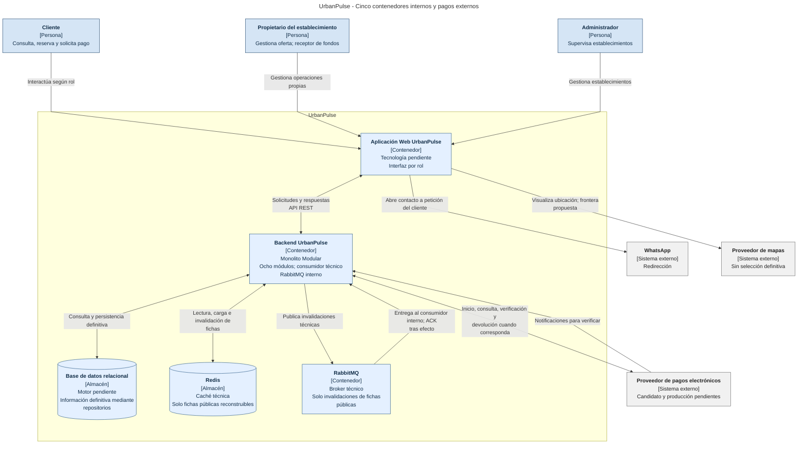

# UrbanPulse — Modelo C4, nivel 2: diagrama de contenedores

**Revisión Tarea 3 — 07/11/2026; pendiente de auditoría.** Se conserva el antecedente de aprobación conceptual y cierre documental de la estructura anterior. La revisión financiera no hereda ese cierre: el alcance funcional está establecido por [RC/DF/DP vigentes](../01-analisis-de-sistema/05-restricciones.md), mientras la respuesta arquitectónica de [ADR-012](../01-analisis-de-sistema/adr/ADR-012-modelo-pagos-mvp.md) sigue propuesta. Mercado Pago Marketplace Split 1:1 es solamente candidato, sin capacidades verificadas ni aprobación de producción. No se acredita implementación, despliegue o pruebas.

## 1. Objetivo

Ampliar [C1](01-contexto-c1.md) conservando exactamente cinco contenedores internos: Aplicación Web UrbanPulse, Backend UrbanPulse, Base de datos relacional, Redis y RabbitMQ. El proveedor financiero pertenece al exterior. La vista describe arquitectura objetivo, sin afirmar contenedores desplegados.

### Historial y reconciliación documental

La jerarquía aplicada es: solicitud explícita actual y Análisis vigente (actores, HU/RF, RC/DF/DP); decisiones estructurales ADR-001–ADR-011 y estado individual de ADR-012; RN/PC, estados y flujos; Diseño Interno; representación C4. Los informes son antecedentes auxiliares, no aprobaciones. Tarea 4 sincroniza AGENTS.md, README y los textos de arquitectura con pagos reales como objetivo y las cuatro capas de ADR-002. Las seis fuentes C1–C4 ya existen para revisión; sus PNG históricos siguen pendientes de actualización. Los ejemplos no seleccionan tecnología ni aprueban ADR-012.

Se conserva ADR-001–ADR-011 dentro de sus alcances. El supuesto del simulador interno se sustituye por integración externa real objetivo conforme a ADR-012, sin aprobar contrato o proveedor.

## 2. Diagrama

**Leyenda:** el subgrafo UrbanPulse delimita el sistema; las cajas Contenedor y los cilindros Almacén representan responsabilidades desplegables o almacenes internos, sin afirmar despliegue real. Los sistemas externos quedan fuera de ese límite. Flechas simples y dobles muestran comunicaciones dirigidas y bidireccionales; no son dependencias de código ni garantías transaccionales. Se usa Mermaid `flowchart` para distribuir y rotular las relaciones.

Las flechas muestran comunicaciones, no dependencia del Dominio hacia adaptadores ni garantía transaccional. API REST está aprobada para web–backend; los protocolos de los demás enlaces y los contratos financieros siguen pendientes. La relación bidireccional financiera incluye respuestas a operaciones; la notificación es una entrada distinta.

**Worker independiente: Preparado arquitectónicamente, no obligatorio inicialmente.** Consumidor técnico dentro del backend durante el MVP. Su extracción se implementará posteriormente cuando las necesidades operativas lo justifiquen, manteniendo fronteras de recepción/coordinación/invalidación sin modificar Dominio. No se dibuja un sexto contenedor interno, proceso desplegado o microservicio.

**PNG histórico desactualizado respecto de pagos reales externos y total/adelanto.** Se conserva como antecedente; la fuente vigente de esta revisión es Mermaid, pendiente de auditoría y futura exportación.

## 3. Contenedores

| Contenedor interno | Responsabilidad | Estado y límite |
|---|---|---|
| Aplicación Web UrbanPulse | Mostrar oferta, modalidades, importes/opción/receptor y resumen autorizado; enviar operaciones y presentar resultados. | RC01/RC03; no acredita aprobación por retorno del navegador ni expone credenciales del receptor. Tecnología pendiente. |
| Backend UrbanPulse | API REST, autorización, coordinación y reglas; ocho módulos; integración financiera por puerto/adaptador propuestos; consulta Redis, publicación y consumo de invalidaciones. | ADR-001/002/005/006/007; cuatro capas, sin servicios separados. Contratos y composición pendientes. |
| Base de datos relacional | Información propia de módulos: reservas, disponibilidad definitiva, aceptación, importes, operación/evidencia verificada, aplicación, incidencias y recepción posterior con historial. | RC04/ADR-008; autoridad definitiva de UrbanPulse, sin suplantar autoridad del proveedor sobre su resultado/liquidación. Modelo y motor pendientes. |
| Redis | Copias reconstruibles de fichas públicas; cache-aside y fallback a fuente definitiva. | ADR-010/D1–D6; sin pagos, credenciales, evidencia financiera, conciliaciones, reservas o disponibilidad autoritativa. |
| RabbitMQ | Transporte de invalidaciones técnicas al consumidor interno. | ADR-011; duplicados posibles, idempotencia requerida y ACK después del efecto. Sin pagos/webhooks/confirmación de reservas. |

### Límites de responsabilidad y colaboración

Backend conserva Usuarios, Establecimientos, Recursos, Disponibilidad, Reservas, Solicitudes, Servicios y Pagos. Colaboran mediante API públicas internas, sin REST interno obligatorio ni acceso a tablas privadas ajenas. Presentación recibe, Aplicación coordina, Dominio expresa reglas e Infraestructura implementa repositorios/adaptadores hacia el núcleo; Dominio no depende de Infraestructura. Un almacén lógico compartido no decide esquemas o propiedad relacional.

### Caché pública y respaldo relacional

La consulta de ficha no pasa por RabbitMQ. Hit físico no equivale a copia admisible; miss, error Redis, ausencia definitiva y falta de publicabilidad son distintos. D3/D4 requieren coordinación autoritativa de revisión/admisibilidad e inicio de emisión incluso con invalidación retrasada. No basta TTL. Una reconstrucción invalidada no se selecciona/emite como vigente; no se exige prohibir absolutamente toda escritura física tardía. Fallos relacionales no autorizan divulgar por defecto una copia.

### Publicación y consumo técnico de invalidaciones

Productores en casos de uso existentes de Establecimientos y, condicionalmente, Recursos/Servicios si cambian contenido incluido. Cambio relacional confirmado, intención, publicación, entrega y procesamiento son hechos distintos. Publisher confirm no acredita invalidación. Caída después del efecto antes de ACK puede duplicar entrega. Publicación fiable, conservación de intención, reintentos y recuperación pendientes; Outbox evaluado, no adoptado. RabbitMQ no hace atómicos el cambio relacional y Redis.

## 4. Relaciones

| Origen → destino | Información y límite | Fuente |
|---|---|---|
| Personas → Web | Operaciones por rol del C1; sin acceso directo a almacenes o broker. | HU01–HU14 según alcance; HU11/RF15 no amplía administrador. |
| Web ↔ Backend | API REST para consultas y operaciones; identidad confiable y validación en backend. | RC03/ADR-005/ADR-007; endpoints y errores pendientes. |
| Backend ↔ proveedor financiero externo | Inicio/correlación, consulta/verificación, identificación de receptor y devolución cuando corresponda. | RC07/RC10; ADR-006 y propuesta ADR-012. Sin SDK/protocolo/checkout elegido. |
| Proveedor → Backend | Notificación recibida en Presentación y verificada por backend; contrastar estado, importe, moneda, receptor y correlación. | ADR-012; autenticidad y contrato PC-08 pendientes. |
| Backend ↔ Base relacional | Datos definitivos por repositorios propios y fronteras autorizadas. | RC04/ADR-008; PC-02/PC-05/PC-08 sin resolver. |
| Backend ↔ Redis | Copias públicas reconstruibles: lectura/carga/invalidación y resultado técnico. | ADR-010/D1–D6; garantía de emisión por diseñar. |
| Backend → RabbitMQ → Backend | Publicación y entrega a consumidor interno; ACK posterior al efecto requerido. | ADR-011; conservación y recuperación no acreditadas. |
| Web → WhatsApp | Redirección al contacto registrado. | RC08/HU12/RF17; sin backend de mensajería. |
| Web → mapas | Visualización de ubicación, frontera propuesta; asignación definitiva pendiente. | RC09/RC10/HU13/RF16; sin aprobación de Backend → mapas. |

### Condiciones funcionales preservadas

Cancha mantiene recurso, fecha y bloque configurado sin duración uniforme obligatoria; karaoke, sala, fecha e intervalo. Son reservas directas, sin solicitud de evento ni cotización obligatoria. Salón/recreo mantienen solicitud, revisión, cotización y condiciones aceptadas por el cliente dentro de UrbanPulse. Recreo reserva un ambiente/espacio definido, sin exclusividad presunta del establecimiento o del día (DF-01–DF-04).

El cliente elige total o adelanto configurado. Antes de iniciar se muestran y fijan total, adelanto, opción, importe, moneda y propietario receptor (DP-02/DP-03). Confirmar exige pago requerido verificado por backend y aplicado una sola vez, disponibilidad válida y ausencia de confirmaciones incompatibles concurrentes; eventos requieren además aceptación interna. Aprobación aislada, navegador o notificación sin verificar no confirman. Consultar/coordinar no retiene recursos (RN-12/RN-13; DP-12; PC-05).

Importe pendiente = total acordado − pago verificado y aplicado. Pago total aplicado implica cero; aprobado sin aplicar no se descuenta. La recepción posterior del saldo completo positivo se registra separadamente, sin doble descuento ni nuevo cobro de lo ya recibido. Solo propietario autorizado de reserva confirmada propia registra método declarado, importe, fecha de recepción, referencia cuando corresponda, autor y fecha/hora de registro; una recepción activa e historial de correcciones. Registrar/corregir no cambia Reserva ni resultado electrónico. Sin fraccionamientos posteriores ni recepción ficticia para cero, cuya etiqueta sigue pendiente (HU14/RF20; DF-05; DP-04–DP-11).

Operación electrónica, resultado verificado, aplicación, confirmación, recepción declarada y liquidación del proveedor son hechos distintos. Aprobados sin confirmación conservan evidencia para conciliación y devolución cuando corresponda; políticas, permisos y ejecución pendientes. Esto no habilita RF13, cancelación, expiración o reapertura. Efectivo, Yape, Plin y transferencia son métodos declarados del saldo, sin acreditar soporte electrónico del candidato. UrbanPulse no recauda para redistribuir manualmente fondos ni adopta comisión propia (RC07/DF-06; ADR-012).

## 5. Decisiones arquitectónicas reflejadas

| Decisión | Representación |
|---|---|
| ADR-001/ADR-002 | Backend modular único y cuatro capas, sin crear contenedores por capa o módulo. |
| ADR-003/ADR-004 | Modalidades diferenciadas y confirmación compatible con disponibilidad integrada. |
| ADR-005/ADR-006 | REST web–backend y desacoplamiento de integraciones; el supuesto financiero histórico no limita el nuevo alcance. |
| ADR-007/ADR-008 | Roles/titularidad y repositorios hacia fuente relacional. |
| ADR-009/ADR-010 | Consultas organizadas y complemento Redis limitado a fichas públicas. |
| ADR-011 | Invalidaciones técnicas, consumidor interno; sin cola financiera. |
| ADR-012 | Total/adelanto real y receptor establecidos; integración financiera propuesta y proveedor sin validar. |

### Atributos de calidad y trazabilidad

| Respaldo | Aplicación y límite |
|---|---|
| HU09 → RF11/RF18/RF19; RC07/RC10 y AC08 → DA06 → ADR-006/ADR-012 | Pagos reales con integración desacoplada; RF18 es origen explícito de DA06; RF11/RF19 son contexto allí y origen en DA08. Arquitectura financiera propuesta. |
| RF04/RF06/RF12 y AC03 → DA02 → ADR-004/ADR-012; RN-13, DP-12 | Confirmación compatible, disponibilidad válida y aplicación única; PC-05 pendiente. HU03/RF04 y HU04/RF06 son contextuales. |
| RC04 y RF11/RF19 → DA08 → ADR-008/ADR-012 | Evidencia definitiva por repositorios; AC03/AC05 son complementarios en DA08, sin garantía operativa inferida. |
| HU10/HU14 → RF14; HU14 → RF20; AC04 → DA05 → ADR-007; RF14/RF20 → DA08 → ADR-008/ADR-012 | Resumen autorizado y recepción posterior completa; autorización apoya ADR-012, sin nuevo origen RF18 → DA05. |
| RC03 → DA07 → ADR-005 | REST web–backend; AC05/AC08 complementarios en DA07. No impone REST entre módulos. |
| AC01 y RF01/RF03/RF05 → DA04 → ADR-009; ADR-010 complementaria | Consultas y fichas públicas; no cachear disponibilidad. ADR-011 procede de su cierre propio, sin nuevo driver de origen. |

La evidencia detallada reside en [HU](../01-analisis-de-sistema/02-historias-del-usuarios.md), [RF](../01-analisis-de-sistema/03-requisitos-funcionales.md), [AC](../01-analisis-de-sistema/04-atributos-de-calidad.md), [drivers](../01-analisis-de-sistema/06-driver-arquitectonicos.md) y [catálogo ADR](../01-analisis-de-sistema/07-decisiones-arquitectonicas.md#7-trazabilidad-y-estado-de-adr-012). RF02/RF09/RF10 carecen de origen explícito en drivers; AC02/AC07 no tienen driver/respuesta explícitos. DF-02 conserva formalización detallada pendiente; RF13 sigue pendiente. [EQ](../01-analisis-de-sistema/08-escenarios-atributos-calidad.md) propone evaluaciones y métricas por revisar, sin pruebas ejecutadas.

### Discrepancias documentales y criterio aplicado

Tarea 4 sincroniza AGENTS.md, README y los textos de arquitectura general con total/adelanto real como objetivo y cuatro capas. La respuesta financiera sigue propuesta; no se aprueban integración o producción. ADR-010/011 conservan antecedentes de C2 con tres contenedores, ya superados por sus cierres y catálogo; no se presentan como estado actual. Las imágenes históricas no aprueban tecnologías ni arquitectura financiera.

### Pendientes arquitectónicos

| Pendiente | Límite conservado |
|---|---|
| PC-01 | Contenido/versiones de cotización, servicios y evidencia de aceptación; DF-02 no formalizada completamente en HU/RF. |
| PC-02 | Creación, cardinalidades, asociaciones y propiedad relacional de Reserva/Solicitud/operación/aplicación/incidencia/saldo. |
| PC-03 | Iniciador y automatización de confirmación de eventos. Un webhook no los decide. |
| PC-04 | Periodos, extremos, solapamientos y espacios compartidos. |
| PC-05 | Garantía concurrente y coordinación aplicación única/confirmación/Disponibilidad; mecanismo y validación pendientes. Sin bloqueo, retención o expiración adoptados. |
| PC-06 | Moneda, precisión, límites, bruto/neto, tarifas y representación de cero; fórmula vigente y recepción completa no se reabren. |
| PC-07 | Evidencia recuperable de aprobación sin confirmación, aplicada o no, caídas tras cobro y responsables de conciliación/devolución. |
| PC-08 | Inicio/consulta/webhook/devolución, autenticidad, correlación, reintentos, duplicados entre canales, aplicación única, desorden e incertidumbre. |
| PC-09 | No aceptación, cambios y reapertura sin estados ni permisos nuevos. |
| PC-10 | RF13/ciclo posterior separados de devolución financiera: política, elegibilidad, importe, iniciador y evidencia final pendientes. |
| PC-11 | Matriz de permisos, seguridad, vinculación/renovación/revocación del receptor y custodia de credenciales. |
| PC-12 | Cobertura HU/RF/DA, onboarding si requiere formalización y evaluación EQ, sin cerrar vacíos por analogía. |

Fuente de detalle: [catálogo RN/PC](../03-diseño-software/01-reglas-de-negocio.md#restricciones-del-mvp-y-pendientes-contractuales), [estados](../03-diseño-software/02-estados-y-transiciones.md), [flujos](../03-diseño-software/03-flujos-de-reserva.md) y reconciliación de Tarea 2 (antecedente auxiliar local, fuera del repositorio). Un timeout no aprueba/rechaza ni autoriza automáticamente otro cobro. Deduplicar solo el ID del evento no evita aplicar dos eventos distintos del mismo pago. No se adopta transacción distribuida, Outbox, inbox, scheduler o cola financiera por esta representación.

Además siguen abiertos lenguaje/framework, motor relacional/ORM, composición, contratos REST, proveedor/frontera de mapas, autenticación, Redis (claves/TTL/versiones/recuperación), RabbitMQ (contratos/durabilidad/confirms/ACK/reintentos/DLQ) y sincronización D3/D4. La preparación del worker no aprueba configuración o extracción inmediata.

## 6. Seguridad entre contenedores

### 6.1 Frontera entre usuarios y Aplicación Web

Autenticación y autorización por rol y titularidad, con matriz/mecanismos PC-11 pendientes. Ocultar botones no concede ni protege permisos. Cliente consulta lo propio; propietario gestiona operaciones propias; administrador se limita a establecimientos.

### 6.2 Frontera entre Aplicación Web y Backend

Backend valida identidad/entradas y obtiene importes/receptor de fuentes autorizadas. El navegador no acredita pago o disponibilidad. Retorno de checkout no confirma; credenciales y evidencia protegida no forman parte de contenido público.

### 6.3 Frontera entre Backend y Base de datos

Repositorios por responsabilidad; sin acceso web directo o tablas privadas ajenas. Acceso mínimo y conservación de evidencia/historial requieren diseño. Un repositorio no prueba atomicidad o compatibilidad concurrente.

### 6.4 Fronteras con sistemas externos

Finanzas: comprobar autenticidad, consultar/contrastar resultados servidor a servidor y preservar incertidumbre; contratos, secretos y vinculación/revocación del receptor pendientes. Producción exige validar candidato en Perú, medios, liquidación, costes y devoluciones conforme ADR-012. No se afirman capacidades actuales. WhatsApp y mapas mantienen sus límites genéricos.

### 6.5 Matriz de seguridad

| Frontera | Obligación | Pendiente |
|---|---|---|
| Personas/Web/Backend | Rol, titularidad, identidad y validación de entradas. | PC-11; contratos REST. |
| Backend/Proveedor | Autenticidad, receptor correcto, correlación, aplicación única e incertidumbre preservada. | PC-06–PC-08/PC-11; vinculación y custodia de credenciales. |
| Backend/Relacional | Datos propios, evidencia recuperable, consistencia y acceso mínimo. | PC-02/PC-05/PC-08; persistencia concreta. |
| Backend/Redis | Solo proyección pública admisible, sin datos financieros/protegidos. | D3/D4; emisión/revisión/recuperación. |
| Backend/RabbitMQ | Validar forma/versión/alcance; idempotencia y ACK tras efecto. | Publicación, contratos, permisos y recuperación. |

### 6.6 Frontera entre Backend y Redis

No cachear autoridad de acceso, credenciales, reservas, disponibilidad, evidencia financiera o conciliaciones. Retirar visibilidad exige protección D3/D4 independiente de invalidación asíncrona. Seguridad, capacidad y operación siguen pendientes.

### 6.7 Frontera entre Backend y RabbitMQ

Mensajes mínimos de invalidación técnica, acceso restringido y diagnóstico sin datos sensibles; contratos por diseñar. Ningún mensaje autoriza negocio o acredita pago. Una extensión a pagos/webhooks exige nueva decisión arquitectónica; no se aprueba por ADR-012.
