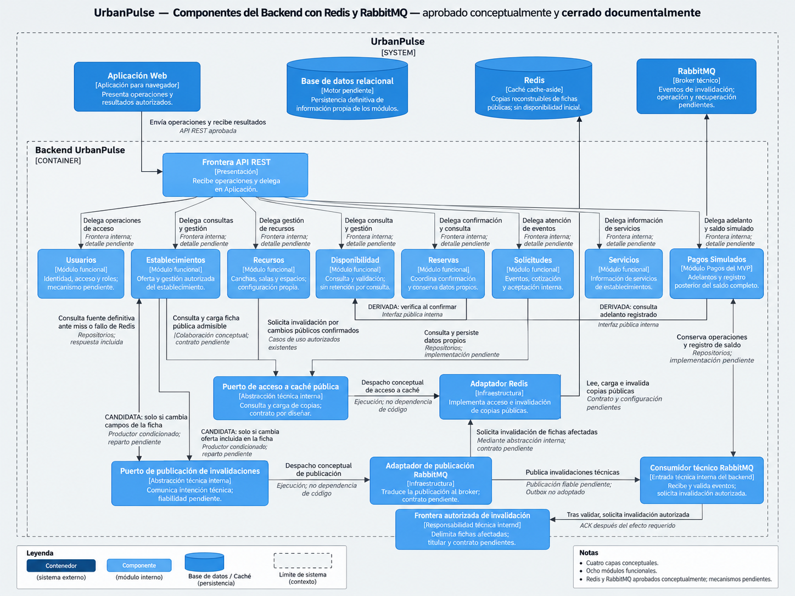

# Nivel 3 · Diagrama de componentes

**Revisión Tarea 3 — 07/11/2026; pendiente de auditoría.** Se conserva el antecedente de aprobación conceptual y cierre documental de la estructura anterior. La revisión financiera no hereda ese cierre: el alcance funcional está establecido por [RC/DF/DP vigentes](../01-analisis-de-sistema/05-restricciones.md), mientras la respuesta arquitectónica de [ADR-012](../01-analisis-de-sistema/adr/ADR-012-modelo-pagos-mvp.md) sigue propuesta. Mercado Pago Marketplace Split 1:1 es solamente candidato, sin capacidades verificadas ni aprobación de producción. No se acredita implementación, despliegue o pruebas.

## 1. Objetivo

Abrir el Backend UrbanPulse del [C2](02-contenedores-c2.md) para representar ocho módulos funcionales y seis responsabilidades técnicas conceptuales de caché/mensajería. La frontera API REST agrupa entradas de Presentación; no es un noveno módulo. Los componentes no son microservicios ni clases obligatorias.

### Base documental y niveles de evidencia

La jerarquía aplicada es: solicitud explícita actual y Análisis vigente (actores, HU/RF, RC/DF/DP); decisiones estructurales ADR-001–ADR-011 y estado individual de ADR-012; RN/PC, estados y flujos; Diseño Interno; representación C4. Los informes son antecedentes auxiliares, no aprobaciones. Tarea 4 sincroniza AGENTS.md, README y los textos de arquitectura con pagos reales como objetivo y las cuatro capas de ADR-002. Las seis fuentes C1–C4 ya existen para revisión; sus PNG históricos siguen pendientes de actualización. Los ejemplos no seleccionan tecnología ni aprueban ADR-012.

El [Diseño Interno](../03-diseño-software/diseño-interno/diseño-interno-de-modulos.md), [Patrones](../03-diseño-software/diseño-interno/patrones-de-diseño.md) y [SOLID](../03-diseño-software/diseño-interno/principios-de-diseño.md) distinguen coordinación, reglas, puertos y adaptadores. Los cierres previos no aprueban contratos financieros concretos. ADR-010/ADR-011 y D1–D6 conservan alcance aprobado; la descomposición financiera es propuesta revisable de ADR-012.

### Reconciliación de vistas

C1 añade proveedor financiero externo genérico; C2 conserva cinco contenedores; C3 mantiene ocho módulos y seis responsabilidades técnicas. Pagos sustituye al nombre histórico «Pagos Simulados», sin módulo adicional. C4-01 representa solo confirmación directa; C4-02/C4-03 conservan caché e invalidación.

## 2. Diagrama

Se utiliza Mermaid de componentes C4. Las relaciones funcionales son interfaces públicas internas; respuestas implícitas no añaden flechas recíprocas. Las relaciones técnicas expresan ejecución, sin invertir las dependencias de código de ADR-002.

La distribución usa Mermaid `flowchart`: el subgrafo delimita el backend; las cajas identifican módulos y responsabilidades técnicas, y las flechas conservan las colaboraciones dirigidas de la vista. No representan dependencias de código entre capas.

```mermaid
---
title: UrbanPulse - Backend modular y responsabilidades técnicas
config:
  flowchart:
    nodeSpacing: 100
    rankSpacing: 130
    wrappingWidth: 400
    curve: linear
---
flowchart LR
    web["<b>Aplicación Web</b><br/>[Contenedor]<br/>Contexto C2<br/>Interfaz por rol"]
    subgraph back["Backend UrbanPulse - Monolito Modular"]
    api["<b>Frontera API REST</b><br/>[Componente]<br/>Presentación<br/>Entradas por rol y notificaciones<br/>financieras para verificar"]
    usuarios["<b>Usuarios</b><br/>[Componente]<br/>Módulo funcional<br/>Identidad y roles"]
    establecimientos["<b>Establecimientos</b><br/>[Componente]<br/>Módulo funcional<br/>Oferta y coordinación de ficha<br/>pública"]
    recursos["<b>Recursos</b><br/>[Componente]<br/>Módulo funcional<br/>Unidades, horarios y adelanto<br/>configurado"]
    servicios["<b>Servicios</b><br/>[Componente]<br/>Módulo funcional<br/>Oferta informativa"]
    disponibilidad["<b>Disponibilidad</b><br/>[Componente]<br/>Módulo funcional<br/>Validez temporal; coordinación<br/>pendiente"]
    reservas["<b>Reservas</b><br/>[Componente]<br/>Módulo funcional<br/>Condiciones y confirmación<br/>compatible"]
    solicitudes["<b>Solicitudes</b><br/>[Componente]<br/>Módulo funcional<br/>Eventos, cotización y aceptación<br/>interna"]
    pagos["<b>Pagos</b><br/>[Componente]<br/>Módulo funcional<br/>Operación, receptor, verificación,<br/>aplicación única, saldo e<br/>incidencias"]
    cachePort["<b>Puerto de acceso a caché pública</b><br/>[Componente]<br/>Abstracción<br/>Lectura y carga de fichas"]
    redisAdapter["<b>Adaptador Redis</b><br/>[Componente]<br/>Infraestructura<br/>Acceso e invalidación de copias"]
    pubPort["<b>Puerto de publicación de invalidaciones</b><br/>[Componente]<br/>Abstracción<br/>Intenciones técnicas"]
    pubAdapter["<b>Adaptador de publicación RabbitMQ</b><br/>[Componente]<br/>Infraestructura<br/>Traducción al broker"]
    consumer["<b>Consumidor técnico RabbitMQ</b><br/>[Componente]<br/>Entrada interna del backend<br/>Validación y coordinación; ACK tras<br/>efecto"]
    invalidation["<b>Frontera autorizada de invalidación</b><br/>[Componente]<br/>Abstracción interna<br/>Alcance y efecto técnico"]
    end
    db[("<b>Base de datos relacional</b><br/>[Almacén]<br/>Contexto C2<br/>Fuente definitiva mediante<br/>repositorios")]
    redis[("<b>Redis</b><br/>[Almacén]<br/>Contexto C2<br/>Fichas públicas reconstruibles")]
    rabbit["<b>RabbitMQ</b><br/>[Contenedor]<br/>Contexto C2<br/>Invalidaciones técnicas"]
    finanzas["<b>Proveedor de pagos electrónicos</b><br/>[Sistema externo]<br/>Externo; producción y contratos<br/>pendientes"]
    web -->|"Consultas y operaciones<br/>API REST"| api
    api -->|"Delega acceso"| usuarios
    api -->|"Delega consulta y gestión"| establecimientos
    api -->|"Delega gestión"| recursos
    api -->|"Delega oferta"| servicios
    api -->|"Delega consulta y gestión"| disponibilidad
    api -->|"Delega confirmación y consulta"| reservas
    api -->|"Delega eventos y aceptación"| solicitudes
    api -->|"Delega operaciones y señal financiera<br/>para verificar"| pagos
    reservas -->|"Consulta por API pública interna"| disponibilidad
    reservas -->|"Coordina evidencia y aplicación por<br/>API pública interna; contrato<br/>pendiente"| pagos
    pagos -->|"Inicio, consulta, verificación y<br/>devolución; puerto y adaptador<br/>propuestos"| finanzas
    finanzas -->|"Notifica para verificación backend"| api
    reservas -->|"Persistencia propia por repositorios;<br/>garantía PC-05 pendiente"| db
    pagos -->|"Evidencia y aplicación propias por<br/>repositorios"| db
    establecimientos -->|"Datos propios y fallback por<br/>repositorios"| db
    establecimientos -->|"Consulta y carga pública"| cachePort
    cachePort -->|"Despacho conceptual por abstracción"| redisAdapter
    redisAdapter -->|"Lee, carga e invalida"| redis
    establecimientos -->|"Cambio público confirmado"| pubPort
    recursos -->|"Solo si cambia contribución incluida"| pubPort
    servicios -->|"Solo si cambia oferta incluida"| pubPort
    pubPort -->|"Despacho conceptual por abstracción"| pubAdapter
    pubAdapter -->|"Publica invalidación"| rabbit
    rabbit -->|"Entrega; duplicados posibles"| consumer
    consumer -->|"Solicita efecto autorizado"| invalidation
    invalidation -->|"Despacho conceptual para invalidar"| redisAdapter
    classDef internal fill:#e4f0ff,stroke:#245580,color:#102c46
    classDef external fill:#f1f1f1,stroke:#666,color:#222
    classDef person fill:#d5e5f5,stroke:#163e67,color:#102c46
    class web,api,usuarios,establecimientos,recursos,disponibilidad,reservas,solicitudes,servicios,pagos,cachePort,redisAdapter,pubPort,pubAdapter,consumer,invalidation,db,redis,rabbit internal
    class finanzas external
```

**Pendientes visibles:** PC-02/PC-05/PC-08: asociación, aplicación única, concurrencia y recuperación sin mecanismo seleccionado. El dibujo no es protocolo financiero completo ni prueba atomicidad. Los adaptadores dependen del contrato interno que realizan, aunque el flujo de ejecución se lea desde el puerto.

**Worker independiente: Preparado arquitectónicamente, no obligatorio inicialmente.** Consumidor técnico interno durante el MVP; se extraerá posteriormente cuando las necesidades operativas lo justifiquen, sin nuevo módulo o microservicio inicial.

**PNG histórico desactualizado:** conserva Pagos Simulados y omite responsabilidades de integración real. Se conserva sin modificación; no es el diagrama vigente de esta revisión.

## 3. Componentes

| Módulo funcional | Responsabilidad | Frontera y límite |
|---|---|---|
| Usuarios | Identidad y roles. | Controles por rol/titularidad en cada operación; PC-11 pendiente. Sin gestión administrativa de usuarios. |
| Establecimientos | Consulta y gestión autorizada de oferta; coordinación de ficha pública. | HU01/HU02/HU06/HU11; RF01/RF02/RF08/RF15; D1–D6. No absorbe autoridad de Recursos/Servicios. |
| Recursos | Unidades, horarios y configuración de adelanto. | HU07/RF09; DF-01/DF-04; DP-03. No altera importes de operación iniciada. |
| Disponibilidad | Consultar/verificar selección temporal. | HU03/RF03, HU04/RF05; ADR-004; PC-04/PC-05. Consultar no retiene. |
| Reservas | Condiciones, datos propios y confirmación consistente; consulta de situación y vínculo de pago aplicado. | RF04/RF06/RF12/RF14/RF19; consulta/coordina por API públicas. No interpreta SDK del proveedor. |
| Solicitudes | Solicitud y revisión de salón/recreo, cotización/condiciones y aceptación interna. | HU05/HU08; RF07/RF10; DF-02; PC-01–PC-03. Aceptar solicitud no confirma. |
| Servicios | Información y gestión de oferta pública. | HU02/HU06; RF02/RF08 y RF07 como contexto. Publicación no incluye automáticamente servicios en cotización. |
| Pagos | Inicio/correlación, propietario receptor, verificación del proveedor, procesamiento idempotente, aplicación única, consulta de pagos/saldos, registro posterior completo, conciliación/incidencias y devolución cuando corresponda. | HU09/HU14; RF11/RF14/RF18–RF20; RC07; DP-01–DP-12; ADR-012 propuesta. Contratos, políticas y operación pendientes. |

### Responsabilidades internas sin módulos autónomos

Pagos conserva esas nueve responsabilidades conceptuales dentro del mismo módulo; no exige una clase o servicio por responsabilidad. Presentación recibe la notificación; Aplicación coordina; Infraestructura adapta/verifica según el contrato del proveedor y consulta su autoridad; Dominio expresa reglas sin SDK, secretos o estados particulares del candidato. Registro declarado de saldo es un caso de uso separado del cobro y la confirmación. No se crean módulos de Webhooks, Saldo, Conciliación, Cotizaciones o Administración.

### Componentes técnicos internos propuestos

Se conservan las seis responsabilidades existentes; nombres y distribución concreta no son clases aprobadas. No se mezclan con Pagos ni se añade una séptima responsabilidad técnica financiera a este inventario acotado.

| Componente técnico | Responsabilidad y colaboración | Capa o frontera conceptual | Estado y límite |
|---|---|---|---|
| Puerto de acceso a caché pública | Permitir a los casos de uso de consulta pública de Establecimientos solicitar lectura y carga de copias reconstruibles. | Abstracción hacia el núcleo apropiado; ubicación exacta pendiente. | ADR-010; contrato y composición de la proyección pública por diseñar, sin cachear disponibilidad ni permisos como autoridad. |
| Adaptador Redis | Implementar acceso e invalidación de copias mediante las abstracciones internas pertinentes. | Infraestructura; depende de contratos internos. | Tecnología conceptual adoptada; cliente, claves, TTL, versiones, evicción y configuración pendientes. No aplica reglas de confirmación. |
| Puerto de publicación de invalidaciones | Recibir intenciones técnicas de casos de uso autorizados que modifiquen campos incluidos en la ficha. | Abstracción interna consumida por Aplicación; ubicación y firma pendientes. | ADR-011; Establecimientos como productor pertinente. Recursos/Servicios candidatos condicionados; no crea un módulo productor separado. |
| Adaptador de publicación RabbitMQ | Traducir la publicación al broker sin exponer el cliente técnico al núcleo. | Infraestructura. | ADR-011; publicación directa u Outbox por decidir; no acredita atomicidad con el cambio relacional. |
| Consumidor técnico RabbitMQ | Recibir y validar eventos, limitar su alcance y solicitar invalidación autorizada. | Entrada técnica dentro del backend; recepción de transporte y coordinación separables según ADR-002. | ADR-011; reparto concreto entre adaptador receptor y coordinación pendiente. ACK después del efecto requerido; sin permisos de negocio por recibir mensajes. |
| Frontera autorizada de invalidación | Delimitar las fichas afectadas y solicitar al adaptador Redis el efecto conforme a la política de caché. | Frontera técnica interna mediante abstracción; titular modular y ubicación exactos pendientes. | ADR-010/ADR-011; no autoriza acceso a tablas privadas ajenas ni decide por sí sola retirada de visibilidad segura. |

Productores en casos de uso existentes de Establecimientos; Recursos/Servicios solo si cambian campos incluidos. Usuarios, Disponibilidad, Reservas, Solicitudes y Pagos no adquieren productores por inferencia.

## 4. Relaciones entre componentes

| Origen → destino | Colaboración y límite |
|---|---|
| Frontera API REST → ocho módulos | Delega entradas en los casos de uso correspondientes; no absorbe reglas o casos de uso. |
| Reservas → Disponibilidad | Verificación de selección al confirmar por API pública; no resuelve PC-05. |
| Reservas → Pagos | Obtiene contexto/evidencia y coordina aplicación única mediante API pública propuesta. No inicia otro cobro por confirmar. Acuerdo aplicación/confirmación PC-05/PC-08 pendiente. |
| Entrada financiera → Pagos → adaptador externo | Notificación como señal; consultar y contrastar estado, importe, moneda, receptor y correlación. Sin autoridad del navegador. |

Las respuestas están incluidas en la colaboración. No se añade un callback Pagos → Reservas ni ciclos funcionales. RF19 exige reflejar resultado y distinguir aprobación/aplicación/confirmación, sin fijar mecanismo de notificación interna.

### Colaboraciones que no se dibujan

Cotización/aceptación e iniciador de evento (Solicitudes/Reservas), origen de configuración (Recursos/Pagos), titularidad del receptor (Establecimientos/Usuarios/Pagos), resumen y recepción de reserva confirmada propia requieren contratos públicos aún pendientes. La obligación de obtener evidencia no autoriza lecturas de tablas privadas ni llamadas recíprocas. Agregador, dirección y modelo persistido PC-01–PC-03/PC-08/PC-11 por diseñar. El recorrido directo no representa eventos con un booleano de aceptación enviado por cliente.

### Colaboraciones técnicas de caché y mensajería

Establecimientos consulta mediante puerto/adaptador Redis y reconstruye desde fuentes definitivas autorizadas ante miss/fallo; la consulta no pasa por broker. Productores pertinentes solicitan publicación por puerto/adaptador; RabbitMQ entrega al consumidor interno, que valida alcance y solicita efecto por frontera autorizada/adaptador Redis. ACK solo después del efecto requerido. Publicación, entrega y procesamiento no son el mismo hecho ni una transacción compartida.

### Seguridad, fallos y recuperación por diseñar

Redis excluye reservas, disponibilidad, pagos definitivos, credenciales, evidencia financiera, aceptación particular y conciliaciones. D3/D4 protege admisibilidad/revisión/emisión independientemente del broker; invalidación asíncrona/TTL no bastan para confidencialidad. No seleccionar/emitir reconstrucción invalidada como vigente; prohibición absoluta de toda escritura física tardía no adoptada.

Publicación después del commit puede perder la intención; no se promete recuperarla si no se conservó. Duplicados/desorden posibles; idempotencia y ACK posterior al efecto son obligaciones por concretar. Publisher confirm no acredita procesamiento. Outbox evaluado, no adoptado; entrega al menos una vez es objetivo condicionado a garantías concretas. Reintentos/DLQ, permisos, supervisión y recuperación pendientes. Idempotencia de invalidación no resuelve idempotencia financiera.

## 5. Relaciones con contenedores y sistemas externos

| Frontera | Responsabilidad y estado |
|---|---|
| Web ↔ Backend | API REST según RC03/ADR-005. |
| Módulos ↔ Relacional | Repositorios propios/contratos públicos autorizados según RC04/ADR-008. Se dibujan Reservas/Pagos/Establecimientos; los otros cinco conservan persistencia propia, omitida por legibilidad. |
| Pagos ↔ proveedor financiero | Puerto interno y adaptador en Infraestructura propuestos, representados en la etiqueta de la relación; no módulo adicional. Proveedor externo, producción y protocolos pendientes. |
| Proveedor → Presentación → Pagos | Notificación para verificar; contrato de autenticidad/consulta PC-08 pendiente. |
| Adaptadores técnicos ↔ Redis/RabbitMQ | Solo fichas reconstruibles e invalidaciones; consumidor dentro del backend. |
| Web → WhatsApp/mapas | Contexto de C2; WhatsApp solo redirección y frontera web–mapas propuesta, sin asignar llamada backend–mapas. |

Las personas usan la web; no acceden directamente a almacenes, broker o interfaces privadas. Flechas de ejecución hacia persistencia no significan dependencia del Dominio hacia Infraestructura.

## 6. Reglas del monolito modular

Ocho módulos en un único backend; cada uno mantiene Presentación, Aplicación, Dominio e Infraestructura. Dependencias de código hacia el núcleo; Infraestructura realiza contratos internos. Colaboración por API públicas internas; compartir base no autoriza tablas ajenas. REST corresponde a web–backend. Repositorios, Adapter e inyección no prueban atomicidad/concurrencia ni adoptan Strategy, Factory, State o Specification.

### Condiciones funcionales que las colaboraciones deben preservar

Cancha mantiene recurso, fecha y bloque configurado sin duración uniforme obligatoria; karaoke, sala, fecha e intervalo. Son reservas directas, sin solicitud de evento ni cotización obligatoria. Salón/recreo mantienen solicitud, revisión, cotización y condiciones aceptadas por el cliente dentro de UrbanPulse. Recreo reserva un ambiente/espacio definido, sin exclusividad presunta del establecimiento o del día (DF-01–DF-04).

El cliente elige total o adelanto configurado. Antes de iniciar se muestran y fijan total, adelanto, opción, importe, moneda y propietario receptor (DP-02/DP-03). Confirmar exige pago requerido verificado por backend y aplicado una sola vez, disponibilidad válida y ausencia de confirmaciones incompatibles concurrentes; eventos requieren además aceptación interna. Aprobación aislada, navegador o notificación sin verificar no confirman. Consultar/coordinar no retiene recursos (RN-12/RN-13; DP-12; PC-05).

Importe pendiente = total acordado − pago verificado y aplicado. Pago total aplicado implica cero; aprobado sin aplicar no se descuenta. La recepción posterior del saldo completo positivo se registra separadamente, sin doble descuento ni nuevo cobro de lo ya recibido. Solo propietario autorizado de reserva confirmada propia registra método declarado, importe, fecha de recepción, referencia cuando corresponda, autor y fecha/hora de registro; una recepción activa e historial de correcciones. Registrar/corregir no cambia Reserva ni resultado electrónico. Sin fraccionamientos posteriores ni recepción ficticia para cero, cuya etiqueta sigue pendiente (HU14/RF20; DF-05; DP-04–DP-11).

Operación electrónica, resultado verificado, aplicación, confirmación, recepción declarada y liquidación del proveedor son hechos distintos. Aprobados sin confirmación conservan evidencia para conciliación y devolución cuando corresponda; políticas, permisos y ejecución pendientes. Esto no habilita RF13, cancelación, expiración o reapertura. Efectivo, Yape, Plin y transferencia son métodos declarados del saldo, sin acreditar soporte electrónico del candidato. UrbanPulse no recauda para redistribuir manualmente fondos ni adopta comisión propia (RC07/DF-06; ADR-012).

### Trazabilidad de decisiones hacia el C3

| Respaldo | Aplicación y límite |
|---|---|
| HU09 → RF11/RF18/RF19; RC07/RC10 y AC08 → DA06 → ADR-006/ADR-012 | Pagos reales con integración desacoplada; RF18 es origen explícito de DA06; RF11/RF19 son contexto allí y origen en DA08. Arquitectura financiera propuesta. |
| RF04/RF06/RF12 y AC03 → DA02 → ADR-004/ADR-012; RN-13, DP-12 | Confirmación compatible, disponibilidad válida y aplicación única; PC-05 pendiente. HU03/RF04 y HU04/RF06 son contextuales. |
| RC04 y RF11/RF19 → DA08 → ADR-008/ADR-012 | Evidencia definitiva por repositorios; AC03/AC05 son complementarios en DA08, sin garantía operativa inferida. |
| HU10/HU14 → RF14; HU14 → RF20; AC04 → DA05 → ADR-007; RF14/RF20 → DA08 → ADR-008/ADR-012 | Resumen autorizado y recepción posterior completa; autorización apoya ADR-012, sin nuevo origen RF18 → DA05. |
| RC03 → DA07 → ADR-005 | REST web–backend; AC05/AC08 complementarios en DA07. No impone REST entre módulos. |
| AC01 y RF01/RF03/RF05 → DA04 → ADR-009; ADR-010 complementaria | Consultas y fichas públicas; no cachear disponibilidad. ADR-011 procede de su cierre propio, sin nuevo driver de origen. |

La evidencia detallada reside en [HU](../01-analisis-de-sistema/02-historias-del-usuarios.md), [RF](../01-analisis-de-sistema/03-requisitos-funcionales.md), [AC](../01-analisis-de-sistema/04-atributos-de-calidad.md), [drivers](../01-analisis-de-sistema/06-driver-arquitectonicos.md) y [catálogo ADR](../01-analisis-de-sistema/07-decisiones-arquitectonicas.md#7-trazabilidad-y-estado-de-adr-012). RF02/RF09/RF10 carecen de origen explícito en drivers; AC02/AC07 no tienen driver/respuesta explícitos. DF-02 conserva formalización detallada pendiente; RF13 sigue pendiente. [EQ](../01-analisis-de-sistema/08-escenarios-atributos-calidad.md) propone evaluaciones y métricas por revisar, sin pruebas ejecutadas.

### Discrepancias conservadas

Tarea 4 sincroniza AGENTS, README y los textos de arquitectura con pagos reales como objetivo y cuatro capas de ADR-002. Catálogo reconoce doce ADR con ADR-012 propuesta, cinco contenedores y ocho módulos; las antiguas afirmaciones C2 de tres contenedores/C3 futuro en cierres históricos no son el estado actual. Los PNG históricos no seleccionan tecnologías.

### Pendientes abiertos y alcance de esta entrega

| Pendiente | Límite conservado |
|---|---|
| PC-01 | Contenido/versiones de cotización, servicios y evidencia de aceptación; DF-02 no formalizada completamente en HU/RF. |
| PC-02 | Creación, cardinalidades, asociaciones y propiedad relacional de Reserva/Solicitud/operación/aplicación/incidencia/saldo. |
| PC-03 | Iniciador y automatización de confirmación de eventos. Un webhook no los decide. |
| PC-04 | Periodos, extremos, solapamientos y espacios compartidos. |
| PC-05 | Garantía concurrente y coordinación aplicación única/confirmación/Disponibilidad; mecanismo y validación pendientes. Sin bloqueo, retención o expiración adoptados. |
| PC-06 | Moneda, precisión, límites, bruto/neto, tarifas y representación de cero; fórmula vigente y recepción completa no se reabren. |
| PC-07 | Evidencia recuperable de aprobación sin confirmación, aplicada o no, caídas tras cobro y responsables de conciliación/devolución. |
| PC-08 | Inicio/consulta/webhook/devolución, autenticidad, correlación, reintentos, duplicados entre canales, aplicación única, desorden e incertidumbre. |
| PC-09 | No aceptación, cambios y reapertura sin estados ni permisos nuevos. |
| PC-10 | RF13/ciclo posterior separados de devolución financiera: política, elegibilidad, importe, iniciador y evidencia final pendientes. |
| PC-11 | Matriz de permisos, seguridad, vinculación/renovación/revocación del receptor y custodia de credenciales. |
| PC-12 | Cobertura HU/RF/DA, onboarding si requiere formalización y evaluación EQ, sin cerrar vacíos por analogía. |

Fuente de detalle: [catálogo RN/PC](../03-diseño-software/01-reglas-de-negocio.md#restricciones-del-mvp-y-pendientes-contractuales), [estados](../03-diseño-software/02-estados-y-transiciones.md), [flujos](../03-diseño-software/03-flujos-de-reserva.md) y reconciliación de Tarea 2 (antecedente auxiliar local, fuera del repositorio). Un timeout no aprueba/rechaza ni autoriza automáticamente otro cobro. Deduplicar solo el ID del evento no evita aplicar dos eventos distintos del mismo pago. No se adopta transacción distribuida, Outbox, inbox, scheduler o cola financiera por esta representación.

### Pendientes técnicos y reconciliación posterior

Contratos públicos y financieros, DTO, errores, composición, modelo persistido, garantías PC-05/PC-08 y vinculación del receptor siguen abiertos. También proyección pública, claves/TTL, sincronización D3/D4, repoblación, publicación/recuperación RabbitMQ y operación del consumidor. Worker posterior con fronteras preparadas, sin despliegue obligatorio inicial. ADR-012 exige evidencia antes de producción; esta revisión textual/Mermaid queda pendiente de auditoría y de futura exportación PNG.
