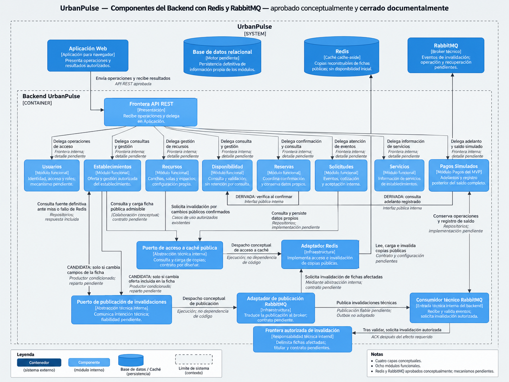

# Nivel 3 · Diagrama de componentes

> **Proyecto:** UrbanPulse
>
> **Contenedor detallado:** Backend UrbanPulse
>
> **Modelo:** C4 · Nivel 3 de 4
>
> **Estado: aprobado conceptualmente y cerrado documentalmente — actualizado conforme a ADR-010 y ADR-011. No acredita implementación ni pruebas ejecutadas.**

## 1. Objetivo

Abrir el contenedor **Backend UrbanPulse** del [C2 — Contenedores](02-contenedores-c2.md) para representar sus componentes internos, responsabilidades, fronteras de colaboración y dependencias funcionales. Esta vista explica su relación con los otros contenedores, las relaciones externas que afectan al backend y las reglas que mantienen la modularidad. Conserva el límite de UrbanPulse del [C1 — Contexto](01-contexto-c1.md).

| Aspecto | Descripción |
|---|---|
| Pregunta que responde | ¿Cómo se organiza el backend y cómo colaboran sus responsabilidades para atender las operaciones aprobadas? |
| Audiencia | Equipo de arquitectura y diseño, desarrolladores y revisores académicos. |
| Contenedor detallado | Backend UrbanPulse, una aplicación organizada como Monolito Modular. |
| Alcance | Frontera API REST, ocho módulos funcionales, componentes técnicos internos de caché y mensajería, colaboraciones respaldadas y acceso abstracto a persistencia. Redis y RabbitMQ ya están adoptados conceptualmente; no define clases, endpoints, tablas ni configuraciones operativas. |
| Nivel anterior C2 | Cinco contenedores: Aplicación Web, Backend UrbanPulse, Base de datos relacional, Redis y RabbitMQ. Revisión aprobada conceptualmente y cerrada documentalmente. |
| Siguiente nivel C4 | Detalle de código de componentes seleccionados, sujeto a aprobación del diseño; las clases y firmas ilustrativas actuales no son implementación aprobada. |

Un módulo se representa aquí como **componente conceptual C3**: agrupa una responsabilidad y una frontera pública, sin constituir otro contenedor ni necesariamente una única clase. La frontera API REST agrupa entradas de Presentación; no es un módulo de negocio adicional ni una aplicación autónoma. El diagrama no descompone cada módulo en clases o capas.

### Base documental y niveles de evidencia

Se consultan [actores](../01-analisis-de-sistema/01-actores.md), [historias HU](../01-analisis-de-sistema/02-historias-del-usuarios.md), [requisitos RF](../01-analisis-de-sistema/03-requisitos-funcionales.md), [atributos AC](../01-analisis-de-sistema/04-atributos-de-calidad.md), [restricciones RC y decisiones DF/DP](../01-analisis-de-sistema/05-restricciones.md), [drivers DA](../01-analisis-de-sistema/06-driver-arquitectonicos.md) y [ADR-001–ADR-011](../01-analisis-de-sistema/07-decisiones-arquitectonicas.md), incluidos los registros de cierre conceptual de [ADR-010 — Redis](../01-analisis-de-sistema/adr/ADR-010-cache-redis.md#registro-de-cierre-conceptual) y [ADR-011 — RabbitMQ](../01-analisis-de-sistema/adr/ADR-011-mensajeria-rabbitmq.md#registro-de-cierre-conceptual). Se contrastan con [arquitectura inicial](../02-arquitectura-software/01-arquitectura-inicial.md), [estilo](../02-arquitectura-software/02-estilo-arquitectonico.md), [enfoque](../02-arquitectura-software/03-enfoque-arquitectonico.md), [reglas RN y pendientes PC](../03-diseño-software/01-reglas-de-negocio.md), [estados](../03-diseño-software/02-estados-y-transiciones.md) y [flujos](../03-diseño-software/03-flujos-de-reserva.md).

El [diseño interno de módulos](../03-diseño-software/diseño-interno/diseño-interno-de-modulos.md), los [patrones](../03-diseño-software/diseño-interno/patrones-de-diseño.md) y los [principios de diseño](../03-diseño-software/diseño-interno/principios-de-diseño.md) aportan la referencia de colaboración de Reservas. Su estructura de archivos sirve como referencia para el futuro nivel C4, sin aprobar nombres físicos, clases, firmas, DTO o composición. La Guía 004 y el ejemplo Marketplace no se localizaron en el repositorio ni entre los adjuntos disponibles; no se afirma cotejo directo ni se incorporan funcionalidades de ese ejemplo.

| Nivel | Interpretación en este C3 |
|---|---|
| Aprobado | Arquitectura ADR-001–ADR-009; ADR-010/ADR-011 aprobadas conceptualmente y cerradas documentalmente con mecanismos operativos pendientes; alcance DF-01–DF-06 y políticas DP-01–DP-12; HU/RF y RN según sus estados individuales. |
| Derivado | Colaboración necesaria para satisfacer condiciones aprobadas; no aprueba la firma, secuencia ni mecanismo que la materialice. |
| Propuesto | Reparto concreto de colaboraciones, contratos y composición no concretados por las fuentes; toda propuesta conserva su estado. La representación conceptual C3 queda aprobada por el cierre, sin aprobar esos detalles. |
| Pendiente | PC-01–PC-12, contratos técnicos, mecanismos e implementación; RF13 no integra el alcance confirmado. |

ADR-001 enumera **Usuarios, Establecimientos, Recursos, Disponibilidad, Reservas, Solicitudes, Servicios y Pagos**. Se usa **Pagos Simulados** como denominación descriptiva del mismo módulo Pagos durante el MVP, conforme al propósito del Diseño Interno y al C2; no se añade un noveno módulo.

### Reconciliación de vistas

Verificación directa de las fuentes: C1 conserva sus actores y sistemas externos; C2 contiene cinco contenedores y su revisión con Redis/RabbitMQ está cerrada documentalmente. Las dos ADR independientes poseen registros explícitos de cierre conceptual. El C3 anterior estaba documentado y pendiente de auditoría, con contexto de tres contenedores y sin componentes de caché o mensajería. La versión actual representa las consecuencias de ambas ADR exclusivamente dentro del backend y su contexto C2 y **queda aprobada conceptualmente y cerrada documentalmente**, tras la revisión conceptual favorable sin hallazgos arquitectónicos bloqueantes comunicada en la solicitud de cierre. El futuro C4 y los tres documentos de Diseño Interno deberán reconciliarse posteriormente sin aprobar nuevos contratos por esta representación.

Las menciones de nueve ADR y ausencia de caché aprobada en [AGENTS.md](../../AGENTS.md) y documentos anteriores corresponden a la base ADR-001–ADR-009; el catálogo vigente incorpora once. Las referencias del catálogo y cierres independientes a C2 todavía con tres contenedores y C3 sin actualizar son desfases frente a las vistas revisadas. C2 registra expresamente ese antecedente. Se aplica el alcance de los cierres ADR-010/ADR-011 y la revisión cerrada de C2, sin corregir esas fuentes ni inferir implementación.

## 2. Diagrama

**Leyenda:** `System_Boundary` delimita UrbanPulse; `Container_Boundary` abre exclusivamente Backend UrbanPulse. `Component` representa la entrada REST, cada uno de los ocho módulos conceptuales o una responsabilidad técnica identificada. Web, base relacional, Redis y RabbitMQ quedan fuera del backend y dentro del sistema, conforme a los cinco contenedores de C2. Las flechas representan **comunicación de ejecución**, incluyendo respuestas, y no dependencias de código ni orden temporal. «DERIVADA» distingue una necesidad funcional de un contrato aprobado; «CANDIDATA» limita los productores de Recursos/Servicios a cambios que afecten la ficha pública. La composición concreta queda propuesta para auditoría; no se añaden colaboraciones funcionales de dirección indeterminada.

Para limitar cruces, se dibujan accesos representativos a persistencia de Reservas, Pagos Simulados y Establecimientos; este último hace visible la fuente de reconstrucción y fallback de fichas. **Los otros cinco módulos también requieren persistencia propia mediante repositorios** (RC04/ADR-008); sus relaciones se explicitan en la sección 5. No existe un módulo compartido de persistencia ni acceso de API REST directamente al almacén. La omisión gráfica no implica que los datos restantes solo existan en memoria.

Los seis componentes técnicos no son módulos funcionales adicionales ni aplicaciones autónomas. La frontera de invalidación se separa gráficamente del puerto de consulta/carga para expresar el acceso autorizado del consumidor; no impone dos interfaces o clases distintas. Su colaboración con el adaptador Redis se ejecuta mediante una abstracción interna por diseñar. Las flechas puerto → adaptador representan despacho en ejecución: **el adaptador depende del contrato interno**, conforme a ADR-002. Dominio no conoce clientes Redis/RabbitMQ ni Infraestructura. No existe interacción directa Redis–RabbitMQ; el backend media publicación, consumo e invalidación. El consumidor comparte el backend; no se incorpora worker independiente ni balanceador.

Las ocho delegaciones desde Presentación expresan el alcance REST de RC03 y la separación ADR-002; no fijan controladores, permisos nuevos ni contratos públicos concretos. La llamada de confirmación no decide el iniciador del evento PC-03. Las llamadas internas pueden resolverse dentro del mismo monolito, como ilustra el Diseño Interno; no se seleccionan protocolos adicionales.

WhatsApp y mapas quedan fuera de esta vista: no hay relación directa aprobada del backend con ellos. El simulador permanece como responsabilidad interna de Pagos Simulados, detrás de su abstracción, sin sistema externo ni módulo adicional. El diagrama se presenta como imagen PNG; esta vista no conserva el código Mermaid fuente ni afirma que la imagen se haya generado desde él. La legibilidad efectiva en GitHub, Obsidian y exposición queda por comprobar en sus entornos.

## 3. Componentes

Las referencias de las tablas remiten a las fuentes de la sección 1. «Aprobado» califica la responsabilidad o decisión citada; no declara aprobada la composición concreta del componente C3.

| Componente | Responsabilidad | Funcionalidades principales | Frontera pública o colaboración | Estado |
|---|---|---|---|---|
| Frontera API REST | Recibir operaciones web en Presentación y delegar en Aplicación. | Traducir entradas y respuestas; validar forma y aplicar los controles de acceso correspondientes. No decide aprobación, disponibilidad o confirmación por cuenta propia. | Aplicación Web y operaciones públicas de los módulos; sin endpoints ni DTO definitivos. | RC03/ADR-005 y separación ADR-002 aprobados; agrupación gráfica propuesta, contratos pendientes. |
| Usuarios | Identidad, acceso y roles dentro del alcance de seguridad. | Dar soporte a autenticación y autorización de Cliente, Propietario y Administrador. No incorpora gestión administrativa de usuarios ni nuevas funciones de registro de cuentas. | Frontera interna para las necesidades de acceso; reparto de controles y mecanismos sin definir PC-11. | Módulo ADR-001 y seguridad AC04/DA05/ADR-007 aprobados; detalle pendiente. |
| Establecimientos | Información y gestión autorizada del establecimiento. | Búsqueda y consulta de información, ubicación y contacto; gestión del propietario y administración de establecimientos según HU11/RF15. | Operaciones de consulta/gestión; colaboración con Recursos, Servicios y Solicitudes por concretar, sin flechas inferidas. | ADR-001; HU01/HU02/HU06/HU11 → RF01/RF02/RF08/RF15; responsabilidades aprobadas, contratos pendientes. |
| Recursos | Identificar y gestionar unidades reservables y su configuración. | Canchas, salas, salones y ambientes/espacios de recreo; horarios y adelanto configurado por recurso de cancha/karaoke. No altera importes ya fijados. | Gestión propia y colaboración con Disponibilidad/Pagos para datos configurados; reparto exacto y contratos pendientes. | ADR-001; HU07/RF09, DF-01/DF-04, DP-02/DP-03 aprobados; delimitación técnica pendiente. |
| Disponibilidad | Consultar y validar disponibilidad según recurso y selección temporal. | Consulta de cancha/karaoke; gestión de disponibilidad; verificación al confirmar, también para espacios de eventos. No retiene por consultar ni resuelve por sí sola concurrencia. | Consulta pública interna consumida por Reservas; contratos de consulta/gestión y coordinación persistente pendientes. | ADR-001/ADR-004; HU03/RF03, HU04/RF05, HU07/RF09, RN-12 derivada y RN-13 aprobada; PC-04/PC-05 abiertos. |
| Reservas | Coordinar condiciones de confirmación y conservar información propia. | Confirmación diferenciada; consulta de reservas y estados; reflejar el resultado del adelanto sin confundirlo con confirmación. Conserva datos propios, importes y evidencia mínima del adelanto aplicado; no copia todo el contexto de Pagos. | Consulta Disponibilidad y resultado registrado de Pagos mediante fronteras internas; repositorios propios. Evidencia de aceptación de eventos y agregación del resumen pendientes de contrato. | ADR-001/ADR-003/ADR-004; RF04/RF06/RF12/RF14/RF19; responsabilidad respaldada, diseño concreto propuesto. |
| Solicitudes | Atender solicitudes de salón/recreo y sus condiciones. | Presentación y revisión de fecha, personas y servicios; aceptación/rechazo del propietario; registro de cotización y aceptación interna del cliente. No confirma por aceptar la solicitud. | Operaciones de eventos; vínculos con establecimiento/recurso, condiciones y confirmación sujetos a PC-01–PC-03. | ADR-001; HU05/HU08 → RF07/RF10, DF-02/DF-03 aprobadas; asignación conceptual de cotización a este módulo, detalle pendiente y cobertura HU/RF por formalizar. |
| Servicios | Mantener información de servicios ofrecidos por cada establecimiento. | Información y gestión de la oferta según HU02/HU05/HU06. Publicación no implica inclusión automática en cotización ni compra de comidas, entradas, actividades o habitaciones. | Consulta/gestión de información; colaboración con Establecimientos y Solicitudes sin dirección contractual definida. | Módulo ADR-001 y oferta HU02/RF02, HU06/RF08; RF07 como contexto de servicios solicitados; fronteras pendientes. |
| Pagos Simulados | Gestionar adelantos académicos y registro posterior del saldo completo. | Iniciar simulación, fijar importes, invocar simulador interno y conservar resultado/antecedentes; registro y correcciones del saldo con historial; resumen autorizado. No procesa dinero real ni confirma Reservas. | Operaciones públicas de adelanto, consulta y saldo separadas; Reservas consulta resultado existente. Evidencia de reserva confirmada propia para saldo y contrato de resumen por definir. | Módulo Pagos ADR-001; HU09/RF11/RF18/RF19; HU14/RF20 y RF14; DF-05/DF-06, DP-01–DP-12 aprobadas; contratos y procedimiento técnico pendientes. |

### Responsabilidades internas sin módulos autónomos

Cotización y aceptación se sitúan conceptualmente en Solicitudes por su relación con HU05/HU08 y DF-02, sin convertir esa agrupación en un contrato aprobado. La administración autorizada corresponde a Establecimientos. La simulación, sus adaptadores y el registro del saldo pertenecen a Pagos Simulados. Identidad y acceso corresponden a Usuarios con controles transversales en las operaciones autorizadas, sin un módulo adicional de Seguridad o Autenticación. No se crean módulos de Cotizaciones, Saldo, Simulador, Administración o Notificaciones.

Los repositorios y adaptadores son responsabilidades de Infraestructura y contratos hacia el núcleo, no nuevos módulos de negocio. Cada módulo conserva la organización de cuatro capas de ADR-002; la frontera API agrupa sus entradas REST sin absorber todos los casos de uso. Las clases y patrones concretos del Diseño Interno siguen propuestos. No se exige adoptar Strategy, Factory, State o Specification por aparecer como candidatos.

### Componentes técnicos internos propuestos

Los nombres siguientes describen responsabilidades C3, **no clases ni firmas adoptadas**. ADR-010/ADR-011 aprueban el alcance conceptual; los puertos, adaptadores, reparto y mecanismos concretos siguen por diseñar. No se decide que exista una instancia, interfaz o archivo por cada caja.

| Componente técnico | Responsabilidad y colaboración | Capa o frontera conceptual | Estado y límite |
|---|---|---|---|
| Puerto de acceso a caché pública | Permitir a los casos de uso de consulta pública de Establecimientos solicitar lectura y carga de copias reconstruibles. | Abstracción hacia el núcleo apropiado; ubicación exacta pendiente. | ADR-010; contrato y composición de la proyección pública por diseñar, sin cachear disponibilidad ni permisos como autoridad. |
| Adaptador Redis | Implementar acceso e invalidación de copias mediante las abstracciones internas pertinentes. | Infraestructura; depende de contratos internos. | Tecnología conceptual adoptada; cliente, claves, TTL, versiones, evicción y configuración pendientes. No aplica reglas de confirmación. |
| Puerto de publicación de invalidaciones | Recibir intenciones técnicas de casos de uso autorizados que modifiquen campos incluidos en la ficha. | Abstracción interna consumida por Aplicación; ubicación y firma pendientes. | ADR-011; Establecimientos como productor pertinente. Recursos/Servicios candidatos condicionados; no crea un módulo productor separado. |
| Adaptador de publicación RabbitMQ | Traducir la publicación al broker sin exponer el cliente técnico al núcleo. | Infraestructura. | ADR-011; publicación directa u Outbox por decidir; no acredita atomicidad con el cambio relacional. |
| Consumidor técnico RabbitMQ | Recibir y validar eventos, limitar su alcance y solicitar invalidación autorizada. | Entrada técnica dentro del backend; recepción de transporte y coordinación separables según ADR-002. | ADR-011; reparto concreto entre adaptador receptor y coordinación pendiente. ACK después del efecto requerido; sin permisos de negocio por recibir mensajes. |
| Frontera autorizada de invalidación | Delimitar las fichas afectadas y solicitar al adaptador Redis el efecto conforme a la política de caché. | Frontera técnica interna mediante abstracción; titular modular y ubicación exactos pendientes. | ADR-010/ADR-011; no autoriza acceso a tablas privadas ajenas ni decide por sí sola retirada de visibilidad segura. |

Los productores permanecen en los casos de uso existentes: Establecimientos para cambios públicos confirmados de gestión autorizada, incluida la administración cuando corresponda a HU11/RF15; Recursos y Servicios únicamente si modifican campos incluidos en la ficha. La composición de esa ficha, cobertura de cambios y contratos cruzados quedan pendientes. Disponibilidad, Reservas, Solicitudes, Usuarios y Pagos Simulados no adquieren productores por inferencia.

## 4. Relaciones entre componentes

La regla de colaboración es utilizar **interfaces públicas internas**, sin acceder a implementaciones privadas ni tablas ajenas. El Diseño Interno, sección 3, y Patrones, apartado Adapter, respaldan llamadas internas dentro del monolito. La comunicación directa en memoria es coherente con esa propuesta; no se convierte en contrato técnico aprobado ni exige REST interno. RabbitMQ se limita al transporte técnico de invalidación adoptado por ADR-011; no sustituye esas colaboraciones funcionales.

| Origen | Destino | Propósito | Tipo de comunicación | Evidencia | Estado |
|---|---|---|---|---|---|
| Frontera API REST | Usuarios | Delegar las operaciones necesarias de identidad/acceso dentro del alcance de roles. | Entrada de Presentación a Aplicación por frontera interna. | RC03 incluye Usuarios; ADR-001/ADR-002/ADR-005/ADR-007. | Alcance aprobado; delegación derivada; contratos y mecanismos PC-11 pendientes. |
| Frontera API REST | Establecimientos | Atender búsquedas, información y gestión autorizada. | Delegación interna; no HTTP entre módulos. | RC03; HU01/HU02/HU06/HU11; RF01/RF02/RF08/RF15. | Funciones aprobadas; delegación derivada, contrato pendiente. |
| Frontera API REST | Recursos | Gestionar recursos, horarios y configuración correspondiente. | Delegación interna. | RC03; HU07/RF09; DF-04. | Funciones aprobadas; delegación derivada, reparto con Disponibilidad pendiente. |
| Frontera API REST | Disponibilidad | Atender consulta y gestión de disponibilidad. | Delegación interna. | RC03; HU03/RF03, HU04/RF05, HU07/RF09. | Funciones aprobadas; delegación derivada, contrato pendiente. |
| Frontera API REST | Reservas | Solicitar confirmación y consultar reservas/estados. | Delegación interna a casos de uso. | RC03; RF04/RF06/RF12/RF14/RF19; Diseño Interno, secciones 5 y 6.4. | Funciones aprobadas; delegación derivada; ejemplo directo propuesto, iniciador del evento PC-03 pendiente. |
| Frontera API REST | Solicitudes | Presentar y atender eventos, cotización y aceptación interna. | Delegación interna. | RC03; HU05/HU08, RF07/RF10; DF-02. | Funciones aprobadas; agrupación propuesta y contratos PC-01–PC-03 pendientes. |
| Frontera API REST | Servicios | Consultar/gestionar información de servicios ofrecidos. | Delegación interna. | RC03 incluye Servicios; ADR-001; HU02/HU06, RF02/RF08. | Función informativa respaldada; delegación derivada, sin endpoint independiente aprobado. |
| Frontera API REST | Pagos Simulados | Iniciar adelanto, consultar resultados/resumen y registrar/corregir saldo mediante operaciones distintas. | Delegación interna a los casos de uso correspondientes. | HU09/HU14; RF11/RF14/RF18/RF20; DP-03–DP-10; Diseño Interno, sección 5. | Funciones aprobadas; delegación derivada, contratos pendientes. No ejecuta saldo como parte de confirmar. |
| Reservas | Disponibilidad | Obtener validez de la selección al confirmar. | Consulta mediante interfaz pública interna. | ADR-004; RF04/RF06/RF12; RN-13; Diseño Interno, secciones 1, 3 y 5. | Necesidad derivada de condiciones aprobadas; dirección respaldada por diseño propuesto, firmas y garantía PC-05 pendientes. |
| Reservas | Pagos Simulados | Consultar contexto y resultado ya registrado de la operación propia, proyectando datos necesarios para confirmar y reflejar RF19. | Consulta mediante interfaz pública interna; incluye respuesta. | RF12/RF19; DP-03; Diseño Interno, secciones 5 y 6.3; Patrones, Adapter. | Necesidad derivada; dirección respaldada por diseño propuesto; correlación PC-02/PC-08 pendiente. No inicia ni repite simulación. |

Las relaciones entre módulos dibujadas no se etiquetan como contratos aprobados: se aprueban las condiciones funcionales y las decisiones arquitectónicas, mientras su realización concreta permanece propuesta. El inicio de RF11/RF18 entra en Pagos; la consulta desde Reservas consume un resultado existente. Una respuesta de Pagos no requiere dibujar otra flecha Pagos → Reservas. RF19 obliga a reflejar el resultado, pero no impone notificación, callback o automatización.

### Colaboraciones que no se dibujan

| Participantes | Necesidad respaldada | Estado y efecto sobre las flechas |
|---|---|---|
| Reservas y Recursos | La reserva identifica recurso/periodo; la operación del adelanto conserva selección e importes fijados. | No se deduce Reservas → Recursos: el ejemplo obtiene esos datos del contexto interno de Pagos. La necesidad de otra consulta y su contrato no están definidos. |
| Recursos, Disponibilidad y Pagos Simulados | Mostrar configuración válida y fijar total/adelanto al iniciar (HU07/RF09, RF11, DP-03). | El Diseño Interno, sección 2, deja el origen concreto entre Recursos/Disponibilidad por precisar. No se dibujan flechas definitivas ni se recalcula desde tarifas posteriores. |
| Solicitudes, Establecimientos y Recursos | Identificar establecimiento y ambiente/espacio del evento (RF07; DF-01; RN-01/RN-06). | Relación de información necesaria; no demuestra llamadas de un módulo a otro. Contratos y dirección pendientes, PC-01/PC-02/PC-04. |
| Solicitudes y Reservas | Incorporar evidencia confiable de condiciones aceptadas al evaluar evento (DF-02/DF-03). | PC-01–PC-03 impiden decidir contrato, momento de creación e iniciador. No se dibuja Solicitudes → Reservas ni la inversa como colaboración definitiva. |
| Pagos Simulados y Reservas | Registro posterior de saldo exige reserva confirmada propia y adelanto aplicado (HU14/RF20; DP-04–DP-09). | Verificación necesaria derivada; consulta pública Pagos → Reservas sería una propuesta, no adoptada aquí. Dirección y datos por definir PC-02/PC-08/PC-11; sin acceso a tablas ajenas ni cambios de estado. |
| Establecimientos, Servicios y Solicitudes | Mostrar oferta y distinguir servicios incluidos en condiciones (HU02/HU05/HU06; RN-07). | Reparto conceptual respaldado; dirección y contrato pendientes. No se infiere compra ni inclusión automática. |
| Reservas y Pagos Simulados para resumen | Cliente y propietario autorizados consultan total, adelanto aplicado, saldo y estado (RF14/DP-10). | Agregación de información necesaria; caso de uso coordinador y contrato por definir. La consulta de adelanto para confirmar no resuelve todo el resumen. |
| Usuarios y demás módulos | Preservar identidad, rol y titularidad (AC04/ADR-007). | Obligación transversal aprobada; no se presuponen llamadas de todos los módulos a Usuarios ni un servicio global de autorización. PC-11 abierto. |

### Colaboraciones técnicas de caché y mensajería

Estas relaciones describen ejecución conceptual conforme a ADR-010/ADR-011 y C2. No son contratos operativos aprobados ni una secuencia atómica; las condiciones de cada productor limitan las flechas del diagrama.

| Origen → destino | Propósito | Evidencia y límite |
|---|---|---|
| Establecimientos → puerto de caché → adaptador Redis | Consultar una copia pública admisible y cargar una reconstrucción obtenida de la fuente definitiva. | ADR-010, contexto HU02/RF02; las respuestas se incluyen. Un hit no acredita autorización ni vigencia. |
| Establecimientos → repositorios/fuente relacional | Ante miss o fallo de Redis, consultar datos definitivos por fronteras autorizadas y construir la proyección pública. | ADR-008/ADR-010; sin lectura de tablas ajenas. Fallar al guardar una copia no invalida datos autorizados ya obtenidos; fallback sujeto a disponibilidad de la base. |
| Casos de uso autorizados de Establecimientos → puerto de publicación | Comunicar la intención de invalidar por cambios públicos confirmados. | ADR-011; HU06/RF08 y HU11/RF15 como contexto. No publica cambios revertidos como definitivos; publicación y commit no son atómicos por dibujar la flecha. |
| Recursos o Servicios → puerto de publicación | **Productores candidatos condicionados:** comunicar cambios solo si afectan campos incluidos en la ficha. | ADR-010/ADR-011; HU07/RF09 y HU02/RF02/HU06/RF08 como contexto. Reparto y cobertura pendientes; sin nueva colaboración obligatoria entre módulos. |
| Puerto de publicación → adaptador RabbitMQ → broker | Despachar en ejecución y transportar invalidaciones técnicas. | ADR-011; el adaptador implementa el contrato, no a la inversa. Garantías de publicación y recuperación pendientes. |
| Broker → consumidor técnico interno | Entregar eventos; validar forma, versión y alcance antes de actuar. | ADR-011; contratos y configuración pendientes, duplicados posibles. No se confía autorización de negocio al mensaje. |
| Consumidor → frontera autorizada → adaptador Redis | Solicitar y completar la invalidación requerida de fichas afectadas. | ADR-010/ADR-011; ACK posterior al efecto, sin acceso privado entre módulos. Titular, contrato e idempotencia concreta pendientes. |

En cache-aside, la consulta de ficha no pasa por RabbitMQ: un hit admisible responde desde la copia; un miss reconstruye desde la base y solicita carga. La invalidación asíncrona es otro recorrido. Los precios públicos siguen siendo informativos: antes de iniciar adelanto se validan valores autorizados y se preservan los importes fijados por DP-03 y las condiciones aceptadas.

### Seguridad, fallos y recuperación por diseñar

- **Contenido público y visibilidad:** Redis contiene solo información pública autorizada. Reservas, cotizaciones particulares, evidencias de aceptación, adelantos, saldos, credenciales y datos protegidos no se incorporan a la ficha. Retirar visibilidad exige impedir divulgación de contenido ya no autorizado; invalidación asíncrona y TTL no bastan por sí solos. Política y mecanismo siguen pendientes de diseño y validación.
- **Caché y respaldo:** Redis caído conduce a consulta relacional sujeta a disponibilidad de la base; no se garantiza continuidad absoluta ni consistencia fuerte. TTL, claves, tolerancia de obsolescencia, evicción, versiones/generaciones, carreras de repoblación, stampede y reutilización de copias al volver a servicio siguen abiertos.
- **Publicación fiable:** RabbitMQ no hace atómicos el commit y la publicación. Publicar directamente después del commit puede perder la intención o dejar resultado incierto. Transactional Outbox es alternativa **no adoptada**; si se seleccionara, cambio e intención deberían conservarse en la misma transacción, con despacho y recuperación por diseñar. No se añade almacenamiento durable implícito ni se garantiza recuperar intenciones nunca conservadas. TTL no sustituye publicación fiable ni recuperación.
- **Consumo:** pueden existir duplicados y eventos fuera de orden. Idempotencia es un requisito conceptual cuyo mecanismo sigue pendiente; borrar repetidamente una clave no resuelve por sí solo carreras de repoblación. El ACK debe ocurrir después de la invalidación requerida; si Redis falla no se considera completado el efecto. Publisher confirms reconocen otra etapa y no prueban consumo o invalidación. Entrega al menos una vez es objetivo condicionado a garantías concretas; no se promete exactamente una vez.
- **Operación y acceso:** esquemas y versiones, colas/exchanges, enrutamiento, durabilidad, confirms/ACK, reintentos limitados y tiempos, mensajes inválidos, agotamiento/DLQ y eventual reproceso, supervisión y recuperación del broker/consumidor/Redis permanecen pendientes. Acceso restringido, credenciales protegidas, permisos mínimos, administración y diagnóstico sin datos sensibles requieren diseño; el consumidor valida y limita el alcance antes de invalidar. No se fijan bibliotecas, configuraciones ni número de consumidores.
- **Aislamiento funcional:** la base relacional sigue como autoridad definitiva. No se cachea disponibilidad inicialmente ni se usa Redis como bloqueo distribuido o retención de reservas. RabbitMQ no transporta confirmaciones de reserva, pagos ni evidencia contractual obligatoria. Sus mensajes no cambian Reserva, resultado del adelanto o registro del saldo. RN-13 permanece obligatoria y PC-05 abierto; reintentar invalidaciones no resuelve PC-08 del simulador.

Son límites y obligaciones documentales; no se declaran mecanismos implementados, probados o conformes a métricas EQ.

## 5. Relaciones con contenedores y sistemas externos

| Origen | Destino | Relación | Mecanismo aprobado o pendiente | Decisión relacionada |
|---|---|---|---|---|
| Aplicación Web | Backend UrbanPulse, por su frontera API REST | Solicitudes y respuestas autorizadas de consulta y operación. | API REST aprobada; contratos, endpoints, errores y tecnología pendientes. | RC03/DA07/ADR-005; ADR-002/ADR-007. |
| Backend UrbanPulse: Reservas | Base de datos relacional | Consultar/persistir datos propios, confirmación y evidencia del adelanto aplicado. | Repositorios aprobados; implementación, modelo y garantía concurrente pendientes PC-02/PC-05/PC-08. Dibujada. | RC04/DA08/ADR-008; RN-13/ADR-004. |
| Backend UrbanPulse: Pagos Simulados | Base de datos relacional | Conservar importes fijados, resultado/antecedentes y registro de saldo con historial. | Repositorios aprobados; modelo, correlación, unicidad activa y procedimiento técnico de corrección pendientes. Dibujada. | RC04/ADR-008; DP-03–DP-09; HU14/RF20. |
| Backend UrbanPulse: Usuarios, Establecimientos, Recursos, Disponibilidad, Solicitudes y Servicios | Base de datos relacional | Consulta y persistencia de la información propia de cada módulo. | Repositorios por responsabilidad modular, sin módulo central de datos; Establecimientos se dibuja por reconstrucción/fallback y las otras cinco relaciones se omiten por legibilidad. Motor y diseño físico pendientes. | RC04 enumera las ocho áreas; DA08/ADR-008; ADR-001/ADR-002. |
| Backend: adaptador Redis | Redis | Lectura, carga e invalidación de copias públicas; incluye respuestas de copia, ausencia o resultado técnico. | Cache-aside conceptual adoptado; contratos y operación pendientes. Solo acceso técnico autorizado desde backend. | ADR-010; límites de ADR-007. |
| Backend: adaptador de publicación RabbitMQ | RabbitMQ | Publicar invalidaciones técnicas de cambios confirmados de campos de fichas. | Puerto/adaptador; publicación fiable y recuperación pendientes. Outbox no adoptado. | ADR-011; ADR-002/ADR-006 como apoyo al desacoplamiento. |
| RabbitMQ | Backend: consumidor técnico interno | Entregar eventos para validación e invalidación mediante frontera autorizada. | Duplicados posibles, idempotencia requerida y ACK posterior al efecto; contratos y garantías operativas pendientes. | ADR-011/ADR-010. |
| Aplicación Web, desde navegador o dispositivo del cliente | WhatsApp | Abrir el contacto registrado del propietario a petición del cliente. | Redirección aprobada, mecanismo concreto pendiente. Sin Backend → WhatsApp ni mensajería integrada. | C1/C2; HU12/RF17/RC08; ADR-006; RN-20. |
| Frontera de UrbanPulse pendiente de asignación; C2 propone Aplicación Web | Proveedor de mapas | Visualizar ubicación registrada del establecimiento. | Servicio externo aprobado; proveedor, frontera y mecanismo pendientes. La flecha web → mapas del C2 es propuesta, no aprobación de Backend → Mapas. | C1/C2; HU13/RF16/RC09/RC10; DA06/ADR-006. |

Web, base relacional, Redis y RabbitMQ son elementos del C2 usados como contexto; C3 detalla únicamente el backend. Cliente, Propietario y Administrador conservan las interacciones del C1/C2 a través de la web: no son componentes internos ni acceden directamente a los almacenes o al broker. La identidad y autorización acompañan los casos de uso según rol y titularidad, con mecanismos pendientes.

La ejecución pasa por abstracciones de repositorio hasta sus implementaciones en Infraestructura. **La flecha hacia el almacén no es una dependencia de Dominio hacia Infraestructura**: el código del adaptador depende del contrato interno. Compartir un almacén lógico no define una base física por módulo ni permite leer tablas privadas ajenas. ADR-009 exige organizar consultas de establecimientos, recursos, fechas y horarios; no aprobó históricamente caché, índices concretos o métricas. ADR-010 la complementa con Redis solo para fichas públicas, sin cachear disponibilidad inicialmente. La reconstrucción/fallback desde Establecimientos sí se dibuja; los demás accesos no representados conservan su responsabilidad modular.

El simulador de adelantos pertenece a Pagos Simulados, detrás de interfaces y adaptadores: no es un contenedor ni sistema externo. Efectivo, Yape, Plin y transferencia son métodos informativos del registro académico, sin destinos de red. No se añaden pasarelas financieras, ERP o envíos.

## 6. Reglas del monolito modular

Estas son obligaciones y criterios de diseño; no se declara que estén implementados o comprobados en código.

| N.º | Regla | Justificación | Evidencia o estado |
|---|---|---|---|
| 1 | Los ocho módulos pertenecen a un único Monolito Modular. | Mantener responsabilidades separadas en la misma aplicación desplegable. | ADR-001 adoptada; no crea microservicios. |
| 2 | Los módulos colaboran por interfaces públicas internas. | Hacer explícitas las necesidades y preservar límites. | Consecuencia derivada ADR-001/ADR-002; Diseño Interno, sección 3. Contratos concretos propuestos. |
| 3 | Ningún módulo accede directamente a tablas o clases privadas de otro. | Evitar acoplamiento con implementación y modelo ajenos. | Regla derivada de modularidad, explicitada en Diseño Interno y C2; persistencia mediante ADR-008. |
| 4 | Cada responsabilidad de negocio conserva su límite modular. | Reservas no absorbe todo Pagos; cotización, administración y saldo no originan módulos nuevos sin respaldo. | ADR-001; reparto conceptual de sección 3, detalles pendientes. |
| 5 | Cada módulo mantiene Presentación, Aplicación, Dominio e Infraestructura. | Separar entrada, coordinación, reglas y detalles. | Cuatro capas oficiales ADR-002; organización concreta pendiente de aprobación. |
| 6 | Las dependencias de código apuntan hacia el núcleo. | Dominio no depende de Infraestructura; ejecución y conocimiento de tipos son distintos. | ADR-002; Diseño Interno, sección 3; principios DIP. |
| 7 | Infraestructura implementa los contratos internos apropiados. | Permitir repositorios/adaptadores sustituibles sin trasladar reglas al detalle. | ADR-002/ADR-008 adoptadas; firmas y composición propuestas. |
| 8 | Las integraciones se desacoplan mediante interfaces y adaptadores cuando corresponda. | Preservar independencia del núcleo frente a proveedores. | RC10/ADR-006; mapas con frontera pendiente; WhatsApp solo redirección y simulador interno. |
| 9 | REST corresponde a la frontera web–backend. | No impone un protocolo REST para colaboración interna. | RC03/ADR-005; llamadas internas del Diseño Interno como propuesta compatible. |
| 10 | Seguridad y consistencia se preservan en cada colaboración. | Validar rol, titularidad y condiciones; no confiar aprobación o importes a declaraciones del navegador. | AC03/AC04; ADR-004/ADR-007; RN-13/RN-19; mecanismos PC-05/PC-11 pendientes. |
| 11 | Caché y mensajería conservan una responsabilidad técnica acotada dentro del backend. | Redis/RabbitMQ no son módulos de negocio; consumidor interno, sin worker separado. Los casos de uso usan abstracciones y los adaptadores dependen de contratos hacia el núcleo. | ADR-010/ADR-011; composición C3 propuesta, sin quinta capa ni dependencias de Dominio a clientes técnicos. |
| 12 | Invalidaciones no sustituyen persistencia ni operaciones críticas. | Mantener datos definitivos, aceptación, confirmación, adelanto y saldo fuera del transporte de caché. Fallback y recuperación no prueban garantías concurrentes o de confidencialidad. | ADR-008/ADR-010/ADR-011; RN-13 y PC-05; políticas DP vigentes. |

### Condiciones funcionales que las colaboraciones deben preservar

- **Reserva directa:** cancha por recurso, fecha y bloque configurado sin duración uniforme obligatoria; karaoke por sala, fecha e intervalo. Adelanto simulado obligatorio configurado por recurso y disponibilidad válida al confirmar; sin solicitud de evento ni cotización obligatoria (DF-04; RN-01–RN-04).
- **Eventos:** salón/recreo mantienen solicitud y cotización del propietario; el cliente acepta condiciones dentro de UrbanPulse. Confirmar requiere aceptación interna, adelanto aprobado y disponibilidad válida conjuntamente. Aceptar solicitud, aceptar condiciones y confirmar son hechos distintos; WhatsApp no sustituye aceptación. Recreo reserva el ambiente/espacio definido, sin exclusividad presunta de establecimiento o día (DF-01–DF-03; RN-09/RN-11 y RN-10 derivada).
- **Importes y resultado:** mostrar total/adelanto antes de iniciar y fijarlos al iniciar (DP-03). Rechazo, falta de aprobación o disponibilidad inválida impiden confirmar; aprobación aislada no confirma. RF19 exige reflejar el resultado en la situación de Reserva. No se fijan importes, porcentajes o plazos universales (RN-15–RN-18; DP-12).
- **Concurrencia:** RN-13 está aprobada y prohíbe confirmaciones incompatibles incluso concurrentes; PC-05 mantiene abierto el mecanismo. Consultar o coordinar no retiene el recurso (RN-12 derivada). Una consulta seguida de escritura, un callback o este diagrama no demuestran la garantía; no se adoptan bloqueos, retenciones o expiraciones.
- **Saldo posterior:** saldo = total acordado menos adelanto simulado aprobado y aplicado (DP-04). Solo el propietario autorizado registra el saldo completo de reserva confirmada propia, con reserva, importe, método informativo, autor y fecha/hora; una recepción activa e historial de correcciones (HU14/RF20; RN-24/RN-25; DP-05–DP-09). Cliente y propietario autorizados consultan el resumen (RF14/DP-10). En cancha/karaoke la liquidación representada corresponde al día del servicio; en eventos, a condiciones aceptadas (DP-11). El procedimiento técnico de corrección sigue pendiente.
- **Independencia:** resultado del adelanto, estado de Reserva y registro del saldo permanecen separados. Registrar/corregir saldo no cambia Reserva ni adelanto y queda fuera del caso de uso de confirmación. DP-08 aprueba solo los dos estados informativos del saldo, sin aprobar las demás máquinas propuestas. Saldo cero continúa pendiente de representación, sin recepción ficticia.
- **Alcance académico:** todos los pagos son simulados; efectivo, Yape, Plin y transferencia son categorías informativas. Se excluyen pagos reales, integraciones financieras, comprobantes bancarios, reembolsos y parciales del saldo (DF-06/DP-01/DP-07). RF13 sigue pendiente; no se habilitan cancelación, devolución, expiración, reapertura o cierre del ciclo. Se conservan las exclusiones de mensajería propia, gestión administrativa de usuarios, compra de comidas/entradas/actividades y reserva de habitaciones.

### Trazabilidad de decisiones hacia el C3

La columna de evidencia conserva los orígenes del catálogo DA/ADR; su aplicación a componentes describe respaldo de diseño, sin inventar nuevas cadenas de origen.

| Decisión | Evidencia pertinente | Aplicación y límite en componentes |
|---|---|---|
| ADR-001 — Monolito Modular | DA01/DA03; AC05/AC06 y RC06 según sus orígenes; RF03–RF07 en DA01. | Ocho módulos dentro del backend. Agrupación conceptual C3, sin servicios adicionales. |
| ADR-002 — Clean Architecture | DA03/DA05/DA06; AC06/AC04/AC05/AC08 según catálogo. | Cuatro capas por módulo; fronteras públicas, contratos y adaptadores sin aprobar clases concretas. |
| ADR-003 — Modalidades | DA01/DA03; RC06; DF-01–DF-04; HU03/RF03, HU04/RF05 y HU05/RF07. | Recursos, Solicitudes y Reservas conservan reglas diferenciadas. RF04 y RF06 mantienen asociaciones contextuales con HU03/HU04. |
| ADR-004 — Disponibilidad y reservas | AC03 → DA02 → ADR-004; RF04/RF06/RF12; RN-13. | Reservas consulta Disponibilidad y evalúa las demás condiciones; mecanismo PC-05 pendiente. |
| ADR-005 — API REST | RC03 → DA07 → ADR-005. | Web → frontera de Presentación del backend; contratos pendientes. AC05/AC08 son complementarios en DA07, no su origen. |
| ADR-006 — Interfaces y adaptadores | AC05/AC08 y RC07–RC10 → DA06 → ADR-006; HU09/RF18, HU12/RF17, HU13/RF16. | Simulación interna desacoplada; sin llamada del backend a WhatsApp o mapas aprobada. El apoyo a adaptación interna no crea otra integración externa. |
| ADR-007 — Seguridad | AC04 → DA05 → ADR-007; HU06/RF08, HU11/RF15, HU10/HU14/RF14 y HU14/RF20 según catálogo ampliado. | Usuarios y controles de cada operación respetan rol/titularidad; saldo restringido; PC-11 abierto. |
| ADR-008 — Repositorios | RC04 y RF04/RF06/RF07/RF11/RF12/RF14/RF19/RF20 → DA08 → ADR-008. | Persistencia propia por abstracciones; trazabilidad del adelanto/saldo. AC03/AC05 son complementarios en DA08. No decide modelo ni garantiza concurrencia. |
| ADR-009 — Consultas | AC01 y RF01/RF03/RF05 → DA04 → ADR-009. | Diseñar consultas eficientes de Establecimientos/Disponibilidad y datos necesarios de recursos/fechas/horarios. No aprobó históricamente caché ni métricas; ADR-010 la complementa. |
| ADR-010 — Redis | Cierre conceptual de ADR-010; relación complementaria con AC01/DA04, contexto HU02/RF02 y HU06/RF08, límites AC03/AC04. | Consulta de fichas en Establecimientos, puerto de caché, adaptador Redis y frontera de invalidación; cache-aside con fuente/fallback relacional. Proyección, titular, contratos, confidencialidad y mecanismos pendientes. No crea origen RF02 → DA04. |
| ADR-011 — RabbitMQ | Cierre conceptual de ADR-011; caso técnico de ADR-010, apoyo ADR-002/ADR-006 y límite AC04; sin nuevo driver de origen. | Productores pertinentes, puerto/adaptador de publicación y consumidor interno que valida y solicita invalidación. Recursos/Servicios condicionados; contratos, publicación fiable y recuperación pendientes; Outbox no adoptado. |

HU09 → RF11/RF18/RF19 respalda el adelanto y su efecto; RF11/RF19 tienen origen explícito en DA08, RF18 en DA06. RF02/RF09/RF10 no tienen origen explícito en drivers, aunque sus funciones estén respaldadas por HU02/HU07/HU08. DF-02 está aprobada, con formalización detallada pendiente en HU/RF. AC02 y AC07 carecen de driver y respuesta arquitectónica explícitos. Los [escenarios EQ](../01-analisis-de-sistema/08-escenarios-atributos-calidad.md) conservan procedimientos y métricas pendientes de revisión; este C3 no acredita pruebas ni cumplimiento.

### Discrepancias conservadas

| Fuentes y conflicto | Criterio respaldado | Efecto sobre este documento |
|---|---|---|
| README y arquitectura inicial describen tres capas; ADR-002, estilo y enfoque establecen cuatro. La afirmación de armonización del catálogo ADR no coincide con el texto inicial actual. | Prioridad de ADR-002. | Se describen cuatro capas y dependencias hacia el núcleo, sin editar fuentes antiguas. |
| Arquitectura inicial menciona pago simulado externo; RC07/DA06/ADR-006 precisan simulador interno del MVP. | Aplicar las aclaraciones vigentes y la frontera de C1/C2. | Simulación dentro de Pagos Simulados, sin contenedor externo. |
| Estilo menciona ORM y las referencias gráficas del ADR conservan desfases. | No hay selección tecnológica aprobada; imágenes y ejemplos no aprueban decisiones. | Se conserva persistencia relacional abstracta, sin elegir motor/ORM ni modificar gráficos. No se afirma inspección visual de sus exportaciones. |
| Patrones declara aprobación conceptual; Diseño Interno conserva pendiente la aprobación concreta. | Separar concepto arquitectónico y clases/firmas propuestas. | Solo se aprovechan responsabilidades y dirección de colaboración documentada, sin aprobar contratos concretos. |
| AGENTS.md, restricciones y Diseño Interno conservan la base de nueve ADR; el catálogo vigente incorpora once. Las ADR y el catálogo aún describen C2 con tres contenedores, mientras su revisión cerrada representa cinco. | Cierres explícitos de ADR-010/ADR-011 y revisión cerrada de C2, dentro del alcance autorizado. | Se actualiza C3 con Redis/RabbitMQ; se conserva el desfase de las otras fuentes y no se interpreta como revocación de los cierres. |

### Pendientes abiertos y alcance de esta entrega

| Pendiente | Límite conservado en C3 |
|---|---|
| PC-01 | Cotización: contenido mínimo, servicios incluidos, evidencia de aceptación, versiones y cambios. DF-02 aprobada; detalle y cobertura HU/RF pendientes. |
| PC-02 | Creación y relaciones Reserva/Solicitud/Pago, cardinalidades y estados persistidos sin decidir. No se infieren contratos entre módulos a partir de asociaciones de datos. |
| PC-03 | Iniciador o automatización de confirmación de eventos sin definir. Ninguna flecha otorga ese permiso. |
| PC-04 | Alcance temporal, extremos, solapamientos y espacios compartidos pendientes; DF-01 ya define la unidad reservable del recreo. |
| PC-05 | Garantía concurrente y disponibilidad durante coordinación pendientes de mecanismo y verificación; RN-13 sigue obligatoria. |
| PC-06 | Precisión monetaria, límites y saldo cero pendientes; fórmula y registro manual completo ya aprobados. Sin tarifas o plazos universales. |
| PC-07 | Adelanto aprobado sin disponibilidad u otras condiciones: no confirmar; resolución posterior sin definir, sin reembolso inferido. |
| PC-08 | Fallos, ausencia de respuesta, reintentos, duplicados y asociación inequívoca de resultados pendientes. No se inventa notificación ni aplicación única resuelta por una referencia. |
| PC-09 | No aceptación, cambios y reapertura sin diseño aprobado; sin estados adicionales. |
| PC-10 | Cancelación y ciclo posterior pendientes; RF13 no habilitado. |
| PC-11 | Matriz detallada y mecanismos de identidad/autorización pendientes; respetar roles y titularidad ya aprobados. |
| PC-12 | Cobertura HU/RF/DA y evaluación EQ pendientes, sin completar huecos por analogía. |

### Pendientes técnicos y reconciliación posterior

Además de PC-01–PC-12, siguen abiertos la proyección pública y su titular técnico, puertos y fronteras autorizadas, composición por capas, claves/TTL/evicción, versionado o generaciones, repoblación concurrente y confidencialidad al retirar visibilidad. ADR-011 mantiene por decidir publicación directa u Outbox, conservación y recuperación de intenciones, contratos y esquemas, colas/exchanges, durabilidad, confirms/ACK, idempotencia concreta, desorden, reintentos limitados, DLQ, seguridad y supervisión. No se fijan clases, firmas, bibliotecas, mecanismos operativos ni métricas.

C1 permanece intacto y conserva actores y externos; C2 sigue cerrado con cinco contenedores. C3 representa la arquitectura objetivo de ADR-010/ADR-011 y sus interacciones técnicas, con aprobación conceptual y cierre documental de esta revisión. El futuro nivel C4 y el Diseño Interno deberán desarrollar y reconciliar contratos y mecanismos cuando se aprueben; no se consideran sincronizados ni aprobados automáticamente por este cierre. Mapas y WhatsApp mantienen las fronteras documentadas en la sección 5.

El cierre aprueba la representación conceptual C3: agrupación de componentes técnicos, frontera de invalidación y selección de relaciones visibles. Las colaboraciones funcionales incompletas quedan fuera del dibujo; Recursos/Servicios conservan su condición de productores candidatos condicionados. Redis y RabbitMQ proceden de decisiones ya aprobadas conceptualmente, sin adoptar nuevos contratos o mecanismos. Se modifica exclusivamente este archivo preexistente, inicialmente sin seguimiento; C1/C2, etapas previas y archivos locales se preservan. La aprobación y el cierre documental no constituyen aprobación de clases, contratos, configuraciones, implementación, despliegue ni pruebas; los pendientes técnicos y PC-01–PC-12, RF13, RN-13 obligatoria y pagos exclusivamente simulados conservan sus estados y límites.

**URBANPULSE — MODELO C4 NIVEL 3 APROBADO CONCEPTUALMENTE — REVISIÓN CON REDIS Y RABBITMQ CERRADA DOCUMENTALMENTE — SIN COMMIT NI PUSH.**
