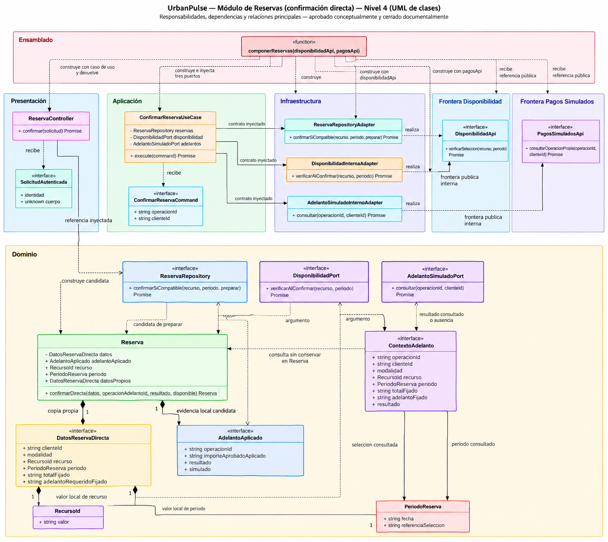

# UrbanPulse — Modelo C4 Nivel 4: Código de Reservas

**Estado: vista ilustrativa aprobada conceptualmente y cerrada documentalmente — confirmación directa de Reservas. Clases, contratos e implementación pendientes de aprobación concreta.**

**Alcance:** módulo Reservas, confirmación directa de cancha y karaoke.

**Fuente:** Diseño Interno de Módulos, secciones 2–6.

Las clases, interfaces, firmas y composición son propuestas académicas existentes, no código implementado ni contratos definitivos. La aprobación conceptual de las responsabilidades no aprueba su realización concreta. Fecha de elaboración: 16/10/2026.

## 1. Objetivo y alcance

Detallar el componente **Reservas** del C3 mediante sus elementos ilustrativos de código, responsabilidades y relaciones. Esta es la primera vista del cuarto nivel del Modelo C4, expresada mediante UML de clases; no se introduce una sintaxis `C4Code`.

Se representa exclusivamente la confirmación directa de cancha y karaoke. El recorrido comienza con una referencia de operación de adelanto ya iniciada: Reservas consulta su contexto y resultado registrado en Pagos Simulados, contrasta operación y titular, coordina la disponibilidad y solicita persistencia compatible. El inicio de la simulación, la fijación de importes y el registro de su resultado pertenecen a Pagos Simulados y no se desarrollan aquí.

El detalle mantiene Presentación, Aplicación, Dominio e Infraestructura según ADR-002. La raíz de composición ensambla esas capas desde fuera del núcleo; no constituye una quinta capa. Disponibilidad y Pagos Simulados aparecen únicamente mediante sus fronteras públicas internas, externas al módulo Reservas y dentro del mismo backend. No se añaden módulos, contenedores o servicios desplegables.

Quedan fuera del diagrama Redis, RabbitMQ, confirmación de salón/recreo, cotizaciones y aceptación de eventos, registro/corrección del saldo, cancelaciones, reembolsos, retenciones temporales y estados persistidos adicionales. Tampoco se representan frameworks, ORM, motor relacional o mecanismos concurrentes concretos. Esta selección de alcance no elimina responsabilidades del sistema completo.

## 2. Fuentes y trazabilidad

### 2.1 Fuentes de la vista

| Fuente | Uso y límite |
|---|---|
| [AGENTS.md](../../AGENTS.md) | Jerarquía documental, preservación del trabajo preexistente y restricciones funcionales/técnicas. |
| [C1 — Contexto](01-contexto-c1.md) | Límite de UrbanPulse y responsabilidades de actores; no determina clases. |
| [C2 — Contenedores](02-contenedores-c2.md) | Cinco contenedores: Aplicación Web, Backend UrbanPulse, Base de datos relacional, Redis y RabbitMQ. Esta vista abre una responsabilidad del backend, sin redibujar el despliegue. |
| [C3 — Componentes](03-componentes-c3.md) | Ocho módulos funcionales; Reservas consulta Disponibilidad y Pagos Simulados por fronteras públicas internas. Su cierre conceptual no aprueba código. |
| [Diseño Interno de Módulos, secciones 2–6](../03-diseño-software/diseño-interno/diseño-interno-de-modulos.md) | Fuente de nombres, capas, datos, firmas, colaboraciones y ensamblado. El árbol y los ejemplos TypeScript son ilustrativos. |
| [Patrones de Diseño](../03-diseño-software/diseño-interno/patrones-de-diseño.md) | Repository, Adapter e inyección por constructor sobre el mismo ejemplo; no acreditan operación ni concurrencia. |
| [Principios SOLID](../03-diseño-software/diseño-interno/principios-de-diseño.md) | Separación de responsabilidades y obligaciones semánticas; dependencias hacia abstracciones. No demuestra garantías ejecutadas. |
| [Catálogo ADR-001–ADR-011](../01-analisis-de-sistema/07-decisiones-arquitectonicas.md) | Monolito Modular, cuatro capas, modalidades, disponibilidad, REST, adaptadores, roles y repositorios. ADR-010/011 conservan su alcance técnico y quedan fuera del diagrama seleccionado. |
| [Reglas RN y pendientes PC](../03-diseño-software/01-reglas-de-negocio.md) | Condiciones aprobadas y contratos pendientes, especialmente RN-04/RN-12/RN-13/RN-15–RN-19 y PC-02/PC-04–PC-08/PC-11. |
| [PNG de clases](../diagramas/diagrama-de-clases.png) y [PNG de secuencia](../diagramas/Flujo-de-ejecución_confirmar-reserva.png) | Antecedentes gráficos disponibles e inspeccionados. No constituyen código ni evidencia de ejecución; las firmas y advertencias textuales del Diseño Interno delimitan su interpretación. Esta vista se presenta como PNG en la sección 3 y no conserva el código Mermaid fuente. |

### 2.2 Matriz C3 ↔ C4 y decisiones

«Aprobado» califica las responsabilidades o decisiones citadas. Los nombres de clases, interfaces, DTO, firmas, relaciones concretas y composición de esta vista permanecen **propuestos**. La matriz describe correspondencia de diseño; no crea cadenas HU/RF/DA ni aprueba contratos por el cierre de C3.

| Elementos C4 propuestos | Componente o frontera C3 | Decisiones pertinentes | RN y pendientes conservados |
|---|---|---|---|
| `Reserva`, `DatosReservaDirecta`, `AdelantoAplicado`, `RecursoId`, `PeriodoReserva` | Reservas: datos propios y condiciones de confirmación directa. | ADR-002/ADR-003/ADR-004/ADR-008. | RN-01–RN-04/RN-15/RN-17; PC-02/PC-04/PC-06/PC-08. Evidencia candidata, sin modelo relacional aprobado. |
| `ConfirmarReservaUseCase`, `ConfirmarReservaCommand` | Reservas: coordinación de disponibilidad y resultado ya registrado del adelanto. | ADR-002/ADR-004/ADR-007. | RN-04/RN-13/RN-15/RN-16/RN-19; PC-05/PC-07/PC-08/PC-11. |
| `ReservaRepository`, `ReservaRepositoryAdapter` | Reservas → persistencia propia mediante repositorios. | ADR-002/ADR-008; obligación de ADR-004. | RN-13/RN-17; PC-02/PC-05/PC-08. El adaptador fuente no es operativo. |
| `DisponibilidadPort`, `DisponibilidadInternaAdapter`, `DisponibilidadApi` | Reservas → Disponibilidad mediante frontera pública interna. | ADR-001/ADR-002/ADR-004; criterio de desacoplamiento de ADR-006. | RN-12/RN-13/RN-15; PC-04/PC-05. Consultar no retiene recursos. |
| `AdelantoSimuladoPort`, `AdelantoSimuladoInternoAdapter`, `ContextoAdelanto`, `PagosSimuladosApi` | Reservas → Pagos Simulados: consulta de operación propia registrada. | ADR-001/ADR-002/ADR-007; criterio de desacoplamiento de ADR-006. | RN-14–RN-17/RN-19; PC-06/PC-08/PC-11. No inicia simulación ni registra saldo. |
| `ReservaController`, `SolicitudAutenticada` | Frontera API REST que delega en Aplicación de Reservas. | ADR-002/ADR-005/ADR-007. | RN-19; PC-11 y contratos REST pendientes. Identidad tomada del contexto autenticado. |
| `componerReservas()` | Ensamblado interno del backend para Reservas; no es otro componente funcional C3. | ADR-001/ADR-002. | RN-22; realización concreta propuesta. PC-05 no se resuelve por inyección. |

Las necesidades funcionales de referencia se conservan como en la fuente: RF04/RF06/RF12 para confirmación y disponibilidad; HU09/RF11/RF18/RF19 para adelanto simulado y su efecto. HU03/RF04 y HU04/RF06 mantienen asociaciones contextuales. HU14/RF20 respalda el saldo posterior, excluido del caso de uso. RF02/RF09/RF10 y AC02/AC07 conservan sus vacíos de trazabilidad; esta vista no los completa por analogía. Las seis responsabilidades técnicas de caché/mensajería de C3 permanecen fuera de esta selección de código.

## 3. Vista de código del módulo Reservas

Los cuatro espacios de nombres `Presentacion`, `Aplicacion`, `Dominio` e `Infraestructura` agrupan las cuatro capas de **Reservas**. Se usan identificadores sin tildes para la notación. `FronteraDisponibilidad` y `FronteraPagosSimulados` identifican contratos públicos de los módulos colaboradores; no son paquetes privados de Reservas. `Ensamblado` ubica la función de composición fuera del núcleo y no representa una capa o módulo adicional.

Las operaciones se abrevian gráficamente para mantener legibilidad. `Promise` omite su parámetro de tipo; las firmas y restricciones respaldadas se precisan en la sección 4. Las cajas con `interface` incluyen contratos de datos ilustrativos, sin afirmar que se instancien interfaces. La caja con `function` representa exclusivamente la función existente `componerReservas()`; **no define una clase**, ni una clase `ReservasModule`.

**Lectura de datos y asociaciones:** `Reserva` contiene sus valores de recurso y periodo a través de `DatosReservaDirecta`. Los accesores `recurso`, `periodo` y `datosPropios` muestran esa misma representación local; no crean copias adicionales ni asociaciones persistentes con el módulo Recursos. Las composiciones `1` a `1` describen únicamente los valores obligatorios del objeto ilustrativo en memoria. No establecen cardinalidades entre tablas, solicitudes, reservas u operaciones de pago.

`ContextoAdelanto` se mantiene en el Dominio local como forma de consulta del puerto, conforme a la fuente. No es la entidad privada de Pagos, no queda compuesto dentro de `Reserva` y no se persiste íntegro por conveniencia. Las API colaboradoras se muestran como fronteras; no se dibuja una dependencia de sus módulos hacia clases privadas de Reservas. La validación y traducción real entre sus DTO y los valores locales siguen pendientes.

## 4. Responsabilidades de clases e interfaces

### 4.1 Elementos representados

| Capa o frontera | Elementos ilustrativos | Responsabilidad y límite |
|---|---|---|
| Dominio | `Reserva` | Exigir aprobación y disponibilidad como condiciones locales, construir candidata y conservar datos propios/evidencia mínima. No garantiza RN-13 por sí sola. |
| Dominio | `RecursoId`, `PeriodoReserva` | Identidad y selección temporal inmutables del ejemplo; sin cargar Recursos ni calcular solapamientos. Cancha conserva bloque configurado sin duración uniforme; karaoke conserva sala/fecha/intervalo. |
| Dominio | `DatosReservaDirecta` | Cliente, modalidad directa, recurso/periodo, total fijado y adelanto requerido fijado. |
| Dominio | `AdelantoAplicado` | Referencia de operación, importe aprobado y aplicado, resultado aprobado y naturaleza simulada; evidencia candidata hasta persistir satisfactoriamente. |
| Dominio | `ContextoAdelanto` | Operación propia consultada, selección, importes fijados y resultado registrado. Aplicación lo proyecta; Reserva no conserva el contexto completo. |
| Dominio | `ReservaRepository` | Solicitar confirmación compatible y conservar datos/vínculo del adelanto aplicado; identificador solo tras persistencia satisfactoria. |
| Dominio | `DisponibilidadPort` | Consultar validez al confirmar; no retiene ni garantiza exclusividad por una consulta aislada. |
| Dominio | `AdelantoSimuladoPort` | Consultar resultado/contexto ya registrado y autorizado; no inicia RF11/RF18 ni implementa RF20. |
| Aplicación | `ConfirmarReservaUseCase` | Consultar adelanto, contrastar operación/titular, coordinar disponibilidad, proyectar datos y solicitar persistencia mediante puertos. |
| Aplicación | `ConfirmarReservaCommand` | Referencia `operacionId` e identidad autenticada `clienteId`; no transporta aprobación o importes declarados por el navegador. |
| Presentación | `ReservaController`, `SolicitudAutenticada` | Validar forma y rol del recorrido directo, construir el comando desde identidad autenticada y llamar al caso de uso. El mecanismo de autenticación no está implementado. |
| Infraestructura | `ReservaRepositoryAdapter` | Esqueleto deliberadamente no operativo: en la fuente lanza error por PC-02/PC-05 antes de ejecutar `preparar`. |
| Infraestructura | `DisponibilidadInternaAdapter`, `AdelantoSimuladoInternoAdapter` | Realizar los puertos y delegar en API públicas internas. Los fragmentos fuente no resuelven traducción completa, fallos o correlación. |
| Módulos colaboradores | `DisponibilidadApi`, `PagosSimuladosApi` | Contratos públicos propuestos de Disponibilidad y Pagos Simulados. No son clases privadas de Reservas ni implican HTTP interno. |
| Ensamblado externo al núcleo | `componerReservas()` | Recibir las API públicas, construir adaptadores y suministrar dependencias por constructor; devolver `{ controller }`. Es función, sin clase ni contenedor DI obligatorio. |

### 4.2 Firmas respaldadas y abreviaciones

Se transcriben las firmas ilustrativas del [Código de referencia del Diseño Interno](../03-diseño-software/diseño-interno/diseño-interno-de-modulos.md#6-código-de-referencia). No se incorporan cuerpos de métodos ni nuevas operaciones. TypeScript sigue siendo notación académica, sin adoptarse como lenguaje del proyecto.

| Elemento | Firma o forma respaldada | Precisión |
|---|---|---|
| `Reserva` | `static confirmarDirecta(datos: DatosReservaDirecta, operacionAdelantoId: string, resultado: "aprobado" \| "rechazado", disponible: boolean): Reserva` | `$` expresa operación estática en el Mermaid. La fábrica construye una candidata. |
| `ConfirmarReservaUseCase` | `constructor(reservas: ReservaRepository, disponibilidad: DisponibilidadPort, adelantos: AdelantoSimuladoPort)`; `async execute(command: ConfirmarReservaCommand)` | La fuente no declara un tipo nominal de retorno de `execute`; se abrevia a `Promise` en el dibujo sin inventar un DTO. |
| `ReservaRepository` | `confirmarSiCompatible(recurso: RecursoId, periodo: PeriodoReserva, preparar: () => Promise<Reserva>): Promise<string>` | Ámbito de consistencia pendiente PC-05; devuelve identificador solo tras persistencia satisfactoria. |
| `DisponibilidadPort` | `verificarAlConfirmar(recurso: RecursoId, periodo: PeriodoReserva): Promise<boolean>` | La respuesta no es retención ni prueba aislada de compatibilidad concurrente. |
| `AdelantoSimuladoPort` | `consultar(operacionId: string, clienteId: string): Promise<ContextoAdelanto \| undefined>` | Ausencia no significa aprobación ni rechazo de negocio. |
| Adaptadores | Operaciones correspondientes de los tres puertos; constructores colaboradores `constructor(api: DisponibilidadApi)` y `constructor(api: PagosSimuladosApi)` | El repositorio fuente usa `_recurso`, `_periodo`, `_preparar` como argumentos no utilizados. El dibujo omite los guiones bajos para mostrar el contrato realizado, sin cambiar parámetros o comportamiento. Los retornos de los adaptadores colaboradores son inferidos en la fuente. |
| `DisponibilidadApi` | `verificarSeleccion(recurso: RecursoId, periodo: PeriodoReserva): Promise<boolean>` | Forma local ilustrativa del contrato público; no aprueba compartir tipos privados entre módulos. |
| `PagosSimuladosApi` | `consultarOperacionPropia(operacionId: string, clienteId: string): Promise<ContextoAdelanto \| undefined>` | Forma local ilustrativa; DTO de frontera y mapeo pendientes. |
| `ReservaController` | `constructor(confirmarReserva: ConfirmarReservaUseCase)`; `async confirmar(solicitud: SolicitudAutenticada)` | Retorno inferido en la fuente y abreviado gráficamente; sin endpoint, verbo o código HTTP adoptados. |
| `componerReservas` | `componerReservas(disponibilidadApi: DisponibilidadApi, pagosApi: PagosSimuladosApi)` | Retorno inferido `{ controller }` en el ejemplo; no se inventa un tipo o clase de módulo. |

Los accesores existentes `recurso: RecursoId`, `periodo: PeriodoReserva` y `datosPropios: DatosReservaDirecta` se muestran como propiedades públicas de lectura; el constructor de `Reserva` es privado en la fuente. `RecursoId` recibe `valor: string`; `PeriodoReserva` recibe `fecha: string` y `referenciaSeleccion: string`. El dibujo omite constructores de valores para reducir detalle, sin añadir fábricas.

Las propiedades de interfaces y valores conservan el carácter `readonly` de la fuente aunque el dibujo no repita ese modificador. `DatosReservaDirecta.modalidad` y `ContextoAdelanto.modalidad` se limitan a `"cancha" | "karaoke"`; `ContextoAdelanto.resultado`, a `"aprobado" | "rechazado"`; `AdelantoAplicado.resultado` es el literal `"aprobado"` y `simulado` es el literal `true`. La omisión gráfica de esos tipos no amplía sus valores. `SolicitudAutenticada.identidad` contiene exclusivamente la forma ilustrativa `{ id: string; rol: string }`, y `cuerpo` es `unknown`; no se completa con campos nuevos. Total e importes son cadenas opacas del ejemplo, sin precisión, moneda o aritmética decididas por esta vista.

## 5. Relaciones y reglas de dependencia

### 5.1 Notación y dirección

| Notación | Significado en esta vista | Ejemplo |
|---|---|---|
| `-->` | Asociación dirigida: referencia utilizada por el objeto. | Controlador → caso de uso; caso de uso → puertos; adaptador → API pública colaboradora. |
| `..>` | Dependencia por tipo, uso temporal o construcción, sin propiedad permanente. | Caso de uso → comando/entidad; raíz → elementos construidos. |
| `..\|>` | Realización; el triángulo apunta al contrato implementado. | Adaptador → puerto. |
| `*--` | Composición de datos/valores locales, con rombo en el todo. | Reserva → datos propios/evidencia; datos propios → recurso/periodo locales. |
| `"1"` | Un valor obligatorio en cada extremo de la composición ilustrativa. | Una candidata contiene un conjunto de datos propios y una evidencia local. No expresa cardinalidad relacional. |

Las flechas representan dependencias o referencias de código, **no secuencia temporal ni despacho desde interfaces hacia implementaciones**. Presentación depende de Aplicación; Aplicación usa Dominio y sus puertos; Infraestructura realiza esos puertos y conoce las API públicas colaboradoras. Dominio no depende de Infraestructura ni de la raíz. La composición puede conocer las cuatro capas para ensamblarlas, sin que el núcleo la utilice como localizador de servicios.

### 5.2 Ensamblado y fronteras

La raíz recibe las dos referencias públicas del monolito, construye los adaptadores y suministra las siguientes referencias al constructor del caso de uso, conforme a la sección 6.5 de la fuente:

| Instancia construida | Contrato con el que se suministra | Destinatario |
|---|---|---|
| `ReservaRepositoryAdapter` | `ReservaRepository` | `ConfirmarReservaUseCase.reservas` |
| `DisponibilidadInternaAdapter` | `DisponibilidadPort` | `ConfirmarReservaUseCase.disponibilidad` |
| `AdelantoSimuladoInternoAdapter` | `AdelantoSimuladoPort` | `ConfirmarReservaUseCase.adelantos` |
| `ConfirmarReservaUseCase` | Tipo del caso de uso existente | Constructor de `ReservaController` |

La tabla describe suministro de objetos; no añade dependencias de código desde adaptadores hacia el caso de uso. `componerReservas()` devuelve la referencia del controlador. El `index.ts` ilustrativo exporta la función y el tipo `SolicitudAutenticada`, sin exportar por ello la entidad o los adaptadores privados.

Compartir backend y almacén relacional no permite leer tablas o clases privadas de Disponibilidad/Pagos. Las API mostradas pertenecen a esos módulos, y las formas locales usadas por brevedad en el ejemplo no deciden su estructura interna ni obligan a que importen el Dominio de Reservas. La API REST de ADR-005/RC03 corresponde a web–backend; no se infiere REST interno.

Repository separa la persistencia; Adapter delimita la colaboración; la inyección suministra implementaciones. SRP separa entrada, coordinación, reglas y detalles; ISP acota los tres puertos; DIP orienta dependencias al núcleo. LSP exige conservar significado y obligaciones al sustituir implementaciones. OCP orienta futuras extensiones sin imponer el proceso de eventos a las reservas directas. Ninguno garantiza por sí solo seguridad, atomicidad o cumplimiento de RN-13, ni adopta Strategy, Factory, State o Specification.

## 6. Límites, decisiones pendientes y riesgos

### 6.1 Confirmación y evidencia

- `Reserva.confirmarDirecta()` construye una candidata en memoria. Solo la persistencia satisfactoria puede acreditar confirmación almacenada y vínculo del adelanto aplicado. Un candidato descartado no acredita ese vínculo.
- Aprobación simulada aislada no confirma. Debe existir disponibilidad válida al confirmar; rechazo, ausencia de aprobación o selección inválida impiden confirmar. Ausencia o fallo técnico no se convierten en aprobación ni en rechazo de negocio.
- **RN-13 está aprobada y obliga a impedir confirmaciones incompatibles incluso concurrentes; PC-05 sigue abierto.** El repositorio debe preservar esa obligación y contrastar la candidata con el mismo recurso y periodo recibidos. El mecanismo y la coordinación con Disponibilidad no están decididos.
- `preparar` ubica la consulta de disponibilidad y construcción de la candidata dentro del ámbito por diseñar. El callback no aporta por sí solo atomicidad, exclusividad ni protección frente a cambios concurrentes de disponibilidad. No se dibuja una transacción implementada, bloqueo o retención.
- `ReservaRepositoryAdapter` es un esqueleto no operativo que falla antes del callback. La composición no lo convierte en una persistencia funcional. No debe atribuirse éxito al recorrido actual.
- PC-08 mantiene pendientes correlación inequívoca, duplicados, aplicación única y recuperación del adelanto. Una referencia y una comprobación de titular no demuestran todas esas propiedades.
- Total y adelanto se muestran antes y quedan fijados al iniciar la simulación en Pagos (DP-03). La confirmación usa esos valores; no recalcula tarifas actuales. Todo pago permanece exclusivamente simulado.
- Resultado del adelanto, estado de Reserva y registro del saldo son hechos distintos. Los resultados ilustrativos de salida no aprueban estados persistidos ni resuelven todo RF19/PC-02. El registro posterior del saldo completo y su corrección quedan fuera del caso de uso y no cambian Reserva ni el resultado del adelanto.

### 6.2 Pendientes conservados

| Pendiente | Límite de esta vista |
|---|---|
| PC-01/PC-03 | Contenido/evidencia de aceptación e iniciador de confirmación de eventos. El recorrido directo no se reutiliza para salón/recreo por cambiar una modalidad. |
| PC-02 | Creación, relaciones, cardinalidades, identificadores y estados persistidos. Composiciones del objeto no aprueban tablas ni modelo persistente. |
| PC-04 | Extremos, formatos, solapamientos y recursos compartidos. `PeriodoReserva` no implementa esos cálculos ni fija duración uniforme. |
| PC-05 | Garantía concurrente y disponibilidad durante coordinación. No se seleccionan bloqueos, retenciones, expiraciones o transacciones distribuidas. |
| PC-06 | Precisión/límites monetarios y representación de saldo cero; cadenas opacas no los resuelven. Fórmula y registro completo del saldo ya aprobados no se reabren. |
| PC-07 | Adelanto aprobado sin disponibilidad u otras condiciones: no confirmar; resolución posterior pendiente, sin reembolso inferido. |
| PC-08 | Fallos, ausencias, reintentos, duplicados, correlación y aplicación única pendientes. No se añade idempotencia operativa por el diagrama. |
| PC-09/PC-10 | No aceptación, cambios, reapertura y ciclo posterior; RF13 sigue pendiente. No se introducen cancelación, devolución, expiración o cierre. |
| PC-11 | Autenticación, matriz de permisos y mecanismos concretos. Identidad confiable es una precondición del ejemplo; no se implementa por definir `SolicitudAutenticada`. |
| PC-12 | Cobertura HU/RF/DA y evaluación EQ. La vista no completa huecos ni acredita pruebas o métricas. |

También siguen pendientes traducción de DTO colaboradores, contrato REST, errores uniformes, persistencia y simulador concreto. No se seleccionan lenguaje, framework, ORM, motor o proveedor. Redis y RabbitMQ conservan los alcances de ADR-010/ADR-011, sus seis responsabilidades conceptuales C3 y sus mecanismos abiertos, incluida la no adopción de Transactional Outbox; no se incorporan como clases o conexiones de Reservas por esta vista.

## 7. Reconciliación y estado documental

Esta vista deriva del Diseño Interno cerrado **conceptualmente**. Su versión anterior se entregó como propuesta ilustrativa pendiente de auditoría; se conserva ese antecedente. Tras la auditoría favorable comunicada en la solicitud de cierre y el contraste sin contradicciones arquitectónicas bloqueantes nuevas, queda **aprobada conceptualmente y cerrada documentalmente exclusivamente la vista ilustrativa de confirmación directa de cancha y karaoke**. El cierre reconoce las cuatro capas, Reservas dentro del Monolito Modular y las responsabilidades ilustrativas de clases y contratos; Presentación depende de Aplicación, Aplicación de contratos y reglas del Dominio, y los adaptadores implementan contratos internos. Conserva las fronteras públicas de Disponibilidad y Pagos Simulados, la raíz de composición externa al núcleo y la distinción entre datos propios, contexto consultado y evidencia mínima del adelanto. La aprobación es documental: no aprueba clases definitivas, interfaces, firmas, algoritmos, implementación ni pruebas. C1 conserva el contexto funcional; C2 conserva cinco contenedores; C3 conserva ocho módulos y sus responsabilidades técnicas. No se cierra el diseño completo de clases del sistema.

Se conservan los desfases identificados en la auditoría cruzada: AGENTS.md mantiene la base de nueve ADR frente a once en el catálogo; README/arquitectura inicial mantienen tres capas y referencias a simulación externa frente a las cuatro capas de ADR-002 y al simulador interno del MVP; catálogo y cierres independientes todavía describen C2/C3 anteriores; C2 presenta la reconciliación de C3 como futura y Patrones aún describe Principios como pendiente. Se aplican los alcances explícitos de los cierres vigentes y las restricciones de diseño concreto, sin inferir aprobación por fecha o Git. Su efecto aquí es preservar cuatro capas, fronteras internas y los límites funcionales, sin corregir otras fuentes.

Los PNG anteriores se conservan como antecedentes. El diagrama de esta vista se presenta mediante el PNG C4-1 en la sección 3; la selección de relaciones y agrupación UML queda aprobada conceptualmente como representación documental, sin aprobar la realización concreta de sus elementos ni afirmar equivalencia gráfica exacta con los antecedentes.

**Verificación documental de este cierre:** siete secciones principales y matriz de trazabilidad intactas; la vista gráfica se presenta como PNG enlazado en la sección 3 y el código Mermaid ya no se conserva en este documento. La imagen no constituye código ni evidencia de ejecución. La selección de responsabilidades descrita en el documento conserva sus límites funcionales y pendientes técnicos; no se afirma equivalencia gráfica exacta con los PNG antecedentes.

**Verificación Git de este cierre:** `git diff --check` termina con código 0. El archivo sin seguimiento se revisa por separado con `git diff --no-index --check -- NUL Doc/04-modelo-c4/04-codigo-c4.md`: no presenta diagnósticos de espacios y devuelve 1 por la diferencia respecto del archivo vacío. La revisión textual tampoco encuentra espacios finales y confirma salto de línea final. Git advierte sobre conversión LF/CRLF. La comparación SHA-256 de los 47 archivos preexistentes enumerados por Git identifica únicamente el cambio editorial del documento autorizado; no se crean ni eliminan archivos. La rama es `main` y el índice permanece vacío e idéntico al inicial. No se ejecutan operaciones de add, commit, push, reset, clean, checkout o restore. Se conserva como antecedente que la creación anterior añadió solo este documento y preservó los 46 archivos entonces preexistentes.

**Límite de verificación gráfica:** se comprueba la existencia del PNG enlazado, pero no se valida visualmente su contenido ni su legibilidad en GitHub/Obsidian. No se ejecuta código ilustrativo, pruebas de negocio, persistencia ni concurrencia. Ninguna garantía operativa se acredita por esta documentación.

Este cierre modifica exclusivamente `Doc/04-modelo-c4/04-codigo-c4.md`; no se crean archivos en `src/`, exportaciones gráficas o informes auxiliares, ni se modifican otras fuentes. **Estado final: vista ilustrativa aprobada conceptualmente y cerrada documentalmente; clases definitivas, interfaces, firmas, algoritmos, mecanismos e implementación pendientes de aprobación concreta, sin pruebas acreditadas.**

**URBANPULSE — MODELO C4 NIVEL 4 DE RESERVAS DIRECTAS APROBADO CONCEPTUALMENTE — VISTA ILUSTRATIVA CERRADA DOCUMENTALMENTE — SIN COMMIT NI PUSH.**
