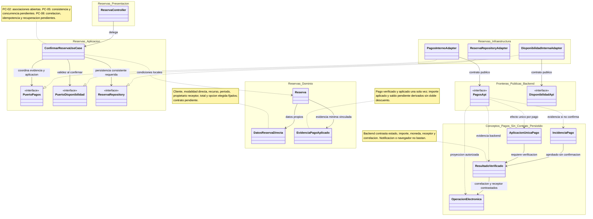
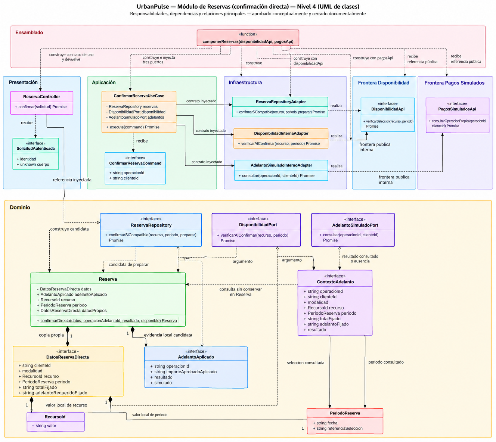

# UrbanPulse — Modelo C4 Nivel 4: Código de Reservas

**Revisión Tarea 3 — 07/11/2026; pendiente de auditoría.** Se conserva el antecedente de aprobación conceptual y cierre documental de la estructura anterior. La revisión financiera no hereda ese cierre: el alcance funcional está establecido por [RC/DF/DP vigentes](../01-analisis-de-sistema/05-restricciones.md), mientras la respuesta arquitectónica de [ADR-012](../01-analisis-de-sistema/adr/ADR-012-modelo-pagos-mvp.md) sigue propuesta. Mercado Pago Marketplace Split 1:1 es solamente candidato, sin capacidades verificadas ni aprobación de producción. No se acredita implementación, despliegue o pruebas.

**Alcance:** vista ilustrativa de confirmación directa de cancha/karaoke. Clases, puertos, contratos y composición candidatos, sin implementación ni firmas definitivas.

## 1. Objetivo y alcance

Reconciliar la confirmación de Reservas con pago real total o adelanto configurado. Se parte de una operación electrónica ya iniciada y correlacionada, cuya asociación exacta con Reserva/intento/Solicitud sigue pendiente PC-02. El inicio, identificación del receptor, fijación de importes y verificación del proveedor pertenecen a Pagos; se muestran conceptualmente para distinguir los hechos financieros, sin incorporar sus clases privadas al Dominio de Reservas.

La coordinación usa fronteras públicas de Pagos y Disponibilidad dentro del mismo backend. Resultado verificado, aplicación única y confirmación persistida son hechos distintos. La incidencia aprobada sin confirmación conserva evidencia; no se resuelve con un renombre del simulador. Redis/RabbitMQ quedan fuera: no procesan cobros ni confirman reservas.

No se desarrolla confirmación de salón/recreo, cotización/aceptación, registro/corrección de saldo o devolución operativa. Eventos siguen requiriendo condiciones aceptadas dentro de UrbanPulse, además de pago y disponibilidad, pero no se simula su cobertura añadiendo booleanos al recorrido directo.

## 2. Fuentes y trazabilidad

### 2.1 Fuentes de la vista

| Fuente | Uso y límite |
|---|---|
| [Restricciones](../01-analisis-de-sistema/05-restricciones.md) y [ADR-012](../01-analisis-de-sistema/adr/ADR-012-modelo-pagos-mvp.md) | Condiciones financieras establecidas; arquitectura financiera propuesta y proveedor sin aprobar. |
| [C1](01-contexto-c1.md), [C2](02-contenedores-c2.md), [C3](03-componentes-c3.md) | Sistema y proveedor externo; cinco contenedores, ocho módulos, seis responsabilidades técnicas fuera de este recorrido. |
| [Diseño Interno](../03-diseño-software/diseño-interno/diseño-interno-de-modulos.md), [Patrones](../03-diseño-software/diseño-interno/patrones-de-diseño.md), [SOLID](../03-diseño-software/diseño-interno/principios-de-diseño.md) | Responsabilidades reconciliadas en Tarea 2, sin contratos o código del simulador vigentes. |
| [RN/PC](../03-diseño-software/01-reglas-de-negocio.md), [estados](../03-diseño-software/02-estados-y-transiciones.md), [flujos](../03-diseño-software/03-flujos-de-reserva.md) | RN-04/RN-12–RN-19/RN-24/RN-25; guardas y separación de hechos; PC-02/PC-05/PC-08 explícitos. No aprueban modelos persistidos. |
| [AGENTS.md](../../AGENTS.md) | Preservación del trabajo y jerarquía; sus referencias financieras se sincronizan en Tarea 4, preservando seguridad, jerarquía y reglas de Git. |

### 2.2 Matriz C3 ↔ C4 y decisiones

| Participantes candidatos | Correspondencia C3 | Respaldo y pendiente |
|---|---|---|
| Reserva, DatosReservaDirecta, EvidenciaPagoAplicado | Datos/reglas de Reservas y evidencia mínima aplicada. | ADR-002/003/004/008; DF-04; DP-03/DP-04/DP-12; PC-02/PC-04/PC-06. |
| ConfirmarReservaUseCase, PuertoPagos, PuertoDisponibilidad, ReservaRepository | Coordinación de Reservas por contratos propios/API públicas. | ADR-001/002/004/006/008; RN-13; PC-05/PC-08. |
| OperacionElectronica, ResultadoVerificado, AplicacionUnicaPago, IncidenciaPago | Conceptos de Pagos; fronteras externas al módulo Reservas, internas al backend. | HU09/RF11/RF18/RF19; RC07; ADR-012 propuesta; PC-02/PC-07/PC-08. |
| Adaptadores internos y de proveedor, repositorios | Infraestructura dependiente de abstracciones internas. | ADR-002/006/008; sin SDK, motor, contratos o mecanismo concurrente seleccionado. |

| Respaldo | Aplicación y límite |
|---|---|
| HU09 → RF11/RF18/RF19; RC07/RC10 y AC08 → DA06 → ADR-006/ADR-012 | Pagos reales con integración desacoplada; RF18 es origen explícito de DA06; RF11/RF19 son contexto allí y origen en DA08. Arquitectura financiera propuesta. |
| RF04/RF06/RF12 y AC03 → DA02 → ADR-004/ADR-012; RN-13, DP-12 | Confirmación compatible, disponibilidad válida y aplicación única; PC-05 pendiente. HU03/RF04 y HU04/RF06 son contextuales. |
| RC04 y RF11/RF19 → DA08 → ADR-008/ADR-012 | Evidencia definitiva por repositorios; AC03/AC05 son complementarios en DA08, sin garantía operativa inferida. |
| HU10/HU14 → RF14; HU14 → RF20; AC04 → DA05 → ADR-007; RF14/RF20 → DA08 → ADR-008/ADR-012 | Resumen autorizado y recepción posterior completa; autorización apoya ADR-012, sin nuevo origen RF18 → DA05. |
| RC03 → DA07 → ADR-005 | REST web–backend; AC05/AC08 complementarios en DA07. No impone REST entre módulos. |
| AC01 y RF01/RF03/RF05 → DA04 → ADR-009; ADR-010 complementaria | Consultas y fichas públicas; no cachear disponibilidad. ADR-011 procede de su cierre propio, sin nuevo driver de origen. |

La evidencia detallada reside en [HU](../01-analisis-de-sistema/02-historias-del-usuarios.md), [RF](../01-analisis-de-sistema/03-requisitos-funcionales.md), [AC](../01-analisis-de-sistema/04-atributos-de-calidad.md), [drivers](../01-analisis-de-sistema/06-driver-arquitectonicos.md) y [catálogo ADR](../01-analisis-de-sistema/07-decisiones-arquitectonicas.md#7-trazabilidad-y-estado-de-adr-012). RF02/RF09/RF10 carecen de origen explícito en drivers; AC02/AC07 no tienen driver/respuesta explícitos. DF-02 conserva formalización detallada pendiente; RF13 sigue pendiente. [EQ](../01-analisis-de-sistema/08-escenarios-atributos-calidad.md) propone evaluaciones y métricas por revisar, sin pruebas ejecutadas.

## 3. Vista de código del módulo Reservas

UML de clases conceptuales mediante Mermaid. Los cuatro espacios de nombres de Reservas representan sus cuatro capas. La frontera pública y los conceptos de Pagos/Disponibilidad se encuentran fuera de Reservas y dentro del backend; no son paquetes privados compartidos. La separación gráfica de conceptos no exige entidades/tablas independientes ni cardinalidades. Se omiten miembros y firmas deliberadamente.

El gráfico no dibuja una secuencia consulta–escritura como garantía. Ubicación de puertos en Aplicación es candidata; no reubica contratos aprobados. `PagosApi` representa acceso público, no un servicio que exporte entidades privadas. Las dependencias punteadas a conceptos explican semántica de la frontera, sin aprobar tipos compartidos. La interfaz no causa ejecución por sí sola.

**PNG histórico desactualizado:** la vista C4-1 y los antecedentes de clases/secuencia conservan supuestos del adelanto simulado y firmas que ya no describen el alcance financiero vigente. Se preservan sin reemplazar ni inspección visual nueva.

Otros antecedentes: [diagrama de clases histórico](../diagramas/diagrama-de-clases.png) y [flujo de ejecución histórico](../diagramas/Flujo-de-ejecución_confirmar-reserva.png).

## 4. Responsabilidades de clases e interfaces

### 4.1 Elementos representados

| Capa/frontera | Responsabilidad candidata | Límite |
|---|---|---|
| Presentación: ReservaController | Recibir operación directa e identidad confiable y delegar. | No acepta aprobación, aplicación o importes como hechos del navegador. Autenticación PC-11 pendiente. |
| Aplicación: ConfirmarReservaUseCase | Contrastar contexto propio, coordinar verificación/aplicación financiera y disponibilidad con confirmación consistente. | No es integración completa ni transacción distribuida; protocolo PC-05/PC-08 pendiente. |
| Aplicación: PuertoPagos | Acceder a evidencia autorizada/correlacionada y coordinar aplicación única por frontera pública de Pagos. | No vuelve a cobrar al confirmar ni confunde aprobado con aplicado. Firma/DTO/errores abiertos. |
| Aplicación: PuertoDisponibilidad | Obtener validez para recurso/periodo dentro del acuerdo de consistencia por diseñar. | Una consulta no retiene ni impide carreras por sí sola. |
| Aplicación: ReservaRepository | Solicitar persistencia propia que preserve incompatibilidad y vínculo del pago aplicado. | No encapsula por nombre toda la garantía; atomicidad/recuperación pendientes. |
| Dominio: Reserva | Expresar condiciones y datos propios de confirmación directa. | Candidata en memoria no acredita confirmación definitiva. Sin SDK o cliente de infraestructura. |
| Dominio: DatosReservaDirecta | Cliente, modalidad cancha/karaoke, recurso/periodo, receptor, total/opción/importe fijados. | Valores y evidencia local; no cardinalidades persistidas ni copia total de Pagos. |
| Dominio: EvidenciaPagoAplicado | Identidad de pago/operación, importe verificado y aplicado, asociación/receptor y evidencia mínima trazable. | Saldo pendiente calculado sobre pago aplicado; dato duplicado/derivado y almacenamiento por decidir. |
| Infraestructura: adaptadores internos | Realizar puertos de Reservas y traducir API públicas de Pagos/Disponibilidad. | Sin importar sus entidades privadas ni HTTP interno obligatorio. |
| Infraestructura: ReservaRepositoryAdapter | Realizar repositorio propio mediante persistencia relacional. | Modelo y garantía PC-02/PC-05/PC-08 pendientes; no hay implementación operativa. |
| Frontera Pagos: OperacionElectronica | Operación iniciada con selección, total/opción/importe/moneda fijados, cliente, propietario receptor y referencias correlacionadas. | Inicio/asociación exacta PC-02/PC-08 abiertos. Receptor debe estar válidamente vinculado. |
| Frontera Pagos: ResultadoVerificado | Hecho contrastado por backend con autoridad del proveedor y evidencia. | Aprobación, rechazo e incertidumbre diferenciados. No aprobación por webhook sin verificar. |
| Frontera Pagos: AplicacionUnicaPago | Aplicar importe al vínculo autorizado una sola vez por pago, incluso entre canales/eventos distintos. | No resuelto por deduplicar ID de evento; persistencia/protocolo pendientes. |
| Frontera Pagos: IncidenciaPago | Conservar aprobado sin confirmación, aplicado o no, correlación/receptor/importe, motivo y seguimiento. | Conciliación y devolución cuando corresponda; políticas y responsables PC-07/PC-10 pendientes. |

### 4.2 Firmas respaldadas y abreviaciones

Las antiguas firmas del simulador y su literal de naturaleza académica dejan de ser contratos vigentes. Se sustituyen por responsabilidades sin miembros en el diagrama. No se aprueban nuevas firmas, booleanos de resultado, callbacks, DTO, IDs físicos, tipos monetarios, cardinalidades o endpoints. La notación TypeScript histórica no selecciona lenguaje. Proyectar información por API pública requiere contratos/mapeo futuros; no obliga a compartir clases del Dominio entre módulos.

## 5. Relaciones y reglas de dependencia

### 5.1 Notación y dirección

`-->` expresa referencia conceptual dirigida; `..>` dependencia semántica/uso sin propiedad persistida; `..|>` realización hacia la interfaz. No se usan multiplicidades ni composiciones para decidir PC-02. Las flechas no expresan orden temporal, transacciones o garantía de ejecución.

Presentación depende de Aplicación; Aplicación coordina mediante abstracciones y reglas del Dominio; Infraestructura realiza abstracciones hacia el núcleo. Dominio no depende de Infraestructura, SDK, secretos, proveedor o broker. Pagos traduce estados del proveedor sin trasladarlos como tipos de SDK al núcleo.

### 5.2 Ensamblado y fronteras

La raíz de composición, fuera del núcleo y omitida por legibilidad, suministraría repositorio y adaptadores a sus puertos; no es quinta capa ni módulo. Contratos públicos de Pagos/Disponibilidad no autorizan tablas privadas. La propuesta financiera sitúa recepción de webhook en Presentación de Pagos, coordinación en Aplicación y adaptador del proveedor en Infraestructura; su código interno queda fuera de esta selección de clases. No se mueve al proveedor o webhook a Reservas ni a RabbitMQ.

Repository, Adapter e inyección conservan separación; SRP distingue cobro, verificación, aplicación y confirmación; DIP evita dependencia al detalle; LSP exige preservar incertidumbre/efecto único al sustituir adaptadores. Ningún patrón acredita la garantía concurrente.

## 6. Límites, decisiones pendientes y riesgos

### 6.1 Confirmación y evidencia

Cancha mantiene recurso, fecha y bloque configurado sin duración uniforme obligatoria; karaoke, sala, fecha e intervalo. Son reservas directas, sin solicitud de evento ni cotización obligatoria. Salón/recreo mantienen solicitud, revisión, cotización y condiciones aceptadas por el cliente dentro de UrbanPulse. Recreo reserva un ambiente/espacio definido, sin exclusividad presunta del establecimiento o del día (DF-01–DF-04).

El cliente elige total o adelanto configurado. Antes de iniciar se muestran y fijan total, adelanto, opción, importe, moneda y propietario receptor (DP-02/DP-03). Confirmar exige pago requerido verificado por backend y aplicado una sola vez, disponibilidad válida y ausencia de confirmaciones incompatibles concurrentes; eventos requieren además aceptación interna. Aprobación aislada, navegador o notificación sin verificar no confirman. Consultar/coordinar no retiene recursos (RN-12/RN-13; DP-12; PC-05).

Importe pendiente = total acordado − pago verificado y aplicado. Pago total aplicado implica cero; aprobado sin aplicar no se descuenta. La recepción posterior del saldo completo positivo se registra separadamente, sin doble descuento ni nuevo cobro de lo ya recibido. Solo propietario autorizado de reserva confirmada propia registra método declarado, importe, fecha de recepción, referencia cuando corresponda, autor y fecha/hora de registro; una recepción activa e historial de correcciones. Registrar/corregir no cambia Reserva ni resultado electrónico. Sin fraccionamientos posteriores ni recepción ficticia para cero, cuya etiqueta sigue pendiente (HU14/RF20; DF-05; DP-04–DP-11).

Operación electrónica, resultado verificado, aplicación, confirmación, recepción declarada y liquidación del proveedor son hechos distintos. Aprobados sin confirmación conservan evidencia para conciliación y devolución cuando corresponda; políticas, permisos y ejecución pendientes. Esto no habilita RF13, cancelación, expiración o reapertura. Efectivo, Yape, Plin y transferencia son métodos declarados del saldo, sin acreditar soporte electrónico del candidato. UrbanPulse no recauda para redistribuir manualmente fondos ni adopta comisión propia (RC07/DF-06; ADR-012).

El acuerdo de consistencia debe impedir tanto doble aplicación como confirmación incompatible y definir recuperación si aplicación/confirmación no completan juntas. No se presupone que proveedor y base compartan transacción. Guardar una candidata, ejecutar un callback o consultar antes de escribir no demuestra RN-13. No se declara éxito mientras PC-05/PC-08 y su validación estén abiertos.

Si el proveedor aprueba y faltan disponibilidad u otras condiciones, no forzar Reserva ni transformar aprobación en rechazo; conservar evidencia de aprobación y aplicación real o ausencia para conciliación/devolución cuando corresponda. También debe diseñarse detección tras caída después del cobro: no se garantiza recuperar intenciones nunca conservadas. Una incidencia no habilita cancelar ni reenviar automáticamente otro cobro. Aprobación no equivale a liquidación del propietario.

### 6.2 Pendientes conservados

| Pendiente | Límite conservado |
|---|---|
| PC-01 | Contenido/versiones de cotización, servicios y evidencia de aceptación; DF-02 no formalizada completamente en HU/RF. |
| PC-02 | Creación, cardinalidades, asociaciones y propiedad relacional de Reserva/Solicitud/operación/aplicación/incidencia/saldo. |
| PC-03 | Iniciador y automatización de confirmación de eventos. Un webhook no los decide. |
| PC-04 | Periodos, extremos, solapamientos y espacios compartidos. |
| PC-05 | Garantía concurrente y coordinación aplicación única/confirmación/Disponibilidad; mecanismo y validación pendientes. Sin bloqueo, retención o expiración adoptados. |
| PC-06 | Moneda, precisión, límites, bruto/neto, tarifas y representación de cero; fórmula vigente y recepción completa no se reabren. |
| PC-07 | Evidencia recuperable de aprobación sin confirmación, aplicada o no, caídas tras cobro y responsables de conciliación/devolución. |
| PC-08 | Inicio/consulta/webhook/devolución, autenticidad, correlación, reintentos, duplicados entre canales, aplicación única, desorden e incertidumbre. |
| PC-09 | No aceptación, cambios y reapertura sin estados ni permisos nuevos. |
| PC-10 | RF13/ciclo posterior separados de devolución financiera: política, elegibilidad, importe, iniciador y evidencia final pendientes. |
| PC-11 | Matriz de permisos, seguridad, vinculación/renovación/revocación del receptor y custodia de credenciales. |
| PC-12 | Cobertura HU/RF/DA, onboarding si requiere formalización y evaluación EQ, sin cerrar vacíos por analogía. |

Fuente de detalle: [catálogo RN/PC](../03-diseño-software/01-reglas-de-negocio.md#restricciones-del-mvp-y-pendientes-contractuales), [estados](../03-diseño-software/02-estados-y-transiciones.md), [flujos](../03-diseño-software/03-flujos-de-reserva.md) y reconciliación de Tarea 2 (antecedente auxiliar local, fuera del repositorio). Un timeout no aprueba/rechaza ni autoriza automáticamente otro cobro. Deduplicar solo el ID del evento no evita aplicar dos eventos distintos del mismo pago. No se adopta transacción distribuida, Outbox, inbox, scheduler o cola financiera por esta representación.

## 7. Reconciliación y estado documental

La jerarquía aplicada es: solicitud explícita actual y Análisis vigente (actores, HU/RF, RC/DF/DP); decisiones estructurales ADR-001–ADR-011 y estado individual de ADR-012; RN/PC, estados y flujos; Diseño Interno; representación C4. Los informes son antecedentes auxiliares, no aprobaciones. Tarea 4 sincroniza AGENTS.md, README y los textos de arquitectura con pagos reales como objetivo y las cuatro capas de ADR-002. Las seis fuentes C1–C4 ya existen para revisión; sus PNG históricos siguen pendientes de actualización. Los ejemplos no seleccionan tecnología ni aprueban ADR-012.

Se preserva el alcance directo y las cuatro capas del cierre conceptual histórico; la revisión financiera queda pendiente de auditoría sin aprobar nombres, firmas, composición o algoritmos. C1/C2/C3 se reconcilian en esta Tarea 3; el aislamiento Redis/RabbitMQ y sus cierres D1–D6 no se reabren. No se selecciona framework/ORM/motor/proveedor. La verificación documental y Mermaid de esta revisión se detalla en el informe Tarea 3 (antecedente auxiliar local, fuera del repositorio); no se heredan resultados de pruebas o de Git de cierres anteriores.
