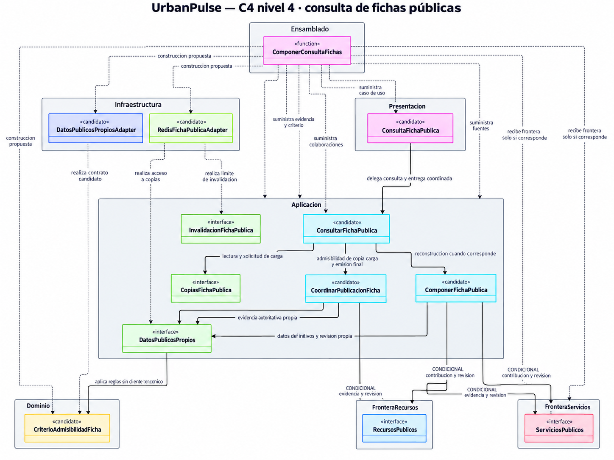

# UrbanPulse — Modelo C4 Nivel 4: Establecimientos y Redis

**Estado: vista ilustrativa aprobada conceptualmente y cerrada documentalmente — Establecimientos y Redis. Clases, contratos, mecanismos operativos e implementación pendientes.**

**Base conceptual:** diseño técnico D1–D6 aprobado conceptualmente y cerrado documentalmente, con fecha de aprobación conceptual 16/10/2026. Esta vista no acredita implementación, configuración ni pruebas.

## 1. Objetivo, alcance y exclusiones

Desarrollar una segunda vista documental del cuarto nivel C4 para Establecimientos: consulta, admisibilidad, reconstrucción y carga segura de fichas públicas con Redis. Se utiliza UML de clases, presentado como PNG en la sección 3; esta vista no conserva el código fuente del diagrama ni introduce sintaxis `C4Code`. La vista detalla candidatos de código derivados de las responsabilidades de C3 y de los acuerdos D1–D6, sin convertirlos en contratos aprobados.

El alcance incluye la frontera de consulta, coordinación del caso de uso, composición de ficha, evidencia autoritativa, política de admisibilidad, coordinación de revisión y emisión, acceso a copias y frontera autorizada de invalidación. Esta última aparece solo como límite. El flujo completo de publicación y consumo RabbitMQ queda para el tercer C4, sin crear esa vista en esta entrega.

Se mantienen cuatro capas oficiales, ocho módulos funcionales y cinco contenedores C2. Establecimientos coordina la proyección; Recursos y Servicios conservan autoridad sobre sus datos. Redis contiene copias públicas reconstruibles y la base relacional conserva los datos definitivos. Los participantes aquí propuestos no crean módulos, capas o contenedores adicionales.

Se excluyen disponibilidad reservable, reservas, cotizaciones particulares, aceptación contractual particular, adelantos, saldo, permisos y datos protegidos de las copias Redis. No se incorporan fotografías, valoraciones, contacto u otros campos fuera de D1. No se diseñan endpoints, DTO, esquemas de mensajes, formatos físicos de revisión, claves, TTL, comandos Redis, locks, mutex o transacciones distribuidas. Tampoco se implementa código ni se seleccionan tecnologías adicionales.

## 2. Fuentes y trazabilidad C3 ↔ D1–D6 ↔ C4

| Fuente | Uso y límite de evidencia |
|---|---|
| [AGENTS.md](../../AGENTS.md) | Jerarquía documental, cuatro capas, restricciones funcionales y preservación de fuentes. Sus desfases históricos se conservan y explican en la sección 9. |
| [Diseño técnico D1–D6 cerrado](../03-diseño-software/diseño-interno/diseno-tecnico-fichas-publicas-redis.md) | Fuente inmediata de categorías, coordinación, visibilidad, revisiones, responsabilidades y semántica. Aprueba redacción y trazabilidad conceptual; no aprueba los candidatos de esta vista. |
| [C1 — Contexto](01-contexto-c1.md), [C2 — Contenedores](02-contenedores-c2.md) y [C3 — Componentes](03-componentes-c3.md) | Vistas cerradas en sus respectivos alcances. C2 contiene cinco contenedores y C3 ocho módulos y seis responsabilidades técnicas. Esta vista abre una selección del backend sin modificar esas fuentes. |
| [Primer C4 — Reservas](04-codigo-c4.md) | Vista ilustrativa cerrada para confirmación directa. No se amplía ni se reutilizan sus firmas para fichas públicas. |
| [Catálogo ADR-001–ADR-011](../01-analisis-de-sistema/07-decisiones-arquitectonicas.md) | Monolito Modular, cuatro capas, REST web–backend, adaptadores, autorización y repositorios. ADR-009 conserva consultas de disponibilidad sin aprobación histórica de caché. |
| [ADR-010 — Redis](../01-analisis-de-sistema/adr/ADR-010-cache-redis.md#registro-de-cierre-conceptual) y [ADR-011 — RabbitMQ](../01-analisis-de-sistema/adr/ADR-011-mensajeria-rabbitmq.md#registro-de-cierre-conceptual) | Alcances conceptuales adoptados, copias reconstruibles, fallback y transporte de invalidaciones. Seguridad, publicación, recuperación y mecanismos permanecen pendientes. |
| [Diseño de módulos](../03-diseño-software/diseño-interno/diseño-interno-de-modulos.md), [Patrones](../03-diseño-software/diseño-interno/patrones-de-diseño.md) y [Principios SOLID](../03-diseño-software/diseño-interno/principios-de-diseño.md) | Cierres conceptuales de responsabilidades y límites, con contratos concretos pendientes. ISP/DIP y la separación de adaptación y coordinación orientan esta propuesta. |
| [HU](../01-analisis-de-sistema/02-historias-del-usuarios.md), [RF](../01-analisis-de-sistema/03-requisitos-funcionales.md), [RN y PC](../03-diseño-software/01-reglas-de-negocio.md) y [restricciones DF/DP](../01-analisis-de-sistema/05-restricciones.md) | HU02 → RF02 respalda consulta informativa; HU06/RF08, HU07/RF09 y HU11/RF15 contextualizan cambios autorizados. No se alteran reglas ni pendientes. |
| [AC](../01-analisis-de-sistema/04-atributos-de-calidad.md), [drivers](../01-analisis-de-sistema/06-driver-arquitectonicos.md) y [EQ](../01-analisis-de-sistema/08-escenarios-atributos-calidad.md) | Seguridad, consistencia y mantenibilidad delimitan el diseño; rendimiento potencial no medido. EQ conserva procedimientos y métricas pendientes. |

La matriz siguiente cubre **todos los nombres nuevos del diagrama**, incluidos los contratos colaboradores: son **candidatos nuevos derivados de D1–D6**, no elementos existentes ni aprobados. Los nombres describen responsabilidades y no definen firmas, propiedades o tipos de resultado. «A» distingue la responsabilidad aprobada conceptualmente; «B», el candidato propuesto; «C», su realización operativa pendiente, sin mecanismo seleccionado.

| Elemento propuesto | Responsabilidad C3 | D1–D6 | Capa o frontera propuesta | Estado de aprobación | Contrato o mecanismo pendiente |
|---|---|---|---|---|---|
| `ConsultaFichaPublica` | Entrada de la frontera API REST hacia Establecimientos. | D3/D5/D6. | Presentación. | A: entrada separada de coordinación. B: clase candidata. C: pendiente. | Contrato REST, traducción de resultados y enlace con emisión efectiva. |
| `ConsultarFichaPublica` | Consulta pública de Establecimientos por abstracciones. | D2–D6. | Aplicación. | A: coordinación. B: clase candidata. C: pendiente. | Colaboraciones, resultados y tratamiento de fallos. |
| `ComponerFichaPublica` | Reconstrucción desde fuentes definitivas y fronteras públicas. | D1/D2/D4/D5. | Aplicación. | A: composición bajo autoridad modular. B: clase candidata. C: pendiente. | Contribuciones necesarias, fuentes de precios/horarios y coherencia de datos/revisiones. |
| `CoordinarPublicacionFicha` | Admisibilidad de consulta/carga y coordinación con emisión. | D3/D4/D5. | Aplicación. | A: dirección de protección. B: clase candidata. C: pendiente. | Cobertura de ejecutores, sincronización, evidencia y punto operativo de emisión. |
| `DatosPublicosPropios` | Acceso por repositorios a datos definitivos de Establecimientos. | D2/D3/D4/D5/D6. | Abstracción interna, ubicada tentativamente en Aplicación. | A: acceso por frontera propia. B: interfaz candidata. C: pendiente. | Datos, evidencia y revisiones propios; propiedad y ubicación exactas del puerto. |
| `CopiasFichaPublica` | Puerto C3 de lectura y carga de caché pública. | D4/D5/D6. | Abstracción interna, ubicada tentativamente en Aplicación. | A: lectura/carga desacopladas. B: interfaz candidata. C: pendiente. | Distinciones semánticas, correlación de revisión y carga segura. |
| `InvalidacionFichaPublica` | Frontera autorizada de invalidación, solo como límite. | D3/D4/D5. | Abstracción interna, ubicación tentativa en Aplicación. | A: frontera C3. B: interfaz candidata. C: pendiente. | Titular, ámbito afectado, realización del efecto e idempotencia. |
| `CriterioAdmisibilidadFicha` | Reglas del núcleo para contenido públicamente admisible. | D1/D3/D4/D5. | Dominio, asignación candidata. | A: reglas independientes de clientes. B: clase candidata. C: pendiente. | Distribución de reglas, evidencia requerida y criterio de coherencia; sin lectura técnica desde Dominio. |
| `DatosPublicosPropiosAdapter` | Implementación de repositorio propio hacia persistencia relacional. | D2/D4/D5/D6. | Infraestructura. | A: repositorios y autoridad relacional. B: clase candidata. C: pendiente. | Mapeo, persistencia coherente de datos/revisiones y fallos, sin motor elegido. |
| `RedisFichaPublicaAdapter` | Adaptador Redis para acceso e invalidación. | D3–D6. | Infraestructura. | A: adaptación Redis. B: clase candidata compartida para dos abstracciones. C: pendiente. | Claves, carga, invalidación, metadatos, comandos, TTL y recuperación. |
| `RecursosPublicos` | Frontera pública de Recursos cuando aporte datos a la ficha. | D1/D2/D3/D4/D5. | Frontera colaboradora fuera de Establecimientos. | A: autoridad de Recursos. B: interfaz candidata condicional. C: pendiente. | Contribución, evidencia pública y revisión coherente; sin exponer modelos privados. |
| `ServiciosPublicos` | Frontera pública de Servicios cuando aporte oferta a la ficha. | D1/D2/D3/D4/D5. | Frontera colaboradora fuera de Establecimientos. | A: autoridad de Servicios. B: interfaz candidata condicional. C: pendiente. | Contribución, publicabilidad y revisión coherente; sin inclusión automática en cotizaciones. |
| `ComponerConsultaFichas` | Ensamblado interno del backend, sin componente funcional adicional. | D2/D5. | Raíz de composición externa al núcleo. | A: suministro de implementaciones. B: función candidata representada gráficamente. C: pendiente. | Composición concreta, ciclo de vida y entrega de fronteras colaboradoras. |

HU02 → RF02 tiene origen funcional explícito y correspondencia con consulta en Establecimientos; RF02 no tiene origen explícito en drivers. AC01 → DA04 → ADR-009 aporta contexto y ADR-010 es complementaria; no se inventa RF02 → DA04. AC04 → DA05 → ADR-007 limita acceso; AC03 → DA02 → ADR-004 y RN-13 delimitan confirmación, fuera de la ficha. AC05/AC08 → DA06 → ADR-002/ADR-006 orienta desacoplamiento, sin atribuir al driver una exigencia histórica de RabbitMQ. RF09/RF10 y AC02/AC07 conservan sus vacíos de trazabilidad; HU03/RF04 y HU04/RF06 siguen contextuales.

## 3. Vista UML de código mediante Mermaid

Todos los nombres son candidatos nuevos. Los espacios `Presentacion`, `Aplicacion`, `Dominio` e `Infraestructura` pertenecen conceptualmente a Establecimientos; las fronteras colaboradoras pertenecen a sus módulos y `Ensamblado` está fuera del núcleo. Las ubicaciones de puertos y política son propuestas revisables, no una decisión de distribución definitiva.

`<<interface>>` distingue abstracciones candidatas; no expresa aprobación. `<<candidato>>` marca clases propuestas. `<<function>>` representa una función candidata mediante una caja UML, sin crear una clase de ensamblado ni definir su firma. Se omiten miembros y parámetros deliberadamente. Las etiquetas de relaciones describen responsabilidades, no métodos ni orden de ejecución.

**Advertencia obligatoria: dibujar una coordinación de emisión no demuestra que la garantía esté implementada.** `CoordinarPublicacionFicha` es un candidato ilustrativo; su aparición no demuestra sincronización efectiva entre la retirada de publicación, la evidencia autoritativa, la comprobación final y el inicio de emisión por el backend. El mecanismo y la cobertura de todos los ejecutores relevantes siguen pendientes. La asociación representa también la comprobación autoritativa final y su coordinación con la entrega efectiva, no solo una validación inicial. La realización física de ese enlace con Presentación sigue pendiente; ninguna flecha prueba exclusión concurrente.

## 4. Inventario de elementos propuestos y responsabilidades

La matriz de la sección 2 inventaría los trece candidatos, su capa y decisión de origen. Su agrupación busca mantener colaboraciones acotadas: `ComponerFichaPublica` reúne reconstrucción y composición; `CoordinarPublicacionFicha` reúne evaluación coordinada de revisiones, carga y emisión; `RedisFichaPublicaAdapter` propone una adaptación técnica compartida para lectura/carga e invalidación. No se aprueba la obligación de implementarlo como una única clase; la separación concreta podrá revisarse cuando se definan los contratos técnicos. No se crea un tipo por cada fila de D5 ni una correspondencia obligatoria con las seis cajas técnicas C3.

Los nombres se justifican por su función: `ConsultaFichaPublica` expresa frontera, `ConsultarFichaPublica` coordinación del caso de uso, y `ComponerFichaPublica` composición bajo titularidad de Establecimientos. `CoordinarPublicacionFicha` distingue coordinación de la regla `CriterioAdmisibilidadFicha`; esta última trabaja sobre evidencia suministrada y no consulta Redis, persistencia ni módulos. `DatosPublicosPropios` identifica acceso propio definitivo, mientras `CopiasFichaPublica` identifica copias prescindibles. `InvalidacionFichaPublica` limita el acceso técnico autorizado. Los sufijos `Adapter` distinguen detalle relacional y Redis; las dos fronteras públicas preservan la autoridad colaboradora y la función de composición proporciona implementaciones desde fuera del núcleo.

### Categorías D1 sin DTO definitivo

| Categoría aprobada conceptualmente | Límite preservado en la composición |
|---|---|
| Nombre público | Solo nombre efectivamente autorizado para exposición. |
| Categoría | Clasificación pública, sin enumeración física adoptada. |
| Descripción pública | Contenido público autorizado, sin identidad privada. |
| Servicios y oferta pública | Contribuciones autorizadas según módulo; publicar no agrega servicios a cotizaciones. |
| Precios informativos | Fuente pública exacta pendiente; no son cotizaciones aceptadas ni importes fijados al iniciar una operación. |
| Horarios informativos | Fuente pública exacta pendiente; no son disponibilidad reservable. |
| Condiciones públicas | Condiciones generales, sin aceptación contractual particular. |
| Ubicación pública | Solo ubicación publicable; representación y proveedor de mapas no se deciden aquí. |

Estas categorías no se dibujan como ocho atributos obligatorios ni se crea una clase de datos para fijarlas. Representación, obligatoriedad, formato, coordenadas, moneda y contratos siguen pendientes. Se conserva el origen propuesto de cada categoría en D1; no se asignan precios u horarios a un módulo por inferencia. Datos técnicos de revisión no amplían el contenido público por defecto.

## 5. Flujo conceptual de consulta cache-aside

El recorrido siguiente explica responsabilidades para análisis, sin prescribir un algoritmo, orden atómico o protocolo de emisión. `ConsultarFichaPublica` coordina por abstracciones; Redis no requiere pasar por RabbitMQ para atender la consulta.

1. `ConsultaFichaPublica` recibe la consulta y delega en Aplicación. El contrato REST y la clasificación detallada de accesos permanecen pendientes; la interfaz no concede autorización por sí misma.
2. Mediante `CopiasFichaPublica`, se solicita lectura. La copia debe poder relacionarse conceptualmente con su revisión; claves, identificadores y metadatos físicos están abiertos. Miss, copia existente y fallo técnico se distinguen.
3. Para una copia candidata, `CoordinarPublicacionFicha` coordina evidencia autoritativa, revisiones coherentes y reglas de admisibilidad. Un hit físico no equivale a hit admisible. Si no puede acreditarse publicabilidad, no se divulga la copia por defecto.
4. Ante miss, fallo Redis o copia no admisible, se evalúa obtener contenido autorizado por fuentes definitivas. `ComponerFichaPublica` utiliza `DatosPublicosPropios` y únicamente las fronteras colaboradoras necesarias. Cada colaborador conserva autoridad sobre publicación y revisión. Un fallo necesario de reconstrucción no se oculta como ausencia legítima de un campo.
5. Antes de solicitar carga de una reconstrucción, se coordina su admisibilidad y coherencia de revisión mediante `CoordinarPublicacionFicha`. Se solicita almacenamiento por `CopiasFichaPublica`; una comprobación anterior no demuestra seguridad de las carreras posteriores. D4 exige impedir selección/emisión como vigente si después resulta invalidada.
6. Tanto para hit como para fallback/reconstrucción, se requiere comprobación autoritativa final y coordinación con el inicio de emisión efectiva. No basta comprobar al principio o devolver sin más un contenido validado anteriormente. `ConsultaFichaPublica` participa en la entrega mediante el resultado coordinado del caso de uso; el punto operativo y su sincronización con retiradas requieren diseño.

| Distinción D6 | Tratamiento conceptual |
|---|---|
| Hit admisible | Puede utilizarse bajo coordinación D3/D4, sin dar por implementada la garantía. |
| Cache miss | Obtener fuentes definitivas cuando estén disponibles; no significa ausencia del establecimiento. |
| Error Redis | Permitir fallback a fuente definitiva, sujeto a su disponibilidad; no convertirlo en inexistencia. |
| Copia obsoleta o no admisible | No seleccionarla ni emitirla como vigente; reconstrucción autorizada si es posible. |
| Ausencia definitiva | Solo acreditada desde fuente definitiva; distinta de miss o fallo. |
| Existente no publicable | No divulgar contenido ni motivos privados. Puede compartir respuesta pública neutral con inexistencia, manteniendo diferencia interna. |
| Error relacional | Si no se acredita publicabilidad, no divulgar la copia por defecto ni inventar ausencia. |
| Error de reconstrucción de contribución necesaria | No presentar una ficha incompleta como completa. Retirada legítima y fallo técnico son hechos diferentes. |
| Fallo de almacenamiento en caché | No vuelve inexistentes los datos correctamente obtenidos y todavía autorizados; la emisión conserva las condiciones D3/D4. |

No se definen tipos de resultado definitivos, códigos HTTP, JSON, caché negativa o reintentos. No se revelan claves Redis, estados internos, motivos privados o información protegida. Fallback no garantiza continuidad absoluta si fallan las fuentes necesarias.

## 6. Visibilidad y revisiones: garantías y mecanismos pendientes

### D3: lectura, admisibilidad y emisión

Leer una copia o reconstruir contenido no autoriza a emitirlo. `CriterioAdmisibilidadFicha` representa la evaluación de reglas del núcleo sobre evidencia suministrada; `CoordinarPublicacionFicha` propone coordinar su obtención y uso, incluidas revisión final y entrega efectiva. Ninguno demuestra una garantía por su nombre.

Una vez efectiva una retirada de publicación, el backend no debe iniciar una nueva emisión del contenido retirado basándose en una comprobación anterior. La retirada completa afecta la ficha; ante retirada de un campo o servicio, **la proyección compuesta completa deja de ser admisible y debe invalidarse**, con reconstrucción posterior sin el contenido retirado. No basta omitir visualmente un campo de una copia previa para acreditar reconstrucción coherente.

La protección debe cubrir todas las rutas pertinentes de cambio: Establecimientos, incluida administración dentro de HU11/RF15, y las contribuciones públicas de Recursos/Servicios cuando participen. La cobertura de ejecutores, efectividad de retirada, sincronización y punto exacto de emisión siguen pendientes. Información ya entregada a un cliente queda fuera de la capacidad de retirada de esta garantía del backend.

### D4: revisión autoritativa y reconstrucciones invalidadas

| Responsabilidad reconocible en la vista | Obligación conceptual | Mecanismo pendiente |
|---|---|---|
| Fuentes propias y fronteras colaboradoras | Obtener datos definitivos y revisiones autoritativas coherentes, persistidas con los datos correspondientes. | Propiedad, representación y almacenamiento coherente; composición de revisiones entre módulos. |
| `CopiasFichaPublica` y adaptación Redis | Distinguir conceptualmente la revisión de la copia. | Identificadores físicos, claves y metadatos; existencia de copia no acredita vigencia. |
| `ComponerFichaPublica` | Reconstruir desde información definitiva, sin mezclar contribuciones incompatibles como si fueran coherentes. | Contratos de contribución y forma de obtener evidencia consistente. |
| `CoordinarPublicacionFicha` antes de carga | Evaluar admisibilidad y revisión al solicitar carga segura. | Sincronización con cambios concurrentes y semántica de carga. |
| `CoordinarPublicacionFicha` antes de emisión | Impedir selección/emisión de una reconstrucción invalidada como versión vigente, incluso con invalidación retrasada. | Punto operativo, cobertura de ejecutores y coordinación efectiva. |
| Consulta ante recuperación Redis | Tratar conservadoramente copias recuperadas o pérdida de metadatos; no presumir autorización o revisión vigente. | Protocolo de recuperación y revalidación por autoridad. |

La exigencia aprobada es no seleccionar ni emitir reconstrucciones antiguas invalidadas como vigentes. **Impedir absolutamente toda escritura física tardía es un requisito adicional no adoptado.** La escritura tardía de una copia no la habilita para selección o emisión. Invalidar o comprobar antes de cargar, aisladamente, no demuestra que se satisfaga esta obligación.

No se afirman atomicidad Redis–base relacional, consistencia fuerte implementada ni exclusión concurrente probada. Locks, mutex, transacciones distribuidas, algoritmos de comparación, escritura condicional, claves, TTL, comandos, versiones físicas y protocolos de recuperación no se seleccionan. Las garantías D3/D4 requieren diseño y validación futuros; TTL e invalidación asíncrona no bastan por sí solos para confidencialidad.

## 7. Relaciones, capas y fronteras modulares

| Notación UML | Interpretación en esta propuesta | Límite |
|---|---|---|
| `-->` | Asociación dirigida: referencia colaboradora conocida por el participante. Es también dependencia de código hacia su tipo. | No indica secuencia temporal ni llamada a un método concreto. |
| `..>` | Dependencia por construcción o suministro desde el ensamblado. | La raíz conoce los tipos, pero no es utilizada por el núcleo como localizador de servicios. |
| `..\|>` | Realización: el adaptador implementaría la abstracción candidata a la que apunta el triángulo. | No declara implementación existente ni cumplimiento de su contrato. |

No se dibujan composiciones `*--`, agregaciones, herencia o multiplicidades: no hay propiedad ni cardinalidades aprobadas que las justifiquen. Las asociaciones no expresan propiedad de los recursos ni de datos privados colaboradores.

Presentación conoce el caso de uso de Aplicación. Aplicación coordina mediante abstracciones y una política candidata del Dominio. Infraestructura realiza contratos internos; Dominio no conoce Aplicación, Presentación, Infraestructura, Redis o clientes técnicos. El adaptador de datos propios representa acceso definitivo mediante repositorios y el de Redis copias reconstruibles; Redis no se convierte en repositorio definitivo ni módulo funcional.

La propuesta ubica provisionalmente los puertos de consulta en Aplicación y el criterio de reglas en Dominio. Propiedad, ubicación exacta y distribución de reglas siguen pendientes. La raíz `ComponerConsultaFichas` recibiría las fronteras públicas pertinentes, construiría los candidatos internos y suministraría implementaciones mediante las abstracciones indicadas. No impone biblioteca de inyección ni convierte la función en una quinta capa.

**ISP:** el cliente de consulta conoce lectura/carga sin depender de publicación o consumo del broker. La frontera de invalidación se distingue para limitar la colaboración autorizada, aunque una adaptación Redis compartida sea candidata. **DIP:** los adaptadores dependen de contratos internos; una ejecución despachada a Infraestructura no crea dependencia del núcleo hacia el adaptador.

Las asociaciones a `RecursosPublicos` y `ServiciosPublicos` son **condicionales**: solo se usarían si la proyección necesitara sus datos o evidencia de publicabilidad/revisión. No son clases privadas de Establecimientos ni obligan a que Recursos o Servicios importen este módulo. No se crean ciclos funcionales ni acceso a tablas privadas ajenas. REST corresponde a web–backend; estas fronteras no adoptan HTTP interno.

`InvalidacionFichaPublica` se muestra sin llamador de transporte dentro del diagrama, porque publicación y consumo quedan fuera. El consumidor técnico de ADR-011 permanecerá dentro del backend, con idempotencia requerida y ACK posterior al efecto requerido; publisher confirms no equivalen a consumo. Publicación, recuperación y mecanismo idempotente siguen pendientes; Outbox permanece evaluado, no adoptado. Esa frontera no demuestra coordinación de retirada/emisión ni modifica reservas o pagos. El tercer C4 abordará el recorrido RabbitMQ; esta entrega no lo diseña.

## 8. Decisiones abiertas, escenarios y riesgos

### Escenarios de análisis sin pruebas ejecutadas

La referencia completa son los [catorce escenarios D1–D6](../03-diseño-software/diseño-interno/diseno-tecnico-fichas-publicas-redis.md#9-escenarios-de-validación-futura). Esta tabla explica cómo estudiar la selección de participantes; no describe resultados observados ni añade métricas.

| Escenario seleccionado | Intercalado o situación por estudiar | Responsabilidades cuya colaboración deberá evaluarse |
|---|---|---|
| Hit válido | Copia y autoridad coherentes, sin cambio invalidante. | Lectura por `CopiasFichaPublica`, evidencia/reglas y emisión final por coordinación. |
| Miss | Copia ausente con fuentes disponibles. | Composición de datos propios y contribuciones necesarias, admisibilidad de carga y emisión. |
| Fallo Redis | Falla lectura o guardado de una reconstrucción. | Diferenciación D6, fallback y mantenimiento de autorización sin atribuir éxito al guardado. |
| Retirada completa | Se hace efectiva después de una comprobación y antes de iniciar emisión. | Cobertura de cambios y coordinación final; la comprobación antigua no habilita respuesta. |
| Retirada de campo | Un campo antes público deja de serlo durante la consulta. | Invalidación de toda la proyección y reconstrucción autorizada; mismo análisis para retirada de servicio. |
| Cambio concurrente | Cambian datos/revisiones propios o colaboradores mientras se componen. | Fuentes y coordinación deben impedir selección/emisión de composición invalidada o incoherente como vigente. |
| Reconstrucción obsoleta | Una reconstrucción anterior solicita carga después de un cambio invalidante. | Control conceptual de carga y selección/emisión; incluir escritura física tardía sin exigir su prohibición absoluta. |
| Fallo relacional | Hay copia pero no puede acreditarse publicabilidad desde autoridad. | Fallo conservador y distinción entre fallo, inexistencia y no publicabilidad. |
| Recuperación Redis | Vuelven copias antiguas o faltan metadatos. | Identificación de revisión y tratamiento conservador, sin presumir vigencia por recuperación física. |

También permanecen los escenarios de retirada de servicio, invalidación retrasada, fallo de contribución, escritura tardía y cambio no confirmado/revertido del diseño técnico. Un evento retrasado no habilita contenido retirado; una contribución necesaria fallida no produce una ficha completa; un cambio no confirmado no se representa como definitivo. Los catorce escenarios mantienen su condición inicial, evento y resultado esperado en la fuente, sin modificación.

### Pendientes y restricciones conservados

| Pendiente | Límite de esta vista |
|---|---|
| PC-01–PC-03 | Cotización/aceptación, creación y relaciones Reserva/Solicitud/Pago e iniciador de confirmación de eventos siguen abiertos; la ficha no los resuelve. |
| PC-04–PC-05 | Alcance temporal, solapamientos y espacios compartidos, garantía concurrente y disponibilidad durante coordinación siguen abiertos. RN-13 es obligatoria; no se aprueban mecanismos, retenciones ni expiraciones. |
| PC-06–PC-08 | Precisión/límites monetarios y saldo cero, resolución de adelanto aprobado sin otras condiciones, fallos/duplicados/correlación del simulador siguen abiertos. Fórmula y registro completo del saldo ya aprobados no se reabren. |
| PC-09–PC-10 | No aceptación, cambios, reapertura y ciclo posterior pendientes. RF13 no habilita cancelación, devolución, expiración o cierre. |
| PC-11–PC-12 | Permisos y mecanismos de identidad/autorización, cobertura HU/RF/DA y evaluación EQ pendientes; no se amplía al administrador a gestión de usuarios. |
| Contratos y composición | Todos los trece nombres, su distribución, interfaces, colaboración, firmas, DTO y resultados concretos son candidatos pendientes. |
| Fuentes públicas | Precios, horarios y contribuciones necesarias conservan sus condicionamientos D1/D2. |
| Visibilidad y revisiones | Coordinación, cobertura de ejecutores, punto operativo de emisión, coherencia y almacenamiento de revisiones, carga y recuperación requieren diseño y pruebas. |
| Operación Redis/RabbitMQ | Claves, TTL, comandos, clientes, capacidad, seguridad y recuperación; publicación/consumo, idempotencia concreta y ACK requieren diseño. Outbox no adoptado; no hay atomicidad relacional atribuida al broker. |

Riesgos persistentes: exposición por evidencia antigua, reconstrucciones obsoletas, mezcla incoherente de contribuciones, pérdida de metadatos, cobertura insuficiente de cambios, invalidación retrasada o perdida, reconstrucciones simultáneas y sobrecarga relacional durante fallback. No se aprueban tolerancias de divulgación tras retirada ni beneficios cuantitativos.

Toda operación monetaria permanece exclusivamente simulada. DP-03 conserva total y adelanto conocidos antes y fijados al iniciar; la ficha informativa no los sustituye. El registro posterior del saldo completo por propietario autorizado de reserva confirmada propia conserva fórmula, una recepción activa e historial de correcciones (HU14/RF20; DP-04–DP-09). Registrar o corregir saldo no cambia Reserva ni resultado del adelanto y está separado de confirmación. No se inventa recepción para saldo cero. No hay pagos reales, parciales del saldo, reembolsos ni comprobantes bancarios.

La confirmación conserva disponibilidad válida y adelanto aprobado, más aceptación interna para eventos. Consultar o coordinar no retiene recursos (RN-12 derivada); caché y mensajes no garantizan RN-13 ni resuelven PC-05. No se añaden flujos de negocio, mensajería propia, compra de comidas/entradas/actividades o reserva de habitaciones.

## 9. Reconciliación y estado documental

Esta vista ilustrativa queda **aprobada conceptualmente y cerrada documentalmente** en cuanto a la representación y trazabilidad de las responsabilidades D1–D6. Se conservan los trece participantes como candidatos ilustrativos: el cierre no les transfiere la aprobación conceptual de D1–D6 ni aprueba sus clases concretas, relaciones como contratos obligatorios, firmas, ubicación definitiva, mecanismos operativos o ensamblado. Tampoco acredita implementación, configuración o pruebas.

| Desfase de fuentes | Criterio y efecto en esta vista |
|---|---|
| AGENTS.md y restricciones conservan nueve ADR y el marco previo sin caché aprobada; catálogo vigente y cierres reconocen ADR-010/011. | Se aplican alcances expresos de cierre: Redis/cache-aside y RabbitMQ acotados, sin adoptar mecanismos adicionales ni modificar fuentes. |
| Catálogo y ADR independientes aún describen C2 con tres contenedores y C3 anterior; C2 anuncia revisión futura de C3. | C2/C3 cerrados vigentes representan cinco contenedores, ocho módulos y seis responsabilidades técnicas. Las referencias anteriores son desfases registrados, sin reabrir vistas. |
| Diseño Interno/Patrones conservan referencias a Principios pendiente; el diseño D1–D6 preparaba un segundo C4 futuro. | Esta vista materializa y cierra documentalmente ese alcance. Se conservan las referencias históricas de Diseño Interno/Patrones sin modificar esos documentos ni declarar sincronización automática. |
| README/arquitectura inicial describen tres capas y simulación externa frente a precisiones vigentes; el catálogo afirma armonización. | Rigen cuatro capas ADR-002 y simulador interno del MVP. Referencias gráficas históricas y menciones de ORM no seleccionan tecnologías; no se afirma inspección visual nueva. |

No se identifican contradicciones bloqueantes que impidan este cierre documental dentro del alcance autorizado. C1, C2, C3, primer C4, ADR, Diseño Interno, AGENTS.md y README se preservan. No se crea código fuente, exportaciones ni archivos auxiliares. Se mantienen todos los pendientes de D1–D6 y PC-01–PC-12, RF13 pendiente, RN-13 obligatoria y pagos exclusivamente simulados.

La imagen PNG enlazada en la sección 3 no se valida visualmente en este documento. Las garantías D3/D4 no se deducen de la representación gráfica; mecanismos, implementación y evidencia operativa permanecen pendientes.

**URBANPULSE — SEGUNDO C4 ESTABLECIMIENTOS/REDIS APROBADO CONCEPTUALMENTE — VISTA ILUSTRATIVA CERRADA DOCUMENTALMENTE — SIN COMMIT NI PUSH.**
