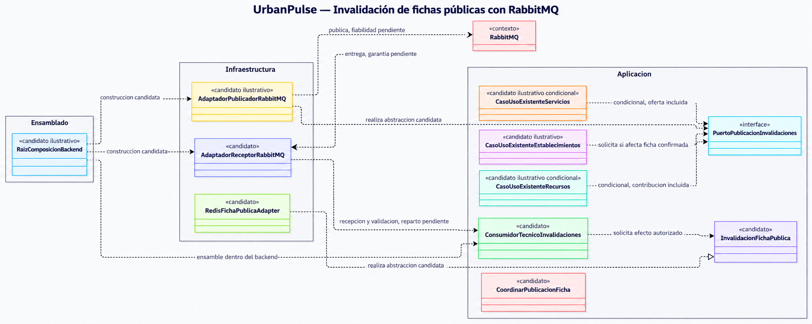

# UrbanPulse — Modelo C4 Nivel 4: Invalidación técnica con RabbitMQ

**Estado: vista ilustrativa aprobada conceptualmente y cerrada documentalmente — invalidación técnica con RabbitMQ. Participantes, contratos, mecanismos operativos e implementación pendientes.**

No acredita implementación, configuración, despliegue, pruebas ni garantías operativas.

## 1. Objetivo, alcance y exclusiones

Preparar una tercera vista C4 Nivel 4 para las responsabilidades de publicación y consumo técnico de invalidaciones de fichas públicas mediante RabbitMQ. El diagrama de la sección 3 representa participantes candidatos y dependencias conceptuales, no una secuencia operativa garantizada ni contratos aprobados.

La vista se limita a:

- Casos de uso existentes que solicitan invalidación cuando un cambio confirmado afecta contenido público de la ficha.
- Una abstracción interna para solicitar la publicación y su adaptador RabbitMQ.
- El consumidor técnico dentro del backend, la frontera autorizada de invalidación y la adaptación Redis.
- La coordinación de Establecimientos con la ficha pública y las protecciones de consulta D3/D4, como referencias al segundo C4 cuando corresponda.
- Las ventanas de fallo, duplicados y recuperación que siguen abiertas.

Se conservan el Monolito Modular, cuatro capas oficiales, ocho módulos funcionales y cinco contenedores C2. RabbitMQ y Redis son infraestructura de apoyo; no se añade una quinta capa, módulo funcional, worker independiente, microservicio o contenedor de backend adicional. La base relacional conserva la fuente definitiva; Redis se limita a copias reconstruibles de fichas públicas.

Se excluyen operaciones de negocio por mensajes, confirmaciones de Reserva, pagos, cotizaciones, aceptación contractual, saldo y cualquier cambio a esos procesos. No se añaden casos de uso de negocio, permisos, llamadas funcionales circulares ni acceso a tablas o clases privadas ajenas. No se definen firmas, propiedades, DTO, esquemas de eventos, colas, exchanges, routing keys, configuración, bibliotecas ni mecanismos operativos. Transactional Outbox permanece evaluado, **no adoptado**.

### Estados de evidencia

| Nivel | Qué significa aquí |
|---|---|
| Aprobado conceptualmente | ADR-011 adopta RabbitMQ para transportar invalidaciones técnicas y ubica el consumidor dentro del backend. C3 define seis responsabilidades técnicas conceptuales; no exige una clase por caja. |
| Derivado | Los cambios pertinentes se limitan a cambios confirmados que afecten datos públicos incluidos; el procesamiento debe admitir duplicados y el ACK debe seguir al efecto requerido. |
| Participante candidato | Nombre UML propuesto para explicar una responsabilidad. No es clase existente ni aprobación de su ubicación, interfaz o firma. |
| Pendiente | Contratos, publicación fiable, idempotencia concreta, recuperación, seguridad operativa y coordinación efectiva D3/D4. |

## 2. Fuentes y trazabilidad

| Fuente | Evidencia usada y límite |
|---|---|
| [AGENTS.md](../../AGENTS.md) | Jerarquía documental, cuatro capas, ocho módulos, PC-01–PC-12, RF13 y límites funcionales. Conserva referencias históricas anteriores a ADR-010/011; no revoca sus cierres posteriores. |
| [Catálogo ADR-001–ADR-011](../01-analisis-de-sistema/07-decisiones-arquitectonicas.md) | Monolito Modular, cuatro capas, cinco contenedores objetivo y alcance adoptado de Redis/RabbitMQ; mecanismos operativos pendientes. |
| [ADR-010 — Redis](../01-analisis-de-sistema/adr/ADR-010-cache-redis.md#registro-de-cierre-conceptual) | Redis/cache-aside solo para fichas públicas, reconstruibles y con fuente relacional definitiva. Invalidación asíncrona y TTL genérico no garantizan por sí solos confidencialidad. |
| [ADR-011 — RabbitMQ](../01-analisis-de-sistema/adr/ADR-011-mensajeria-rabbitmq.md#registro-de-cierre-conceptual) | Puerto interno y adaptador en Infraestructura; consumidor técnico interno; idempotencia requerida; ACK posterior al efecto. Publicación directa y Outbox sin resolver; no hay atomicidad relacional. |
| [C2](02-contenedores-c2.md) y [C3](03-componentes-c3.md) | Cinco contenedores, ocho módulos y seis responsabilidades técnicas conceptuales. No prueban despliegue ni fijan clases. |
| [C4 de Reservas](04-codigo-c4.md) | Vista ilustrativa de confirmación directa, cerrada en su alcance. No se reutilizan sus contratos para invalidación. |
| [Segundo C4: Establecimientos y Redis](05-codigo-c4-establecimientos-redis.md) | `InvalidacionFichaPublica`, `RedisFichaPublicaAdapter` y `CoordinarPublicacionFicha` son candidatos ilustrativos de esa vista; se referencian, no se convierten en elementos definitivos ni se aprueba una implementación Redis compartida. |
| [Diseño técnico D1–D6](../03-dise%C3%B1o-software/dise%C3%B1o-interno/diseno-tecnico-fichas-publicas-redis.md) | Establecimientos coordina la proyección; Recursos y Servicios conservan autoridad de datos; D3/D4 exigen protección de consulta y revisiones, con mecanismos pendientes. |
| [Diseño interno de módulos](../03-dise%C3%B1o-software/dise%C3%B1o-interno/dise%C3%B1o-interno-de-modulos.md), [Patrones](../03-dise%C3%B1o-software/dise%C3%B1o-interno/patrones-de-dise%C3%B1o.md) y [Principios SOLID](../03-dise%C3%B1o-software/dise%C3%B1o-interno/principios-de-dise%C3%B1o.md) | Cierres conceptuales sobre las capas, fronteras, adaptadores y responsabilidades; no aprueban clases ni mecanismos concretos nuevos. |
| [HU](../01-analisis-de-sistema/02-historias-del-usuarios.md), [RF](../01-analisis-de-sistema/03-requisitos-funcionales.md), [restricciones](../01-analisis-de-sistema/05-restricciones.md) y [RN/PC](../03-dise%C3%B1o-software/01-reglas-de-negocio.md) | HU02/RF02 y HU06/RF08, HU07/RF09, HU11/RF15 contextualizan datos y cambios; PC-01–PC-12 siguen abiertos, RN-13 obligatoria y PC-05 abierto. |

No se crean cadenas nuevas HU → RF → DA. HU02 → RF02 es contexto de consulta; HU06/RF08 y HU11/RF15 contextualizan gestión autorizada; HU07/RF09 contextualiza gestión de recursos. RF02/RF09/RF10 mantienen la ausencia de origen explícito en drivers. ADR-011 no se atribuye a una exigencia histórica de DA06; su adopción procede de su propio cierre.

## 3. Vista UML de participantes candidatos

El diagrama distingue capas y fronteras. `<<candidato>>` marca participantes propuestos, incluidas referencias cruzadas al segundo C4; no son clases aprobadas. `<<contexto>>` identifica RabbitMQ como referencia externa al código del backend, no como clase del Dominio. Las flechas expresan colaboraciones/dependencias conceptuales, no secuencia temporal, entrega garantizada ni atomicidad.

El estereotipo `<<interface>>` identifica a `PuertoPublicacionInvalidaciones` como interfaz propuesta en esta vista; sigue siendo una propuesta ilustrativa no aprobada, al igual que su ubicación, contrato y firmas. El consumidor y el receptor se desglosan solo para mostrar la distinción conceptual entre adaptación del transporte y coordinación de Aplicación. C3 no exige dos clases: su reparto, ciclo de vida y ensamblado son candidatos. Las relaciones del adaptador publicador con el broker, del broker con el receptor y del receptor con el consumidor representan flujo de ejecución; no dependencias de código del broker hacia el backend. En cambio, el adaptador depende del puerto interno que realiza. La raíz de composición es ensamblado externo al núcleo, no una quinta capa.

`InvalidacionFichaPublica`, `RedisFichaPublicaAdapter` y `CoordinarPublicacionFicha` se enlazan como referencias ilustrativas al segundo C4, no como clases definitivas; esa vista mantiene sus contratos y mecanismos pendientes. `CoordinarPublicacionFicha` es una referencia contextual al segundo C4. D3/D4 protegen las consultas y emisiones independientemente del transporte RabbitMQ; el consumidor no tiene obligación aprobada de invocar esa clase candidata. No se añade una flecha entre el consumidor y `CoordinarPublicacionFicha` ni se establece una dependencia funcional nueva. El adaptador Redis del segundo C4 integra lectura/carga y un límite de invalidación como propuesta, pero este diagrama no decide que una única clase Redis realice todas esas tareas.

## 4. Inventario de responsabilidades y fronteras

La responsabilidad C3 y ADR-011 tiene respaldo conceptual; los participantes de esta vista siguen propuestos. No se fija una equivalencia uno a uno entre responsabilidades y clases.

| Participante candidato o frontera | Responsabilidad C3 | Capa o frontera | Estado y vínculo C4-05 | Contrato o mecanismo pendiente |
|---|---|---|---|---|
| Caso de uso existente de Establecimientos | Origen de solicitudes ante cambios públicos confirmados. | Aplicación / módulo Establecimientos. | Candidato ilustrativo; no crea caso de uso nuevo. | Campos incluidos, condición de confirmación y alcance de invalidación. |
| Caso de uso existente de Recursos | Productor solo si cambia contribución incluida. | Aplicación / módulo Recursos. | Candidato condicional. | Contribución pública efectiva y cobertura. |
| Caso de uso existente de Servicios | Productor solo si cambia oferta incluida. | Aplicación / módulo Servicios. | Candidato condicional. | Oferta incluida y autoridad de publicación. |
| Puerto de publicación técnica | Frontera para solicitar publicación desde el núcleo. | Abstracción interna; ubicación exacta pendiente. | Participante candidato; contrato no aprobado. | Semántica de solicitud, resultado, incertidumbre y error. |
| Adaptador publicador RabbitMQ | Traducir la publicación hacia el broker. | Infraestructura. | Responsabilidad respaldada; clase candidata. | Confirmación, routing, persistencia y tratamiento de resultado incierto. |
| Consumidor técnico | Validar y coordinar instrucciones de invalidación. | Backend: adaptación técnica y coordinación de Aplicación, distribución pendiente. | Responsabilidad aprobada conceptualmente; candidato. No es módulo funcional o proceso separado. | Mensaje, autorización de alcance, fallos, ACK, idempotencia y ciclo de vida. |
| Frontera autorizada `InvalidacionFichaPublica` | Delimitar y solicitar el efecto técnico permitido. | Frontera interna, titular y ubicación exactos pendientes. | Referencia al C4-05; sigue candidata. | Fichas afectadas y criterio de efecto completado. |
| Adaptador Redis | Acceso técnico a copias públicas e invalidación según la abstracción aprobada luego. | Infraestructura. | `RedisFichaPublicaAdapter` del C4-05 es candidato, no clase aprobada ni necesariamente única. | Contrato, claves, invalidación, versiones, concurrencia y recuperación. |
| Coordinación de fichas públicas | Establecimientos coordina proyección; conserva autoridad modular y D3/D4. | Módulo Establecimientos / Aplicación. | `CoordinarPublicacionFicha` del C4-05 es candidato ilustrativo de consulta/emisión. | Cobertura de cambios, evidencia, revisiones y coordinación efectiva de emisión. |
| Raíz de composición | Suministrar adaptadores y consumidor dentro del backend. | Ensamblado fuera del núcleo. | Candidato ilustrativo; no añade capa. | Composición, ciclo de vida y recuperación del consumidor. |
| RabbitMQ | Transportar mensajes técnicos. | Broker, contenedor contextual del C2. | Decisión conceptual adoptada; no es clase del Dominio. | Configuración, enrutamiento, durabilidad y operación. |

## 5. Productores y cambios que originan invalidaciones

Una solicitud solo es pertinente si el cambio se confirmó y afecta un dato realmente incluido en la ficha o su publicabilidad. La vista no prescribe una publicación por cada modificación.

| Módulo | Candidato de origen | Cambios conceptuales relevantes | Límite |
|---|---|---|---|
| Establecimientos | Casos de uso existentes de gestión autorizada. | Cambios confirmados de nombre, categoría, descripción, condiciones generales, ubicación u otros datos propios efectivamente incluidos; cambio de publicabilidad de la ficha o de un campo. | No modifica HU11/RF15 ni amplía permisos administrativos. |
| Recursos | Casos de uso existentes, condicionalmente. | Cambio confirmado de una contribución pública de recurso/horario/precio solo si D1/D2 determina que integra la ficha. | Horarios informativos no son disponibilidad reservable. Fuente de precios/horarios y su inclusión exacta siguen pendientes. |
| Servicios | Casos de uso existentes, condicionalmente. | Alta, modificación o retirada confirmada de una oferta pública que efectivamente se compone en la ficha. | La oferta publicada no equivale a cotización aceptada ni se añade automáticamente al evento. |

Se distinguen tres hechos: **confirmación relacional del cambio**, **solicitud/intención de publicar** y **publicación efectiva al broker**. Una intención posterior al commit no queda conservada automáticamente. El broker no debe anunciar como definitivo un cambio revertido. La definición de cambio confirmado y la asociación de una intención con el cambio requieren decisión de diseño; no se inventan operaciones de negocio adicionales.

Establecimientos coordina conceptualmente la ficha; Recursos y Servicios conservan autoridad sobre sus datos. La composición, fuentes públicas efectivas y cobertura de cambios dependen de D1/D2. No se crean llamadas recíprocas entre módulos ni se incluyen productores de Usuarios, Disponibilidad, Reservas, Solicitudes o Pagos por inferencia.

## 6. Publicación, recepción, invalidación y ACK

El recorrido es explicativo. Ninguna flecha representa una transacción compartida o garantiza la etapa siguiente.

| Etapa | Hecho distinguido | Obligación o incertidumbre |
|---|---|---|
| 1. Solicitud de publicación | Un caso de uso existente solicita comunicar una invalidación técnica. | No equivale a confirmación relacional ni a publicación. |
| 2. Publicación | El adaptador intenta enviar la intención a RabbitMQ. | Puede perderse entre commit y envío si no hay conservación; el resultado de red puede ser incierto. |
| 3. Publisher confirm, si se diseña | El productor recibe una confirmación del broker sobre la etapa de publicación. | No acredita que el consumidor recibió, procesó o invalidó Redis. Su semántica queda pendiente. |
| 4. Entrega | RabbitMQ entrega un mensaje al consumidor conforme a una configuración aún no seleccionada. | Puede haber demora, duplicado o fallo; la entrega no es el efecto. |
| 5. Recepción y validación | El componente técnico interno recibe y valida forma, versión y alcance según un contrato futuro. | Recepción no equivale a invalidación. El consumidor permanece dentro del backend. |
| 6. Efecto de invalidación | La frontera autorizada solicita y completa el efecto técnico requerido sobre Redis. | Si falla el efecto, no se considera completado. El protocolo y criterio de finalización no están fijados. |
| 7. ACK | El consumidor reconoce el mensaje después del efecto requerido. | ACK prematuro puede perder trabajo. Caer tras el efecto y antes del ACK puede causar redelivery. |

Publisher confirm, entrega, recepción, efecto Redis y ACK son eventos distintos, no atómicos. El procesamiento idempotente es obligación conceptual; no se define aquí cómo identificar duplicados ni cómo resolver carreras con reconstrucciones concurrentes.

La publicación directa posterior al commit puede perder la intención si el proceso cae antes del envío o de su conservación. Una respuesta incierta puede motivar reenvío duplicado. **Transactional Outbox es una alternativa evaluada, no adoptada**; no se dibujan repositorio, dispatcher o transacción compartida como participantes aprobados. Si una decisión posterior lo adopta, el alcance transaccional, despacho, marcado y recuperación requerirán diseño. Ni Outbox proporciona entrega exactamente una vez ni RabbitMQ es atómico con la base relacional o Redis.

## 7. Relación con D3/D4 y protección de consultas

**Invalidar una copia no autoriza la consulta.** Redis es una caché de fichas públicas, no la fuente definitiva ni autoridad de visibilidad. La comprobación autoritativa y la coordinación D3/D4 deben proteger la selección y el inicio de emisión, también si la invalidación se retrasa o se pierde.

Caso: se confirma un cambio público; RabbitMQ no publica o demora; una copia Redis antigua existe y una consulta intenta usarla. La copia no se considera vigente por estar presente. Si el cambio la invalida, la revisión autoritativa D4 impide seleccionarla o emitirla como versión vigente. D3 exige coordinar admisibilidad y comienzo de emisión para no iniciar una nueva emisión de contenido retirado basándose en una comprobación anterior. Si no puede acreditarse publicabilidad, no se divulga la copia por defecto; el fallo no se presenta como inexistencia definitiva.

La invalidación contribuye a retirar copias técnicas y puede facilitar reconstrucción posterior; la protección de consulta impide que la copia antigua se divulgue mientras el mensaje no llega o la invalidación falla. La reconstrucción también debe respetar D3/D4; no basta reconstruir o cargar porque llegó un evento. Las revisiones autoritativas no deben retroceder. Una reconstrucción antigua no puede seleccionarse como vigente tras un cambio invalidante, aun si una escritura física tardía no se impide absolutamente.

La retirada parcial de un campo o servicio invalida conceptualmente la proyección compuesta completa; la reconstrucción posterior solo puede incluir contribuciones que sigan autorizadas. No se debe confundir una retirada legítima con un error técnico de una contribución necesaria. Estas son obligaciones conceptuales: el diagrama no prueba coordinación efectiva, cobertura de ejecutores, seguridad ni consistencia fuerte.

## 8. Riesgos, mecanismos pendientes y escenarios

La prioridad es cualitativa, considerando impacto y dependencia arquitectónica, sin métricas ni probabilidad inventadas.

| Prioridad | Riesgo | Obligación conceptual | Mecanismo pendiente |
|---|---|---|---|
| Alta | Pérdida de intención entre commit y publicación | No fingir que el cambio relacional y el envío son atómicos. | Decidir publicación directa frente a conservación duradera; Outbox no adoptado. |
| Alta | Divulgación de contenido retirado por mensaje retrasado/perdido | D3/D4 protegen la consulta independientemente de que llegue la invalidación. | Coordinación efectiva de admisibilidad, revisiones y emisión. |
| Alta | ACK prematuro o fallo Redis tratado como éxito | ACK posterior al efecto requerido; efecto fallido no se reconoce como completado. | Contrato de resultado, ACK, tratamiento de errores. |
| Alta | Reconstrucción antigua seleccionada como vigente | Revisión autoritativa evita retroceso y selección de una copia invalidada. | Coordinación de carga/selección y carreras de repoblación. |
| Media | Publicación incierta y reenvíos duplicados | El procesamiento admite duplicados, sin promesa exactly-once. | Confirmación del productor, correlación e idempotencia concreta. |
| Media | Consumidor caído antes del ACK o durante el efecto | El trabajo incompleto no se debe declarar completado. | Redelivery, reintentos, recuperación y supervisión pendientes. |
| Media | Invalidaciones fuera de orden | Un evento antiguo no habilita datos o revisión antigua. | Relación con revisiones/versionado; sin esquema ni algoritmo seleccionado. |
| Media | Expansión a operaciones de negocio o acceso privado | RabbitMQ solo transporta invalidación técnica y respeta fronteras públicas internas. | Contratos y controles de alcance/autorización pendientes. |
| Media | Productores indiscriminados en Recursos/Servicios | Solo cambios de contribuciones realmente incluidas originan solicitudes. | Precisar D1/D2, precios/horarios y cobertura. |

| Escenario conceptual | Resultado esperado, no prueba ejecutada | Pendiente para concretarlo |
|---|---|---|
| Cambio confirmado antes de publicar | El cambio relacional no se confunde con solicitud o publicación efectiva. | Definir conservación de intención y vínculo con el cambio. |
| Caída después del commit | No se afirma que la intención vaya a recuperarse si nunca se conservó. | Política directa o duradera y comportamiento al reiniciar. |
| Resultado incierto de publicación | No se supone ni éxito ni fallo definitivo por una respuesta ambigua. | Semántica de confirmación y decisión sobre reenvío. |
| Entrega duplicada | Repetir el procesamiento no debe alterar reglas de negocio ni corromper la caché. | Idempotencia concreta y carreras de repoblación. |
| Consumidor cae antes del ACK | No debe darse por reconocido trabajo cuyo efecto no se completó; tras completar efecto antes de caer, duplicados son posibles. | ACK, entrega y recuperación configurados por decidir. |
| Fallo Redis al invalidar | No se reconoce como efecto completado ni se envía ACK de éxito. | Resultado de operación, reintento y recuperación. |
| Evento retrasado | La consulta no puede emitir contenido retirado solo porque no llegó el mensaje. | D3/D4 efectivos; cobertura y sincronización por diseñar. |
| Invalidaciones fuera de orden | Una invalidación antigua no debe habilitar reconstrucción obsoleta. | Revisiones/versionado y coordinación, sin mecanismo adoptado. |
| Retirada parcial | Se invalida la proyección compuesta y se reconstruye sin el contenido retirado. | Identificación de contribuciones y política de reconstrucción. |
| Reconstrucción antigua concurrente | No se selecciona ni emite como vigente tras el cambio invalidante. | Control D4 y coordinación D3; no exigir por defecto prohibir toda escritura tardía. |
| Recuperación de proceso y broker | Solo se afirma recuperar intenciones cuya conservación esté garantizada. | Durabilidad, reinicios, reintentos y supervisión. |

Se mantienen expresamente pendientes: publicación directa frente a conservación duradera; Outbox no adoptado; contrato/esquema de evento; semántica de publisher confirms; idempotencia; ACK y errores; reintentos y recuperación; configuración/durabilidad del broker; claves, TTL y protocolo de invalidación Redis; D3/D4; fuentes públicas de precios/horarios; PC-01–PC-12. RN-13 sigue obligatoria y PC-05 abierto; RF13 sigue pendiente. TTL no sustituye conservación de intención, entrega fiable, recuperación ni protección de contenido retirado.

Los mensajes no transportan órdenes de reservar, confirmar, simular adelantos, registrar saldo, cotizar o aceptar condiciones. Todo pago sigue exclusivamente simulado; la invalidación no cambia Reserva, resultado del adelanto o registro del saldo. Consultas y coordinación no retienen recursos ni resuelven RN-13/PC-05.

## 9. Reconciliación y estado documental

Esta vista ilustrativa queda **aprobada conceptualmente y cerrada documentalmente** en cuanto a la representación de responsabilidades y fronteras. El cierre no altera ADR, C1, C2, C3, los dos C4 existentes, Diseño Interno, AGENTS ni requisitos. Mantiene ocho módulos funcionales, cinco contenedores C2 y cuatro capas. El consumidor permanece dentro del Backend UrbanPulse; las colaboraciones de módulos son fronteras públicas internas y no accesos a datos privados ajenos. Las dependencias de código se orientan al núcleo; la raíz de composición no es una quinta capa.

El segundo C4 mantiene `InvalidacionFichaPublica`, `RedisFichaPublicaAdapter` y `CoordinarPublicacionFicha` como candidatos ilustrativos. Aquí se los cita como referencias cruzadas, sin duplicar funcionalidad aprobada ni afirmar que un único adaptador Redis realice lectura, carga e invalidación. El C4 de Reservas conserva su alcance de confirmación directa y no se extiende.

La aprobación conceptual de ADR-011 sustenta las responsabilidades del broker y el consumidor, no su implementación. Siguen abiertos publicación directa frente a conservación duradera, idempotencia, errores, ACK, recuperación, contratos, configuración y coordinación D3/D4. Transactional Outbox permanece **evaluado, no adoptado**. No se afirma publicación fiable, atomicidad entre sistemas, entrega exactamente una vez, seguridad o pruebas ejecutadas.

El cierre conceptual favorable no convierte participantes candidatos en clases definitivas ni aprueba contratos, firmas, ubicación concreta, mecanismos operativos o implementación. Las relaciones UML conservan su carácter de representación ilustrativa de responsabilidades y fronteras, no de contratos obligatorios. Se preservan las obligaciones conceptuales y los mecanismos pendientes, sin cambiar el alcance funcional. PC-01–PC-12, RF13 y RN-13/PC-05 conservan sus estados.

**URBANPULSE — TERCER C4 RABBITMQ APROBADO CONCEPTUALMENTE — VISTA ILUSTRATIVA CERRADA DOCUMENTALMENTE — SIN COMMIT NI PUSH.**
